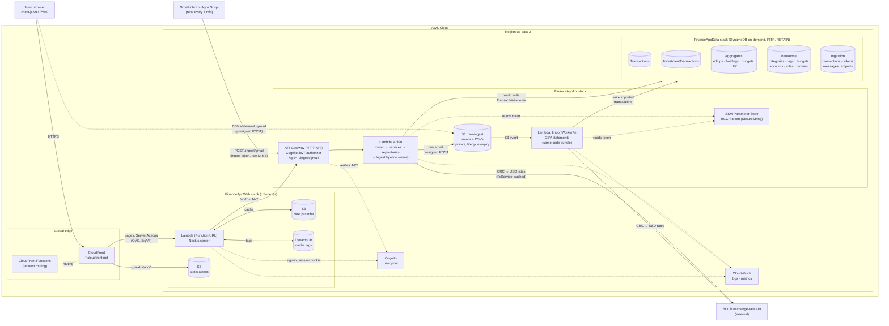

# Architecture

Personal AWS account, region `us-east-2` (the only Region the project allows). CloudFront is global.
The editable draw.io version with AWS icons is [`architecture.drawio`](./architecture.drawio).

**Legend:** solid arrow = request or data flow; dashed arrow = auth check, direct upload, config read, or logging.
All stack, table, function, and role names start with `FinanceApp`.
