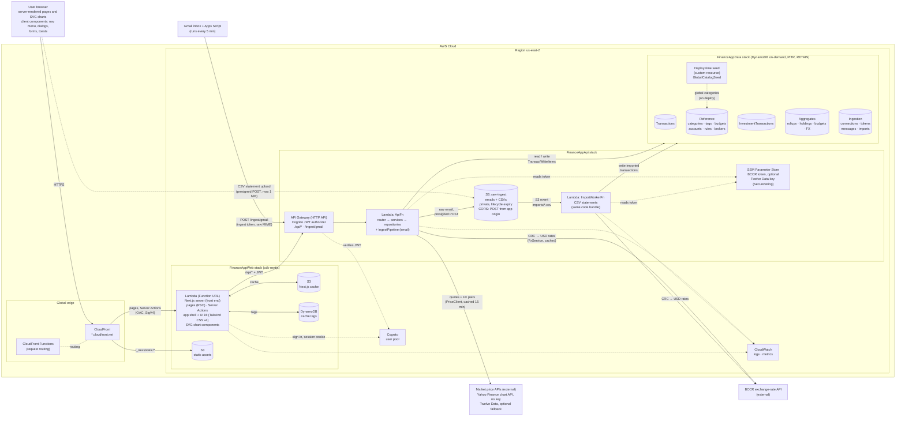

# Architecture

Personal AWS account, region `us-east-2` (the only Region the project allows). CloudFront is global.
The editable draw.io version with AWS icons is [`architecture.drawio`](./architecture.drawio).

**Legend:** solid arrow = request or data flow; dashed arrow = auth check, direct upload, config read, logging, or a deploy-time write.
All stack, table, function, and role names start with `FinanceApp`.

## Layers

| Layer | Runtime elements | Designed in |
|---|---|---|
| Front end | The Next.js server Lambda renders every page, including its charts, and runs the Server Actions. CloudFront and S3 serve the static assets. The browser runs only the client components | [Class diagram section 2](class-diagram.md#2-nextjs-layer) |
| Back end | API Gateway, `ApiFn`, and `ImportWorkerFn` | Class diagram sections 3 to 10 |
| Data | Five DynamoDB tables and the deploy-time seed of the global categories, the `raw-ingest` bucket, SSM parameters | Class diagram sections 1, 3c, and 6 |
| External services | Gmail with Apps Script, BCCR, the market price APIs, Cognito | [Context model](context.md) |

**Front-end elements**

| Element | Where it runs | What it is |
|---|---|---|
| Pages | Next.js server (React Server Components) | One per route. Each loads its data on the server, in parallel where a page needs several reads, and returns finished HTML |
| Server Actions | Next.js server | The UI controllers: every create, edit, and delete goes through one, which calls `/api/*` with the user's token |
| App shell and UI kit | Next.js server, with a few client components | The navigation and about twenty shared components (`PageHeader`, `StatTile`, `DataTable`, `Dialog`, `EmptyState`, ...), styled with Tailwind CSS v4 from one set of design tokens. No component library |
| Chart components | Next.js server | Hand-written SVG and HTML (`BarList`, `SegmentedBar`, `ColumnChart`, `LineChart`, `Meter`). No chart library and no client JavaScript |
| Client components | Browser | Only what needs the browser: the nav menu, dialogs and their forms, chip pickers, copy buttons, toasts, the import wizard |
| Loading and error states | Next.js server and browser | A `loading.tsx` skeleton and an `error.tsx` per route |

Charts are rendered on the server so that a page's answer is in the first HTML the phone
receives: it is readable without interaction (04-S01), it counts inside the 1.5-second
render budget of one-pager 04, and it adds no JavaScript to download. Naming no component
or chart library keeps the bundle small and makes both code generators build the same
components from the same specification instead of each choosing its own.

**Notes for the runtime elements added or tightened in this iteration**

- **Market price APIs.** `ApiFn` calls the Yahoo Finance chart API
  (`query1.finance.yahoo.com/v8/finance/chart/{symbol}`) with a browser `User-Agent`, and
  Twelve Data only when its key exists in SSM. Lambdas run outside a VPC, so both are reached
  over the internet like BCCR. Quotes are cached in `Aggregates` as `PRICE#<ticker>`.
- **Statement uploads.** The presigned POST limits the object key to
  `imports/<userId>/<importId>.csv` and the size to 1 byte to 1 MiB, and expires after 5
  minutes. The `raw-ingest` bucket has a CORS rule that allows `POST` from the CloudFront
  domain and from `http://localhost:3000`, and an event notification for `ObjectCreated` with
  prefix `imports/` and suffix `.csv` that invokes `ImportWorkerFn`. Raw emails are stored
  under `raw/` and never start the worker.
- **Supported banks.** The ingestion paths read BAC Credomatic and Banco Nacional statements
  and alert emails only; their formats are in [Bank Formats](bank-formats.md).
- **Global catalog seed.** The Data stack contains a CloudFormation custom resource
  (`AwsCustomResource` calling DynamoDB `BatchWriteItem`) that writes the sixteen global
  categories to `Reference` as `PK = GLOBAL`, `SK = CAT#<id>` on every deployment. The
  writes are plain puts of fixed items, so repeating them changes nothing. The list is in
  [class diagram section 6](class-diagram.md#catalog-and-settings).
- **Front end.** The Next.js Lambda gains no new AWS resource in this iteration; the UI kit
  and the charts are code inside the same bundle.
