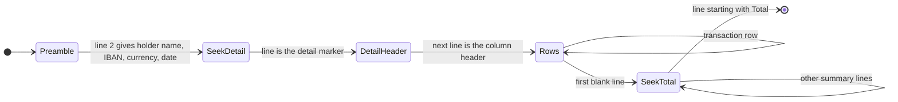

# Bank Formats

## What this document shows

The exact layout of every file and email the product reads, and the rules that turn each
one into a `ParsedTransaction` (see the [class diagram](class-diagram.md#5a-csv-import-and-the-shared-pipeline)).
Two banks are supported: **BAC Credomatic** and **Banco Nacional (BN)**. Each has one
statement export and one card alert email, so there are four templates. A redacted real
sample of each lives in [`../samples/`](../samples/), and the end of each section lists the
result the parser must produce for that sample.

## Why this document is valuable to the design

- **It removes guessing.** A parser written from "detect the bank by its header row" alone
  fails on these files: BAC's first line is an account summary rather than the column header,
  BN ends its file with a total row, and the two banks write amounts differently. Every one
  of those details is written down here.
- **It gives each template a test.** The sample files and the expected results below are the
  golden tests. Totals are checked against the totals each bank prints in its own file.
- **It keeps templates declarative.** Each template is a config object (shown below) read by
  the generic `CsvTemplateParser` and `EmailTemplateParser`. Supporting a new bank means
  adding one object, one sample, and one expected result.

| Source | Bank | Template id | Sample |
|---|---|---|---|
| Statement file (CSV) | Banco Nacional | `bn-consulta-saldos` | [`bn-statement-usd.csv`](../samples/bn-statement-usd.csv) |
| Statement file (CSV) | BAC Credomatic | `bac-transacciones-mes` | [`bac-statement-usd.csv`](../samples/bac-statement-usd.csv) |
| Card alert email | BAC Credomatic | `bac-notificacion` | [`bac-card-alert.eml`](../samples/bac-card-alert.eml) |
| Card alert email | Banco Nacional | `bn-voucher-digital` | [`bn-voucher-digital.eml`](../samples/bn-voucher-digital.eml) |

---

## 1. Rules shared by every template

These are small pure functions in `api/src/ingest/` used by both parsers.

| Function | Rule |
|---|---|
| `CsvReader.decode(bytes)` | Decode as UTF-8 with `fatal: true`; if that throws, decode as `windows-1252` (the BAC statement is Windows-1252). Strip a leading BOM. Split lines on `\r?\n`. |
| `CsvReader.normalize(text)` | Used only to compare headers and markers: trim, Unicode NFD, remove combining accents, lower-case. `Código de Transacción` becomes `codigo de transaccion`. |
| `AmountParser.parse(text)` | Remove everything except digits, `.` and `,`. If the result ends in `.` or `,` followed by exactly two digits, that separator is the decimal point and every other `.` or `,` is a thousands separator; otherwise the number is whole units. Returns integer minor units. Empty text and `0.00` both mean "no amount". Examples: `1,000.00` → 100000, `3948.11` → 394811, `CRC 2,000.00` → 200000, `CRC 113,00` → 11300. |
| `DateParser.dmy(text)` | `dd/mm/yyyy` → `yyyy-mm-dd`. |
| `DateParser.month(text)` | Three-letter month, Spanish or English, any case: `ene`/`jan`, `feb`, `mar`, `abr`/`apr`, `may`, `jun`, `jul`, `ago`/`aug`, `set`/`sep`, `oct`, `nov`, `dic`/`dec`. |
| `DateParser.time(h, m, ampm?)` | `a.m.`/`p.m.` to 24-hour when given (`12:05 a.m.` → `00:05`); otherwise the hour is already 24-hour. |
| Time zone | Every bank date and time is local time in `America/Costa_Rica` (UTC−6, no daylight saving). `localDate` is the date as printed; `occurredAt` is `yyyy-mm-ddTHH:mm:00-06:00`. A statement row has no time, so its `occurredAt` is `null`. |

Amounts are always stored positive. Whether money left or entered the account is the row's
`direction` (`out` or `in`), and the transaction `kind` (section 4) follows from it.

---

## 2. BN statement: `bn-consulta-saldos`

```text
oficina;fechaMovimiento;numeroDocumento;debito;credito;descripcion;
0;20/10/2026;85365331;1,000.00;;ABOGADO/ANA MARIA PRUEBA SOL;
198;20/10/2026;93153013;;102.00;RETIRO SOBRE N 2173740NABOGADO/ANA MARIA PRUEBA SOL;
228;12/10/2026;10605622;304.65;;PAGO SPAY 723329/PRUEBA SOLANO ANA MA;
228;12/10/2026;10602201;;305.00;INVERSIONES HAPI VT/ANA MARIA PRUEBA SOL;
;;TOTAL;1,304.65;1,305.00;;
```

| Aspect | Rule |
|---|---|
| Encoding, line ends | ASCII / UTF-8, CRLF |
| Delimiter | `;`. Every line ends with `;`, so the last field is empty and is dropped. No quoting. |
| Detection | The first line's normalized fields, without the trailing empty one, are exactly `oficina, fechamovimiento, numerodocumento, debito, credito, descripcion`. |
| Data rows | Every line after the header. |
| Skipped rows | Blank lines, and the total row: a row whose `fechaMovimiento` is empty or whose `numeroDocumento` is `TOTAL`. |
| Date | `fechaMovimiento`, `dd/mm/yyyy` |
| Reference | `numeroDocumento` → `statementRef` |
| Amount and direction | `debito` has a value → `out`; `credito` has a value → `in`. Exactly one of the two must have a value, otherwise the row is an error. Numbers use `,` for thousands and `.` for decimals. |
| Merchant | `descripcion` up to its last `/`, trimmed → `merchantRaw`. The text after the `/` is the originator's name and is not stored. |
| Currency | Not in the file: the currency of the account chosen for the import. |
| Account | Not in the file: the account chosen for the import. |
| Checksum | The total row's `debito` and `credito` must equal the sums of the imported out and in rows. |
| Kind | `out` → `purchase`, `in` → `income`. The file names no counterparty, so transfers between the user's own accounts are corrected by the user, who can have the correction remembered (02-S05). |

```ts
const bnConsultaSaldos: CsvTemplate = {
  id: 'bn-consulta-saldos', bank: 'BN', layout: 'table', delimiter: ';',
  header: ['oficina', 'fechamovimiento', 'numerodocumento', 'debito', 'credito', 'descripcion'],
  columns: { date: 'fechamovimiento', ref: 'numerodocumento', debit: 'debito',
             credit: 'credito', description: 'descripcion' },
  merchant: 'beforeLastSlash',
  currencySource: 'account',
  totalRow: { column: 'numerodocumento', value: 'TOTAL' },
  checksum: 'totalRow',
  kindRules: [],                       // defaults: out → purchase, in → income
};
```

---

## 3. BAC statement: `bac-transacciones-mes`

The file has three sections. Only the detail section holds transactions; the first section
says whose account it is and in which currency, and the last one holds the bank's own totals.

```text
Número de Clientes, Nombre, Producto, Moneda, Saldo Inicial, Saldo en Libros, Retenidos y Diferidos, Saldo Disponible, Fecha, STBGAV, STBUNC, Mensaje1, …, Mensaje6
1000001, ANA MARIA PRUEBA SOLANO, CR00010200001234567890, USD, 3948.11, 3785.70, 0.00, 3785.70, 31/10/2026, 3808.42, 0.00, , , , , ,

Detalle de Estado Bancario
Fecha de Transacción, Referencia de Transacción, Código de Transacción, Descripción de Transacción, Débito de Transacción, Crédito de Transacción, Balance de Transacción
01/10/2026, 406477115, TF, TEF A : 123456781             , 15.49, 0.00, 3932.62
05/10/2026, 958480982, TS, SINPE MOVIL Gasolina_______   , 11.11, 0.00, 3870.56
20/10/2026, 301433811, MC, DTR SINPE ANA_MARIA_PRUEBA_SOL, 0.00, 1000.00, 4245.04
31/10/2026, 103152278, 3O, INTERESES                     , 0.00, 0.31, 3829.35

Resumen de Estado Bancario
Código Transacción Totales , Cantidad Débitos Totales, Montos Débitos Totales, Cantidad Créditos Totales, Montos Créditos Totales
TF, 58, 1709.64, 0, 0.00
…
Total, 61, 2032.43, 4, 1913.67
```

`CsvTemplateParser` reads a sectioned file with this state machine:



| Aspect | Rule |
|---|---|
| Encoding, line ends | **Windows-1252**, CRLF |
| Delimiter | `,` followed by a space. Split on `,` and trim every field (descriptions are padded with spaces to 30 characters). No quoting, no thousands separators. |
| Detection | Line 1's first four normalized fields are `numero de clientes, nombre, producto, moneda`, **and** some line normalizes to `detalle de estado bancario`. |
| Preamble | Line 2, read with line 1 as its header: `Nombre` → `holderName`, `Producto` → `iban`, `Moneda` → `currency` of every row, `Fecha` → `statementDate`. These are kept on the `ImportJob`. |
| Detail section | The line after the marker is the column header (`fecha de transaccion, referencia de transaccion, codigo de transaccion, descripcion de transaccion, debito de transaccion, credito de transaccion, balance de transaccion`). Rows follow until the first blank line. |
| Date | `Fecha de Transacción`, `dd/mm/yyyy` |
| Reference, code | `Referencia de Transacción` → `statementRef`; `Código de Transacción` → `bankCode` |
| Amount and direction | `Débito` greater than 0 → `out`; `Crédito` greater than 0 → `in`. The empty side is written `0.00`. Exactly one side must be greater than 0. |
| Merchant | `Descripción de Transacción`, trimmed → `merchantRaw`. The bank cuts it at 30 characters. |
| Balance | `Balance de Transacción` is ignored. |
| Currency | The preamble's `Moneda`. If it differs from the chosen account's currency the import fails (section 5). |
| Checksum | The summary's `Total` line holds `count of debits, sum of debits, count of credits, sum of credits`, which must equal the imported out and in rows. |
| Kind | The rules in section 4. |

```ts
const bacTransaccionesMes: CsvTemplate = {
  id: 'bac-transacciones-mes', bank: 'BAC', layout: 'sectioned', delimiter: ',',
  preamble: { header: ['numero de clientes', 'nombre', 'producto', 'moneda'],
              fields: { holderName: 'nombre', iban: 'producto',
                        currency: 'moneda', statementDate: 'fecha' } },
  detailMarker: 'detalle de estado bancario',
  header: ['fecha de transaccion', 'referencia de transaccion', 'codigo de transaccion',
           'descripcion de transaccion', 'debito de transaccion', 'credito de transaccion',
           'balance de transaccion'],
  columns: { date: 'fecha de transaccion', ref: 'referencia de transaccion',
             code: 'codigo de transaccion', description: 'descripcion de transaccion',
             debit: 'debito de transaccion', credit: 'credito de transaccion' },
  merchant: 'description',
  currencySource: 'preamble',
  checksum: 'summaryTotalLine',        // the line starting with "Total,"
  kindRules: BAC_KIND_RULES,           // section 4
};
```

---

## 4. Transaction kind from a statement row

`KindResolver` walks the template's `kindRules` in order and the first rule that matches
sets the kind. A rule matches when the direction is the same and the trimmed description
matches the pattern; a rule with a `when` condition must also pass that check. When no rule
matches, `out` is `purchase` and `in` is `income`. A user rule for the merchant (02-S05) is
applied afterwards and can replace the kind.

| # | Direction | Description pattern | `when` | Kind | Example |
|---|---|---|---|---|---|
| 1 | out | `^TEF A\s*:\s*(\d+)` | `ownAccount` | `transfer` | `TEF A : 123456781` (an account the user registered) |
| 2 | out | `^TEF A\s*:` | | `payment_sent` | `TEF A : 987654321` (someone else) |
| 3 | out | `^SINPE MOVIL` | | `sinpe_sent` | `SINPE MOVIL Gasolina_______` |
| 4 | out | `^DTR:` | | `payment_sent` | `DTR:inversiones_hapi_VT` |
| 5 | in | `^(?:DTR\|CD) SINPE\s+(.+)` | `holderName` | `transfer` | `DTR SINPE ANA_MARIA_PRUEBA_SOL` (from the holder) |
| 6 | in | `^(?:DTR\|CD) SINPE` | | `sinpe_received` | `CD SINPE 213585__` |
| 7 | in | `^INTERESES` | | `income` | `INTERESES` |

- **`ownAccount`**: the captured local account number appears inside the digits of the
  `iban` of any account the user has registered. A Costa Rican IBAN is `CR`, two check
  digits, a reserved `0`, the 3-digit bank code, and a 14-digit account part that contains the
  local account number (`CR90 0 102 0000 705236974 0` holds BAC account `705236974`), so the
  user only ever types the IBAN. The rule is the same for every user: a transfer to an
  account the user registered is a `transfer`, and a transfer to any other account is a
  `payment_sent`. In the sample, the test user registered their colones account (IBAN
  `CR00010200000123456781`), so the 56 top-ups to `123456781` are transfers; the purchases
  made from that account arrive from its card alert emails or its own statement.
- **`holderName`**: the captured counterparty, with `_` replaced by a space and upper-cased,
  is at least 10 characters long and is a prefix of the preamble's `holderName`. Money the
  holder sends themselves from another bank is a transfer.
- `transfer` is left out of spending, income, and budgets. `payment_sent` and `sinpe_sent`
  count as spending; `sinpe_received` and `income` count as income (see the kind table in the
  class diagram, section 1a).

---

## 5. Import checks and expected results

`IngestPipeline.processCsv` refuses the whole file, with status `FAILED` and the reason
shown to the user, when:

| Check | Reason shown |
|---|---|
| No template detects the file | "This file is not a BAC or Banco Nacional statement export." |
| The template's bank differs from the account's bank | "This is a BAC statement, but the account BN dólares is at Banco Nacional." |
| The file states a currency that differs from the account's | "This statement is in USD, but the account BAC colones is in CRC." |
| The detail header is missing or has different columns | "The statement's columns are not the expected ones for BAC." |

A single bad row (unreadable date, both or neither amounts, unknown currency) becomes a row
error with its line number and reason, and the other rows still import. A checksum mismatch
does not stop the import; the summary shows it as a warning, because it means a row was
skipped or misread.

**Expected results for the samples**, imported with the accounts listed in
[`../samples/README.md`](../samples/README.md):

| Sample | Rows | Out | In | Checksum | Kinds |
|---|---|---|---|---|---|
| `bac-statement-usd.csv` | 65 | 61 rows, $2,032.43 | 4 rows, $1,913.67 | matches `Total, 61, 2032.43, 4, 1913.67` | 58 `transfer` (56 out, 2 in), 2 `payment_sent`, 2 `sinpe_sent`, 1 `purchase`, 1 `sinpe_received`, 1 `income` |
| `bn-statement-usd.csv` | 5 | 2 rows, $1,304.65 | 3 rows, $1,305.00 | matches `TOTAL;1,304.65;1,305.00` | 2 `purchase`, 3 `income` |

Selected rows the golden test checks field by field (all `currency = USD`):

| Sample line | `localDate` | `statementRef` | `merchantRaw` | `direction` | `amountMinor` | `kind` |
|---|---|---|---|---|---|---|
| BAC 6 | 2026-10-01 | 406477115 | `TEF A : 123456781` | out | 1549 | `transfer` |
| BAC 12 | 2026-10-05 | 958480982 | `SINPE MOVIL Gasolina_______` | out | 1111 | `sinpe_sent` |
| BAC 27 | 2026-10-10 | 951570525 | `Pago Liberty Móvil (Movistar 8` | out | 2738 | `purchase` |
| BAC 32 | 2026-10-12 | 666456850 | `DTR:inversiones_hapi_VT` | out | 30500 | `payment_sent` |
| BAC 43 | 2026-10-20 | 301433811 | `DTR SINPE ANA_MARIA_PRUEBA_SOL` | in | 100000 | `transfer` |
| BAC 47 | 2026-10-20 | 406457526 | `TEF A : 987654321` | out | 100000 | `payment_sent` |
| BAC 65 | 2026-10-30 | 960482912 | `CD SINPE 213585__` | in | 71336 | `sinpe_received` |
| BAC 70 | 2026-10-31 | 103152278 | `INTERESES` | in | 31 | `income` |
| BN 2 | 2026-10-20 | 85365331 | `ABOGADO` | out | 100000 | `purchase` |
| BN 5 | 2026-10-12 | 10605622 | `PAGO SPAY 723329` | out | 30465 | `purchase` |
| BN 6 | 2026-10-12 | 10602201 | `INVERSIONES HAPI VT` | in | 30500 | `income` |

---

## 6. Card alert emails

Both banks send one HTML email per card transaction. `EmailTemplateParser.parse` does the
same steps for both:

1. Parse the raw MIME with `mailparser` (`simpleParser`). It decodes the RFC 2047 subject
   (BAC's arrives as `=?utf-8?Q?Notificaci=C3=B3n_de_transacci=C3=B3n_…?=`), the base64
   body, and the nested `multipart/mixed` > `multipart/related` > `text/html` parts. Use its
   `html` output; image parts are ignored.
2. `HtmlText.toText(html)`: remove `<head>…</head>`, `<style>…</style>`, and every comment,
   including Outlook conditionals such as `<!--[if mso]>…<![endif]-->`; replace every tag
   with a space; decode HTML entities; collapse all whitespace to single spaces. The result
   is one line of text.
3. Run the template's field patterns on that line. A required field that does not match
   makes the email `unparsed` with reason `FIELD_MISSING:<field>`.

`TemplateRegistry.match(sender, subject)` picks the template; the sender address is compared
case-insensitively. `DkimVerifier.verify` must find at least one valid DKIM signature whose
`d=` is the template's `dkimDomain` or a subdomain of it. Other signatures on the same email
are ignored. A message with no such signature is `rejected`.

### 6a. BAC: `bac-notificacion`

Normalized text of the sample (from `Hola`):

```text
Hola ANA MARIA PRUEBA SOLANO A continuación le detallamos la transacción realizada: Comercio: FM ESC AVENIDA ESCAZU Ciudad y país: SAN JOSE, Costa Rica Fecha: Nov 10, 2026, 12:18 MASTER: ************1111 Autorización: 001818 Referencia: 15723379 Tipo de Transacción: COMPRA Monto: CRC 2,000.00 ¿Tiene dudas sobre esta transacción?
```

| Field | Value or pattern |
|---|---|
| Sender | `NotificacionBAC@baccredomatic.cr` |
| Subject | `^Notificaci[oó]n de transacci[oó]n ` |
| DKIM domain | `baccredomatic.cr` (the email is also signed by `amazonses.com`, which does not count) |
| Merchant | `Comercio:\s*(.+?)\s*Ciudad y país:` |
| Date and time | `Fecha:\s*(\w{3}) (\d{1,2}), (\d{4}), (\d{1,2}):(\d{2})` (24-hour) |
| Card last 4 | `\b[A-Z]+:\s*\*{4,}(\d{4})` (the label is the card brand, e.g. `MASTER:`) |
| Authorization | `Autorización:\s*(\d+)` |
| Reference | `Referencia:\s*(\d+)` → `statementRef` |
| Type | `Tipo de Transacción:\s*(.+?)\s+Monto:` → `COMPRA` = `purchase`, `DEVOLUCION` = `refund` (compared without accents, upper-case); any other type → `unparsed`, reason `UNKNOWN_TYPE:<type>` |
| Amount | `Monto:\s*(CRC\|USD)\s*([\d.,]+)` → currency and `AmountParser.parse` |

### 6b. BN: `bn-voucher-digital`

Normalized text of the sample (from `Estimado`):

```text
Estimado señor(a): PRUEBA SOLANO ANA MARIA Reciba un cordial saludo de parte del Banco Nacional. Por este medio le hacemos llegar el comprobante de Compra realizada en TRANSPORTES JACO CENTRAL CR el 31 de Agosto de 2026 a las 10:42 a.m. TRANSPORTES JACO CENTRAL CR Ago 31, 2026 - 10:42 a.m. VISA ************2222 NRO. AUT: 638122 REF: 624316493500 TOTAL: CRC 113,00
```

| Field | Value or pattern |
|---|---|
| Sender | `bncontacto@bncr.fi.cr` |
| Subject | `^Voucher Digital$` |
| DKIM domain | `bncr.fi.cr` |
| Type and merchant | `comprobante de (\S+) realizada en (.+?) el \d{1,2} de` (merchant: collapse inner spaces) |
| Date and time | `(\w{3}) (\d{1,2}), (\d{4}) - (\d{1,2}):(\d{2}) ([ap])\.m\.` (12-hour) |
| Card last 4 | `\b(?:VISA\|MASTER(?:CARD)?\|AMEX)\s*\*{4,}(\d{4})` |
| Authorization | `NRO\. AUT:\s*(\d+)` |
| Reference | `REF:\s*(\d+)` → `statementRef` |
| Type mapping | `Compra` = `purchase`; any other type → `unparsed`, reason `UNKNOWN_TYPE:<type>` |
| Amount | `TOTAL:\s*(CRC\|USD)\s*([\d.,]+)`. **BN uses a decimal comma** (`CRC 113,00` is 113 colones), which `AmountParser.parse` handles. |

### 6c. Routing to an account and expected results

An alert names a card, not an account. `ReferenceRepository.findAccountByCard(userId,
last4)` returns the account whose `cardLast4s` contains the digits. When no account has that
card, the message is stored as `unparsed` with reason `UNKNOWN_CARD:<last4>`, the review
inbox shows "Card ending 1111 isn't linked to an account", and once the user adds the card
to an account, **Retry** processes the stored email again (01-S08c).

| Sample | `merchantRaw` | `occurredAt` | `localDate` | card | `currency` | `amountMinor` | `statementRef` | `kind` | Account |
|---|---|---|---|---|---|---|---|---|---|
| `bac-card-alert.eml` | `FM ESC AVENIDA ESCAZU` | 2026-11-10T12:18:00-06:00 | 2026-11-10 | 1111 | CRC | 200000 | 15723379 | `purchase` | BAC colones |
| `bn-voucher-digital.eml` | `TRANSPORTES JACO CENTRAL CR` | 2026-08-31T10:42:00-06:00 | 2026-08-31 | 2222 | CRC | 11300 | 624316493500 | `purchase` | BN colones |

```ts
const bacNotificacion: EmailTemplate = {
  id: 'bac-notificacion', bank: 'BAC',
  senders: ['notificacionbac@baccredomatic.cr'],
  subject: /^Notificaci[oó]n de transacci[oó]n /,
  dkimDomain: 'baccredomatic.cr',
  fields: {
    merchant: /Comercio:\s*(.+?)\s*Ciudad y país:/,
    dateTime: /Fecha:\s*(\w{3}) (\d{1,2}), (\d{4}), (\d{1,2}):(\d{2})/,
    cardLast4: /\b[A-Z]+:\s*\*{4,}(\d{4})/,
    authorization: /Autorización:\s*(\d+)/,
    reference: /Referencia:\s*(\d+)/,
    type: /Tipo de Transacción:\s*(.+?)\s+Monto:/,
    amount: /Monto:\s*(CRC|USD)\s*([\d.,]+)/,
  },
  clock: '24h',
  typeMap: { COMPRA: 'purchase', DEVOLUCION: 'refund' },
};

const bnVoucherDigital: EmailTemplate = {
  id: 'bn-voucher-digital', bank: 'BN',
  senders: ['bncontacto@bncr.fi.cr'],
  subject: /^Voucher Digital$/,
  dkimDomain: 'bncr.fi.cr',
  fields: {
    typeAndMerchant: /comprobante de (\S+) realizada en (.+?) el \d{1,2} de/,
    dateTime: /(\w{3}) (\d{1,2}), (\d{4}) - (\d{1,2}):(\d{2}) ([ap])\.m\./,
    cardLast4: /\b(?:VISA|MASTER(?:CARD)?|AMEX)\s*\*{4,}(\d{4})/,
    authorization: /NRO\. AUT:\s*(\d+)/,
    reference: /REF:\s*(\d+)/,
    amount: /TOTAL:\s*(CRC|USD)\s*([\d.,]+)/,
  },
  clock: '12h',
  typeMap: { COMPRA: 'purchase' },
};
```

The Gmail script's search uses the senders of every email template:
`from:(notificacionbac@baccredomatic.cr OR bncontacto@bncr.fi.cr) -label:financeapp-processed`.
