# Class Diagram

## What this diagram shows

This is the class model needed to implement every in-scope
[sequence diagram](sequences/README.md). Every participant in a sequence diagram is a class
here, and every message is a method. The model is split into one diagram per layer or
module so each stays readable:

| Section | Contents |
|---|---|
| [1. Domain model](#1-domain-model) | Entities, value objects, enums, and how they relate |
| [2. Next.js layer](#2-nextjs-layer) | Pages, Server Actions (UI controllers), session handling, the typed API client |
| [3. API shell and data access](#3-api-shell-and-data-access) | Lambda entry points, routers, errors, configuration, repositories |
| [4. Transactions core](#4-transactions-core) | The single save path every source uses, and the rollup planner |
| [5. Module 01: Accounts and Ingestion](#5-module-01-accounts-and-ingestion) | CSV import, Gmail connection and ingest, parsing, duplicates, review |
| [6. Module 02: Categorization and Rules](#6-module-02-categorization-and-rules) | Normalizer, categorizer, rules |
| [7. Module 03: Budgets](#7-module-03-budgets) | Budgets, matching, periods, progress |
| [8. Module 04: Dashboard](#8-module-04-dashboard) | Spending analytics |
| [9. Module 05: Multi-Currency](#9-module-05-multi-currency) | FX service and the BCCR rate provider |
| [10. Module 07: Investments](#10-module-07-investments) | Investment transactions, holdings, brokers, valuation, prices |
| [11. Gmail Apps Script](#11-gmail-apps-script) | The script that runs in the user's Google account |

Module 06 (Security and Data Control) has no classes of its own in this iteration. Its one
in-scope story, revoking the Gmail connection (06-S02), is handled by `ConnectionService` in
module 01.

## Why this diagram is valuable to the design

- **It is the build list.** A code generator can create one file per class and one function
  per method, and the sequence diagrams say in which order those methods are called.
- **It fixes the boundaries.** Routers only parse and validate, services hold the business
  rules, and repositories are the only classes that touch DynamoDB, S3, or SSM. Each rule
  of the design has exactly one class that owns it.
- **It makes reuse explicit.** All three ingestion routes end in `TransactionService`, and all
  rollup arithmetic is in `RollupPlanner`, so spending totals and budgets cannot drift apart.

## Conventions

- **Money is integer minor units.** `amountMinor` is in the original currency. Fields ending
  in `Cents` are USD cents. Quantities are `quantityMicro` (millionths of a unit). No
  floating point is used for money.
- **Code layout.** `shared/` holds the Zod schemas and types used by both the Next.js app and
  the API. `api/src/` holds routers, services, repositories, `keys.ts`, and factories. Both
  Lambdas (`ApiFn`, `ImportWorkerFn`) are built from the same `api/` bundle.
- **Dependency injection.** `ServiceFactory` builds each client, repository, and service once
  per Lambda container and passes dependencies through constructors. Services depend on
  interfaces where an external system is involved (`FxRateProvider`, `MarketPriceProvider`,
  `Clock`), so tests can pass fakes.
- **Arrows.** `-->` is "uses", `..|>` is "implements", `--|>` is "extends", `*--` is
  "contains", and multiplicities are written on the line. `$` marks a static method.

---
## 1. Domain model

These are the records stored in DynamoDB and passed between layers. Key formats are listed
in the [sequence diagram conventions](sequences/README.md#keys-and-indexes-used-in-these-diagrams).

### 1a. Spending, budgets, and currency

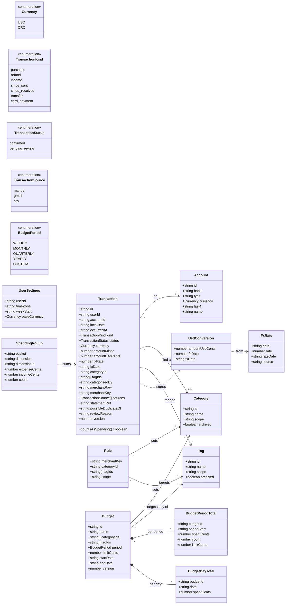

`Transaction.countsAsSpending()` is false for `income`, `transfer`, and `card_payment`. Those
kinds never enter expense rollups or budgets. `SpendingRollup` covers the `DAY#`, `MONTH#`,
`CAT#`, and `TAG#` items; `dimension` is `TOTAL`, `CAT`, or `TAG`. `UserSettings` is the
`PROFILE` item in `Reference`; `baseCurrency` is always `USD` in this iteration, and
`timeZone` decides each transaction's `localDate`.

### 1b. Ingestion and investments

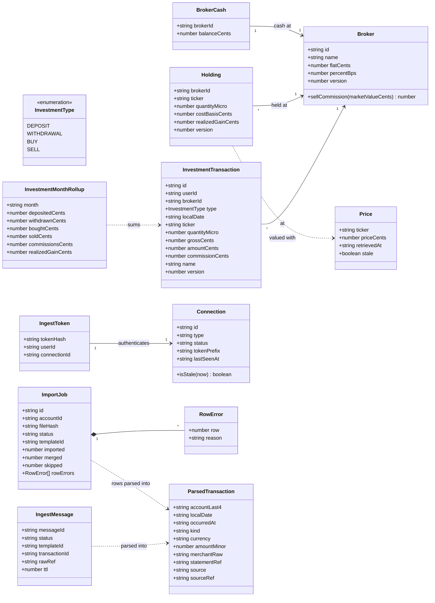

`ParsedTransaction` is what a template produces, before currency conversion, duplicate
matching, and categorization turn it into a `Transaction`. `Broker.sellCommission` is
`flatCents + marketValueCents × percentBps / 10000`, used to estimate the cost of selling.

---
## 2. Next.js layer

Pages are React Server Components. Server Actions are the UI controllers: they read the
session, call the API through `ApiClient`, and return data or errors to the page.
`ApiClient` uses the request and response types from `shared/`, so the UI and `ApiFn` agree
on the contract.

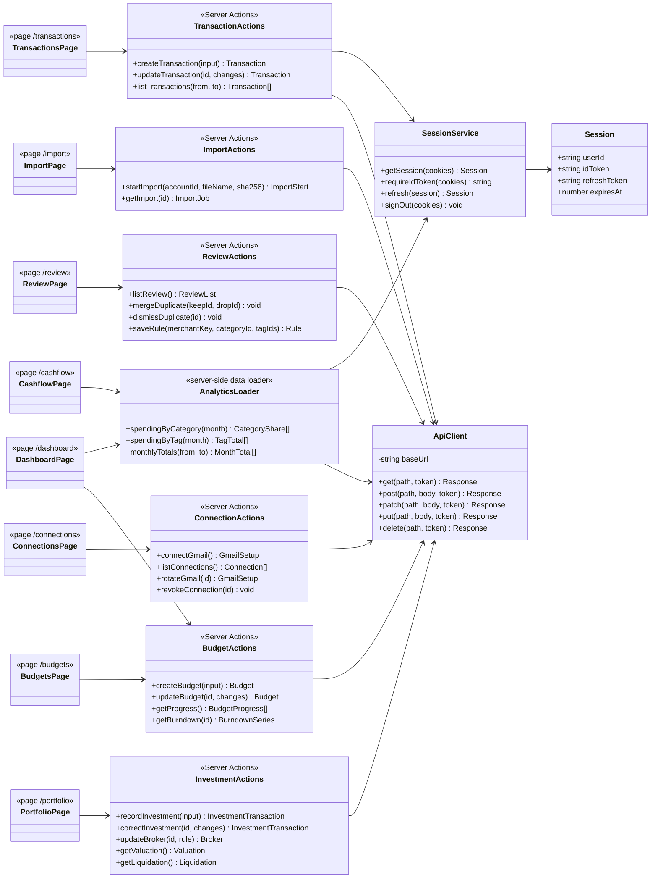

Every Server Action and the `AnalyticsLoader` call `SessionService` first; only one of those
edges is drawn to keep the diagram readable. `SessionService` keeps the Cognito tokens in
`HttpOnly`, `SameSite=Strict` cookies and gives `ApiClient` the ID token to send as a bearer
token, so browser JavaScript never sees it. The CSV upload itself goes from the browser
straight to S3 using the presigned form returned by `startImport`.

---
## 3. API shell and data access

`ApiHandler` is the `ApiFn` entry point: one Powertools `Router` with one feature router
mounted per route prefix. `ImportWorkerHandler` is the `ImportWorkerFn` entry point for S3
events. The routers are the API controllers: they read `AuthContext`, validate the body
with the shared Zod schemas, call one service method, and return JSON.

### 3a. Entry points, routers, and errors

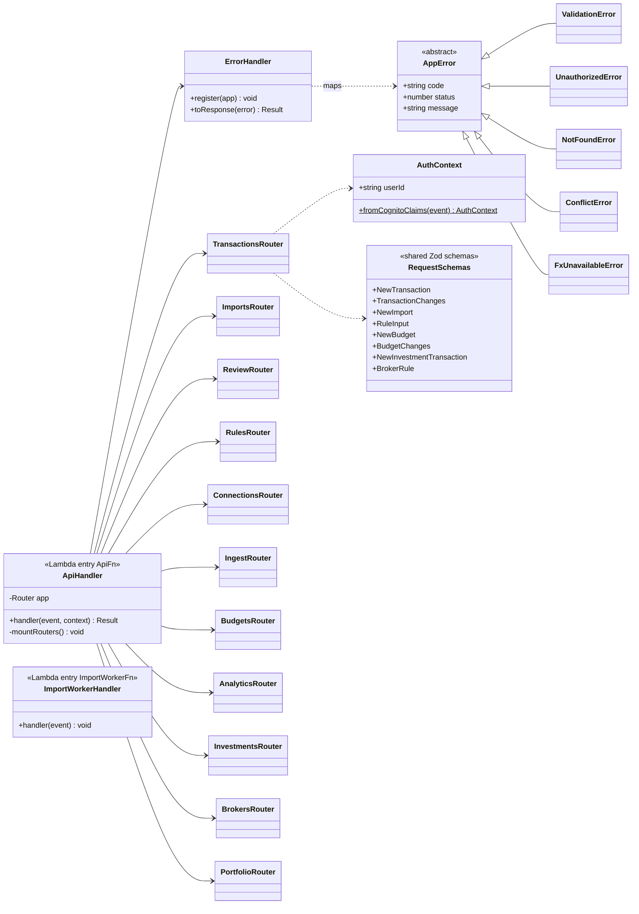

Every router uses `AuthContext` and `RequestSchemas` the way `TransactionsRouter` does; only
that pair of edges is drawn. `IngestRouter` is the exception: it has no Cognito claims and
authenticates the Gmail ingest token through `ConnectionService` instead.
`ErrorHandler` maps `ValidationError` to 400, `UnauthorizedError` to 401, `NotFoundError` to
404, `ConflictError` to 409, `FxUnavailableError` to 503, and anything else to 500, always as
`{code, message}`.

**Routes per router.** Each route calls the service method named in its sequence diagram.

| Router | Routes | Service |
|---|---|---|
| `TransactionsRouter` | `POST /api/transactions`, `GET /api/transactions`, `PATCH /api/transactions/{id}` | `TransactionService`, `TransactionQueryService` |
| `ImportsRouter` | `POST /api/imports`, `GET /api/imports/{id}` | `ImportService` |
| `ReviewRouter` | `GET /api/review`, `POST /api/review/duplicates/merge`, `POST /api/review/duplicates/dismiss` | `ReviewService`, `TransactionService` |
| `RulesRouter` | `PUT /api/rules/{merchantKey}` | `RuleService` |
| `ConnectionsRouter` | `POST /api/connections/gmail`, `GET /api/connections`, `POST /api/connections/gmail/{id}/rotate`, `DELETE /api/connections/{id}` | `ConnectionService` |
| `IngestRouter` | `GET /ingest/gmail/config`, `POST /ingest/gmail`, `POST /ingest/gmail/heartbeat` | `ConnectionService`, `IngestPipeline` |
| `BudgetsRouter` | `POST /api/budgets`, `PATCH /api/budgets/{id}` | `BudgetService` |
| `AnalyticsRouter` | `GET /api/analytics/spending`, `GET /api/analytics/budgets`, `GET /api/analytics/budgets/{id}` | `SpendingAnalyticsService`, `BudgetAnalyticsService` |
| `InvestmentsRouter` | `POST /api/investments/transactions`, `PATCH /api/investments/transactions/{id}` | `InvestmentService` |
| `BrokersRouter` | `PUT /api/brokers/{id}` | `BrokerService` |
| `PortfolioRouter` | `GET /api/portfolio/valuation`, `GET /api/portfolio/liquidation` | `ValuationService` |

### 3b. Configuration and factories

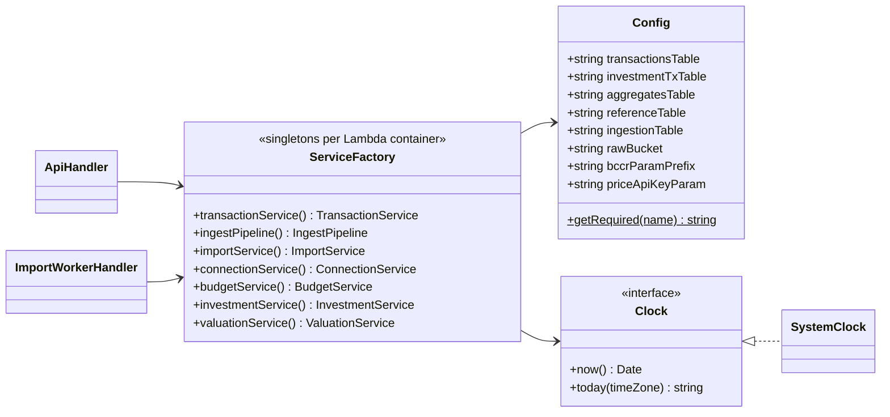

`Config.getRequired` throws at start-up if an environment variable is missing, so a
misconfigured Lambda fails on its first request instead of part way through one. Environment
variables hold table names, the bucket name, and SSM parameter names, never secret values.

### 3c. Repositories (database handlers)

Repositories are the only classes that call DynamoDB, S3, or SSM. There is one repository per
DynamoDB table, all built on `DynamoStore`, and every key is built by `Keys`. Methods ending
in `Item` return a `TransactItem` instead of writing, so a service can combine writes to
several tables in one `DynamoStore.transactWrite`.

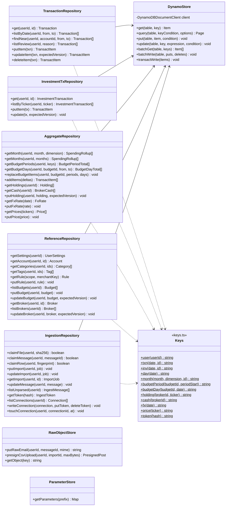

The `claim...` methods are conditional puts with `attribute_not_exists` and return `false`
when the item already exists. They are how the pipeline makes every source idempotent.
Repositories strip `PK` and `SK` before returning items, so services never see key strings.

---
## 4. Transactions core

Manual entry, Gmail alerts, and CSV rows all end in `TransactionService`. It converts to USD,
categorizes, matches budgets, and asks `RollupPlanner` for every rollup change, then writes
the transaction and all rollups in one `TransactWriteItems`. Updates and merges subtract the
old contribution and add the new one in the same call, guarded by `version`.

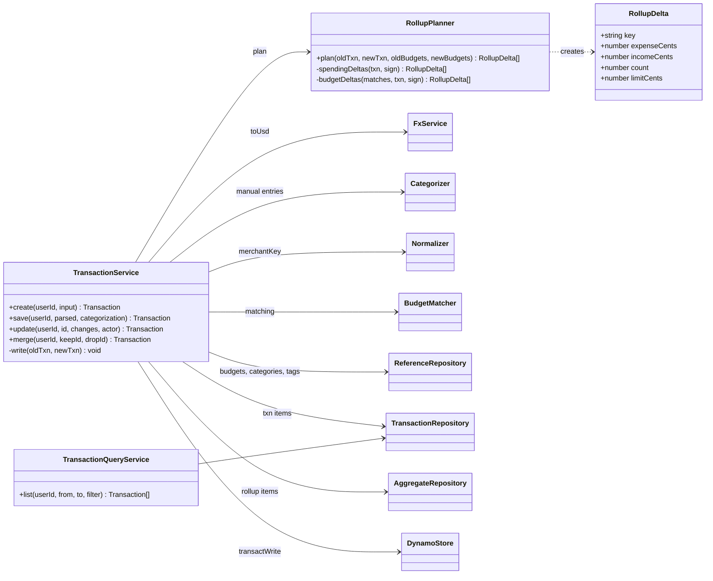

`save` is called by `IngestPipeline` with a categorization it has already done; `create` is
the manual-entry path and categorizes itself. `RollupPlanner` skips expense rollups and
budgets when `countsAsSpending()` is false, and only touches `incomeCents` for income. When
the `version` condition fails, `TransactionService` re-reads and retries once, then throws
`ConflictError`. A missing rate makes `FxService` throw `FxUnavailableError` and nothing is
written.

---
## 5. Module 01: Accounts and Ingestion

### 5a. CSV import and the shared pipeline

`IngestPipeline` handles both CSV rows and Gmail emails. Each source is claimed first
(`FILE#`, `ROWFP#`, `MSG#`), so a repeat delivery is skipped. Templates are declarative
config objects; the two parsers are generic and interpret them.

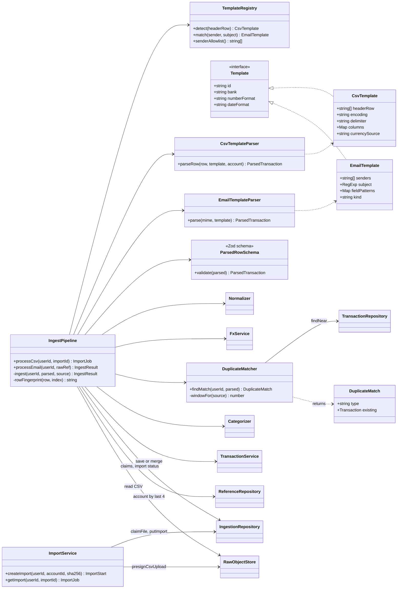

`DuplicateMatch.type` is `exact` (merge into the existing transaction), `near` (save with
`possibleDuplicateOf` set), or `none`. The match key is the original amount, the account, and
a date window of the same day when a statement gives the transaction date. Templates live in
code under `api/src/ingest/templates/`, with golden tests that run each redacted sample
email and CSV through the parser.

### 5b. Gmail connection and review inbox

```mermaid
classDiagram
    direction LR
    class ConnectionService {
        +createGmail(userId) GmailSetup
        +authenticate(token) IngestToken
        +list(userId) Connection[]
        +rotate(userId, connectionId) GmailSetup
        +revoke(userId, connectionId) void
        +heartbeat(token) void
        -newToken() string
        -hash(token) string
    }
    class GmailSetup {
        +string connectionId
        +string token
        +string script
    }
    class DkimVerifier {
        +verify(mime, allowedDomains) boolean
    }
    class ReviewService {
        +list(userId) ReviewList
        +listDuplicates(userId) DuplicatePair[]
        +dismiss(userId, transactionId) void
    }
    class ReviewList {
        +Transaction[] uncategorized
        +DuplicatePair[] duplicates
        +IngestMessage[] unparsed
        +number count
    }
    class IngestPipeline
    class TemplateRegistry
    class IngestionRepository
    class TransactionRepository
    ConnectionService --> IngestionRepository : TOKEN#, CONN#
    ConnectionService --> TemplateRegistry : senderAllowlist
    ConnectionService ..> GmailSetup : returns
    IngestPipeline --> DkimVerifier
    ReviewService --> TransactionRepository : review GSI
    ReviewService --> IngestionRepository : unparsed MSG#
    ReviewService ..> ReviewList : returns
```

`ConnectionService.authenticate` hashes the bearer token and looks up `TOKEN#<sha256>`. A
revoked token has no item, so the lookup fails and `IngestRouter` returns `401`. The token is
returned only once, from `createGmail` or `rotate`, and is never stored or logged.
`isStale(now)` on `Connection` compares `lastSeenAt` with a 24-hour threshold (01-S09).

---
## 6. Module 02: Categorization and Rules

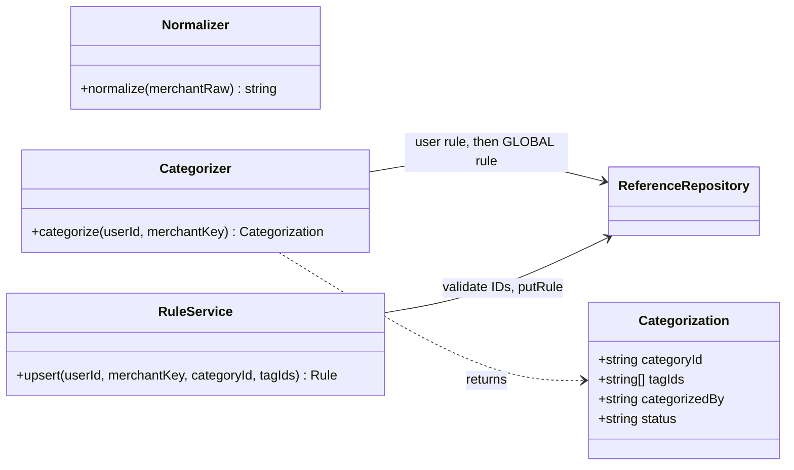

`Normalizer` lower-cases the merchant text, strips digits, store numbers, and padding, and
returns a stable `merchantKey` such as `automercado`. `Categorizer` returns
`categorizedBy = rule` for a user rule, `global` for a global rule, and status
`pending_review` with no category when nothing matches. It is deterministic. Category and tag
changes on an existing transaction go through `TransactionService.update` (section 4), and a
category set by the user (`categorizedBy = user`) is never replaced by a merge.

---

## 7. Module 03: Budgets

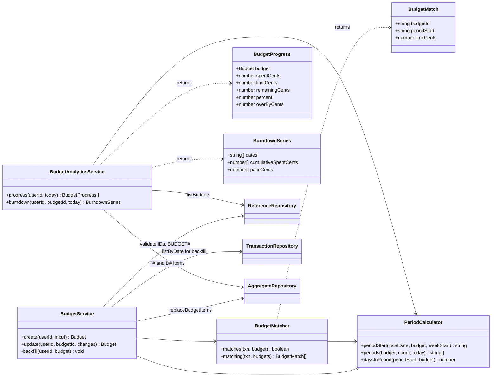

`BudgetMatcher.matches` returns true when `txn.countsAsSpending()`, the transaction's
category is in `categoryIds` (or the list is empty), and it has any of `tagIds` (or the list
is empty). `BudgetProgress.percent` is `round(spent / limit × 100)` with no upper bound, so
an exceeded budget reads above 100. `BurndownSeries.paceCents` is the even-spending line,
`limit × day ÷ daysInPeriod`. The week-start day and time zone come from the user's settings.

---
## 8. Module 04: Dashboard

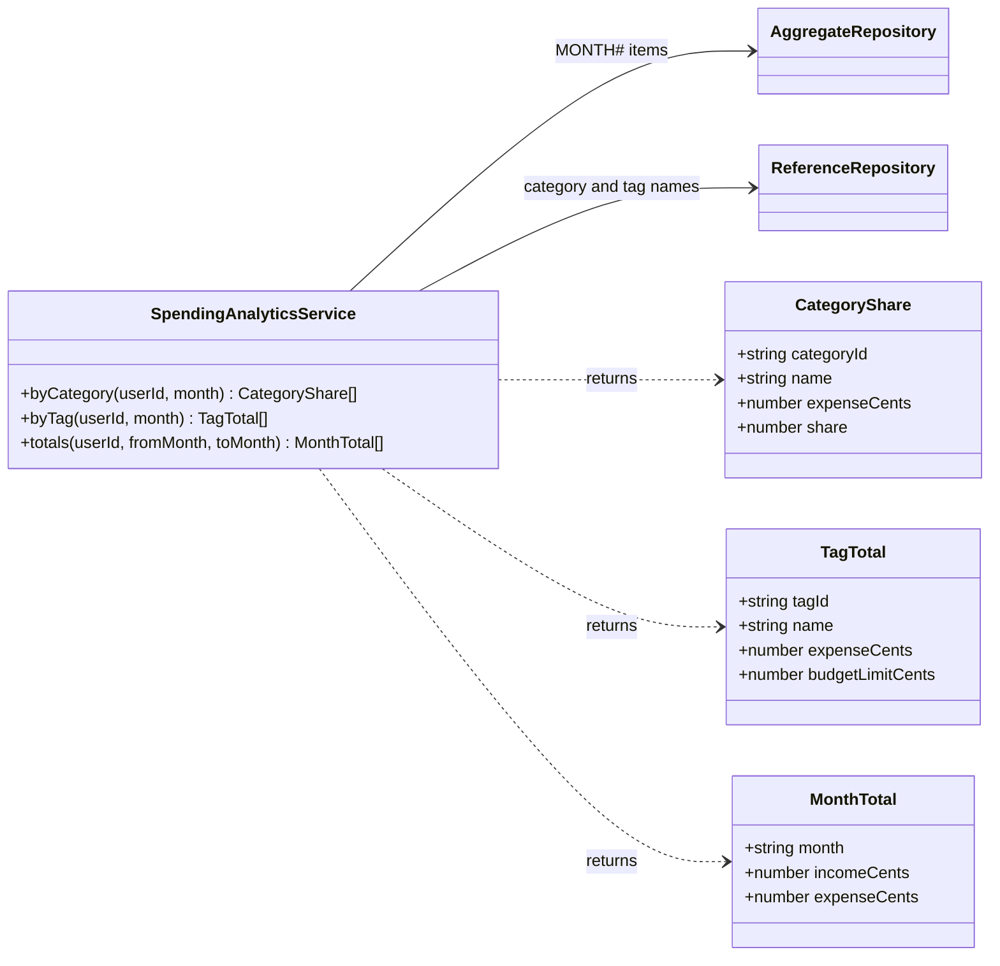

`byCategory` keeps `Uncategorized` as its own row instead of dropping it. `totals` returns
one point per month in the range, filling months with no rollup item as zero, so a month
with no income shows as `$0` and not as a gap. Tag totals can overlap, because a transaction
with two tags counts in both.

---
## 9. Module 05: Multi-Currency

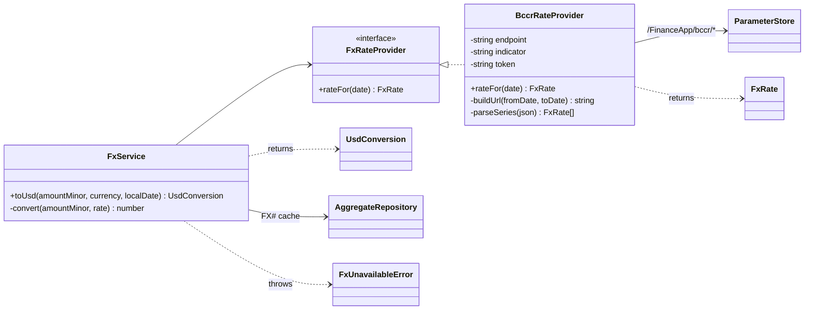

- `FxService.toUsd` returns the amount unchanged with rate `1.0` for USD. For CRC it reads
  `FX#USD-CRC#<date>`, asks the provider on a cache miss, and stores the result.
- `convert` divides with exact integer arithmetic and rounds half-to-even to cents.
- `BccrRateProvider` reads `endpoint`, `indicator`, and `token` from Parameter Store once per
  Lambda container. `buildUrl` produces
  `{endpoint}/{indicator}/series?fechaInicio=yyyy/mm/dd&fechaFin=yyyy/mm/dd&idioma=ES`,
  with the query built by `URLSearchParams`. Every request sends the header
  `Authorization: Bearer <token>`.
- `parseSeries` reads `datos[0].series`, an array of `{ fecha, valorDatoPorPeriodo }` where
  `fecha` is the date and `valorDatoPorPeriodo` is the colones-per-dollar rate. A non-`200`
  status or an empty `series` array means no rate.
- When a date has no rate (weekend or holiday), the provider asks for the 7 days before and
  returns the latest earlier rate with its own `rateDate`.
- If BCCR cannot be reached and nothing is cached, `FxUnavailableError` (503) is thrown and
  the save is refused instead of using a guessed rate.

---
## 10. Module 07: Investments

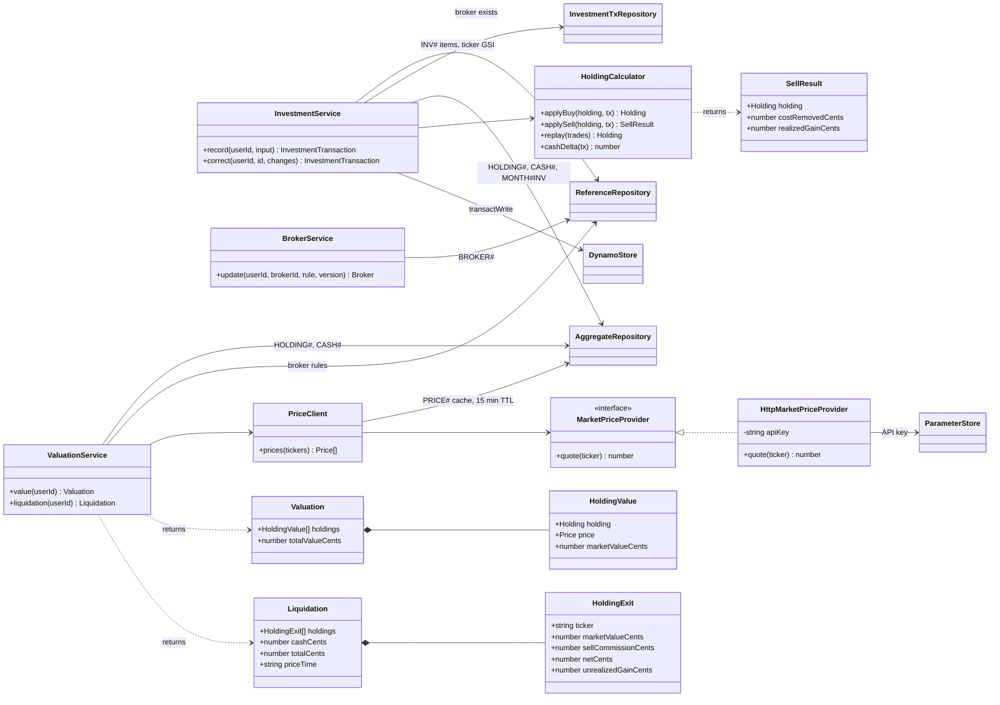

- **Average cost.** `HoldingCalculator.applySell` removes
  `costBasis × soldQuantity ÷ quantity` and records `realizedGain = gross − commission −
  costRemoved`. The write is conditioned on `version` and on `quantityMicro ≥ sold`, so a
  sale larger than the holding is rejected with `ConflictError`.
- **Corrections.** `correct` updates the investment transaction, then `replay` rebuilds the
  holding from every trade for that ticker in date order, because an edited old trade changes
  the cost of every later sale.
- **Prices.** `PriceClient` returns the cached price when it is under 15 minutes old.
  Otherwise it asks the provider, and when the provider fails it returns the last known price
  marked `stale`. The price API provider is still to be chosen, so it sits behind
  `MarketPriceProvider`.
- **Selling estimate.** `liquidation` uses `Broker.sellCommission` per holding and adds broker
  cash. It is a before-tax figure and never a recommendation.

---
## 11. Gmail Apps Script

The script runs in the user's own Google account, not in AWS. It is plain Apps Script
(JavaScript) and talks to the product only through the three `/ingest/gmail` routes.

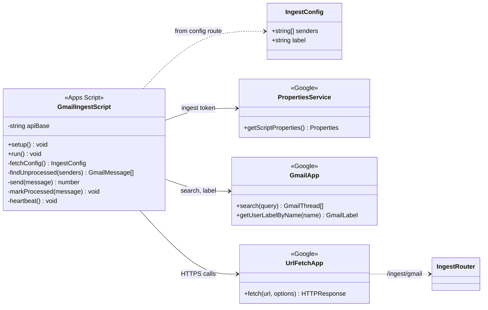

- `setup()` checks the token by calling `GET /ingest/gmail/config`, then creates a 5-minute
  time trigger for `run()`.
- `run()` searches for allowlisted senders without the `yourapp-processed` label and sends
  each message's raw MIME (`getRawContent()`) to `POST /ingest/gmail`.
- A message is labelled only after a `2xx` response, so failures are retried on the next run.
  A `401` removes the trigger, because the token was revoked.
- Every run ends with `POST /ingest/gmail/heartbeat`, which keeps the connection from being
  marked stale during a week with no purchases.
- The token is read from `PropertiesService`, never written in the script source.
