# Class Diagram

## What this diagram shows

This is the class model needed to implement every in-scope
[sequence diagram](sequences/README.md). Every participant in a sequence diagram is a class
here, and every message is a method. The model is split into one diagram per layer or
module so each stays readable:

| Section | Contents |
|---|---|
| [1. Domain model](#1-domain-model) | Entities, value objects, enums, and how they relate |
| [2. Next.js layer](#2-nextjs-layer) | Server Actions (UI controllers) and session handling; the app shell, UI kit, and design tokens; the chart components; and every page's layout, states, and wording |
| [3. API shell and data access](#3-api-shell-and-data-access) | Lambda entry points, routers, errors, configuration, repositories |
| [4. Transactions core](#4-transactions-core) | The single save path every source uses, and the rollup planner |
| [5. Module 01: Accounts and Ingestion](#5-module-01-accounts-and-ingestion) | Accounts, statement import, Gmail connection and ingest, bank templates, duplicates, review |
| [6. Module 02: Categorization and Rules](#6-module-02-categorization-and-rules) | Normalizer, categorizer, rules, the category and tag catalog, user settings |
| [7. Module 03: Budgets](#7-module-03-budgets) | Budgets, matching, periods, progress |
| [8. Module 04: Dashboard](#8-module-04-dashboard) | Spending analytics |
| [9. Module 05: Multi-Currency](#9-module-05-multi-currency) | FX service and the BCCR rate provider |
| [10. Module 07: Investments](#10-module-07-investments) | Investment transactions, broker fee schedules, holdings, prices, valuation |
| [11. Gmail Apps Script](#11-gmail-apps-script) | The script that runs in the user's Google account |

Module 06 (Security and Data Control) has no classes of its own in this iteration. Its one
in-scope story, revoking the Gmail connection (06-S02), is handled by `ConnectionService` in
module 01.

## Why this diagram is valuable to the design

- **It is the build list.** A code generator can create one file per class and one function
  per method, and the sequence diagrams say in which order those methods are called.
- **It fixes the boundaries.** Routers only parse and validate, services hold the business
  rules, and repositories are the only classes that touch DynamoDB, S3, or SSM. Each rule
  of the design has exactly one class that owns it.
- **It makes reuse explicit.** All three ingestion routes end in `TransactionService`, and all
  rollup arithmetic is in `RollupPlanner`, so spending totals and budgets cannot drift apart.
- **It specifies the screen, not only the data.** Section 2 gives every page its components,
  layout, states, charts, and wording, so the front end is built from the design the same way
  the services are, instead of being improvised from the last line of each sequence diagram.

## Conventions

- **Money is integer minor units.** `amountMinor` is in the original currency. Fields ending
  in `Cents` are USD cents. Quantities are `quantityMicro` (millionths of a unit) and market
  prices are `priceMicros` (millionths of a dollar). Percentages are `percentBps` (basis
  points, 1.55% = 155). No floating point is used for money; products that can exceed
  `2^53` use `BigInt`.
- **Code layout.** `app/` is the Next.js application: one folder per page, `app/ui/` for the
  UI kit, and `app/ui/charts/` for the charts (section 2). `shared/` holds the Zod schemas and
  types used by both the Next.js app and the API. `api/src/` holds routers, services, repositories, `keys.ts`, and factories. Both
  Lambdas (`ApiFn`, `ImportWorkerFn`) are built from the same `api/` bundle.
- **Dependency injection.** `ServiceFactory` builds each client, repository, and service once
  per Lambda container and passes dependencies through constructors. Services depend on
  interfaces where an external system is involved (`FxRateProvider`, `MarketPriceProvider`,
  `Clock`), so tests can pass fakes.
- **Arrows.** `-->` is "uses", `..|>` is "implements", `--|>` is "extends", `*--` is
  "contains", and multiplicities are written on the line. `$` marks a static method.

---
## 1. Domain model

These are the records stored in DynamoDB and passed between layers. Key formats are listed
in the [sequence diagram conventions](sequences/README.md#keys-and-indexes-used-in-these-diagrams).

### 1a. Spending, budgets, and currency

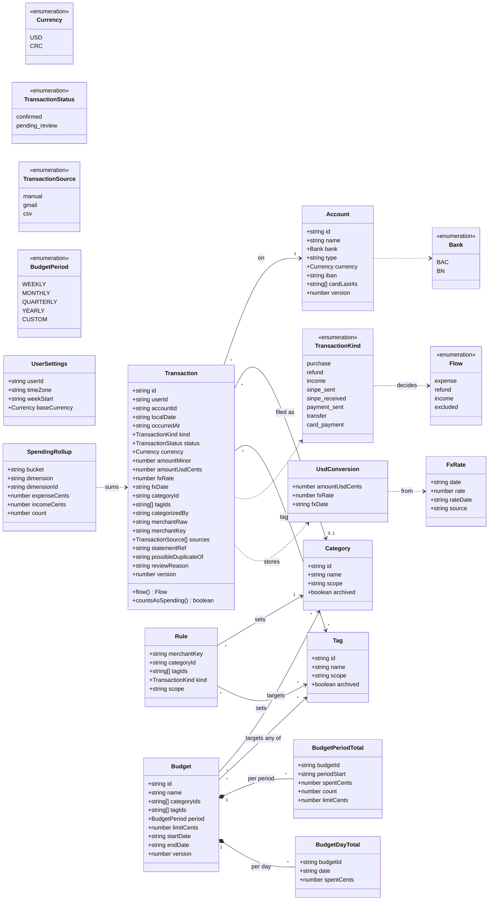

`amountMinor` is always positive. Which way the money moved, and whether it counts, follows
from the kind through `Transaction.flow()`:

| Kind | Meaning | Flow | Effect on rollups and budgets |
|---|---|---|---|
| `purchase` | Card purchase, bill, or any other spending | `expense` | Adds to `expenseCents` and matching budgets |
| `sinpe_sent` | SINPE Móvil payment to someone else | `expense` | Same as `purchase` |
| `payment_sent` | Bank transfer (TEF) to someone else's account | `expense` | Same as `purchase` |
| `refund` | Money back from a merchant | `refund` | Subtracts from `expenseCents` and matching budgets |
| `income` | Salary, interest, a client's payment | `income` | Adds to `incomeCents`; budgets untouched |
| `sinpe_received` | SINPE from someone else | `income` | Same as `income` |
| `transfer` | Between the user's own accounts, or to their broker | `excluded` | None |
| `card_payment` | Paying the user's own credit card | `excluded` | None |

`countsAsSpending()` is true for the `expense` and `refund` flows. `SpendingRollup` covers the
`DAY#`, `MONTH#`, `CAT#`, and `TAG#` items; `dimension` is `TOTAL`, `CAT`, or `TAG`.
`UserSettings` is the `PROFILE` item in `Reference`; `baseCurrency` is always `USD` in this
iteration, and `timeZone` (`America/Costa_Rica` by default) decides each transaction's
`localDate`.

`Account.iban` is optional: the account's Costa Rican IBAN (`CR` followed by 20 digits). A
Costa Rican IBAN contains the bank's local account number, so when a statement row names a
destination by its local number (BAC prints `TEF A : <number>`), the row is a transfer
between the user's own accounts if that number appears inside the IBAN of any account the
user registered. Nothing is specific to one user: a transfer to an account that is not
registered stays a payment (see
[bank formats](bank-formats.md#4-transaction-kind-from-a-statement-row)).
`Account.cardLast4s` lists the last four digits of every card linked to the account; card
alert emails name a card, never an account, so they are routed by these digits. `Rule.kind` is
optional; when set, it replaces the kind a template derived for that merchant (02-S05).

### 1b. Ingestion and investments

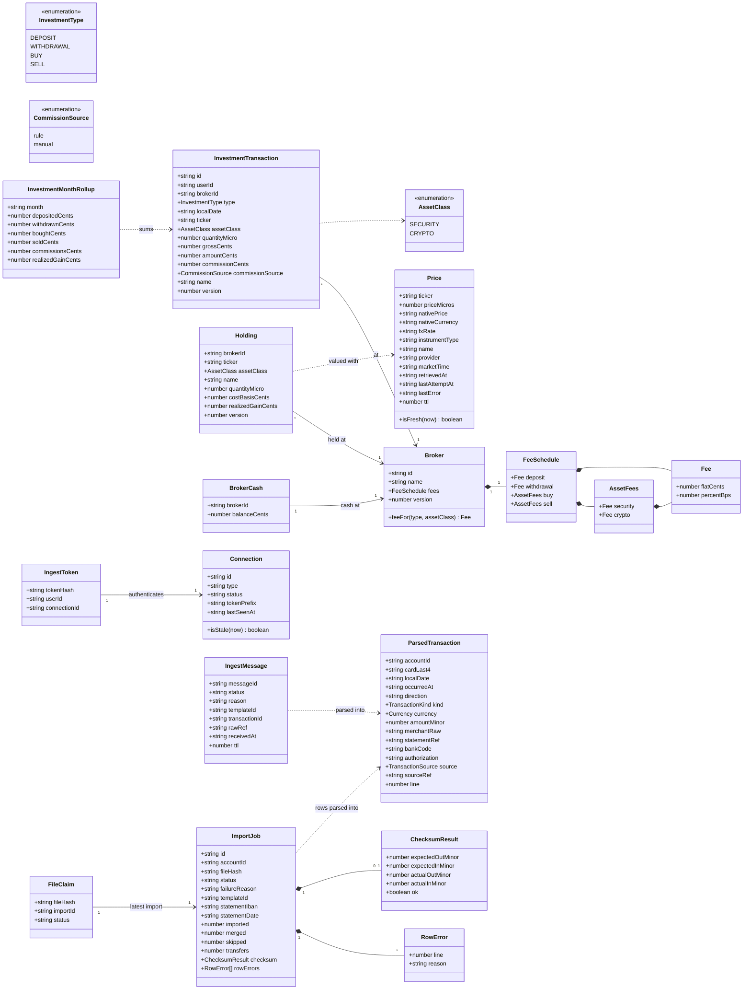

`ParsedTransaction` is what a template produces, before currency conversion, duplicate
matching, and categorization turn it into a `Transaction`. A statement row carries the
`accountId` chosen for the import and its `line` number; a card alert carries `cardLast4`
instead, which is resolved to an account. `direction` is `out` or `in`.

**Investment fields per type.** `DEPOSIT` and `WITHDRAWAL` use `amountCents` (the gross amount
sent to, or taken from, the broker). `BUY` and `SELL` use `ticker`, `assetClass`,
`quantityMicro`, and `grossCents` (units × price, before fees). Every type stores
`commissionCents`; `commissionSource` says whether it was derived from the broker's fee
schedule (`rule`) or typed by the user (`manual`).

**Fees.** A broker has one `Fee` per operation, and buys and sells have one per asset class:
`SECURITY` (stocks, ETFs, mutual funds) and `CRYPTO`. A `Fee` is a flat amount plus a
percentage: `percentBps` is basis points, so 1.55% is `155` (0 to 9999). Both default to 0.
`Broker.feeFor(type, assetClass)` picks the entry; `FeeCalculator` (section 10) does the
arithmetic.

**Prices.** `Price` is the shared `PRICE#<ticker>` item. `priceMicros` is the USD price ×
10⁶, so assets worth less than a cent are still exact. `nativePrice` and `nativeCurrency`
are what the provider quoted, and `fxRate` is the conversion used when that currency is not
USD. `isFresh(now)` is true when `retrievedAt` is under 15 minutes old; an older price is
shown as stale with its age. `lastError` is `NOT_FOUND`, `UNAVAILABLE`, or
`UNSUPPORTED_CURRENCY` from the latest failed attempt, so the UI can say why a price is
missing.

**Import records.** `FileClaim` is the `FILE#<sha256>` item: it points at the latest import
of that file and copies its status, so a file whose import `FAILED` can be uploaded again.
`ImportJob` keeps the statement's IBAN and date when the file states them (BAC),
the counts shown in the summary, and the result of comparing the imported totals with the
totals the bank printed in the file.

---
## 2. Next.js layer

This section is the front end. It has four parts, and a page is not finished until it
follows all four:

| Part | What it fixes |
|---|---|
| [2a. Controllers and session](#2a-controllers-and-session) | Which Server Action or loader each page calls |
| [2b. App shell and UI kit](#2b-app-shell-and-ui-kit) | Navigation, the shared components, the colour and type tokens, and the rules every page follows |
| [2c. Charts](#2c-charts) | The chart components, their geometry, and which question each chart answers |
| [2d. Pages](#2d-pages) | For every page: its layout (wireframe), its sections in order, its states, and its exact wording |

**Why the screens are specified.** The sequence diagrams describe one story at a time. A
screen shows several stories at once, and nothing else in the design says which one leads,
what is a chart and what is a table, or what the page says when there is no data. Without
this section a generator stacks the stories in the order they are numbered and prints each
diagram's last message as a line of text.

### 2a. Controllers and session

Pages are React Server Components. Server Actions are the UI controllers: they read the
session, call the API through `ApiClient`, and return data or errors to the page.
`ApiClient` uses the request and response types from `shared/`, so the UI and `ApiFn` agree
on the contract.

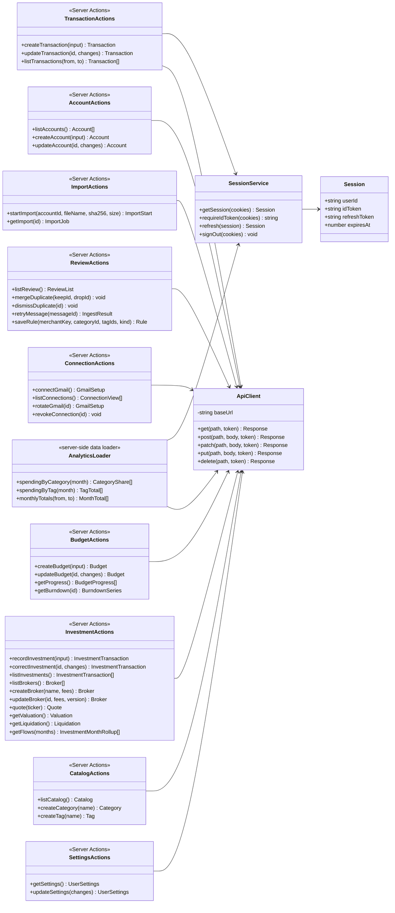

Every Server Action and the `AnalyticsLoader` call `SessionService` first; only one of those
edges is drawn to keep the diagram readable. `SessionService` keeps the Cognito tokens in
`HttpOnly`, `SameSite=Strict` cookies and gives `ApiClient` the ID token to send as a bearer
token, so browser JavaScript never sees it. The CSV upload itself goes from the browser
straight to S3 using the presigned form returned by `startImport`.

A Server Action never throws to the page. It returns `{ok: true, data}` or
`{ok: false, code, message, fields}`, where `fields` maps a field name to its message for a
`ValidationError`. The form shows `fields` under the matching `FormField` and anything else in
a `Toast` (section 2b).

### 2b. App shell and UI kit

Every signed-in page is rendered inside `AppShell`, and every page is built only from the
components below. They live in `app/ui/`, are styled with Tailwind CSS utilities that read
the `Theme` tokens, and use no component library.

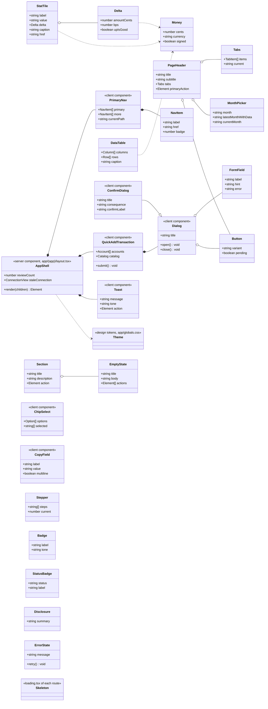

**`AppShell`.** One layout for every signed-in route. It calls `ReviewActions.listReview()`
for the badge count and `ConnectionActions.listConnections()` for the stale banner.

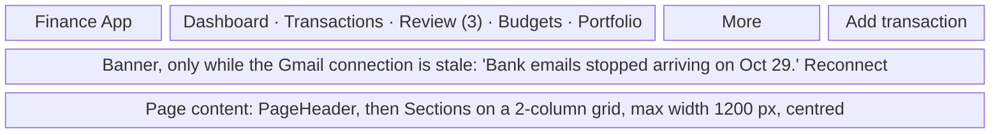

| Element | Rule |
|---|---|
| Brand | "Finance App", links to `/dashboard` |
| Primary items | Dashboard `/dashboard`, Transactions `/transactions`, Review `/review`, Budgets `/budgets`, Portfolio `/portfolio`, in that order |
| Review badge | `ReviewList.count` next to "Review"; hidden at 0 |
| More menu | Accounts `/accounts`, Import a statement `/import`, Connections `/connections`, Settings `/settings`, Sign out |
| Current item | The item whose `href` starts the current path has `aria-current="page"`, bold text, and a 2 px accent underline. "Money in and out" (`/cashflow`) marks Dashboard as current |
| Add transaction | `secondary` `Button` at the right of the bar on every page. Opens `QuickAddTransaction` in a `Dialog`, so an entry never leaves the page it started from (01-S03) |
| Phone (under 640 px) | The top bar keeps the brand, "Add", and "More". The five primary items move to a fixed bottom tab bar of five text labels; targets are at least 44 px high |
| Stale banner | Shown on every page while any connection `isStale` (01-S09), with a "Reconnect" link to `/connections` |

**UI kit.** One row per component: what it is for and the rule that keeps pages consistent.

| Component | Use | Rule |
|---|---|---|
| `PageHeader` | Top of every page | Title (one `h1`), optional one-line subtitle, optional `Tabs` or `MonthPicker`, and at most **one** primary `Button` at the right |
| `Section` | A titled card | White card on the page plane, 1 px border, 8 px radius, 24 px padding, `h2` title. A section never contains another card |
| `StatTile` | One headline number | Label above (sentence case), value at 28 px semibold in proportional figures, optional `Delta`, optional one-line caption. Tiles sit in a row of 2 on phones and 4 from 1024 px |
| `Delta` | A gain, loss, or difference | Always a sign, an arrow (▲ or ▼), and the amount or percent: "▲ +$3.87 (+1.3%)". Positive tone when the direction is good, negative when it is bad, never colour alone |
| `Money` | Every amount | `Intl.NumberFormat`: `$1,234.56` for USD, `₡14,000` for CRC (no decimals). Negative amounts use a minus sign, "−$52.30". `signed` adds "+" to positive amounts |
| `DataTable` | Any list with columns | Text columns left, numbers right in tabular numerals, header row in secondary text. Under 640 px each row becomes a stacked card with the first column as its title. No horizontal scrolling |
| `Tabs` | Views of one page | Links, not buttons: the current tab is in the URL (`?tab=`), so a tab can be opened directly and works without client JavaScript |
| `MonthPicker` | Every month-based page | "‹ Oct 2026 ›". Opens on the current month. When the current month has no data it opens on `latestMonthWithData` instead. The next arrow is disabled on the current month. The month is in the URL (`?month=2026-10`) |
| `Dialog` | Every create and edit form | Native `<dialog>` opened with `showModal()`: title, fields, then "Cancel" (secondary) and one primary button at the bottom right. Closes on success and shows a `Toast`. Full screen under 640 px |
| `ConfirmDialog` | Every destructive action | States the consequence in one sentence and names the action on its button ("Disconnect"), never "OK" |
| `FormField` | Every input | Visible label above, optional hint under the label in secondary text, error under the input in negative tone with `aria-describedby`. Placeholders are examples, never the label |
| `Button` | Every action | Variants `primary` (accent fill), `secondary` (border), `destructive` (negative text and border, never a filled red block), `link`. One height (36 px; 44 px on phones), width fits the label, never the width of the page. While its action runs it is disabled and reads "Saving…" |
| `ChipSelect` | Choosing several categories or tags | Each option is a toggle chip (`aria-pressed`). Replaces native multi-select list boxes. An empty option list shows a hint and a link to create one |
| `CopyField` | A value the user must copy | Read-only monospace value with a "Copy" button that changes to "Copied" for 2 s. `multiline` shows a code block capped at 8 lines with "Show all" |
| `Stepper` | A task with ordered steps | Numbered steps with the current one marked (`aria-current="step"`) |
| `Badge` | A category, tag, or type on a row | Small pill, neutral tone by default |
| `StatusBadge` | A state | Icon, label, and tone together: ● Working (good), ◔ Waiting (neutral), ▲ Stopped (critical), ◷ Older price (warning) |
| `Disclosure` | Detail that is not needed at first glance | Native `<details>`. Used for "How this is calculated", "Show as table", and long tails |
| `EmptyState` | A page or section with no data | Title that says what is missing, one sentence that says what fills it, and one or two actions. A page with no data at all shows **one** `EmptyState` in place of its sections, not one empty card per section |
| `ErrorState` | A failed load (`error.tsx`) | The API's `message` in plain words and a "Try again" button |
| `Skeleton` | A loading route (`loading.tsx`) | Grey blocks in the shape of the page's tiles and sections. Shown only on first load, never when data refreshes |
| `Toast` | The result of an action | Bottom of the screen, `role="status"`, disappears after 5 s, may carry one action |

**`Theme`.** The tokens are CSS custom properties declared once in `app/globals.css` and
exposed to Tailwind with `@theme`. Components use the role, never a raw hex value. The
application is light only in this iteration: `:root` sets `color-scheme: light` and the
starter template's `prefers-color-scheme: dark` block is removed, so a device in dark mode
does not get a half-dark page.

| Token | Value | Used for |
|---|---|---|
| `--color-page` | `#f9f9f7` | Page background |
| `--color-surface` | `#fcfcfb` | Cards, dialogs, the chart surface |
| `--color-text` | `#0b0b0b` | Primary text, values (19.2:1 on surface) |
| `--color-text-secondary` | `#52514e` | Labels, hints, table headers, axis labels (7.7:1) |
| `--color-border` | `#e1e0d9` | Card borders, table rules, chart gridlines |
| `--color-axis` | `#c3c2b7` | Chart baselines, disabled controls, muted bars |
| `--color-accent` | `#256abf` | Primary buttons, links, current nav item (white text on it is 5.4:1) |
| `--color-positive` | `#006300` | Text and arrow of a good `Delta` (7.4:1) |
| `--color-negative` | `#b42828` | Text and arrow of a bad `Delta`, field errors, destructive buttons (6.3:1) |
| `--color-good` | `#0ca30c` | Fill of a "good" `StatusBadge` icon |
| `--color-warning` | `#fab219` | Fill of a "warning" icon and the tint of warning banners; its label is always primary text |
| `--color-critical` | `#d03b3b` | Fill of a "critical" icon and of an exceeded `Meter` |
| `--color-series-1` … `-6` | `#2a78d6`, `#eb6834`, `#1baf7a`, `#eda100`, `#e87ba4`, `#008300` | Chart series, always in this order (section 2c) |
| `--color-series-1-track` | `#cde2fb` | Unfilled part of a `Meter` |
| Font | `system-ui, -apple-system, "Segoe UI", sans-serif`; monospace only in `CopyField` and IBANs | One family, no display face |
| Type scale | 13, 14 (body), 16, 20 (`h2`), 24 (`h1`), 28 (tile value) px | Nothing smaller than 13 px |
| Spacing | 4, 8, 12, 16, 24, 32 px | Gaps between sections 24 px, inside a section 16 px |
| Radius | 8 px cards and dialogs, 6 px inputs and buttons, 999 px chips and badges | |

Status colours (`good`, `warning`, `critical`) are reserved for states and are never used
as a chart series; series colours are never used for a state.

**Rules every page follows**

| # | Rule |
|---|---|
| 1 | **The answer comes first.** Order on every page: `PageHeader`, then `StatTile` row, then charts, then tables. A user who reads only the top of the page has the page's answer |
| 2 | **Forms open in a `Dialog`.** A create or edit form is never permanently open on a page and never sits under the data it adds to. It opens from the header's primary button or from a row's "Edit". The one exception is a single-field add (a new category or tag on `/settings`), which may sit inline in its own section |
| 3 | **One primary action per page**, in the `PageHeader`. Everything else, including the shell's "Add transaction", is `secondary` or `link`. Destructive actions are `destructive` and always confirmed |
| 4 | **Three states per route.** `loading.tsx` renders the `Skeleton`, `error.tsx` renders `ErrorState`, and a page with no data renders one `EmptyState` |
| 5 | **Months.** Month pages use `MonthPicker` and its default. A month is written "Oct 2026" everywhere, including chart axes; a day is "Oct 14" (with the year only when it is not the current year); a time is "3:00 PM" in the profile's time zone |
| 6 | **Money.** Every amount goes through `Money`. The original currency is shown first and the USD amount and rate next to it (05-S01). A gain or loss goes through `Delta` |
| 7 | **Layout.** Content is centred with a maximum width of 1200 px. Sections sit on a 2-column grid from 1024 px and in one column below it, in the order of the page's wireframe read left to right, top to bottom. At 360 px nothing scrolls sideways and no figure is cut off |
| 8 | **Accessibility.** Text contrast is at least 4.5:1. Nothing is told by colour alone: states have an icon and a label, chart series have a label. Every input has a visible label, focus is always visible, and every action is reachable by keyboard |
| 9 | **Feedback.** Every action shows that it is running (rule on `Button`), and ends in a `Toast` or in field errors. A row that was acted on is removed or updated without reloading the page |
| 10 | **Wording.** Interface text comes from the copy tables in section 2d. Words from this design never appear on screen: no "ingest token", "rebuild", "rollup", "kind", "MiB", "priced holdings", or "none selected = all" |

### 2c. Charts

Charts are hand-written SVG and HTML components in `app/ui/charts/`. There is no chart
library. They are rendered on the server from their props, so a chart is on the page as
soon as it loads and is readable without any interaction (04-S01). `scale` holds the only
arithmetic, as pure functions with unit tests.

A chart is drawn only when it answers a question a story asks, and it shows only recorded
or current figures: nothing is projected or recommended (one-pagers 04 and 07).

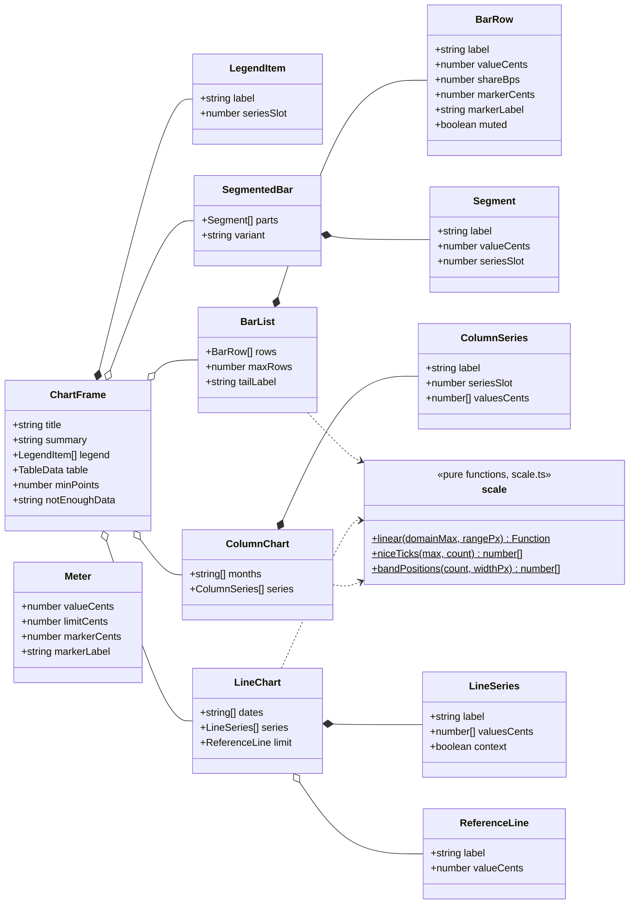

**Which chart answers which question**

| Chart | Page | Question it answers | Story | Component | Data |
|---|---|---|---|---|---|
| Where the money went | Dashboard | Which categories (or tags) took the largest share of what I spent? | 04-S01, 04-S03 | `BarList` | `CategoryShare[]` or `TagTotal[]` |
| Budgets | Dashboard, Budgets | How much of each budget have I used, and am I ahead of an even pace? | 03-S11 | `Meter` | `BudgetProgress` |
| Burn-down | Budgets | When in the period did this budget's money go? | 03-S11 | `LineChart` | `BurndownSeries` |
| Money in and out | Dashboard, Money in and out | When did money arrive, and how did spending track it? | 04-S06 | `ColumnChart` | `MonthTotal[]` |
| What I hold | Portfolio | How is my money split across my holdings? | 07-S02 | `SegmentedBar` | `HoldingValue.marketValueCents`, `shareBps` |
| Value against what I paid | Portfolio | Is each holding worth more or less than it cost me, fees included? | 07-S02, 07-S04 | `BarList` with marker | `HoldingValue` |
| If I sold everything today | Portfolio | How much of the market value would reach my bank, and what takes the rest? | 07-S05 | `SegmentedBar` | `BrokerExit` |
| What I have put in | Portfolio | How much have I deposited each month, and what did fees cost? | 07-S04 | `ColumnChart` | `InvestmentMonthRollup[]` |

**`ChartFrame`** wraps every chart: an `h3` title, a one-sentence `summary` that states the
answer in words ("Groceries took 34% of Oct 2026"), the legend, the chart, and a
`Disclosure` "Show as table" holding the same numbers in a `DataTable`. The chart is a
`<figure>` whose SVG has `role="img"` and `aria-label` equal to the summary. When the data
has fewer points than `minPoints`, the frame shows the `notEnoughData` sentence and the
table instead of the chart, never an empty or one-point chart.

**Rules for every chart**

- **Responsive.** SVG charts use a `viewBox` and `width: 100%` with a fixed height that
  includes the axis labels (`ColumnChart` 240 px, `LineChart` 220 px).
- **Text is never in a series colour.** Labels, values, and legends use the text tokens; the
  coloured mark or swatch beside them carries identity. Axis ticks use tabular numerals.
- **Series colours follow the thing, in a fixed order.** A series keeps its slot whatever
  its rank. Fixed slots: money in 1, spending 2; deposited 1, withdrawn 2; to your bank 1,
  selling fees 2, withdrawal fee 3. Holdings take slots 1 to 6 in alphabetical order of
  ticker. Past six parts, the smallest fold into "Other" in `--color-axis`.
- **Never colour alone.** Two or more series always have a legend of swatch plus label
  above the chart; a single series has no legend because the title names it.
- **Marks.** Bars and columns are at most 24 px thick with a 4 px radius on the data end
  and a square end on the baseline. Lines are 2 px with round joins. Touching marks are
  separated by a 2 px gap in the surface colour, never by an outline. Gridlines are 1 px
  solid in `--color-border`.
- **Labels are sparing.** Label the latest or the largest point; the axis and the table
  carry the rest. A label that does not fit inside its mark moves outside it or is dropped,
  and is never clipped.
- **Every mark has a `<title>`** with its name, amount, and share, which gives a native
  hover tooltip and an accessible name without client JavaScript. The tooltip is never the
  only place a value can be read.
- **No dual axes, no pie or donut, no animation.**

**Geometry of each component**

| Component | How it is drawn |
|---|---|
| `BarList` | HTML rows on a CSS grid: label, bar, share, amount. The bar column takes all the remaining width (at least 40% of the row); under 640 px the bar drops under the label at full width. Bar length is `value ÷ scale maximum`, where the scale maximum is the largest value or marker in the list, so the largest fills the track and a marker is never outside it. Bars are 12 px thick in `--color-series-1` (one hue: the rows are ranked, not different series); `muted` rows use `--color-axis`. Rows are sorted largest first, with `muted` rows last. Only `maxRows` (6) are shown; the rest are summed in one line, "9 smaller categories · $382.10", that opens them in a `Disclosure`. A row with `markerCents` draws a 2 px tick in `--color-text` at `marker ÷ scale maximum` across the track, with `markerLabel` in its `<title>` and printed under the row's label ("Paid $300.15", "Limit $300") |
| `SegmentedBar` | One whole split into at most six parts, widths proportional to the values, 2 px gaps. `tall`: 28 px high, 4 px corners, the share ("46%") printed in white inside a block that is at least 48 px wide (near-black on slot 4), and a legend listing each part's name, amount, and share. `thin`: 8 px, fully rounded, no text. A part of zero draws nothing. It is drawn only when there are at least two parts above zero |
| `ColumnChart` | Months on the x axis, one group of columns per month, a 2 px gap between the columns of a group. The y axis starts at 0 and has four `niceTicks` with gridlines; tick labels are whole dollars ("$1,000"). X labels are the short month ("Oct"), with the year under the first month and under every January. A zero value draws no column and prints "$0" on the baseline, so a month without income reads as zero and not as a gap (04-S06). Only the latest month's columns carry a value label. `minPoints` is 3 months with data |
| `LineChart` | Days on the x axis from the period start to the period end, labelled at the start, today, and the end. The main series is a 2 px line in `--color-series-1` that ends today in an 8 px dot with a 2 px surface ring and the label "Spent $136". A `context` series (the even pace) is a 2 px line in `--color-axis` labelled "Even pace" at its end. `limit` is a 1 px line in `--color-text-secondary` across the plot, labelled "Limit $90" above its right end. The y axis covers the larger of the limit and the amount spent |
| `Meter` | A thin bar for one ratio against a limit: 8 px, fully rounded, track in `--color-series-1-track`, fill in `--color-series-1` for `min(value ÷ limit, 1)`. At or over the limit the fill is `--color-critical` and the row gains a ▲ icon. `markerCents` draws a 2 px tick in `--color-text` (the even pace for today). The figures are always printed beside it: "$136 of $90 · 151% · $46 over". The bar is never the only carrier of the number (03-S11) |

### 2d. Pages

Each page is a class that composes its own components (in the page's folder) from the UI
kit and the charts, and reads its data through the controllers of section 2a.

```mermaid
classDiagram
    direction LR
    class DashboardPage {
        <<page /dashboard>>
        +string month
        +string groupBy
    }
    class CashflowPage {
        <<page /cashflow>>
    }
    class TransactionsPage {
        <<page /transactions>>
        +string month
    }
    class ReviewPage {
        <<page /review>>
        +string tab
    }
    class BudgetsPage {
        <<page /budgets>>
        +string open
    }
    class PortfolioPage {
        <<page /portfolio>>
        +string tab
    }
    class AccountsPage {
        <<page /accounts>>
    }
    class ImportPage {
        <<page /import>>
    }
    class ConnectionsPage {
        <<page /connections>>
    }
    class SettingsPage {
        <<page /settings>>
    }
    class SpendingBreakdown {
        +CategoryShare[] byCategory
        +TagTotal[] byTag
        +headline() string
    }
    class BudgetStrip {
        +BudgetProgress[] budgets
    }
    class TransactionTable {
        +Transaction[] transactions
    }
    class TransactionDialog {
        <<client component>>
        +Transaction transaction
        +submit() void
        +offerRule() void
    }
    class ReviewInbox {
        <<client component>>
        +ReviewList list
        +file(transactionId, categoryId) void
        +merge(keepId, dropId) void
        +keepBoth(id) void
        +retry(messageId) void
    }
    class BudgetCard {
        +BudgetProgress progress
        +paceText() string
    }
    class BudgetDialog {
        <<client component>>
        +Budget budget
        +Catalog catalog
        +submit() void
    }
    class BurndownSection {
        +BurndownSeries series
    }
    class PortfolioOverview {
        +Valuation valuation
        +Liquidation liquidation
        +InvestmentMonthRollup[] flows
    }
    class HoldingsTable {
        +HoldingValue[] holdings
        +BrokerCash[] cash
    }
    class LiquidationSection {
        +Liquidation liquidation
    }
    class InvestmentTable {
        +InvestmentTransaction[] transactions
    }
    class InvestmentForm {
        <<client component>>
        -string type
        -FeeSuggestion suggestion
        -boolean feeEdited
        +onTypeChange(type) void
        +onTickerBlur(ticker) void
        +recalculate() void
        +submit() void
    }
    class BrokerFeesForm {
        <<client component>>
        +submit(broker) void
    }
    class FeeCalculator {
        <<shared pure functions>>
    }
    class AccountDialog {
        <<client component>>
        +submit() void
    }
    class ImportWizard {
        <<client component>>
        +number step
        +hashFile() string
        +upload() void
        +poll() void
    }
    class ConnectionCard {
        +ConnectionView view
    }
    class GmailSetupPanel {
        <<client component>>
        +GmailSetup setup
    }
    class PreferencesForm {
        <<client component>>
        +UserSettings settings
        +submit() void
    }
    class CatalogEditor {
        <<client component>>
        +Catalog catalog
        +addCategory(name) void
        +addTag(name) void
    }
    DashboardPage --> AnalyticsLoader
    DashboardPage --> BudgetActions
    DashboardPage *-- SpendingBreakdown
    DashboardPage *-- BudgetStrip
    CashflowPage --> AnalyticsLoader
    TransactionsPage --> TransactionActions
    TransactionsPage --> CatalogActions
    TransactionsPage --> AnalyticsLoader : months with data
    TransactionsPage *-- TransactionTable
    TransactionsPage *-- TransactionDialog
    TransactionDialog --> ReviewActions : saveRule
    ReviewPage --> ReviewActions
    ReviewPage --> CatalogActions
    ReviewPage *-- ReviewInbox
    ReviewInbox --> TransactionActions : updateTransaction
    BudgetsPage --> BudgetActions
    BudgetsPage --> CatalogActions
    BudgetsPage *-- BudgetCard
    BudgetsPage *-- BudgetDialog
    BudgetsPage *-- BurndownSection
    PortfolioPage --> InvestmentActions
    PortfolioPage *-- PortfolioOverview
    PortfolioPage *-- InvestmentTable
    PortfolioPage *-- InvestmentForm
    PortfolioPage *-- BrokerFeesForm
    PortfolioOverview *-- HoldingsTable
    PortfolioOverview *-- LiquidationSection
    InvestmentForm --> FeeCalculator : live fee suggestion
    InvestmentForm --> InvestmentActions : quote, record
    BrokerFeesForm --> InvestmentActions : create, update broker
    AccountsPage --> AccountActions
    AccountsPage *-- AccountDialog
    ImportPage --> AccountActions
    ImportPage --> ImportActions
    ImportPage *-- ImportWizard
    ConnectionsPage --> ConnectionActions
    ConnectionsPage *-- ConnectionCard
    ConnectionsPage *-- GmailSetupPanel
    SettingsPage --> SettingsActions
    SettingsPage --> CatalogActions
    SettingsPage *-- PreferencesForm
    SettingsPage *-- CatalogEditor
```

The classes of sections 2a to 2c that appear here (`AnalyticsLoader`, the `...Actions`) are
the same ones; they are not redrawn with their members. Each page below has the same four
parts: the question it answers, a wireframe (blocks are in reading order; a row of blocks
is one row of the desktop grid and stacks top to bottom on a phone), a table of its
sections, and a table of its wording. Text in the wording tables is used as written;
`{braces}` mark values.

#### Dashboard `/dashboard`

**Question:** where did this month's money go, and am I inside my budgets?
**Data:** three calls (04-S01a). `monthlyTotals` for the 12 months ending with the month in
the URL, or with the current month when the URL has none; `spendingByCategory(month)` or
`spendingByTag(month)`; and `getProgress()`. When the URL has no `month`, the page opens the
current month if it has income or spending, otherwise the latest of the loaded months that
has (rule 5). The tiles and the six-month chart are read from the same twelve rows.

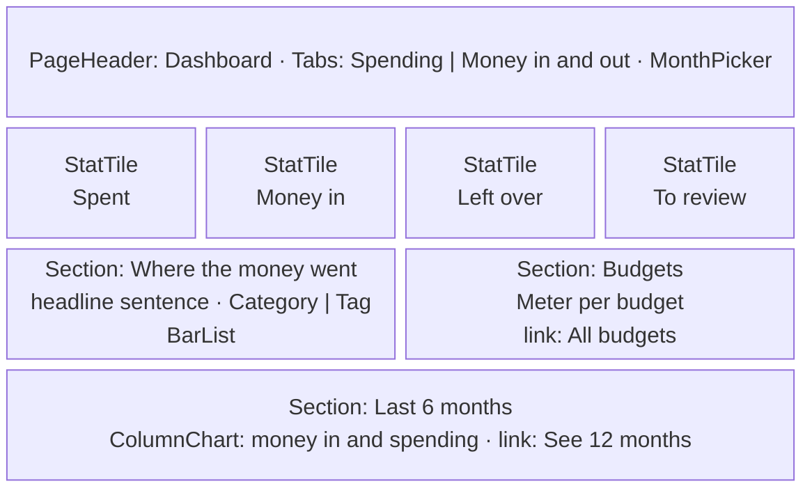

| # | Section | Component | Shows |
|---|---|---|---|
| 1 | Header | `PageHeader`, `Tabs`, `MonthPicker` | Tabs "Spending" (`/dashboard`) and "Money in and out" (`/cashflow`) |
| 2 | Tiles | 4 × `StatTile` | Spent = `expenseCents`; Money in = `incomeCents`; Left over = income − spent as a `Delta`; To review = `ReviewList.count`, linking to `/review` |
| 3 | Where the money went | `SpendingBreakdown` → `ChartFrame` + `BarList` | Category view: one row per `CategoryShare`, share and amount at the right. "Other" (`categoryId` `other`) and "Uncategorized" are `muted` and come last. Tag view (`?groupBy=tag`): one row per `TagTotal`, with `markerCents = budgetLimitCents` where the tag has a budget |
| 4 | Budgets | `BudgetStrip` → `Meter` | The four budgets with the highest `percent`, each with its name, `Meter`, and figures |
| 5 | Last 6 months | `ChartFrame` + `ColumnChart` | Money in (slot 1) and spending (slot 2) per month |

`SpendingBreakdown.headline()` names the largest row that is neither "Other" nor
"Uncategorized": "Groceries took 10% of Oct 2026". A catch-all is never the headline. When
there is an "Uncategorized" row, a second line says how much is waiting and links to Review.

| Where | Text |
|---|---|
| Tiles | "Spent", "Money in", "Left over", "To review" |
| To review at 0 | Value "0", caption "All caught up" |
| Headline | "{category} took {share}% of {month}" |
| Uncategorized line | "{share}% of {month} is not filed yet. Review {n} transactions" |
| Tag view note | "A purchase with two tags counts in both, so tags can add up to more than the total." |
| Tail row | "{n} smaller categories · {amount}" |
| Budgets, none | "No budgets yet" · "Set a limit for a category or a tag to see it here." · button "Create a budget" |
| Last 6 months, under 3 months of data | "Trends appear after three months of data. You have {n} so far." |
| Whole page, no transactions at all | "Nothing to show yet" · "Import a statement, connect Gmail, or add a transaction to see where your money goes." · buttons "Import a statement", "Connect Gmail" |
| Footnote | "All amounts in USD. Transfers between your own accounts and card payments are not counted." |

#### Money in and out `/cashflow`

**Question:** when did money arrive, and how did spending track it?
**Data:** `monthlyTotals` for the last 12 months. The page shows the months from the first
one with data to the current one, so months before the user had any data are not drawn.

| # | Section | Component | Shows |
|---|---|---|---|
| 1 | Header | `PageHeader`, `Tabs` | Same tabs as the dashboard, "Money in and out" current |
| 2 | Tiles | 3 × `StatTile` | Money in, Spent, Left over for the months shown, with the range as caption ("Aug 2026 – Nov 2026") |
| 3 | Money in and out | `ChartFrame` + `ColumnChart` | Two labelled series, money in (slot 1) and spending (slot 2); a month without income prints "$0" |
| 4 | By month | `DataTable` | Month, Money in, Spent, Left over (a `Delta`), newest first, only the months shown |

| Where | Text |
|---|---|
| Chart title | "Money in and spending by month" |
| Under 3 months of data | "Trends appear after three months of data. You have {n} so far." (the tiles and the table are still shown) |
| No data | "Nothing to show yet" · same actions as the dashboard |
| Footnote | Same as the dashboard |

#### Transactions `/transactions`

**Question:** what exactly did I spend and receive this month?
**Data:** `listTransactions(from, to)` for the month, `listCatalog()`, `listAccounts()`, and
`monthlyTotals` for the `MonthPicker` default.

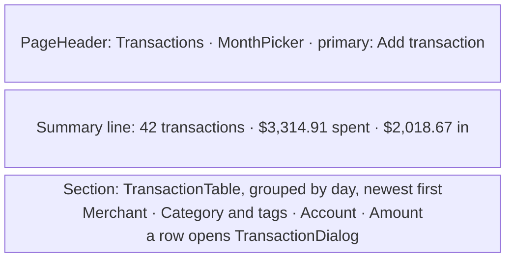

| # | Section | Component | Shows |
|---|---|---|---|
| 1 | Header | `PageHeader`, `MonthPicker` | Primary "Add transaction" opens the same `QuickAddTransaction` dialog as the shell's button. No form on the page |
| 2 | Summary | One line of text | Count, spent, and money in for the month |
| 3 | List | `TransactionTable` (`DataTable`) | Day sub-headers ("Wed, Oct 14"). Columns: merchant; category `Badge` and tag `Badge`s (an uncategorized row shows a warning-tone "Needs a category" badge); account; amount. A CRC amount shows "₡14,000" with "$27.40 at 510.95" under it (05-S01, 05-S02). Money in is `signed` with positive tone. Transfers and card payments are in secondary text with a "Not counted" badge |
| 4 | Edit | `TransactionDialog` | Category (select), tags (`ChipSelect`), type. After a category or type change it asks whether to remember it (02-S05) |
| 5 | Add | `QuickAddTransaction` (owned by the shell) | Money out / Money in, amount, currency (defaults to the account's), account, date (today), merchant or description, category ("Choose automatically" by default). Type sits under a `Disclosure` "More options" |

| Where | Text |
|---|---|
| Dialog titles | "Add a transaction", "Edit transaction" |
| Fields | "Amount", "Currency", "Account", "Date", "Merchant or description", "Category", "Tags", "Type" |
| Type options | `purchase` "Purchase" · `sinpe_sent` "SINPE sent" · `payment_sent` "Bank transfer sent" · `refund` "Refund" · `income` "Income" · `sinpe_received` "SINPE received" · `transfer` "Between my own accounts" · `card_payment` "Credit card payment" |
| Category default | "Choose automatically" |
| Remember prompt | "Always file {merchant} as {category}?" · buttons "Always", "Only this one" |
| Saved | Toast "Transaction saved" |
| Rate unavailable (503) | "The exchange rate for {date} is not available yet. Nothing was saved. Try again in a moment." |
| Empty month | "No transactions in {month}" · "Your latest transactions are in {latest month}." · button "Go to {latest month}" |
| No transactions at all | Same `EmptyState` as the dashboard |

#### Review `/review`

**Question:** what needs a decision from me?
**Data:** `listReview()`, `listCatalog()`.

| # | Section | Component | Shows |
|---|---|---|---|
| 1 | Header | `PageHeader`, `Tabs` | Tabs with counts: "To categorize ({n})", "Possible duplicates ({n})", "Emails not understood ({n})". Opens on the first tab that has items |
| 2 | To categorize | `ReviewInbox` | One row per transaction: merchant, date, account, amount, and a category select. Choosing a category files the row at once (02-S06); the row leaves the list and a `Toast` offers the rule |
| 3 | Possible duplicates | `ReviewInbox` | The two transactions side by side with their source, date, account, and amount (01-S04) |
| 4 | Emails not understood | `ReviewInbox` | Date received, the reason in words, and what to do about it (01-S08c) |

When `ReviewList.count` is 0 the page shows one `EmptyState` and no tabs.

| Where | Text |
|---|---|
| Title | "Review" |
| Filed toast | "Filed under {category}." · action "Always file {merchant} this way" |
| Duplicate buttons | "Same purchase, merge them" (primary) · "Different purchases, keep both" |
| Email row | "{reason}" · button "Try again" · e.g. "Card ending 1111 isn't linked to an account. Add the card to an account, then try again." |
| All clear | "All caught up" · "Transactions that need a category, look like duplicates, or could not be read will appear here." |

#### Budgets `/budgets`

**Question:** how much of each limit have I used, and am I going too fast?
**Data:** `getProgress()`, `listCatalog()`, and `getBurndown(id)` for the budget named in
`?open=`.

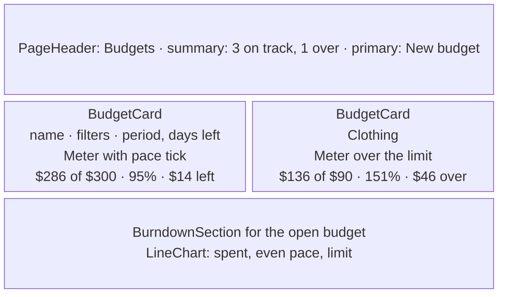

| # | Section | Component | Shows |
|---|---|---|---|
| 1 | Header | `PageHeader` | Subtitle counts budgets on track and over; primary "New budget" opens `BudgetDialog` |
| 2 | Cards | `BudgetCard` on the 2-column grid | Name; its categories and tags as `Badge`s; period and `daysLeft`; `Meter` with `markerCents = expectedCents`; the figures; `paceText()`; links "Details" (`?open=id`) and "Edit". Over-limit budgets come first |
| 3 | Burn-down | `BurndownSection` → `ChartFrame` + `LineChart` | For the open budget only: `cumulativeSpentCents` as the main series, `paceCents` as the `context` series, `limitCents` as the limit line |
| 4 | Dialog | `BudgetDialog` | Name, limit (USD), period (week, month, quarter, year, custom range with two dates), categories (`ChipSelect`), tags (`ChipSelect`) |

`BudgetCard.paceText()` compares `spentCents` with `expectedCents`. The week-start setting is
not on this page; it is in Settings.

| Where | Text |
|---|---|
| Figures | "{spent} of {limit} · {percent}% · {remaining} left" or "… · {overBy} over" |
| Pace | "On pace" (within 5% of the limit either side of the pace), "{amount} ahead of an even pace", "{amount} under an even pace" |
| Period | "Monthly · {n} days left", "Weekly · ends {day}", "Aug 1 – Dec 15 · {n} days left" |
| Dialog titles | "New budget", "Edit budget" |
| Fields | "Name", "Limit (USD)", "Period", "Categories", "Tags" |
| Hint under Categories and Tags | "Leave both empty to count all spending. With tags, a purchase counts if it has any of them." |
| No tags to choose | "You have no tags yet." · link "Create tags in Settings" |
| Burn-down title | "{budget}: spending against an even pace" |
| No budgets | "No budgets yet" · "A budget is a limit for a category, a tag, or both. For example, $300 a month for everything tagged University." · button "New budget" |

#### Portfolio `/portfolio`

**Question:** what are my investments worth, what did they cost me, and what would reach
my bank if I sold them?
**Data (Overview):** `getValuation()`, `getLiquidation()`, `getFlows(12)`, and
`listBrokers()`, requested in parallel (07-S02a).

The page has three tabs, so the figures, the history, and the set-up are not stacked on
one screen: "Overview" (`?tab=overview`, the default), "Transactions" (`?tab=transactions`),
and "Brokers and fees" (`?tab=brokers`).

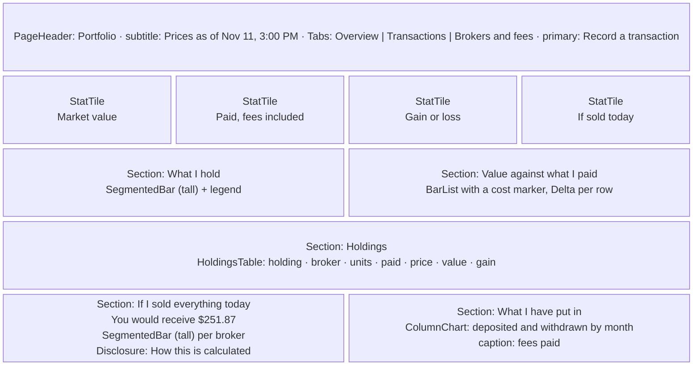

| # | Section | Component | Shows |
|---|---|---|---|
| 1 | Header | `PageHeader`, `Tabs` | Subtitle "Prices as of {priceTime}"; a `StatusBadge` "Some prices are older" when any holding is `stale`. Primary "Record a transaction" opens `InvestmentForm` in a `Dialog` from any tab |
| 2 | Warnings | Banner per case | Negative broker cash (`BrokerExit.negativeCash`); holdings without a price (`Valuation.unpriced`) with the reason for each |
| 3 | Tiles | 4 × `StatTile` | Market value = `totalValueCents`; Paid, fees included = `totalCostBasisCents`; Gain or loss = `Delta(unrealizedGainCents, gainBps)`; If sold today = `Liquidation.totalCents` |
| 4 | What I hold | `ChartFrame` + `SegmentedBar` (tall) | One part per priced holding by `marketValueCents`; legend rows show ticker, name, value, and `shareBps` |
| 5 | Value against what I paid | `ChartFrame` + `BarList` | One row per priced holding: bar = `marketValueCents`, `markerCents = costBasisCents` ("Paid {amount}"), and the row's `Delta` at the right |
| 6 | Holdings | `HoldingsTable` (`DataTable`) | Holding (ticker, name under it), broker, units, paid, price (with its time; a stale price shows a warning `StatusBadge` "from 3 h ago"; no price shows the reason), value, gain (`Delta`). One "Cash at {broker}" row per broker |
| 7 | If I sold everything today | `LiquidationSection` → `SegmentedBar` (tall) | Headline amount; per broker a bar that splits what the holdings and cash are worth (`grossCents`) into "To your bank" (`netToBankCents`), "Selling fees" (`sellFeesCents`), and "Withdrawal fee" (`withdrawalFeeCents`). The `Disclosure` lists every holding's value, fee with its explanation, and net, then cash, the withdrawal fee with its explanation, and the total (07-S05). A broker with negative cash shows its lines without a bar |
| 8 | What I have put in | `ChartFrame` + `ColumnChart` | `depositedCents` (slot 1) and `withdrawnCents` (slot 2) per month from the first month with activity; caption sums `commissionsCents` |

"Transactions" tab: `InvestmentTable` lists every investment transaction, newest first:
date, type (`Badge`), broker, holding, units, amount, fee (with an "edited" `Badge` when
`commissionSource` is `manual`), and "Edit", which opens `InvestmentForm` to correct it
(07-S01). "Brokers and fees" tab: one `Section` per broker with its six fees in a read-only
table (rows deposit, withdrawal, buy stocks and ETFs, buy crypto, sell stocks and ETFs, sell
crypto; columns flat amount and percent) and "Edit fees", which opens `BrokerFeesForm` in a
`Dialog`; the tab's "Add a broker" button opens the same form empty (07-S03).

**`InvestmentForm`** (in a `Dialog`, tabs Deposit / Buy / Sell / Withdrawal) shows only the
fields of the chosen type (section 10, table "What each type records"). It imports
`FeeCalculator` from `shared/`, the same code the API runs, and recalculates on every change
of broker, type, asset class, or amount: the fee field is filled with the suggestion and
the line under it explains it, for example "Hapi deposit fee: 1.55% of $300.00 = $4.65". If
the user edits the fee, `feeEdited` is set and the suggestion stops overwriting it; the
request then sends `commissionCents`, and otherwise omits it so the API derives it. On the
Buy tab, leaving the ticker field calls `quote(ticker)`: the form shows the instrument's
name, type, and live price, pre-selects the asset class (`CRYPTOCURRENCY` → crypto, anything
else → stocks and ETFs), and pre-fills the gross value with units × price, all editable.
After saving, the dialog closes and a `Toast` says what was saved for that type.

| Where | Text |
|---|---|
| Tiles | "Market value", "Paid, fees included", "Gain or loss", "If sold today" |
| Tile captions | "{n} holdings at {m} brokers" · "everything you paid to buy them" · "before selling costs" · "after fees, before taxes" |
| What I hold, one holding | "{ticker} is your only holding." (no bar) |
| Holdings columns | "Holding", "Broker", "Units", "Paid", "Price", "Value", "Gain or loss" |
| Stale price | "from {age} ago" |
| No price | `NOT_FOUND` "{ticker} is not a Yahoo Finance ticker" · `UNAVAILABLE` "Price service unavailable, retrying" · `UNSUPPORTED_CURRENCY` "Prices in {currency} are not supported" |
| Unpriced banner | "{tickers} could not be priced and are left out of the totals." |
| Negative cash banner | "Cash at {broker} is {amount}. Record the deposits that paid for these buys." |
| Sell headline | "You would receive {amount}" · "Prices as of {priceTime}. Before taxes. An estimate, not a recommendation." |
| Sell legend | "To your bank", "Selling fees", "Withdrawal fee" |
| What I have put in | Title "Deposits and withdrawals by month" · caption "Fees paid in this period: {amount}" · under 3 months "You deposited {amount} and paid {fees} in fees so far. A chart appears after three months." |
| Dialog title | "Record a transaction" / "Correct a transaction" |
| Deposit amount choice | "I know" is not used. Two radio options: "The amount I sent from my bank" · "The amount that arrived at {broker}" |
| Fee field | Label "Fee (USD)" · hint is the calculator's explanation |
| Ticker hint | "As shown on Yahoo Finance, for example VT, BTC-USD, VWRA.L" |
| Saved toasts | "Deposit saved: {sent} sent, {fee} fee, {net} now in cash at {broker}" · "{ticker}: {units} units, cost {cost} including {fee} in fees" |
| No brokers | "Start with your broker" · "1. Add your broker and the fees it charges. 2. Record a deposit. 3. Record what you bought." · button "Add a broker" |
| Brokers, no transactions | "No investments recorded yet" · button "Record a transaction" |

#### Accounts `/accounts`

**Question:** which bank accounts and cards does the app know about?

| # | Section | Component | Shows |
|---|---|---|---|
| 1 | Header | `PageHeader` | Primary "Add an account" opens `AccountDialog` |
| 2 | List | `DataTable` | Name, bank, currency, IBAN in monospace grouped in fours ("CR94 0102 0000 7052 3696 68"), cards as "•••• 5196", and "Edit" |
| 3 | Dialog | `AccountDialog` | Name, bank (BAC Credomatic or Banco Nacional), currency, IBAN (optional), last four digits of each linked card. Bank and currency are read-only once the account has transactions |

| Where | Text |
|---|---|
| IBAN hint | "Optional. Lets transfers to this account be recognized as your own." |
| Cards hint | "Last 4 digits of each card, separated by commas. Bank alert emails name the card, so this is how they find the account." |
| Card on another account | "Card {last4} is already on {account}." |
| No accounts | "No accounts yet" · "Add the accounts your statements and bank emails come from." · button "Add an account" |

#### Import a statement `/import`

**Question:** how do I bring in a statement, and what happened to it?

| # | Section | Component | Shows |
|---|---|---|---|
| 1 | Header | `PageHeader` | Subtitle "BAC Credomatic and Banco Nacional statements in CSV" |
| 2 | Steps | `ImportWizard` with `Stepper` | "1 Account", "2 File", "3 Result" |
| 3 | Step 1 | Account select | The user's accounts; with none, an `EmptyState` linking to Accounts |
| 4 | Step 2 | File input with drop area | Says which export to download for the chosen account's bank. The browser hashes the file, refuses one over 1 MB, uploads it, and polls `getImport` (01-S02) |
| 5 | Step 3 | 4 × `StatTile`, `StatusBadge`, `DataTable` | Imported, Between your accounts (`transfers`), Merged with existing, Already imported (`skipped`); whether the totals match the statement; a table of the rows that could not be read (line and reason) |

| Where | Text |
|---|---|
| BAC help | "In BAC online banking, open the account and download 'Transacciones del mes' as CSV." |
| Banco Nacional help | "In BN online banking, open 'Consulta de saldos' for the account and download it as CSV." |
| File hint | "CSV file, up to 1 MB. Amounts keep the statement's currency." |
| Progress | "Uploading…", "Reading the statement…" |
| Totals | "Totals match the statement" (good) · "Totals do not match the statement: {detail}" (warning) |
| Already imported (409) | "This file was already imported." · link "See that import's result" |
| Failed | "The statement could not be read: {reason}. Nothing was imported." · button "Choose another file" |
| After a result | Buttons "See the transactions", "Import another" |

#### Connections `/connections`

**Question:** what can the app access, and is it still working?

| # | Section | Component | Shows |
|---|---|---|---|
| 1 | Header | `PageHeader` | Subtitle from the wording table. Primary "Connect Gmail" only when there is no active connection |
| 2 | Active connection | `ConnectionCard` | `StatusBadge`; when the last email arrived; what it can read; four small `StatTile`s for the last 7 days; "Replace the key" (`secondary`) and "Disconnect" (`destructive`, through `ConfirmDialog`) (06-S02) |
| 3 | Set-up | `GmailSetupPanel` | Only right after connecting or replacing the key: a warning that the key is shown once, a `CopyField` with the key, three numbered steps, and a multiline `CopyField` with the script (01-S08a) |
| 4 | Past connections | `Disclosure` | Revoked connections as one line each (key prefix, last email, "Disconnected"), closed by default |

| Where | Text |
|---|---|
| Subtitle | "The only access the app has is the key your Gmail script uses. It never sees your Gmail or bank password." |
| Status | `working` "Working" · `pending` "Waiting for the first email" · stale "Stopped" |
| Last seen | "Last email received {date and time}" · "No email received yet" |
| Can read | "Reads only the BAC and Banco Nacional alert emails your script forwards." |
| Last 7 days tiles | "Imported", "Not understood" (links to Review), "Rejected", "Already known" |
| Key warning | "This key is shown only once. Copy it now." |
| Steps | "1. Open script.google.com, create a project, and paste the script into Code.gs." · "2. In Project Settings, under Script properties, add INGEST_TOKEN with the key above." · "3. Choose the setup function, click Run, and approve the Gmail permissions." |
| Disconnect confirm | Title "Disconnect Gmail?" · "New bank emails will stop arriving. Imported transactions stay." · button "Disconnect" |
| Replace confirm | Title "Replace the key?" · "The current key stops working at once. You will need to paste the new one into your script." · button "Replace the key" |
| No connection | "Bank emails can file themselves" · "A small script in your own Google account forwards your bank's alert emails here. Statements and manual entry work without it." · button "Connect Gmail" |

#### Settings `/settings`

**Question:** how do I change how the app counts and names things?
**Data:** `getSettings()`, `listCatalog()`.

| # | Section | Component | Shows |
|---|---|---|---|
| 1 | Preferences | `PreferencesForm` | Week starts on (Monday to Sunday), time zone; "Save" |
| 2 | Categories | `CatalogEditor` | Built-in categories with a "Built-in" `Badge`, then the user's own; one inline field "New category" with "Add" |
| 3 | Tags | `CatalogEditor` | The user's tags; one inline field "New tag" with "Add" |

| Where | Text |
|---|---|
| Week start hint | "Weekly budgets are recalculated when you change this." |
| Saved | Toast "Settings saved" |
| Name taken (409) | "You already have a category called {name}." / "… a tag called {name}." |
| No tags | "No tags yet. Tags group purchases across categories, for example University or Trip to Panama." |

Pages outside the shell (sign-in) use the same `Theme`, `FormField`, and `Button`.

---
## 3. API shell and data access

`ApiHandler` is the `ApiFn` entry point: one Powertools `Router` with one feature router
mounted per route prefix. `ImportWorkerHandler` is the `ImportWorkerFn` entry point for S3
events. The routers are the API controllers: they read `AuthContext`, validate the body
with the shared Zod schemas, call one service method, and return JSON.

### 3a. Entry points, routers, and errors

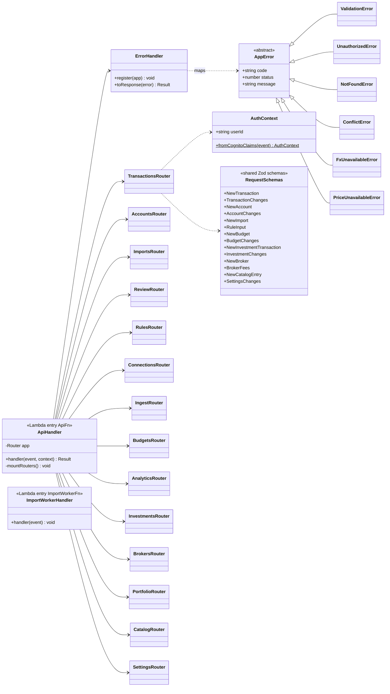

Every router uses `AuthContext` and `RequestSchemas` the way `TransactionsRouter` does; only
that pair of edges is drawn. `IngestRouter` is the exception: it has no Cognito claims and
authenticates the Gmail ingest token through `ConnectionService` instead.
`ErrorHandler` maps `ValidationError` to 400, `UnauthorizedError` to 401, `NotFoundError` to
404, `ConflictError` to 409, `FxUnavailableError` and `PriceUnavailableError` to 503, and
anything else to 500, always as `{code, message}`.

**Routes per router.** Each route calls the service method named in its sequence diagram.

| Router | Routes | Service |
|---|---|---|
| `TransactionsRouter` | `POST /api/transactions`, `GET /api/transactions`, `PATCH /api/transactions/{id}` | `TransactionService`, `TransactionQueryService` |
| `AccountsRouter` | `GET /api/accounts`, `POST /api/accounts`, `PATCH /api/accounts/{id}` | `AccountService` |
| `ImportsRouter` | `POST /api/imports`, `GET /api/imports/{id}` | `ImportService` |
| `ReviewRouter` | `GET /api/review`, `POST /api/review/duplicates/merge`, `POST /api/review/duplicates/dismiss`, `POST /api/review/messages/{messageId}/retry` | `ReviewService`, `TransactionService` |
| `RulesRouter` | `PUT /api/rules/{merchantKey}` | `RuleService` |
| `ConnectionsRouter` | `POST /api/connections/gmail`, `GET /api/connections`, `POST /api/connections/gmail/{id}/rotate`, `DELETE /api/connections/{id}` | `ConnectionService` |
| `IngestRouter` | `GET /ingest/gmail/config`, `POST /ingest/gmail`, `POST /ingest/gmail/heartbeat` | `ConnectionService`, `IngestPipeline` |
| `BudgetsRouter` | `POST /api/budgets`, `PATCH /api/budgets/{id}` | `BudgetService` |
| `AnalyticsRouter` | `GET /api/analytics/spending`, `GET /api/analytics/budgets`, `GET /api/analytics/budgets/{id}` | `SpendingAnalyticsService`, `BudgetAnalyticsService` |
| `InvestmentsRouter` | `POST /api/investments/transactions`, `GET /api/investments/transactions`, `PATCH /api/investments/transactions/{id}`, `GET /api/investments/flows?months=` | `InvestmentService` |
| `BrokersRouter` | `GET /api/brokers`, `POST /api/brokers`, `PUT /api/brokers/{id}` | `BrokerService` |
| `PortfolioRouter` | `GET /api/portfolio/valuation`, `GET /api/portfolio/liquidation`, `GET /api/portfolio/quote?ticker=` | `ValuationService` |
| `CatalogRouter` | `GET /api/catalog`, `POST /api/categories`, `POST /api/tags` | `CatalogService` |
| `SettingsRouter` | `GET /api/settings`, `PUT /api/settings` | `SettingsService` |

**Request bodies that changed.** `NewAccount` is `{name, bank, currency, iban?,
cardLast4s[]}`; `iban` is `CR` plus 20 digits (spaces removed, upper-cased) and each card entry
is exactly four digits. `NewInvestmentTransaction` is
`{type, brokerId, localDate, name?}` plus, for `DEPOSIT` and `WITHDRAWAL`, `amountCents`, and
for `BUY` and `SELL`, `ticker`, `assetClass`, `quantityMicro`, and `grossCents`.
`commissionCents` is **optional**: when it is missing the API derives it from the broker's fee
schedule. `NewBroker` is `{name, fees}` and `BrokerFees` is `{fees, version}`, where `fees` has
the `FeeSchedule` shape with every `flatCents` ≥ 0 and every `percentBps` from 0 to 9999.
`RuleInput` gains an optional `kind`. `NewCatalogEntry` is `{name}`, trimmed, 1 to 40
characters. `SettingsChanges` is `{weekStart?, timeZone?}`, where `weekStart` is a day name
(`MONDAY` to `SUNDAY`) and `timeZone` is an IANA zone name. `GET /api/investments/flows`
takes `months` from 1 to 24 (default 12).

### 3b. Configuration and factories

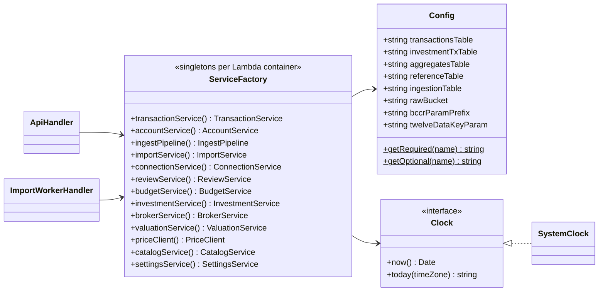

`Config.getRequired` throws at start-up if an environment variable is missing, so a
misconfigured Lambda fails on its first request instead of part way through one. Environment
variables hold table names, the bucket name, and SSM parameter names, never secret values.
`twelveDataKeyParam` (`/FinanceApp/prices/twelvedata-api-key`) is read with `getOptional`:
the primary price provider needs no key, and the fallback provider is only built when that
parameter exists in SSM.

### 3c. Repositories (database handlers)

Repositories are the only classes that call DynamoDB, S3, or SSM. There is one repository per
DynamoDB table, all built on `DynamoStore`, and every key is built by `Keys`. Methods ending
in `Item` return a `TransactItem` instead of writing, so a service can combine writes to
several tables in one `DynamoStore.transactWrite`.

```mermaid
classDiagram
    direction LR
    class DynamoStore {
        -DynamoDBDocumentClient client
        +get(table, key) Item
        +query(table, keyCondition, options) Page
        +put(table, item, condition) void
        +update(table, key, expression, condition) void
        +batchGet(table, keys) Item[]
        +batchWrite(table, puts, deletes) void
        +transactWrite(items) void
    }
    class Keys {
        <<keys.ts>>
        +user(userId)$ string
        +txn(date, id)$ string
        +inv(date, id)$ string
        +day(date)$ string
        +month(month, dimension, id)$ string
        +budgetPeriod(budgetId, periodStart)$ string
        +budgetDay(budgetId, date)$ string
        +holding(brokerId, ticker)$ string
        +cash(brokerId)$ string
        +fx(date)$ string
        +price(ticker)$ string
        +token(hash)$ string
        +account(id)$ string
        +broker(id)$ string
        +category(id)$ string
        +tag(id)$ string
        +profile()$ string
        +file(sha256)$ string
        +rowFingerprint(hash)$ string
        +message(messageId)$ string
    }
    class TransactionRepository {
        +get(userId, id) Transaction
        +listByDate(userId, from, to) Transaction[]
        +findNear(userId, accountId, from, to) Transaction[]
        +listReview(userId, reason) Transaction[]
        +putItem(txn) TransactItem
        +updateItem(txn, expectedVersion) TransactItem
        +deleteItem(txn) TransactItem
    }
    class InvestmentTxRepository {
        +get(userId, id) InvestmentTransaction
        +listByTicker(userId, ticker) InvestmentTransaction[]
        +putItem(tx) TransactItem
        +update(tx, expectedVersion) void
    }
    class AggregateRepository {
        +getMonth(userId, month, dimension) SpendingRollup[]
        +getMonths(userId, months) SpendingRollup[]
        +getInvestmentMonths(userId, months) InvestmentMonthRollup[]
        +getBudgetPeriods(userId, keys) BudgetPeriodTotal[]
        +getBudgetDays(userId, budgetId, from, to) BudgetDayTotal[]
        +replaceBudgetItems(userId, budgetId, periods, days) void
        +addItems(deltas) TransactItem[]
        +getHoldings(userId) Holding[]
        +getCash(userId) BrokerCash[]
        +putHolding(userId, holding, expectedVersion) void
        +getFxRate(date) FxRate
        +putFxRate(rate) void
        +getPrices(tickers) Price[]
        +putPrice(price) void
    }
    class ReferenceRepository {
        +getSettings(userId) UserSettings
        +putSettings(userId, settings) void
        +getAccount(userId, id) Account
        +listAccounts(userId) Account[]
        +findAccountByCard(userId, last4) Account
        +putAccount(userId, account) void
        +updateAccount(userId, account, expectedVersion) void
        +getCategories(userId, ids) Category[]
        +getTags(userId, ids) Tag[]
        +listCategories(userId) Category[]
        +listTags(userId) Tag[]
        +putCategory(userId, category) void
        +putTag(userId, tag) void
        +getRule(scope, merchantKey) Rule
        +putRule(userId, rule) void
        +listBudgets(userId) Budget[]
        +putBudget(userId, budget) void
        +updateBudget(userId, budget, expectedVersion) void
        +getBroker(userId, id) Broker
        +listBrokers(userId) Broker[]
        +putBroker(userId, broker) void
        +updateBroker(userId, broker, expectedVersion) void
    }
    class IngestionRepository {
        +claimFile(userId, sha256, importId) boolean
        +setFileStatus(userId, sha256, status) void
        +claimMessage(userId, messageId) boolean
        +rowClaimItem(userId, fingerprint, importId) TransactItem
        +putImport(userId, job) void
        +updateImport(userId, job) void
        +getImport(userId, id) ImportJob
        +getMessage(userId, messageId) IngestMessage
        +updateMessage(userId, message) void
        +listUnparsed(userId) IngestMessage[]
        +messageStats(userId, since) DeliveryStats
        +getToken(hash) IngestToken
        +listConnections(userId) Connection[]
        +writeConnection(connection, putToken, deleteToken) void
        +touchConnection(userId, connectionId, at) void
    }
    class RawObjectStore {
        +putRawEmail(userId, messageId, mime) string
        +presignCsvUpload(userId, importId, maxBytes) PresignedPost
        +getObject(key) Uint8Array
    }
    class ParameterStore {
        +getParameters(prefix) Map
    }
    TransactionRepository --> DynamoStore
    InvestmentTxRepository --> DynamoStore
    AggregateRepository --> DynamoStore
    ReferenceRepository --> DynamoStore
    IngestionRepository --> DynamoStore
    TransactionRepository ..> Keys
    InvestmentTxRepository ..> Keys
    AggregateRepository ..> Keys
    ReferenceRepository ..> Keys
    IngestionRepository ..> Keys
```

The `claim...` methods are conditional puts with `attribute_not_exists` and return `false`
when the item already exists. They are how the pipeline makes every source idempotent.
`claimFile` is the one exception: its condition is `attribute_not_exists(PK) OR #status =
:failed`, so a file whose last import failed can be claimed again for a new import.
`rowClaimItem` does not write: it returns the conditional put of `ROWFP#<hash>` so that
`TransactionService` writes it in the same `TransactWriteItems` as the transaction, and a row
is marked as imported only if its transaction was saved. `findAccountByCard` queries the
user's `ACCOUNT#` items and returns the one whose `cardLast4s` contains `last4` (a user has
few accounts, so no index is needed). `messageStats` counts the user's `MSG#` items by
status since a date. `listCategories` returns the `GLOBAL` categories followed by
the user's own, and `listTags` the user's tags, without archived ones. `getInvestmentMonths` is one `BatchGet` of the
`MONTH#<yyyy-mm>#INV` items for the months asked for. Repositories strip `PK` and `SK` before
returning items, so services never see key strings.

---
## 4. Transactions core

Manual entry, Gmail alerts, and CSV rows all end in `TransactionService`. It converts to USD,
categorizes, matches budgets, and asks `RollupPlanner` for every rollup change, then writes
the transaction and all rollups in one `TransactWriteItems`. Updates and merges subtract the
old contribution and add the new one in the same call, guarded by `version`.

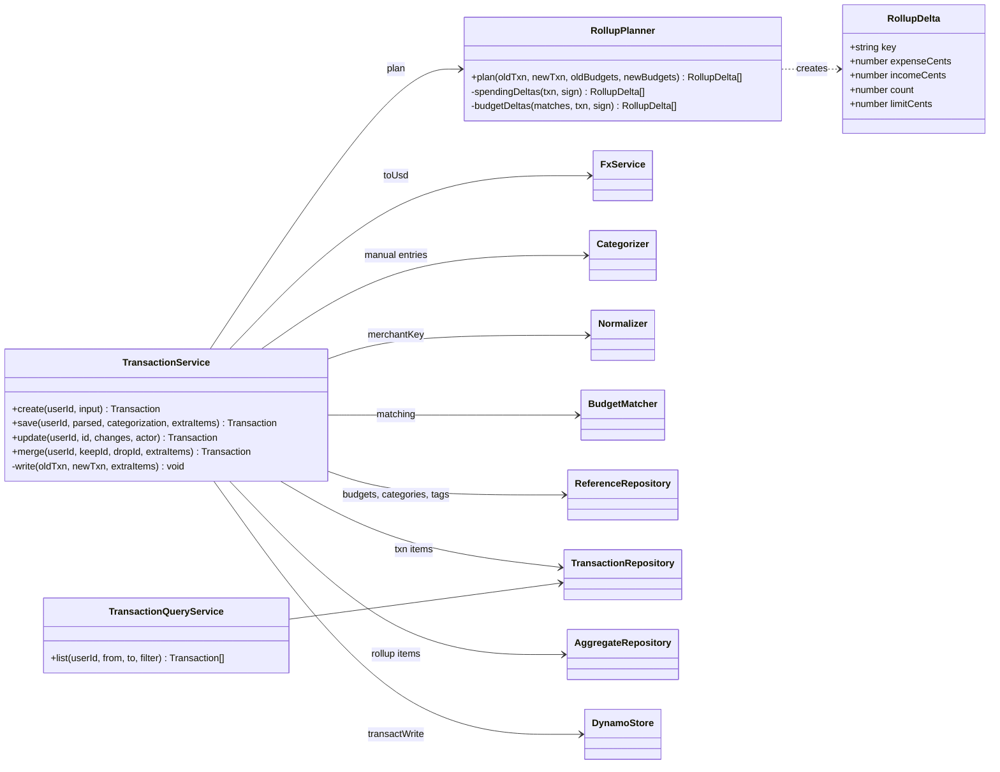

`save` is called by `IngestPipeline` with a categorization it has already done; `create` is
the manual-entry path and categorizes itself. `RollupPlanner` follows `Transaction.flow()`
(section 1a): `expense` adds to `expenseCents` and matching budgets, `refund` subtracts from
them, `income` adds to `incomeCents` only, and `excluded` touches no rollup. When the
`version` condition fails, `TransactionService` re-reads and retries once, then throws
`ConflictError`. A missing rate makes `FxService` throw `FxUnavailableError` and nothing is
written.

`extraItems` are conditional writes to other tables that must succeed or fail together with
the transaction; the CSV pipeline passes the row's `ROWFP#` claim. If the transaction is
cancelled because one of those conditions failed, `save` throws `AlreadyClaimedError` (not an
HTTP error), and the pipeline counts the row as already imported. Because the claim and the
transaction are one write, a row that failed for another reason, such as a missing exchange
rate, is not claimed and imports when the file is uploaded again.

---
## 5. Module 01: Accounts and Ingestion

### 5a. CSV import and the shared pipeline

`IngestPipeline` handles both CSV statements and Gmail emails. Each source is claimed
(`FILE#`, `ROWFP#`, `MSG#`), so a repeat delivery is skipped. Templates are declarative
config objects; the two parsers are generic and interpret them. **Every template, its sample
file, and the exact result it must produce are in [Bank Formats](bank-formats.md)**; the
four supported templates are `bac-transacciones-mes` and `bn-consulta-saldos` (statements)
and `bac-notificacion` and `bn-voucher-digital` (card alert emails).

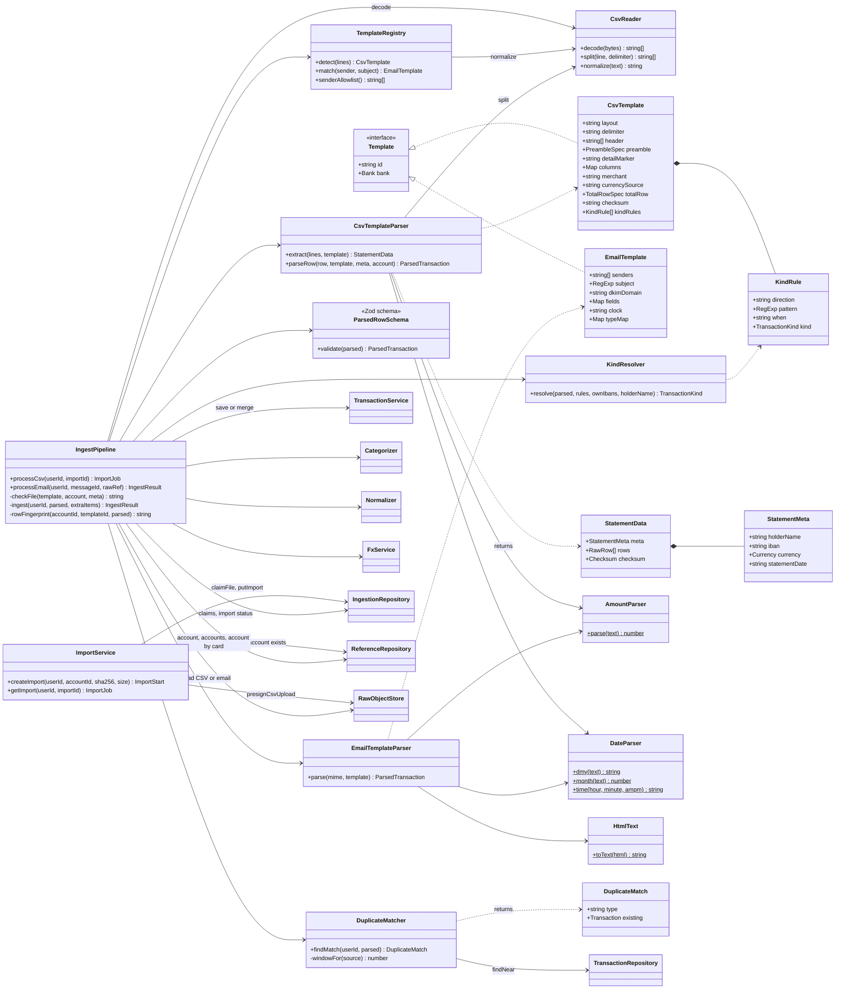

**`processCsv` step by step.**

1. Read `IMPORT#` (for `accountId`) and the account, then the object's bytes.
   `CsvReader.decode` tries UTF-8 and falls back to Windows-1252.
2. `TemplateRegistry.detect(lines)` tries each CSV template's detection rule against the
   first lines. `extract` reads the preamble (if the layout is `sectioned`), the data rows
   with their line numbers, and the bank's printed totals.
3. `checkFile` returns a failure reason when no template matched, the template's bank is not
   the account's bank, the file's currency is not the account's currency, or the detail
   header is not the expected one. The import is then `FAILED` with that reason, and
   `FILE#` is set to `FAILED` so the file can be uploaded again.
4. For each row: `parseRow` → `ParsedRowSchema.validate` (a failure becomes a `RowError` with
   the line number and reason) → `KindResolver.resolve` (with the IBANs of all the user's
   accounts and the preamble's holder name) → `Normalizer` → `Categorizer` (a user rule may
   replace the kind) → `FxService.toUsd` → `DuplicateMatcher` → `TransactionService.save` or
   `merge`, passing `rowClaimItem` as an extra item. `AlreadyClaimedError` counts the row as
   skipped. Rows whose kind is `transfer` are counted in `transfers` as well as `imported`.
5. Compare the imported out and in totals with the printed totals into `ChecksumResult`,
   then write `IMPORT#` (`DONE`, counts, row errors, checksum) and set `FILE#` to `DONE`.

`rowFingerprint` is the SHA-256 of `accountId | templateId | localDate | statementRef |
amountMinor | direction`; the row's position in the file is not part of it, so an overlapping
statement downloaded later skips the rows already imported.

**`processEmail`.** `TemplateRegistry.match` picks the template by sender and subject,
`DkimVerifier` checks the signature against its `dkimDomain`, `EmailTemplateParser.parse`
turns the HTML into text and reads the fields, and `ReferenceRepository.findAccountByCard`
resolves the card to an account. A missing field, an unknown transaction type, or an unknown
card leaves the message `unparsed` with a reason (`FIELD_MISSING:<field>`,
`UNKNOWN_TYPE:<type>`, `UNKNOWN_CARD:<last4>`).

`DuplicateMatch.type` is `exact` (merge into the existing transaction), `near` (save with
`possibleDuplicateOf` set), or `none`. The match key is the original amount, the account, and
a date window of the same day when a statement gives the transaction date. Templates live in
code under `api/src/ingest/templates/`. The golden tests read the redacted samples in
`docs/samples/` and assert the results listed in [Bank Formats](bank-formats.md).

### 5b. Gmail connection and review inbox

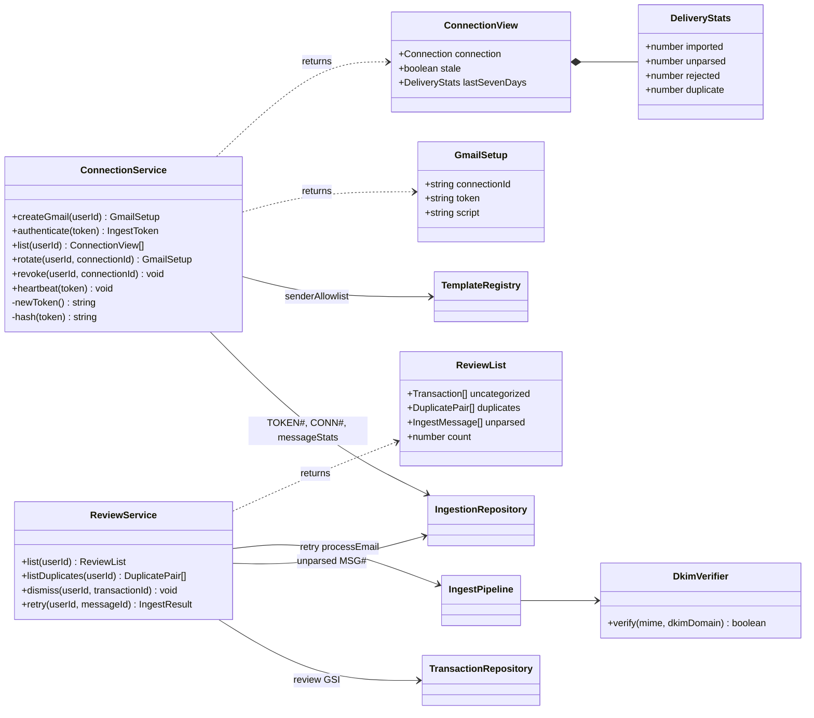

`ConnectionService.authenticate` hashes the bearer token and looks up `TOKEN#<sha256>`. A
revoked token has no item, so the lookup fails and `IngestRouter` returns `401`. The token is
returned only once, from `createGmail` or `rotate`, and is never stored or logged.
`isStale(now)` on `Connection` compares `lastSeenAt` with a 24-hour threshold (01-S09).
`ConnectionView.lastSevenDays` counts the emails received in the last 7 days by outcome, so
the Connections page shows, for example, "12 imported, 1 not understood, 0 rejected" and a
problem with a template or with DKIM is visible instead of silent.

`DkimVerifier.verify` passes when at least one valid signature's `d=` equals `dkimDomain` or
is a subdomain of it; other signatures on the same email are ignored. `ReviewList.unparsed`
shows each message's reason in words ("Card ending 1111 isn't linked to an account").
`ReviewService.retry` reads the `MSG#` item and calls `processEmail` again with its stored
`rawRef`, after the `MSG#` status is reset, so an email can be processed once its card has
been added to an account or a template has been fixed.

### 5c. Accounts

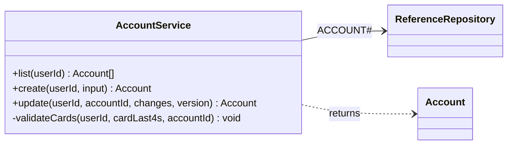

`validateCards` rejects a card that already belongs to another of the user's accounts
(`ValidationError`), because a card must route to exactly one account. An account's bank and
currency cannot change once transactions exist on it; the rest can be edited.

---
## 6. Module 02: Categorization and Rules

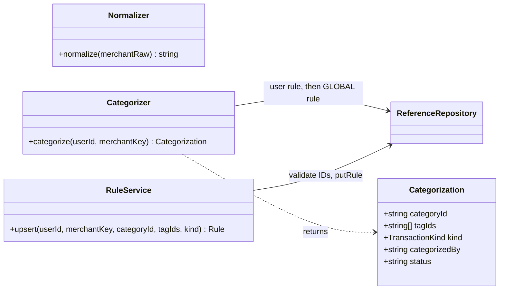

`Normalizer` lower-cases the merchant text, strips digits, store numbers, and padding, and
returns a stable `merchantKey` such as `automercado`. `Categorizer` returns
`categorizedBy = rule` for a user rule, `global` for a global rule, and status
`pending_review` with no category when nothing matches. It is deterministic. When the rule
that matched has a `kind`, `Categorization.kind` carries it and replaces the kind the template
derived (for example, a rule that files the BAC row `DTR:inversiones_hapi_VT` as a
`transfer`, because it is money sent to the user's own broker account). A manual entry keeps the kind the user picked. Category, tag, and kind
changes on an existing transaction go through `TransactionService.update` (section 4), and a
category set by the user (`categorizedBy = user`) is never replaced by a merge.

There is no catch-all: no rule and no fallback ever files a transaction under "Other" or any
other category on its own. A transaction that no rule settles stays without a category
("Uncategorized") and waits in the review inbox until the user decides.

### Catalog and settings

Categories, tags, and the user's settings are reference data that every other module reads:
the category select of a transaction, the filters of a budget, the labels of the dashboard.
These classes are how the user sees and extends them.

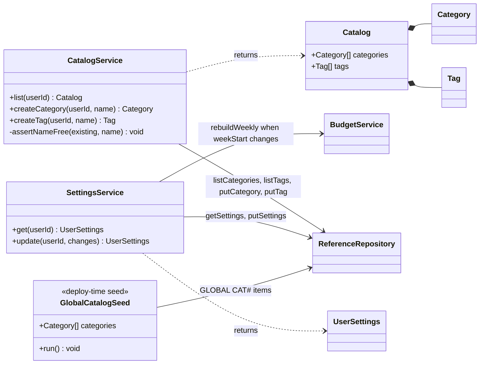

- **`CatalogService.list`** returns the global categories followed by the user's own, and the
  user's tags, each sorted by name, without archived entries. It is the one source for every
  category select and tag `ChipSelect` in the UI.
- **`createCategory` and `createTag`** write a `CAT#<id>` or `TAG#<id>` item under the user's
  partition with `scope = user` and a generated id. `assertNameFree` compares names without
  case or surrounding spaces against the global and the user's entries and throws
  `ConflictError` (409) when the name is taken. Renaming and archiving stay in the backlog
  with the rule editor (02-S04).
- **`SettingsService.get`** returns the `PROFILE` item, or the defaults (`timeZone`
  `America/Costa_Rica`, `weekStart` `MONDAY`) when the user has none yet. **`update`** writes
  it; when `weekStart` changed, it then calls `BudgetService.rebuildWeekly(userId)`, which
  rebuilds the rollups of every weekly budget with the same backfill as 03-S10, so the change
  takes effect at once.
- **`GlobalCatalogSeed`** writes the global categories below as `PK = GLOBAL`, `SK =
  CAT#<id>`, `scope = global` items when the stacks are deployed (see the
  [architecture](architecture.md)). It is idempotent: running it again overwrites the same
  items. There are no global tags; tags are always the user's own.

| Id | Name | | Id | Name |
|---|---|---|---|---|
| `groceries` | Groceries | | `education` | Education |
| `eating-out` | Eating out | | `entertainment` | Entertainment |
| `transport` | Transport | | `travel` | Travel |
| `fuel` | Fuel | | `health` | Health |
| `utilities` | Utilities | | `gifts-donations` | Gifts and donations |
| `phone-internet` | Phone and internet | | `bank-fees` | Bank fees |
| `subscriptions` | Subscriptions | | `income-interest` | Income and interest |
| `clothing` | Clothing | | `other` | Other |

"Other" is an ordinary category that only the user can choose. "Uncategorized" is not a
category: it is the name shown for a transaction whose `categoryId` is empty. The dashboard
shows both as muted last rows and never as its headline (section 2d).

---

## 7. Module 03: Budgets

```mermaid
classDiagram
    direction LR
    class BudgetService {
        +create(userId, input) Budget
        +update(userId, budgetId, changes) Budget
        +rebuildWeekly(userId) void
        -backfill(userId, budget) void
    }
    class BudgetMatcher {
        +matches(txn, budget) boolean
        +matching(txn, budgets) BudgetMatch[]
    }
    class BudgetMatch {
        +string budgetId
        +string periodStart
        +number limitCents
    }
    class PeriodCalculator {
        +periodStart(localDate, budget, weekStart) string
        +periods(budget, count, today) string[]
        +daysInPeriod(periodStart, budget) number
    }
    class BudgetAnalyticsService {
        +progress(userId, today) BudgetProgress[]
        +burndown(userId, budgetId, today) BurndownSeries
    }
    class BudgetProgress {
        +Budget budget
        +string periodStart
        +string periodEnd
        +number daysLeft
        +number spentCents
        +number limitCents
        +number remainingCents
        +number percent
        +number overByCents
        +number expectedCents
    }
    class BurndownSeries {
        +string[] dates
        +number[] cumulativeSpentCents
        +number[] paceCents
        +number limitCents
    }
    class ReferenceRepository
    class TransactionRepository
    class AggregateRepository
    BudgetService --> ReferenceRepository : validate IDs, BUDGET#
    BudgetService --> TransactionRepository : listByDate for backfill
    BudgetService --> AggregateRepository : replaceBudgetItems
    BudgetService --> BudgetMatcher
    BudgetService --> PeriodCalculator
    BudgetMatcher --> PeriodCalculator
    BudgetMatcher ..> BudgetMatch : returns
    BudgetAnalyticsService --> ReferenceRepository : listBudgets
    BudgetAnalyticsService --> AggregateRepository : P# and D# items
    BudgetAnalyticsService --> PeriodCalculator
    BudgetAnalyticsService ..> BudgetProgress : returns
    BudgetAnalyticsService ..> BurndownSeries : returns
```

`BudgetMatcher.matches` returns true when `txn.countsAsSpending()`, the transaction's
category is in `categoryIds` (or the list is empty), and it has any of `tagIds` (or the list
is empty). `BudgetProgress.percent` is `round(spent / limit × 100)` with no upper bound, so
an exceeded budget reads above 100. `BurndownSeries.paceCents` is the even-spending line,
`limit × day ÷ daysInPeriod`. The week-start day and time zone come from the user's settings.

`BudgetProgress.expectedCents` is the same even pace for today only, `round(limit ×
elapsedDays ÷ daysInPeriod)`, where `elapsedDays` counts today. It is the pace tick on the
budget's `Meter` and the basis of the card's pace sentence (section 2d). `periodStart`,
`periodEnd`, and `daysLeft` (days after today until the period ends) come from
`PeriodCalculator` and label the card. `BurndownSeries.dates` holds every date of the period,
`paceCents` has one value per date, and `cumulativeSpentCents` has one value per date up to
and including today (so it is shorter than `dates` until the period ends); the chart then
shows the rest of the period as empty and not as flat spending. `limitCents` is the limit
line.
`BudgetService.rebuildWeekly` runs `backfill` for each of the user's weekly budgets; it is
called only by `SettingsService` when the week-start day changes.

---
## 8. Module 04: Dashboard

```mermaid
classDiagram
    direction LR
    class SpendingAnalyticsService {
        +byCategory(userId, month) CategoryShare[]
        +byTag(userId, month) TagTotal[]
        +totals(userId, fromMonth, toMonth) MonthTotal[]
    }
    class CategoryShare {
        +string categoryId
        +string name
        +number expenseCents
        +number share
    }
    class TagTotal {
        +string tagId
        +string name
        +number expenseCents
        +number budgetLimitCents
    }
    class MonthTotal {
        +string month
        +number incomeCents
        +number expenseCents
    }
    class AggregateRepository
    class ReferenceRepository
    SpendingAnalyticsService --> AggregateRepository : MONTH# items
    SpendingAnalyticsService --> ReferenceRepository : category and tag names
    SpendingAnalyticsService ..> CategoryShare : returns
    SpendingAnalyticsService ..> TagTotal : returns
    SpendingAnalyticsService ..> MonthTotal : returns
```

`byCategory` keeps `Uncategorized` as its own row instead of dropping it. `totals` returns
one point per month in the range, filling months with no rollup item as zero, so a month
with no income shows as `$0` and not as a gap. Tag totals can overlap, because a transaction
with two tags counts in both.

---
## 9. Module 05: Multi-Currency

```mermaid
classDiagram
    direction LR
    class FxService {
        +toUsd(amountMinor, currency, localDate) UsdConversion
        -convert(amountMinor, rate) number
    }
    class FxRateProvider {
        <<interface>>
        +rateFor(date) FxRate
    }
    class BccrRateProvider {
        -string endpoint
        -string indicator
        -string token
        +rateFor(date) FxRate
        -buildUrl(fromDate, toDate) string
        -parseSeries(json) FxRate[]
    }
    class UsdConversion
    class FxRate
    class AggregateRepository
    class ParameterStore
    class FxUnavailableError
    FxRateProvider <|.. BccrRateProvider
    FxService --> FxRateProvider
    FxService --> AggregateRepository : FX# cache
    FxService ..> UsdConversion : returns
    FxService ..> FxUnavailableError : throws
    BccrRateProvider --> ParameterStore : /FinanceApp/bccr/*
    BccrRateProvider ..> FxRate : returns
```

- `FxService.toUsd` returns the amount unchanged with rate `1.0` for USD. For CRC it reads
  `FX#USD-CRC#<date>`, asks the provider on a cache miss, and stores the result.
- `convert` divides with exact integer arithmetic and rounds half-to-even to cents.
- `BccrRateProvider` reads `endpoint`, `indicator`, and `token` from Parameter Store once per
  Lambda container. `buildUrl` produces
  `{endpoint}/{indicator}/series?fechaInicio=yyyy/mm/dd&fechaFin=yyyy/mm/dd&idioma=ES`,
  with the query built by `URLSearchParams`. Every request sends the header
  `Authorization: Bearer <token>`.
- `parseSeries` reads `datos[0].series`, an array of `{ fecha, valorDatoPorPeriodo }` where
  `fecha` is the date and `valorDatoPorPeriodo` is the colones-per-dollar rate. A non-`200`
  status or an empty `series` array means no rate.
- When a date has no rate (weekend or holiday), the provider asks for the 7 days before and
  returns the latest earlier rate with its own `rateDate`.
- If BCCR cannot be reached and nothing is cached, `FxUnavailableError` (503) is thrown and
  the save is refused instead of using a guessed rate.

---
## 10. Module 07: Investments

### 10a. Recording, fees, and brokers

```mermaid
classDiagram
    direction LR
    class InvestmentService {
        +record(userId, input) InvestmentTransaction
        +correct(userId, id, changes) InvestmentTransaction
        +list(userId) InvestmentTransaction[]
        +monthlyFlows(userId, months) InvestmentMonthRollup[]
        -deriveCommission(broker, input) number
    }
    class HoldingCalculator {
        +applyBuy(holding, tx) Holding
        +applySell(holding, tx) SellResult
        +replay(trades) Holding
        +cashDelta(tx) number
    }
    class SellResult {
        +Holding holding
        +number costRemovedCents
        +number realizedGainCents
    }
    class FeeCalculator {
        <<shared/ pure functions>>
        +fee(fee, baseCents)$ number
        +grossUp(fee, netCents)$ number
        +suggest(broker, type, assetClass, baseCents)$ FeeSuggestion
        +explain(fee, baseCents)$ string
    }
    class FeeSuggestion {
        +number commissionCents
        +number netCents
        +string explanation
    }
    class BrokerService {
        +list(userId) Broker[]
        +create(userId, name, fees) Broker
        +update(userId, brokerId, fees, version) Broker
    }
    class Broker
    class InvestmentMonthRollup
    class InvestmentTxRepository
    class AggregateRepository
    class ReferenceRepository
    class DynamoStore
    InvestmentService ..> InvestmentMonthRollup : returns
    InvestmentService --> ReferenceRepository : broker and its fees
    InvestmentService --> FeeCalculator : commission when omitted
    InvestmentService --> InvestmentTxRepository : INV# items, ticker GSI
    InvestmentService --> AggregateRepository : HOLDING#, CASH#, MONTH#INV
    InvestmentService --> HoldingCalculator
    InvestmentService --> DynamoStore : transactWrite
    HoldingCalculator ..> SellResult : returns
    FeeCalculator ..> Broker : reads fees
    FeeCalculator ..> FeeSuggestion : returns
    BrokerService --> ReferenceRepository : BROKER#
```

**What each type records.** The browser shows only these fields per tab, and
`HoldingCalculator.cashDelta` applies the cash column.

| Type | User enters | Fee rule and base | Broker cash | Holding |
|---|---|---|---|---|
| `DEPOSIT` | Amount sent from the bank, **or** the amount that arrived at the broker | `fees.deposit` on the amount sent | + (sent − fee) | — |
| `BUY` | Ticker, asset class, units, gross value (units × price) | `fees.buy[assetClass]` on the gross value | − (gross + fee) | + units, + cost (gross + fee) |
| `SELL` | Holding, units, gross value | `fees.sell[assetClass]` on the gross value | + (gross − fee) | − units, − average cost |
| `WITHDRAWAL` | Amount taken out of the broker | `fees.withdrawal` on that amount | − amount (the bank receives amount − fee) | — |

**`FeeCalculator`** lives in `shared/` and is used by the browser for the live suggestion and
by `InvestmentService` when `commissionCents` is omitted, so both always agree:

- `fee(fee, base) = flatCents + roundHalfEven(base × percentBps ÷ 10000)`, in integer
  arithmetic. Example: Hapi's deposit fee of 1.55% on $300.00 is
  `0 + roundHalfEven(30000 × 155 ÷ 10000) = 465`, so $4.65.
- `grossUp(fee, net)` is the amount to send so that `net` arrives:
  `roundHalfEven((net + flatCents) × 10000 ÷ (10000 − percentBps))`. The fee is then
  `gross − net`. This is the deposit form's "amount that arrived" mode: 1.55% on an arrival
  of $295.35 gives $300.00 sent.
- `suggest` picks `Broker.feeFor(type, assetClass)`, applies `fee`, and returns the
  commission, the net amount, and `explain`'s sentence, for example
  "Hapi buy fee, crypto: 1% of $200.00 = $2.00" or "Hapi buy fee, stocks and ETFs: $0.15
  flat".

`InvestmentService.record` stores the commission the user typed with `commissionSource =
manual`, or derives it with `deriveCommission` and stores `commissionSource = rule`. Editing a
broker's fees never changes commissions already stored on past transactions.

- **Average cost.** `HoldingCalculator.applySell` removes
  `costBasis × soldQuantity ÷ quantity` and records `realizedGain = gross − commission −
  costRemoved`. The write is conditioned on `version` and on `quantityMicro ≥ sold`, so a
  sale larger than the holding is rejected with `ConflictError`.
- **Corrections.** `correct` updates the investment transaction, then `replay` rebuilds the
  holding from every trade for that ticker in date order, because an edited old trade changes
  the cost of every later sale.
- **Negative cash is allowed.** Buys recorded without the deposits that funded them leave
  `CASH#` below zero. Nothing is rejected; the portfolio shows the warning "Cash at Hapi is
  −$52.30. Record the deposits that paid for these buys."
- **Monthly flows.** `monthlyFlows(userId, months)` reads the `MONTH#<yyyy-mm>#INV` rollups
  that `record` already writes, for the last `months` months ending with the current one
  (`AggregateRepository.getInvestmentMonths`), and returns one `InvestmentMonthRollup` per
  month in date order, with a month that has no item as all zeros. It is read-only and is
  the data of the portfolio's "What I have put in" chart (07-S02a).

### 10b. Prices and valuation

```mermaid
classDiagram
    direction LR
    class ValuationService {
        +value(userId) Valuation
        +liquidation(userId) Liquidation
        +quote(ticker) Quote
    }
    class Valuation {
        +HoldingValue[] holdings
        +BrokerCash[] cash
        +number totalValueCents
        +number totalCostBasisCents
        +number unrealizedGainCents
        +number gainBps
        +string priceTime
        +string[] unpriced
    }
    class HoldingValue {
        +Holding holding
        +Price price
        +number marketValueCents
        +number unrealizedGainCents
        +number gainBps
        +number shareBps
        +string priceTime
        +boolean stale
    }
    class Liquidation {
        +BrokerExit[] brokers
        +number totalCents
        +string priceTime
        +string[] unpriced
    }
    class BrokerExit {
        +string brokerId
        +HoldingExit[] holdings
        +number cashCents
        +number grossCents
        +number sellFeesCents
        +number proceedsCents
        +number withdrawalFeeCents
        +string withdrawalFeeExplained
        +number netToBankCents
        +boolean negativeCash
    }
    class HoldingExit {
        +string ticker
        +number marketValueCents
        +number sellFeeCents
        +string sellFeeExplained
        +number netCents
        +number unrealizedGainCents
    }
    class PriceClient {
        +prices(tickers) Price[]
        +quote(ticker) Quote
        -refresh(ticker) Price
        -toUsd(quote) Price
    }
    class Quote {
        +string symbol
        +string name
        +string instrumentType
        +AssetClass assetClass
        +string currency
        +string price
        +string time
    }
    class MarketPriceProvider {
        <<interface>>
        +quote(symbol) Quote
    }
    class YahooChartPriceProvider {
        -string userAgent
        +quote(symbol) Quote
    }
    class TwelveDataPriceProvider {
        -string apiKey
        +supports(symbol) boolean
        +quote(symbol) Quote
    }
    class FallbackPriceProvider {
        -MarketPriceProvider[] providers
        +quote(symbol) Quote
    }
    class PriceError {
        +string code
        +string provider
        +number httpStatus
    }
    class FeeCalculator
    class AggregateRepository
    class ReferenceRepository
    class ParameterStore
    ValuationService --> AggregateRepository : HOLDING#, CASH#
    ValuationService --> ReferenceRepository : broker fees
    ValuationService --> PriceClient
    ValuationService --> FeeCalculator : sell and withdrawal fees
    ValuationService ..> Valuation : returns
    ValuationService ..> Liquidation : returns
    Valuation *-- HoldingValue
    Liquidation *-- BrokerExit
    BrokerExit *-- HoldingExit
    PriceClient --> AggregateRepository : PRICE# cache
    PriceClient --> MarketPriceProvider
    MarketPriceProvider <|.. YahooChartPriceProvider
    MarketPriceProvider <|.. TwelveDataPriceProvider
    MarketPriceProvider <|.. FallbackPriceProvider
    FallbackPriceProvider o-- MarketPriceProvider : tries in order
    TwelveDataPriceProvider --> ParameterStore : optional API key
    MarketPriceProvider ..> PriceError : throws
```

**Tickers.** A ticker is the symbol as Yahoo Finance shows it, upper-cased: `VT`, `VOO`,
`BRK-B`, `VWRA.L`, `SHOP.TO`, `7203.T`, mutual funds such as `VTSAX`, and crypto as
`BTC-USD`. The only rewrite is `/` to `-`, so `BTC/USD` is stored as `BTC-USD`. The ticker
field's hint says "as shown on Yahoo Finance, e.g. VT, BTC-USD, VWRA.L".

**`YahooChartPriceProvider`** is the primary provider. It needs no key and covers stocks,
ETFs, mutual funds, crypto, and exchanges outside the US.

- Request: `GET https://query1.finance.yahoo.com/v8/finance/chart/{encodeURIComponent(symbol)}?range=1d&interval=1d`
  with the header **`User-Agent: Mozilla/5.0`**. Without a browser-like `User-Agent` Yahoo
  answers `429`. Timeout 4 seconds.
- Success (`200`): read `chart.result[0].meta`: `regularMarketPrice` (number),
  `regularMarketTime` (Unix seconds), `currency` (e.g. `USD`, `CAD`, `JPY`, `GBp`),
  `instrumentType` (`ETF`, `EQUITY`, `MUTUALFUND`, `CRYPTOCURRENCY`, `CURRENCY`), and
  `longName`, else `shortName`.
- Unknown symbol: `404` with `{"chart":{"result":null,"error":{"code":"Not Found",...}}}` →
  `PriceError` `NOT_FOUND`. A `429`, a `5xx`, a timeout, or a body without
  `regularMarketPrice` → `PriceError` `UNAVAILABLE`.

**`TwelveDataPriceProvider`** is optional. `ServiceFactory` adds it only when the SSM
parameter `/FinanceApp/prices/twelvedata-api-key` exists. `supports(symbol)` is true for US
symbols (no `.` suffix) and for crypto pairs. Request:
`GET https://api.twelvedata.com/price?symbol={symbol}&apikey={key}`, with crypto written
`BTC/USD`. Success is `{"price":"348.63000"}`. Any body with `"status":"error"` (for example
`{"code":401,"message":"...","status":"error"}`) is a failure, whatever the HTTP status. This
endpoint returns no trade time, so a Twelve Data quote uses the time it was fetched as its
`time`.
`FallbackPriceProvider` asks Yahoo first and then each provider that supports the symbol,
and returns the first quote. It throws `NOT_FOUND` only when every provider said so.

**`PriceClient`**

- `prices(tickers)` batch-reads the `PRICE#` items. A price that `isFresh` (under 15 minutes
  old) is used as is. The others are refreshed, at most 4 at a time. A `NOT_FOUND` ticker is
  asked again at most once an hour.
- `toUsd(quote)`: a `USD` quote is stored as is. For another currency, divide by 100 first for
  quotes in minor units (`GBp` → GBP, `ZAc` → ZAR, `ILA` → ILS), then fetch the pair
  `USD{CUR}=X` from the same provider (`USDCAD=X`, `USDJPY=X`) and divide the price by it. The
  pair is cached as its own `PRICE#` item. If the pair cannot be fetched, the price fails with
  `UNSUPPORTED_CURRENCY`.
- `priceMicros = round(price × 10⁶)`. A holding's value is `quantityMicro × priceMicros ÷
  10¹⁰` cents (the product is in millionths of a unit times millionths of a dollar, so
  `÷ 10¹²` gives dollars and `÷ 10¹⁰` gives cents), computed with **`BigInt`** (half a
  bitcoin is already beyond `2^53` in that product) and rounded half-to-even.
- A successful refresh writes `PRICE#<ticker>` with `marketTime` (the quote's
  `regularMarketTime`), `retrievedAt`, and a **DynamoDB TTL of 30 days**. Freshness comes from `retrievedAt`, not from the TTL, so the last known price is
  still there to be shown, marked stale with its age, when a refresh fails. A failed refresh
  updates only `lastError` and `lastAttemptAt`.
- `quote(ticker)` is the Buy form's lookup (`GET /api/portfolio/quote`). It returns the
  `Quote` with the USD price and `assetClass` (`CRYPTO` when `instrumentType` is
  `CRYPTOCURRENCY`, otherwise `SECURITY`). `NOT_FOUND` becomes `NotFoundError` (404, "No
  instrument VTX on Yahoo Finance") and `UNAVAILABLE` becomes `PriceUnavailableError` (503).
  Neither blocks saving the transaction.
- Logs name the ticker, the provider, the HTTP status, and the error code, never amounts.

**Figures for the portfolio's tiles and charts.** `ValuationService.value` computes them so
the browser does no arithmetic. For each priced holding, `unrealizedGainCents =
marketValueCents − costBasisCents`, `gainBps = round(unrealizedGain × 10000 ÷ costBasis)` (0
when the cost basis is 0), and `shareBps = round(marketValue × 10000 ÷ totalValueCents)`.
`totalValueCents` and `totalCostBasisCents` sum the priced holdings only, so the total gain
(`unrealizedGainCents`, `gainBps`) compares like with like; an unpriced holding is in
neither. `cash` is the `CASH#` balance of each broker, shown under the holdings and not part
of the gain. These gains are before selling costs; what selling would cost is the
liquidation below.

**One price time.** A price has two times: when the market last traded it (`Quote.time`,
stored on the `PRICE#` item as `marketTime`) and when the product fetched it (`retrievedAt`). The user is
shown the **market time**, always with its date, in the profile's time zone: "Nov 11, 3:00
PM". `HoldingValue.priceTime` is that time for one holding. `Valuation.priceTime` and
`Liquidation.priceTime` are both the oldest market time among the prices used, so the
holdings table and the selling estimate can never show two different times for the same
price. `retrievedAt` only decides freshness; it is shown only for a stale price, as its age
("from 3 h ago").

**What the portfolio shows when a price is missing.** Each holding shows its price and the
price's time. A stale price shows its age ("price from 3 h ago"). A holding with no price at
all shows the reason from `lastError`: "VTX is not a Yahoo Finance ticker" for `NOT_FOUND`,
"price service unavailable, retrying" for `UNAVAILABLE`, or "prices in KRW are not supported"
for `UNSUPPORTED_CURRENCY`. Its ticker is listed in `unpriced` and it is left out of totals.

**Selling estimate (`liquidation`).** For each broker: every priced holding is sold with that
broker's sell fee for the holding's asset class (`netCents = marketValue − sellFee`), the
broker's cash is added (`proceedsCents = Σ netCents + cashCents`), and the withdrawal fee is
applied once to the proceeds when they are positive (`netToBankCents = proceeds −
withdrawalFee`). `totalCents` is the sum over brokers. Every deduction carries its
explanation, so the page can show how each number was reached. It is a before-tax figure and
never a recommendation. `grossCents` is `Σ marketValue + cashCents` and `sellFeesCents` is
`Σ sellFeeCents`, so `grossCents = netToBankCents + sellFeesCents + withdrawalFeeCents`: the
three parts of the broker's bar in "If I sold everything today" (section 2d).

---
## 11. Gmail Apps Script

The script runs in the user's own Google account, not in AWS. It is plain Apps Script
(JavaScript) and talks to the product only through the three `/ingest/gmail` routes.

```mermaid
classDiagram
    direction LR
    class GmailIngestScript {
        <<Apps Script>>
        -string apiBase
        +setup() void
        +run() void
        -fetchConfig() IngestConfig
        -findUnprocessed(senders) GmailMessage[]
        -send(message) number
        -markProcessed(message) void
        -heartbeat() void
    }
    class IngestConfig {
        +string[] senders
        +string label
    }
    class PropertiesService {
        <<Google>>
        +getScriptProperties() Properties
    }
    class GmailApp {
        <<Google>>
        +search(query) GmailThread[]
        +getUserLabelByName(name) GmailLabel
    }
    class UrlFetchApp {
        <<Google>>
        +fetch(url, options) HTTPResponse
    }
    class IngestRouter
    GmailIngestScript --> PropertiesService : ingest token
    GmailIngestScript --> GmailApp : search, label
    GmailIngestScript --> UrlFetchApp : HTTPS calls
    GmailIngestScript ..> IngestConfig : from config route
    UrlFetchApp ..> IngestRouter : /ingest/gmail
```

- `setup()` checks the token by calling `GET /ingest/gmail/config`, then creates a 5-minute
  time trigger for `run()`.
- `run()` searches for allowlisted senders without the `financeapp-processed` label, with the
  query `from:(notificacionbac@baccredomatic.cr OR bncontacto@bncr.fi.cr)
  -label:financeapp-processed` built from `IngestConfig.senders`, and sends each message's raw
  MIME (`getRawContent()`) to `POST /ingest/gmail`.
- A message is labelled only after a `2xx` response, so failures are retried on the next run.
  A `401` removes the trigger, because the token was revoked.
- Every run ends with `POST /ingest/gmail/heartbeat`, which keeps the connection from being
  marked stale during a week with no purchases.
- The token is read from `PropertiesService`, never written in the script source.
