# Class Diagram

## What this diagram shows

This is the class model needed to implement every in-scope
[sequence diagram](sequences/README.md). Every participant in a sequence diagram is a class
here, and every message is a method. The model is split into one diagram per layer or
module so each stays readable:

| Section | Contents |
|---|---|
| [1. Domain model](#1-domain-model) | Entities, value objects, enums, and how they relate |
| [2. Next.js layer](#2-nextjs-layer) | Pages, Server Actions (UI controllers), session handling, the typed API client |
| [3. API shell and data access](#3-api-shell-and-data-access) | Lambda entry points, routers, errors, configuration, repositories |
| [4. Transactions core](#4-transactions-core) | The single save path every source uses, and the rollup planner |
| [5. Module 01: Accounts and Ingestion](#5-module-01-accounts-and-ingestion) | Accounts, statement import, Gmail connection and ingest, bank templates, duplicates, review |
| [6. Module 02: Categorization and Rules](#6-module-02-categorization-and-rules) | Normalizer, categorizer, rules |
| [7. Module 03: Budgets](#7-module-03-budgets) | Budgets, matching, periods, progress |
| [8. Module 04: Dashboard](#8-module-04-dashboard) | Spending analytics |
| [9. Module 05: Multi-Currency](#9-module-05-multi-currency) | FX service and the BCCR rate provider |
| [10. Module 07: Investments](#10-module-07-investments) | Investment transactions, broker fee schedules, holdings, prices, valuation |
| [11. Gmail Apps Script](#11-gmail-apps-script) | The script that runs in the user's Google account |

Module 06 (Security and Data Control) has no classes of its own in this iteration. Its one
in-scope story, revoking the Gmail connection (06-S02), is handled by `ConnectionService` in
module 01.

## Why this diagram is valuable to the design

- **It is the build list.** A code generator can create one file per class and one function
  per method, and the sequence diagrams say in which order those methods are called.
- **It fixes the boundaries.** Routers only parse and validate, services hold the business
  rules, and repositories are the only classes that touch DynamoDB, S3, or SSM. Each rule
  of the design has exactly one class that owns it.
- **It makes reuse explicit.** All three ingestion routes end in `TransactionService`, and all
  rollup arithmetic is in `RollupPlanner`, so spending totals and budgets cannot drift apart.

## Conventions

- **Money is integer minor units.** `amountMinor` is in the original currency. Fields ending
  in `Cents` are USD cents. Quantities are `quantityMicro` (millionths of a unit) and market
  prices are `priceMicros` (millionths of a dollar). Percentages are `percentBps` (basis
  points, 1.55% = 155). No floating point is used for money; products that can exceed
  `2^53` use `BigInt`.
- **Code layout.** `shared/` holds the Zod schemas and types used by both the Next.js app and
  the API. `api/src/` holds routers, services, repositories, `keys.ts`, and factories. Both
  Lambdas (`ApiFn`, `ImportWorkerFn`) are built from the same `api/` bundle.
- **Dependency injection.** `ServiceFactory` builds each client, repository, and service once
  per Lambda container and passes dependencies through constructors. Services depend on
  interfaces where an external system is involved (`FxRateProvider`, `MarketPriceProvider`,
  `Clock`), so tests can pass fakes.
- **Arrows.** `-->` is "uses", `..|>` is "implements", `--|>` is "extends", `*--` is
  "contains", and multiplicities are written on the line. `$` marks a static method.

---
## 1. Domain model

These are the records stored in DynamoDB and passed between layers. Key formats are listed
in the [sequence diagram conventions](sequences/README.md#keys-and-indexes-used-in-these-diagrams).

### 1a. Spending, budgets, and currency

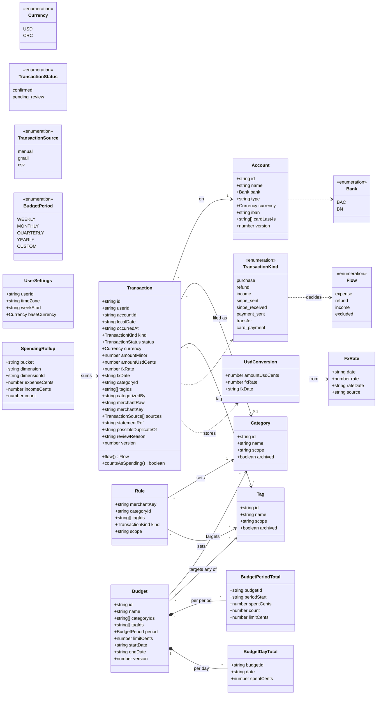

`amountMinor` is always positive. Which way the money moved, and whether it counts, follows
from the kind through `Transaction.flow()`:

| Kind | Meaning | Flow | Effect on rollups and budgets |
|---|---|---|---|
| `purchase` | Card purchase, bill, or any other spending | `expense` | Adds to `expenseCents` and matching budgets |
| `sinpe_sent` | SINPE Móvil payment to someone else | `expense` | Same as `purchase` |
| `payment_sent` | Bank transfer (TEF) to someone else's account | `expense` | Same as `purchase` |
| `refund` | Money back from a merchant | `refund` | Subtracts from `expenseCents` and matching budgets |
| `income` | Salary, interest, a client's payment | `income` | Adds to `incomeCents`; budgets untouched |
| `sinpe_received` | SINPE from someone else | `income` | Same as `income` |
| `transfer` | Between the user's own accounts, or to their broker | `excluded` | None |
| `card_payment` | Paying the user's own credit card | `excluded` | None |

`countsAsSpending()` is true for the `expense` and `refund` flows. `SpendingRollup` covers the
`DAY#`, `MONTH#`, `CAT#`, and `TAG#` items; `dimension` is `TOTAL`, `CAT`, or `TAG`.
`UserSettings` is the `PROFILE` item in `Reference`; `baseCurrency` is always `USD` in this
iteration, and `timeZone` (`America/Costa_Rica` by default) decides each transaction's
`localDate`.

`Account.iban` is optional: the account's Costa Rican IBAN (`CR` followed by 20 digits). A
Costa Rican IBAN contains the bank's local account number, so when a statement row names a
destination by its local number (BAC prints `TEF A : <number>`), the row is a transfer
between the user's own accounts if that number appears inside the IBAN of any account the
user registered. Nothing is specific to one user: a transfer to an account that is not
registered stays a payment (see
[bank formats](bank-formats.md#4-transaction-kind-from-a-statement-row)).
`Account.cardLast4s` lists the last four digits of every card linked to the account; card
alert emails name a card, never an account, so they are routed by these digits. `Rule.kind` is
optional; when set, it replaces the kind a template derived for that merchant (02-S05).

### 1b. Ingestion and investments

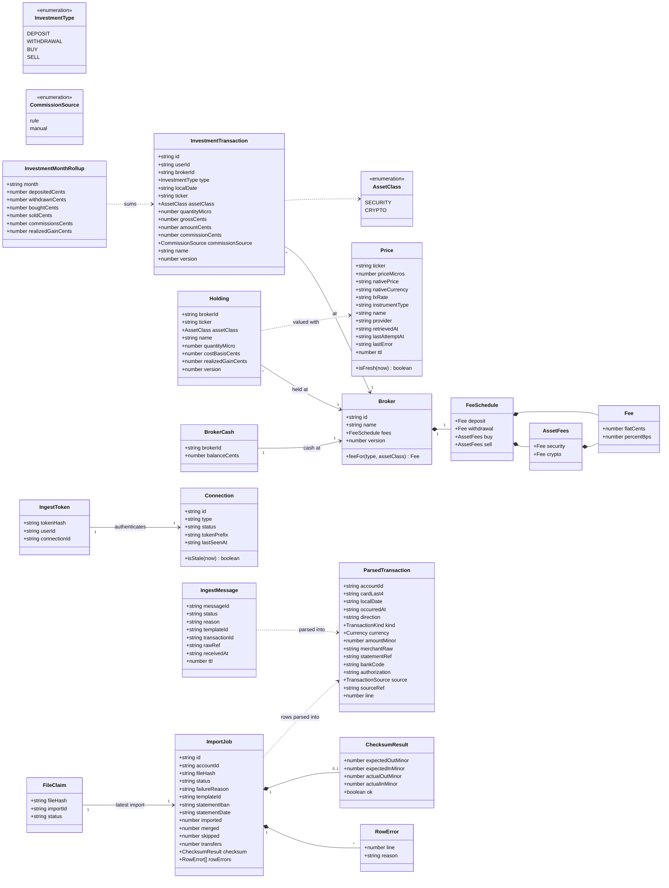

`ParsedTransaction` is what a template produces, before currency conversion, duplicate
matching, and categorization turn it into a `Transaction`. A statement row carries the
`accountId` chosen for the import and its `line` number; a card alert carries `cardLast4`
instead, which is resolved to an account. `direction` is `out` or `in`.

**Investment fields per type.** `DEPOSIT` and `WITHDRAWAL` use `amountCents` (the gross amount
sent to, or taken from, the broker). `BUY` and `SELL` use `ticker`, `assetClass`,
`quantityMicro`, and `grossCents` (units × price, before fees). Every type stores
`commissionCents`; `commissionSource` says whether it was derived from the broker's fee
schedule (`rule`) or typed by the user (`manual`).

**Fees.** A broker has one `Fee` per operation, and buys and sells have one per asset class:
`SECURITY` (stocks, ETFs, mutual funds) and `CRYPTO`. A `Fee` is a flat amount plus a
percentage: `percentBps` is basis points, so 1.55% is `155` (0 to 9999). Both default to 0.
`Broker.feeFor(type, assetClass)` picks the entry; `FeeCalculator` (section 10) does the
arithmetic.

**Prices.** `Price` is the shared `PRICE#<ticker>` item. `priceMicros` is the USD price ×
10⁶, so assets worth less than a cent are still exact. `nativePrice` and `nativeCurrency`
are what the provider quoted, and `fxRate` is the conversion used when that currency is not
USD. `isFresh(now)` is true when `retrievedAt` is under 15 minutes old; an older price is
shown as stale with its age. `lastError` is `NOT_FOUND`, `UNAVAILABLE`, or
`UNSUPPORTED_CURRENCY` from the latest failed attempt, so the UI can say why a price is
missing.

**Import records.** `FileClaim` is the `FILE#<sha256>` item: it points at the latest import
of that file and copies its status, so a file whose import `FAILED` can be uploaded again.
`ImportJob` keeps the statement's IBAN and date when the file states them (BAC),
the counts shown in the summary, and the result of comparing the imported totals with the
totals the bank printed in the file.

---
## 2. Next.js layer

Pages are React Server Components. Server Actions are the UI controllers: they read the
session, call the API through `ApiClient`, and return data or errors to the page.
`ApiClient` uses the request and response types from `shared/`, so the UI and `ApiFn` agree
on the contract.

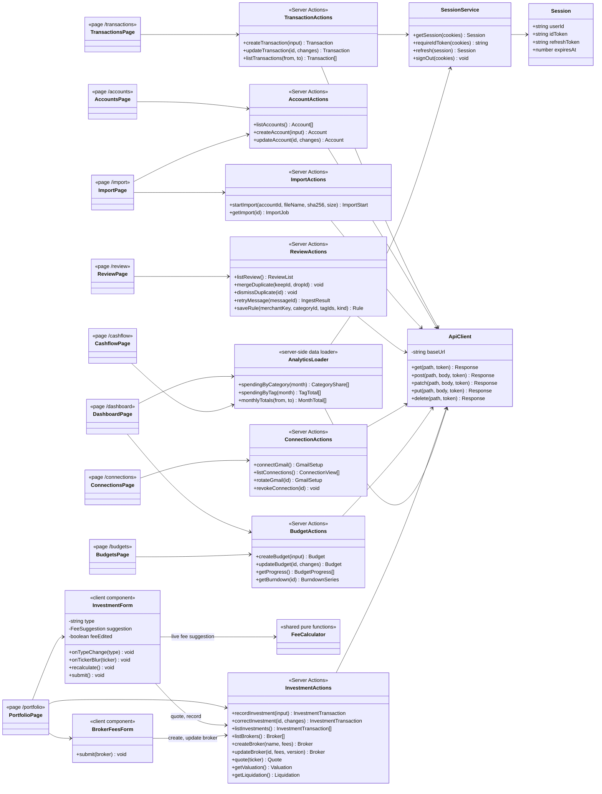

Every Server Action and the `AnalyticsLoader` call `SessionService` first; only one of those
edges is drawn to keep the diagram readable. `SessionService` keeps the Cognito tokens in
`HttpOnly`, `SameSite=Strict` cookies and gives `ApiClient` the ID token to send as a bearer
token, so browser JavaScript never sees it. The CSV upload itself goes from the browser
straight to S3 using the presigned form returned by `startImport`.

**Accounts page.** Lists the user's accounts and creates or edits one: name, bank (BAC or
Banco Nacional), currency, IBAN (optional), and the last four digits of each card
linked to it. The import page uses the same list for its account picker.

**Portfolio forms.** `PortfolioPage` loads the brokers and passes them to two client
components. `InvestmentForm` has one tab per investment type and shows only that type's
fields (section 10, table "What each type records"). It imports `FeeCalculator` from
`shared/`, the same code the API runs, and recalculates on every change of broker, type,
asset class, or amount: the commission field is filled with the suggestion and the line
under it explains it, for example "Hapi deposit fee: 1.55% of $300.00 = $4.65". If the user
edits the commission, `feeEdited` is set and the suggestion stops overwriting it; the request
then sends `commissionCents`, and otherwise omits it so the API derives it. On the Buy tab,
leaving the ticker field calls `quote(ticker)`: the form shows the instrument's name, type,
and live price, pre-selects the asset class (`CRYPTOCURRENCY` → crypto, anything else →
stocks and ETFs), and pre-fills the gross value with units × price, all editable. The
success message describes what was saved for that type (for a deposit: amount sent, fee,
and the cash credited at the broker) and is cleared when the tab changes. `BrokerFeesForm`
shows each broker's fee schedule as a table with one row per fee (deposit, withdrawal, buy
stocks and ETFs, buy crypto, sell stocks and ETFs, sell crypto) and two columns, flat USD
and % of amount.

---
## 3. API shell and data access

`ApiHandler` is the `ApiFn` entry point: one Powertools `Router` with one feature router
mounted per route prefix. `ImportWorkerHandler` is the `ImportWorkerFn` entry point for S3
events. The routers are the API controllers: they read `AuthContext`, validate the body
with the shared Zod schemas, call one service method, and return JSON.

### 3a. Entry points, routers, and errors

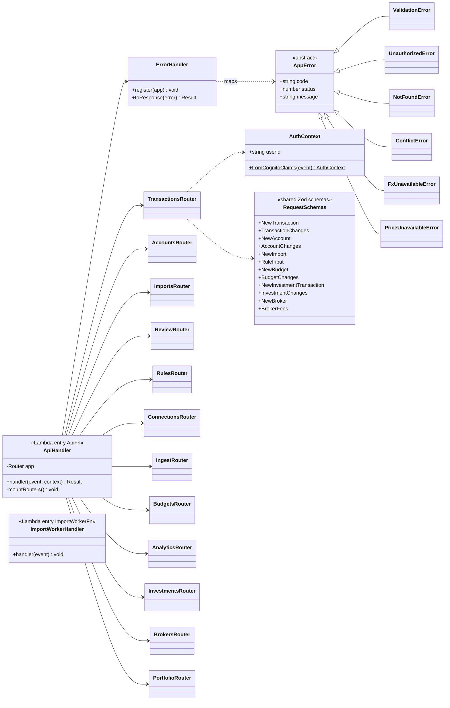

Every router uses `AuthContext` and `RequestSchemas` the way `TransactionsRouter` does; only
that pair of edges is drawn. `IngestRouter` is the exception: it has no Cognito claims and
authenticates the Gmail ingest token through `ConnectionService` instead.
`ErrorHandler` maps `ValidationError` to 400, `UnauthorizedError` to 401, `NotFoundError` to
404, `ConflictError` to 409, `FxUnavailableError` and `PriceUnavailableError` to 503, and
anything else to 500, always as `{code, message}`.

**Routes per router.** Each route calls the service method named in its sequence diagram.

| Router | Routes | Service |
|---|---|---|
| `TransactionsRouter` | `POST /api/transactions`, `GET /api/transactions`, `PATCH /api/transactions/{id}` | `TransactionService`, `TransactionQueryService` |
| `AccountsRouter` | `GET /api/accounts`, `POST /api/accounts`, `PATCH /api/accounts/{id}` | `AccountService` |
| `ImportsRouter` | `POST /api/imports`, `GET /api/imports/{id}` | `ImportService` |
| `ReviewRouter` | `GET /api/review`, `POST /api/review/duplicates/merge`, `POST /api/review/duplicates/dismiss`, `POST /api/review/messages/{messageId}/retry` | `ReviewService`, `TransactionService` |
| `RulesRouter` | `PUT /api/rules/{merchantKey}` | `RuleService` |
| `ConnectionsRouter` | `POST /api/connections/gmail`, `GET /api/connections`, `POST /api/connections/gmail/{id}/rotate`, `DELETE /api/connections/{id}` | `ConnectionService` |
| `IngestRouter` | `GET /ingest/gmail/config`, `POST /ingest/gmail`, `POST /ingest/gmail/heartbeat` | `ConnectionService`, `IngestPipeline` |
| `BudgetsRouter` | `POST /api/budgets`, `PATCH /api/budgets/{id}` | `BudgetService` |
| `AnalyticsRouter` | `GET /api/analytics/spending`, `GET /api/analytics/budgets`, `GET /api/analytics/budgets/{id}` | `SpendingAnalyticsService`, `BudgetAnalyticsService` |
| `InvestmentsRouter` | `POST /api/investments/transactions`, `GET /api/investments/transactions`, `PATCH /api/investments/transactions/{id}` | `InvestmentService` |
| `BrokersRouter` | `GET /api/brokers`, `POST /api/brokers`, `PUT /api/brokers/{id}` | `BrokerService` |
| `PortfolioRouter` | `GET /api/portfolio/valuation`, `GET /api/portfolio/liquidation`, `GET /api/portfolio/quote?ticker=` | `ValuationService` |

**Request bodies that changed.** `NewAccount` is `{name, bank, currency, iban?,
cardLast4s[]}`; `iban` is `CR` plus 20 digits (spaces removed, upper-cased) and each card entry
is exactly four digits. `NewInvestmentTransaction` is
`{type, brokerId, localDate, name?}` plus, for `DEPOSIT` and `WITHDRAWAL`, `amountCents`, and
for `BUY` and `SELL`, `ticker`, `assetClass`, `quantityMicro`, and `grossCents`.
`commissionCents` is **optional**: when it is missing the API derives it from the broker's fee
schedule. `NewBroker` is `{name, fees}` and `BrokerFees` is `{fees, version}`, where `fees` has
the `FeeSchedule` shape with every `flatCents` ≥ 0 and every `percentBps` from 0 to 9999.
`RuleInput` gains an optional `kind`.

### 3b. Configuration and factories

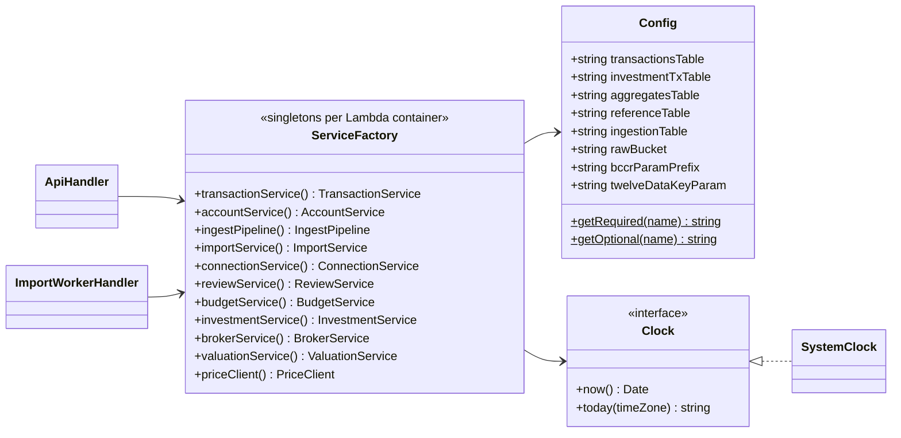

`Config.getRequired` throws at start-up if an environment variable is missing, so a
misconfigured Lambda fails on its first request instead of part way through one. Environment
variables hold table names, the bucket name, and SSM parameter names, never secret values.
`twelveDataKeyParam` (`/FinanceApp/prices/twelvedata-api-key`) is read with `getOptional`:
the primary price provider needs no key, and the fallback provider is only built when that
parameter exists in SSM.

### 3c. Repositories (database handlers)

Repositories are the only classes that call DynamoDB, S3, or SSM. There is one repository per
DynamoDB table, all built on `DynamoStore`, and every key is built by `Keys`. Methods ending
in `Item` return a `TransactItem` instead of writing, so a service can combine writes to
several tables in one `DynamoStore.transactWrite`.

```mermaid
classDiagram
    direction LR
    class DynamoStore {
        -DynamoDBDocumentClient client
        +get(table, key) Item
        +query(table, keyCondition, options) Page
        +put(table, item, condition) void
        +update(table, key, expression, condition) void
        +batchGet(table, keys) Item[]
        +batchWrite(table, puts, deletes) void
        +transactWrite(items) void
    }
    class Keys {
        <<keys.ts>>
        +user(userId)$ string
        +txn(date, id)$ string
        +inv(date, id)$ string
        +day(date)$ string
        +month(month, dimension, id)$ string
        +budgetPeriod(budgetId, periodStart)$ string
        +budgetDay(budgetId, date)$ string
        +holding(brokerId, ticker)$ string
        +cash(brokerId)$ string
        +fx(date)$ string
        +price(ticker)$ string
        +token(hash)$ string
        +account(id)$ string
        +broker(id)$ string
        +file(sha256)$ string
        +rowFingerprint(hash)$ string
        +message(messageId)$ string
    }
    class TransactionRepository {
        +get(userId, id) Transaction
        +listByDate(userId, from, to) Transaction[]
        +findNear(userId, accountId, from, to) Transaction[]
        +listReview(userId, reason) Transaction[]
        +putItem(txn) TransactItem
        +updateItem(txn, expectedVersion) TransactItem
        +deleteItem(txn) TransactItem
    }
    class InvestmentTxRepository {
        +get(userId, id) InvestmentTransaction
        +listByTicker(userId, ticker) InvestmentTransaction[]
        +putItem(tx) TransactItem
        +update(tx, expectedVersion) void
    }
    class AggregateRepository {
        +getMonth(userId, month, dimension) SpendingRollup[]
        +getMonths(userId, months) SpendingRollup[]
        +getBudgetPeriods(userId, keys) BudgetPeriodTotal[]
        +getBudgetDays(userId, budgetId, from, to) BudgetDayTotal[]
        +replaceBudgetItems(userId, budgetId, periods, days) void
        +addItems(deltas) TransactItem[]
        +getHoldings(userId) Holding[]
        +getCash(userId) BrokerCash[]
        +putHolding(userId, holding, expectedVersion) void
        +getFxRate(date) FxRate
        +putFxRate(rate) void
        +getPrices(tickers) Price[]
        +putPrice(price) void
    }
    class ReferenceRepository {
        +getSettings(userId) UserSettings
        +getAccount(userId, id) Account
        +listAccounts(userId) Account[]
        +findAccountByCard(userId, last4) Account
        +putAccount(userId, account) void
        +updateAccount(userId, account, expectedVersion) void
        +getCategories(userId, ids) Category[]
        +getTags(userId, ids) Tag[]
        +getRule(scope, merchantKey) Rule
        +putRule(userId, rule) void
        +listBudgets(userId) Budget[]
        +putBudget(userId, budget) void
        +updateBudget(userId, budget, expectedVersion) void
        +getBroker(userId, id) Broker
        +listBrokers(userId) Broker[]
        +putBroker(userId, broker) void
        +updateBroker(userId, broker, expectedVersion) void
    }
    class IngestionRepository {
        +claimFile(userId, sha256, importId) boolean
        +setFileStatus(userId, sha256, status) void
        +claimMessage(userId, messageId) boolean
        +rowClaimItem(userId, fingerprint, importId) TransactItem
        +putImport(userId, job) void
        +updateImport(userId, job) void
        +getImport(userId, id) ImportJob
        +getMessage(userId, messageId) IngestMessage
        +updateMessage(userId, message) void
        +listUnparsed(userId) IngestMessage[]
        +messageStats(userId, since) DeliveryStats
        +getToken(hash) IngestToken
        +listConnections(userId) Connection[]
        +writeConnection(connection, putToken, deleteToken) void
        +touchConnection(userId, connectionId, at) void
    }
    class RawObjectStore {
        +putRawEmail(userId, messageId, mime) string
        +presignCsvUpload(userId, importId, maxBytes) PresignedPost
        +getObject(key) Uint8Array
    }
    class ParameterStore {
        +getParameters(prefix) Map
    }
    TransactionRepository --> DynamoStore
    InvestmentTxRepository --> DynamoStore
    AggregateRepository --> DynamoStore
    ReferenceRepository --> DynamoStore
    IngestionRepository --> DynamoStore
    TransactionRepository ..> Keys
    InvestmentTxRepository ..> Keys
    AggregateRepository ..> Keys
    ReferenceRepository ..> Keys
    IngestionRepository ..> Keys
```

The `claim...` methods are conditional puts with `attribute_not_exists` and return `false`
when the item already exists. They are how the pipeline makes every source idempotent.
`claimFile` is the one exception: its condition is `attribute_not_exists(PK) OR #status =
:failed`, so a file whose last import failed can be claimed again for a new import.
`rowClaimItem` does not write: it returns the conditional put of `ROWFP#<hash>` so that
`TransactionService` writes it in the same `TransactWriteItems` as the transaction, and a row
is marked as imported only if its transaction was saved. `findAccountByCard` queries the
user's `ACCOUNT#` items and returns the one whose `cardLast4s` contains `last4` (a user has
few accounts, so no index is needed). `messageStats` counts the user's `MSG#` items by
status since a date. Repositories strip `PK` and `SK` before returning items, so services
never see key strings.

---
## 4. Transactions core

Manual entry, Gmail alerts, and CSV rows all end in `TransactionService`. It converts to USD,
categorizes, matches budgets, and asks `RollupPlanner` for every rollup change, then writes
the transaction and all rollups in one `TransactWriteItems`. Updates and merges subtract the
old contribution and add the new one in the same call, guarded by `version`.

`save` is called by `IngestPipeline` with a categorization it has already done; `create` is
the manual-entry path and categorizes itself. `RollupPlanner` follows `Transaction.flow()`
(section 1a): `expense` adds to `expenseCents` and matching budgets, `refund` subtracts from
them, `income` adds to `incomeCents` only, and `excluded` touches no rollup. When the
`version` condition fails, `TransactionService` re-reads and retries once, then throws
`ConflictError`. A missing rate makes `FxService` throw `FxUnavailableError` and nothing is
written.

`extraItems` are conditional writes to other tables that must succeed or fail together with
the transaction; the CSV pipeline passes the row's `ROWFP#` claim. If the transaction is
cancelled because one of those conditions failed, `save` throws `AlreadyClaimedError` (not an
HTTP error), and the pipeline counts the row as already imported. Because the claim and the
transaction are one write, a row that failed for another reason, such as a missing exchange
rate, is not claimed and imports when the file is uploaded again.

---
## 5. Module 01: Accounts and Ingestion

### 5a. CSV import and the shared pipeline

`IngestPipeline` handles both CSV statements and Gmail emails. Each source is claimed
(`FILE#`, `ROWFP#`, `MSG#`), so a repeat delivery is skipped. Templates are declarative
config objects; the two parsers are generic and interpret them. **Every template, its sample
file, and the exact result it must produce are in [Bank Formats](bank-formats.md)**; the
four supported templates are `bac-transacciones-mes` and `bn-consulta-saldos` (statements)
and `bac-notificacion` and `bn-voucher-digital` (card alert emails).

**`processCsv` step by step.**

1. Read `IMPORT#` (for `accountId`) and the account, then the object's bytes.
   `CsvReader.decode` tries UTF-8 and falls back to Windows-1252.
2. `TemplateRegistry.detect(lines)` tries each CSV template's detection rule against the
   first lines. `extract` reads the preamble (if the layout is `sectioned`), the data rows
   with their line numbers, and the bank's printed totals.
3. `checkFile` returns a failure reason when no template matched, the template's bank is not
   the account's bank, the file's currency is not the account's currency, or the detail
   header is not the expected one. The import is then `FAILED` with that reason, and
   `FILE#` is set to `FAILED` so the file can be uploaded again.
4. For each row: `parseRow` → `ParsedRowSchema.validate` (a failure becomes a `RowError` with
   the line number and reason) → `KindResolver.resolve` (with the IBANs of all the user's
   accounts and the preamble's holder name) → `Normalizer` → `Categorizer` (a user rule may
   replace the kind) → `FxService.toUsd` → `DuplicateMatcher` → `TransactionService.save` or
   `merge`, passing `rowClaimItem` as an extra item. `AlreadyClaimedError` counts the row as
   skipped. Rows whose kind is `transfer` are counted in `transfers` as well as `imported`.
5. Compare the imported out and in totals with the printed totals into `ChecksumResult`,
   then write `IMPORT#` (`DONE`, counts, row errors, checksum) and set `FILE#` to `DONE`.

`rowFingerprint` is the SHA-256 of `accountId | templateId | localDate | statementRef |
amountMinor | direction`; the row's position in the file is not part of it, so an overlapping
statement downloaded later skips the rows already imported.

**`processEmail`.** `TemplateRegistry.match` picks the template by sender and subject,
`DkimVerifier` checks the signature against its `dkimDomain`, `EmailTemplateParser.parse`
turns the HTML into text and reads the fields, and `ReferenceRepository.findAccountByCard`
resolves the card to an account. A missing field, an unknown transaction type, or an unknown
card leaves the message `unparsed` with a reason (`FIELD_MISSING:<field>`,
`UNKNOWN_TYPE:<type>`, `UNKNOWN_CARD:<last4>`).

`DuplicateMatch.type` is `exact` (merge into the existing transaction), `near` (save with
`possibleDuplicateOf` set), or `none`. The match key is the original amount, the account, and
a date window of the same day when a statement gives the transaction date. Templates live in
code under `api/src/ingest/templates/`. The golden tests read the redacted samples in
`docs/samples/` and assert the results listed in [Bank Formats](bank-formats.md).

### 5b. Gmail connection and review inbox

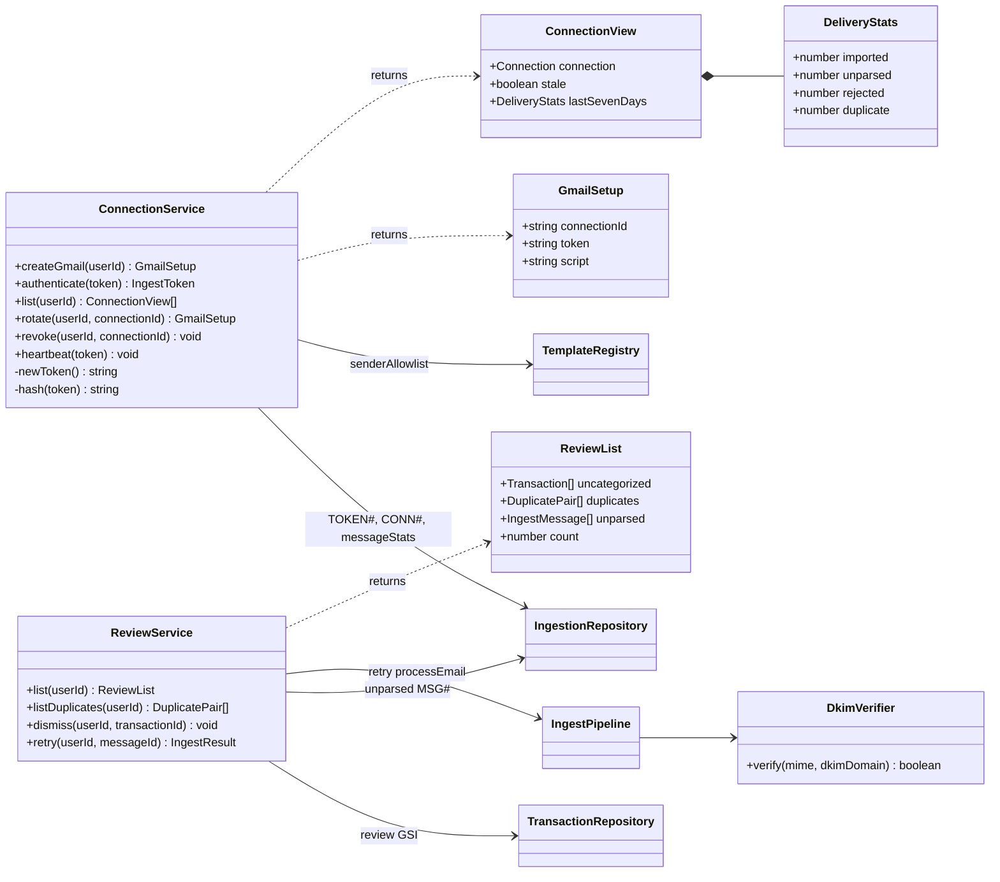

`ConnectionService.authenticate` hashes the bearer token and looks up `TOKEN#<sha256>`. A
revoked token has no item, so the lookup fails and `IngestRouter` returns `401`. The token is
returned only once, from `createGmail` or `rotate`, and is never stored or logged.
`isStale(now)` on `Connection` compares `lastSeenAt` with a 24-hour threshold (01-S09).
`ConnectionView.lastSevenDays` counts the emails received in the last 7 days by outcome, so
the Connections page shows, for example, "12 imported, 1 not understood, 0 rejected" and a
problem with a template or with DKIM is visible instead of silent.

`DkimVerifier.verify` passes when at least one valid signature's `d=` equals `dkimDomain` or
is a subdomain of it; other signatures on the same email are ignored. `ReviewList.unparsed`
shows each message's reason in words ("Card ending 1111 isn't linked to an account").
`ReviewService.retry` reads the `MSG#` item and calls `processEmail` again with its stored
`rawRef`, after the `MSG#` status is reset, so an email can be processed once its card has
been added to an account or a template has been fixed.

### 5c. Accounts

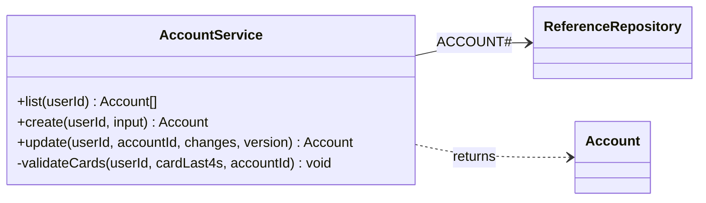

`validateCards` rejects a card that already belongs to another of the user's accounts
(`ValidationError`), because a card must route to exactly one account. An account's bank and
currency cannot change once transactions exist on it; the rest can be edited.

---
## 6. Module 02: Categorization and Rules

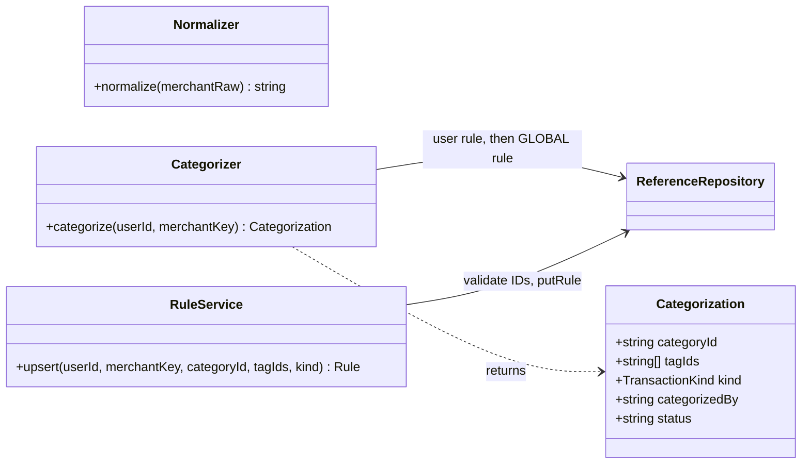

`Normalizer` lower-cases the merchant text, strips digits, store numbers, and padding, and
returns a stable `merchantKey` such as `automercado`. `Categorizer` returns
`categorizedBy = rule` for a user rule, `global` for a global rule, and status
`pending_review` with no category when nothing matches. It is deterministic. When the rule
that matched has a `kind`, `Categorization.kind` carries it and replaces the kind the template
derived (for example, a rule that files the BAC row `DTR:inversiones_hapi_VT` as a
`transfer`, because it is money sent to the user's own broker account). A manual entry keeps the kind the user picked. Category, tag, and kind
changes on an existing transaction go through `TransactionService.update` (section 4), and a
category set by the user (`categorizedBy = user`) is never replaced by a merge.

---

## 7. Module 03: Budgets

`BudgetMatcher.matches` returns true when `txn.countsAsSpending()`, the transaction's
category is in `categoryIds` (or the list is empty), and it has any of `tagIds` (or the list
is empty). `BudgetProgress.percent` is `round(spent / limit × 100)` with no upper bound, so
an exceeded budget reads above 100. `BurndownSeries.paceCents` is the even-spending line,
`limit × day ÷ daysInPeriod`. The week-start day and time zone come from the user's settings.

---
## 8. Module 04: Dashboard

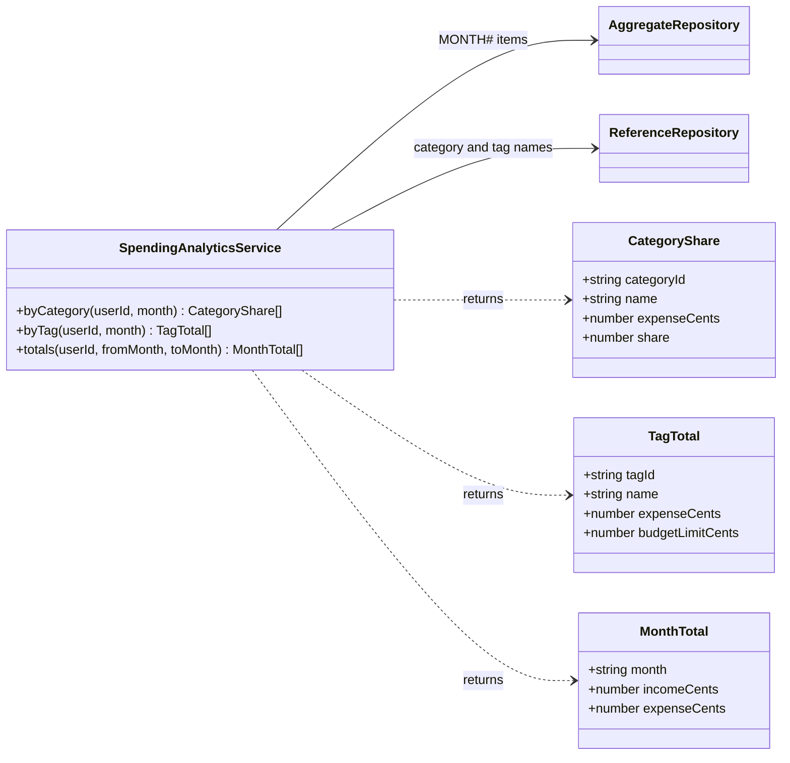

`byCategory` keeps `Uncategorized` as its own row instead of dropping it. `totals` returns
one point per month in the range, filling months with no rollup item as zero, so a month
with no income shows as `$0` and not as a gap. Tag totals can overlap, because a transaction
with two tags counts in both.

---
## 9. Module 05: Multi-Currency

- `FxService.toUsd` returns the amount unchanged with rate `1.0` for USD. For CRC it reads
  `FX#USD-CRC#<date>`, asks the provider on a cache miss, and stores the result.
- `convert` divides with exact integer arithmetic and rounds half-to-even to cents.
- `BccrRateProvider` reads `endpoint`, `indicator`, and `token` from Parameter Store once per
  Lambda container. `buildUrl` produces
  `{endpoint}/{indicator}/series?fechaInicio=yyyy/mm/dd&fechaFin=yyyy/mm/dd&idioma=ES`,
  with the query built by `URLSearchParams`. Every request sends the header
  `Authorization: Bearer <token>`.
- `parseSeries` reads `datos[0].series`, an array of `{ fecha, valorDatoPorPeriodo }` where
  `fecha` is the date and `valorDatoPorPeriodo` is the colones-per-dollar rate. A non-`200`
  status or an empty `series` array means no rate.
- When a date has no rate (weekend or holiday), the provider asks for the 7 days before and
  returns the latest earlier rate with its own `rateDate`.
- If BCCR cannot be reached and nothing is cached, `FxUnavailableError` (503) is thrown and
  the save is refused instead of using a guessed rate.

---
## 10. Module 07: Investments

### 10a. Recording, fees, and brokers

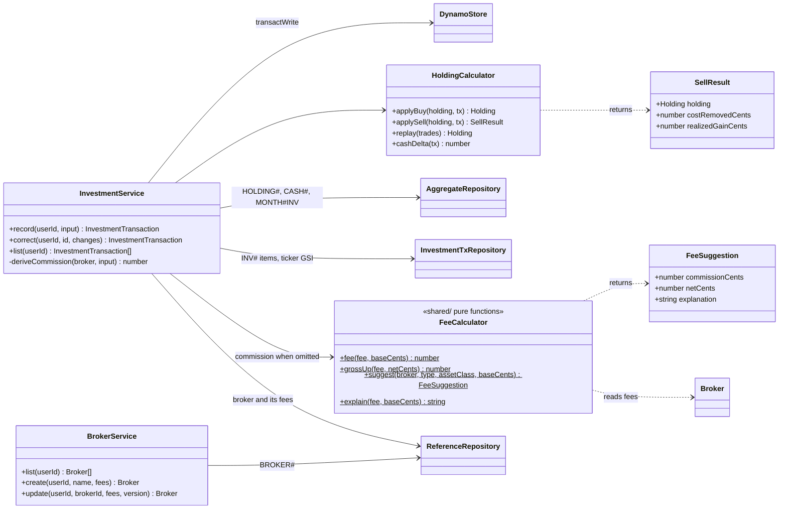

**What each type records.** The browser shows only these fields per tab, and
`HoldingCalculator.cashDelta` applies the cash column.

| Type | User enters | Fee rule and base | Broker cash | Holding |
|---|---|---|---|---|
| `DEPOSIT` | Amount sent from the bank, **or** the amount that arrived at the broker | `fees.deposit` on the amount sent | + (sent − fee) | — |
| `BUY` | Ticker, asset class, units, gross value (units × price) | `fees.buy[assetClass]` on the gross value | − (gross + fee) | + units, + cost (gross + fee) |
| `SELL` | Holding, units, gross value | `fees.sell[assetClass]` on the gross value | + (gross − fee) | − units, − average cost |
| `WITHDRAWAL` | Amount taken out of the broker | `fees.withdrawal` on that amount | − amount (the bank receives amount − fee) | — |

**`FeeCalculator`** lives in `shared/` and is used by the browser for the live suggestion and
by `InvestmentService` when `commissionCents` is omitted, so both always agree:

- `fee(fee, base) = flatCents + roundHalfEven(base × percentBps ÷ 10000)`, in integer
  arithmetic. Example: Hapi's deposit fee of 1.55% on $300.00 is
  `0 + roundHalfEven(30000 × 155 ÷ 10000) = 465`, so $4.65.
- `grossUp(fee, net)` is the amount to send so that `net` arrives:
  `roundHalfEven((net + flatCents) × 10000 ÷ (10000 − percentBps))`. The fee is then
  `gross − net`. This is the deposit form's "amount that arrived" mode: 1.55% on an arrival
  of $295.35 gives $300.00 sent.
- `suggest` picks `Broker.feeFor(type, assetClass)`, applies `fee`, and returns the
  commission, the net amount, and `explain`'s sentence, for example
  "Hapi buy fee, crypto: 1% of $200.00 = $2.00" or "Hapi buy fee, stocks and ETFs: $0.15
  flat".

`InvestmentService.record` stores the commission the user typed with `commissionSource =
manual`, or derives it with `deriveCommission` and stores `commissionSource = rule`. Editing a
broker's fees never changes commissions already stored on past transactions.

- **Average cost.** `HoldingCalculator.applySell` removes
  `costBasis × soldQuantity ÷ quantity` and records `realizedGain = gross − commission −
  costRemoved`. The write is conditioned on `version` and on `quantityMicro ≥ sold`, so a
  sale larger than the holding is rejected with `ConflictError`.
- **Corrections.** `correct` updates the investment transaction, then `replay` rebuilds the
  holding from every trade for that ticker in date order, because an edited old trade changes
  the cost of every later sale.
- **Negative cash is allowed.** Buys recorded without the deposits that funded them leave
  `CASH#` below zero. Nothing is rejected; the portfolio shows the warning "Cash at Hapi is
  −$52.30: record the deposits that paid for these buys".

### 10b. Prices and valuation

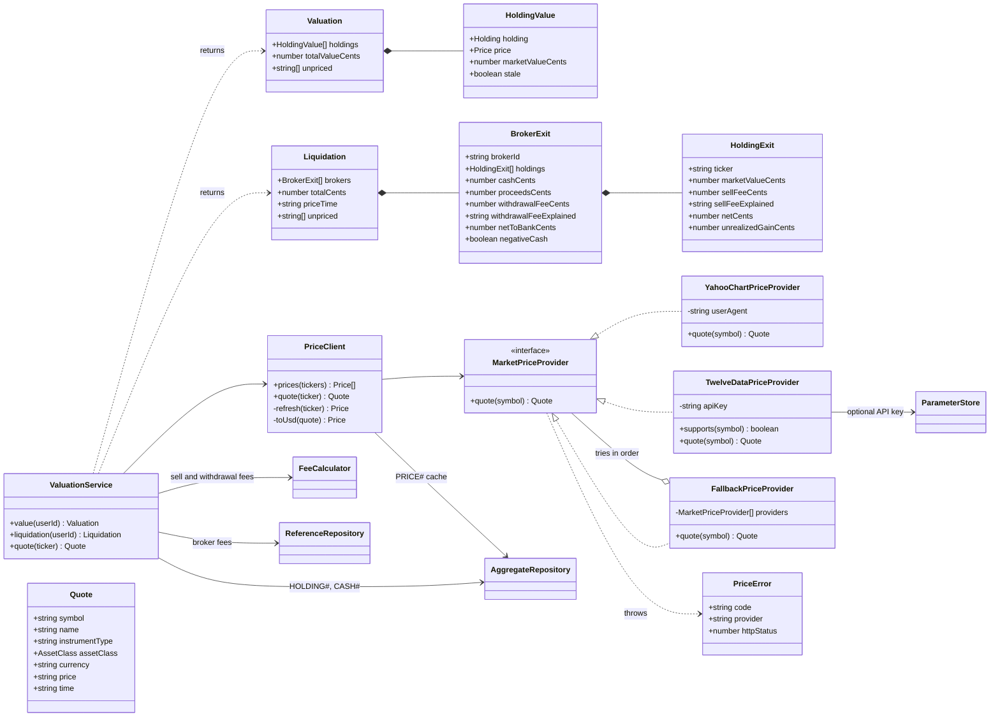

**Tickers.** A ticker is the symbol as Yahoo Finance shows it, upper-cased: `VT`, `VOO`,
`BRK-B`, `VWRA.L`, `SHOP.TO`, `7203.T`, mutual funds such as `VTSAX`, and crypto as
`BTC-USD`. The only rewrite is `/` to `-`, so `BTC/USD` is stored as `BTC-USD`. The ticker
field's hint says "as shown on Yahoo Finance, e.g. VT, BTC-USD, VWRA.L".

**`YahooChartPriceProvider`** is the primary provider. It needs no key and covers stocks,
ETFs, mutual funds, crypto, and exchanges outside the US.

- Request: `GET https://query1.finance.yahoo.com/v8/finance/chart/{encodeURIComponent(symbol)}?range=1d&interval=1d`
  with the header **`User-Agent: Mozilla/5.0`**. Without a browser-like `User-Agent` Yahoo
  answers `429`. Timeout 4 seconds.
- Success (`200`): read `chart.result[0].meta`: `regularMarketPrice` (number),
  `regularMarketTime` (Unix seconds), `currency` (e.g. `USD`, `CAD`, `JPY`, `GBp`),
  `instrumentType` (`ETF`, `EQUITY`, `MUTUALFUND`, `CRYPTOCURRENCY`, `CURRENCY`), and
  `longName`, else `shortName`.
- Unknown symbol: `404` with `{"chart":{"result":null,"error":{"code":"Not Found",...}}}` →
  `PriceError` `NOT_FOUND`. A `429`, a `5xx`, a timeout, or a body without
  `regularMarketPrice` → `PriceError` `UNAVAILABLE`.

**`TwelveDataPriceProvider`** is optional. `ServiceFactory` adds it only when the SSM
parameter `/FinanceApp/prices/twelvedata-api-key` exists. `supports(symbol)` is true for US
symbols (no `.` suffix) and for crypto pairs. Request:
`GET https://api.twelvedata.com/price?symbol={symbol}&apikey={key}`, with crypto written
`BTC/USD`. Success is `{"price":"348.63000"}`. Any body with `"status":"error"` (for example
`{"code":401,"message":"...","status":"error"}`) is a failure, whatever the HTTP status.
`FallbackPriceProvider` asks Yahoo first and then each provider that supports the symbol,
and returns the first quote. It throws `NOT_FOUND` only when every provider said so.

**`PriceClient`**

- `prices(tickers)` batch-reads the `PRICE#` items. A price that `isFresh` (under 15 minutes
  old) is used as is. The others are refreshed, at most 4 at a time. A `NOT_FOUND` ticker is
  asked again at most once an hour.
- `toUsd(quote)`: a `USD` quote is stored as is. For another currency, divide by 100 first for
  quotes in minor units (`GBp` → GBP, `ZAc` → ZAR, `ILA` → ILS), then fetch the pair
  `USD{CUR}=X` from the same provider (`USDCAD=X`, `USDJPY=X`) and divide the price by it. The
  pair is cached as its own `PRICE#` item. If the pair cannot be fetched, the price fails with
  `UNSUPPORTED_CURRENCY`.
- `priceMicros = round(price × 10⁶)`. A holding's value is `quantityMicro × priceMicros ÷
  10¹²` cents, computed with **`BigInt`** (half a bitcoin is already beyond `2^53` in that
  product) and rounded half-to-even.
- A successful refresh writes `PRICE#<ticker>` with `retrievedAt` and a **DynamoDB TTL of
  30 days**. Freshness comes from `retrievedAt`, not from the TTL, so the last known price is
  still there to be shown, marked stale with its age, when a refresh fails. A failed refresh
  updates only `lastError` and `lastAttemptAt`.
- `quote(ticker)` is the Buy form's lookup (`GET /api/portfolio/quote`). It returns the
  `Quote` with the USD price and `assetClass` (`CRYPTO` when `instrumentType` is
  `CRYPTOCURRENCY`, otherwise `SECURITY`). `NOT_FOUND` becomes `NotFoundError` (404, "No
  instrument VTX on Yahoo Finance") and `UNAVAILABLE` becomes `PriceUnavailableError` (503).
  Neither blocks saving the transaction.
- Logs name the ticker, the provider, the HTTP status, and the error code, never amounts.

**What the portfolio shows when a price is missing.** Each holding shows its price and the
price's time. A stale price shows its age ("price from 3 h ago"). A holding with no price at
all shows the reason from `lastError`: "VTX is not a Yahoo Finance ticker" for `NOT_FOUND`,
"price service unavailable, retrying" for `UNAVAILABLE`, or "prices in KRW are not supported"
for `UNSUPPORTED_CURRENCY`. Its ticker is listed in `unpriced` and it is left out of totals.

**Selling estimate (`liquidation`).** For each broker: every priced holding is sold with that
broker's sell fee for the holding's asset class (`netCents = marketValue − sellFee`), the
broker's cash is added (`proceedsCents = Σ netCents + cashCents`), and the withdrawal fee is
applied once to the proceeds when they are positive (`netToBankCents = proceeds −
withdrawalFee`). `totalCents` is the sum over brokers. Every deduction carries its
explanation, so the page can show how each number was reached. It is a before-tax figure and
never a recommendation.

---
## 11. Gmail Apps Script

The script runs in the user's own Google account, not in AWS. It is plain Apps Script
(JavaScript) and talks to the product only through the three `/ingest/gmail` routes.

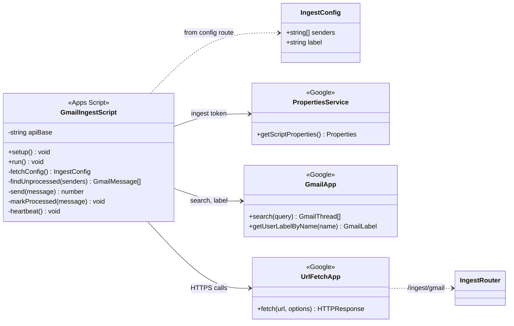

- `setup()` checks the token by calling `GET /ingest/gmail/config`, then creates a 5-minute
  time trigger for `run()`.
- `run()` searches for allowlisted senders without the `financeapp-processed` label, with the
  query `from:(notificacionbac@baccredomatic.cr OR bncontacto@bncr.fi.cr)
  -label:financeapp-processed` built from `IngestConfig.senders`, and sends each message's raw
  MIME (`getRawContent()`) to `POST /ingest/gmail`.
- A message is labelled only after a `2xx` response, so failures are retried on the next run.
  A `401` removes the trigger, because the token was revoked.
- Every run ends with `POST /ingest/gmail/heartbeat`, which keeps the connection from being
  marked stale during a week with no purchases.
- The token is read from `PropertiesService`, never written in the script source.
