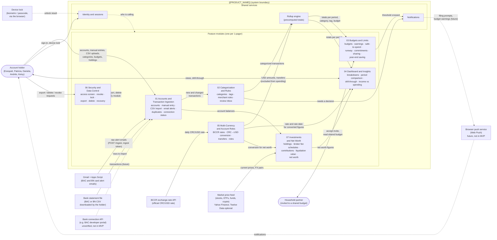

# Context Model

## What this diagram shows

The context model draws the boundary of `{{PRODUCT_NAME}}`. Inside the boundary are its
modules; outside it are the people and external systems it exchanges data with. Each arrow
is a flow of data across the boundary or between modules, labelled with what moves.

There is one module per initiative in [`../one-pagers/`](../one-pagers/), so every user
story has exactly one home. Three shared services sit underneath them because several
modules depend on them: identity, notifications, and the rollup engine that keeps totals
precomputed.

Where the design deliberately differs from a one-pager, this model follows the design:
transactions carry one category and any number of tags (budgets are set per category
and/or tags); totals are kept in USD, with CRC amounts converted at the BCCR rate of the
transaction date and the original amount kept on the transaction; and a duplicate that
arrives from both Gmail and a CSV statement is merged automatically, with near matches
flagged for review.

## Diagram

**Legend:** rounded nodes are people; rectangles outside the boundary are external systems;
solid arrows are data flows; dashed arrows are optional, future, or cross-cutting flows.

## Modules

| Module | Responsibility | Stories |
|---|---|---|
| 01 Accounts and Transaction Ingestion | Holds the holder's accounts (bank, currency, IBAN, linked cards). Brings transactions in by manual entry, CSV statement import, and bank alert emails from Gmail, all through one template-based parsing pipeline that reads BAC Credomatic and Banco Nacional formats ([Bank Formats](bank-formats.md)). Recognizes transfers between the holder's own accounts, merges exact duplicates across sources, flags near matches for review, and reports when the Gmail connection has gone quiet. | 01-S02 to 01-S09 |
| 02 Categorization and Rules | Gives each transaction one category and any number of tags, applies the user's merchant rules, and sends anything no rule settles to the review inbox. Corrections become rules. | 02-S01 to 02-S07 |
| 03 Budgets and Limits | Weekly, monthly, quarterly, yearly, and custom budgets per category and/or tags (any of the tags), with progress, burn-down, and history views, plus warnings, safe-to-spend, runway, commitments, shared household budgets, and the year-end saving figure. | 03-S01 to 03-S12 |
| 04 Dashboard and Insights | The read-only views: where the money went, period comparisons, category and tag breakdowns, drill-through to transactions, per-person household split, and income against spending. | 04-S01 to 04-S06 |
| 05 Multi-Currency and Account Roles | Uses USD as the base currency. CRC amounts are converted at the BCCR rate of the transaction date; the original amount and the rate are kept on the transaction. Excludes transfers between the holder's own accounts and card payments from spending, and records account roles. | 05-S01 to 05-S06 |
| 06 Security and Data Control | One screen of everything the product can access, immediate revocation, idle lock, full export, verified deletion, and account recovery. | 06-S01 to 06-S06 |
| 07 Investments and Net Worth | Manually entered holdings, broker fee schedules (deposit, withdrawal, and buy and sell fees per asset class), contributions with suggested and overridable fees, liquidation value at live prices net of sell and withdrawal fees, and net worth. | 07-S01 to 07-S06 |

**Shared services**

- **Identity and sessions** authenticates the holder and the household partner and tells
  every module who is calling, so sharing rules can be enforced in one place.
- **Notifications** shows budget warnings (03) and pending reviews (02) inside the app.
  Delivery through Web Push is planned for a later iteration.
- **Rollup engine** keeps totals per period, category, tag, budget, and account current in
  the same write as each transaction, so dashboards and budgets read stored numbers instead
  of recomputing them.

## External entities

| Entity | Direction | What crosses the boundary |
|---|---|---|
| Account holder | In and out | Entries, uploads, settings, and every view. Represents all five personas the one-pagers' stories are written for. |
| Household partner | In and out | Accepts an invitation and reads only the shared budget and its attributed transactions (03-S07 to 03-S09). |
| Gmail + Apps Script | In | Raw BAC and Banco Nacional card alert emails, sent with a revocable ingest token. |
| Bank statement file | In | CSV rows the holder downloaded from BAC Credomatic or Banco Nacional. |
| Bank connection API | In (future) | Transactions through an institution-issued token. Shown dashed because 01-S08 is unverified and not part of the MVP. |
| BCCR exchange-rate API | In | The official CRC/USD rate, fetched daily and cached per date. |
| Market price feed | In | Current prices for stocks, ETFs, mutual funds, and crypto, plus exchange rates for quotes not in USD. The Yahoo Finance chart API is the primary source (no key); Twelve Data is an optional fallback. |
| Browser push service | Out (future) | Filing prompts and budget warnings. Shown dashed because Web Push is not part of the MVP. |
| Device lock | In | The browser's biometric or passcode check (06-S03). |

## Why this model is valuable to the design

- **It fixes the boundary.** Banks, BCCR, Gmail, and the price feed are outside the system,
  so their failures are something the product must degrade around (stale rates, stale
  prices, stale connections) rather than something it can fix.
- **It gives every story one owner.** The class diagram groups classes by these modules,
  and each sequence diagram starts from the module that owns its story.
- **It makes cross-module dependencies explicit.** Budgets and the dashboard depend on the
  rollup engine; net worth depends on currency conversion; security reaches every module.
  These are the places where a one-shot code generator is most likely to miss a connection.
- **It shows what is deliberately not in the MVP.** The bank connection API and Web Push
  are drawn but dashed, so their absence is a recorded decision rather than an oversight.
