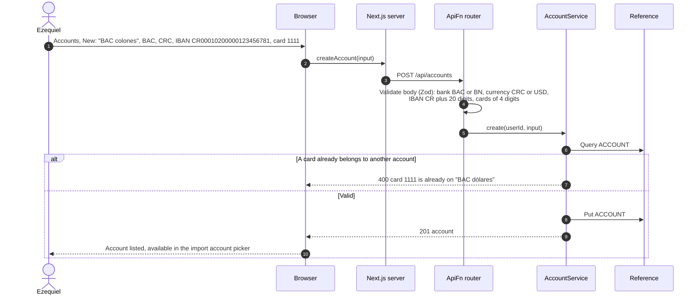
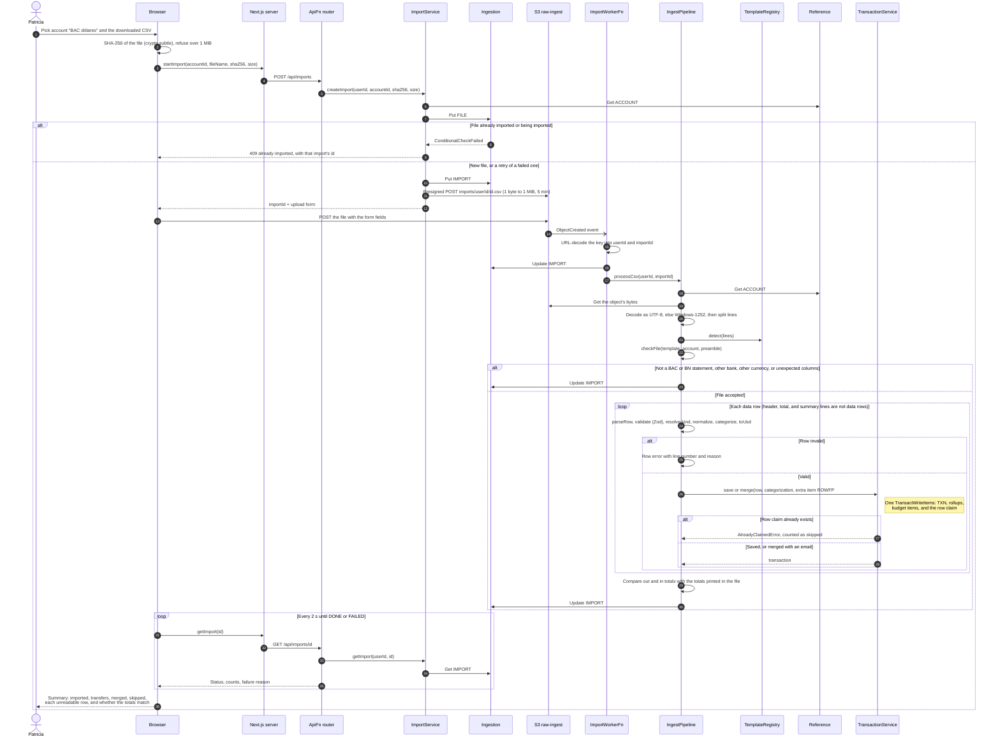
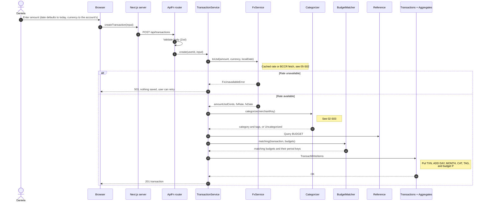
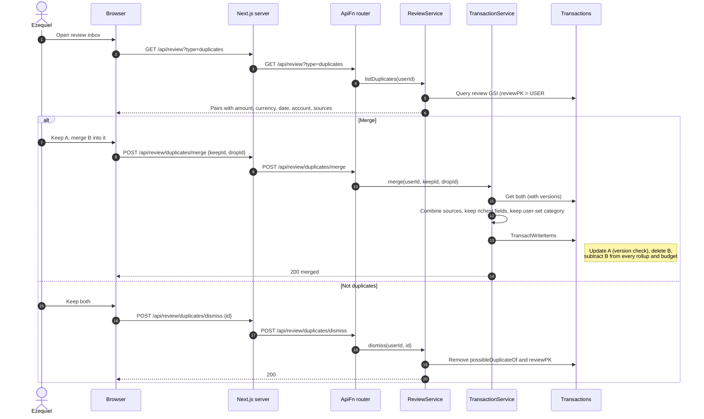
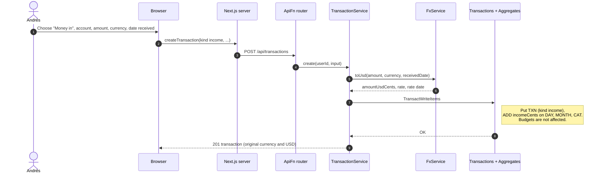
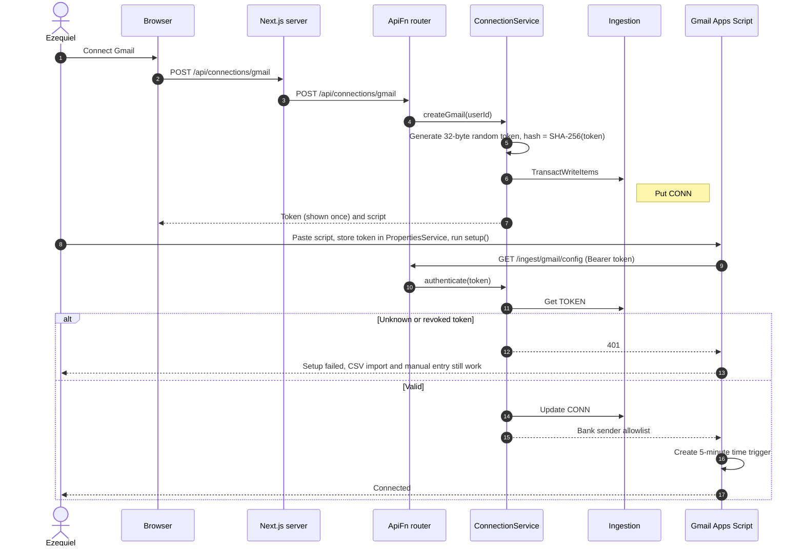
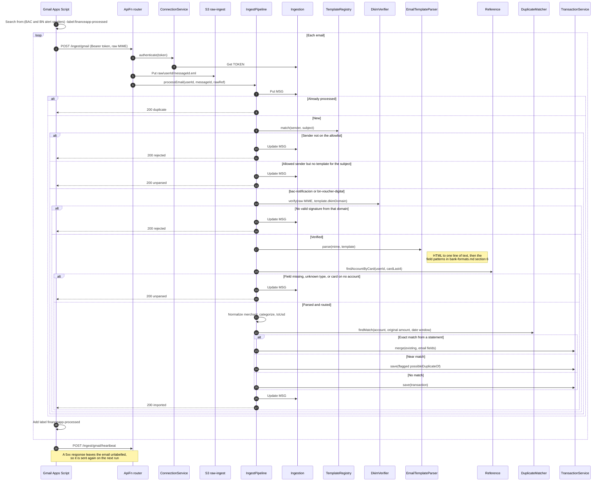
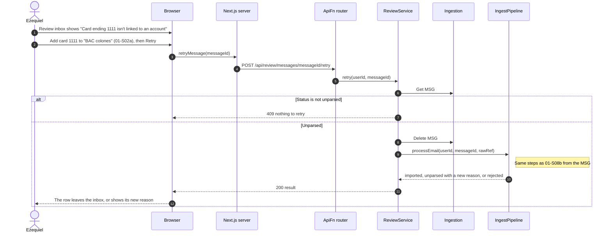
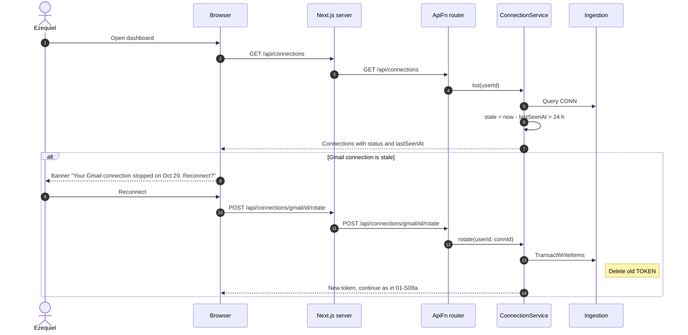

# 01 Accounts and Transaction Ingestion — Sequence Diagrams

Module 01 of the [context model](../context.md). These diagrams cover every way a
transaction enters the system: manual entry, CSV statements, and bank alert emails from
the Gmail script. All three end in the same `TransactionService.save` path (see the
[conventions](README.md#conventions)), so categorization, rollups, and budgets never need a
separate code path per source.

Two banks are supported, **BAC Credomatic** and **Banco Nacional**. The exact layout of their
statement files and alert emails, the rules that read them, and the result expected from
each redacted sample are in [Bank Formats](../bank-formats.md). The diagrams below name
those rules but do not repeat them.

---

### 01-S02a — Register an account

**Story (supporting 01-S02 and 01-S08):** As Ezequiel, I want to register each of my bank
accounts with its bank, currency, number, and cards so that statements import into the right
account and card alerts find their account.

An account is needed before anything can be imported. Its IBAN lets a statement row such as
`TEF A : 123456781` be recognized as a transfer to one of the user's own accounts (the local
number appears inside the IBAN), and its
cards route alert emails, which name a card and never an account.

Editing an account (`PATCH /api/accounts/id`, with its version) follows the same checks, for
example to add a new card's last four digits.

---

### 01-S02 — Import a CSV statement

**Story:** As Patricia, I want to import a statement file I downloaded from my bank so that
I can use the product without giving it access to my account.

The browser uploads the file straight to S3 with a presigned POST, so the file never passes
through a Lambda. The bucket's CORS rule allows `POST` from the app's CloudFront domain and
from `http://localhost:3000`, and its event notification (prefix `imports/`, suffix `.csv`)
starts `ImportWorkerFn`, which runs the same `IngestPipeline` that emails use. The file is
matched to a bank template, checked against the chosen account, and then each row is saved
independently: a bad row is reported with its line number and reason while the rest import.

Re-running an import is safe: a row is claimed by its fingerprint in the same write that
saves its transaction, so rows that were saved are skipped and rows that failed (for
example because no exchange rate was available) import on the next try. Importing the BAC
sample into "BAC dólares" gives 65 rows, of which 58 are transfers between the holder's own
accounts, and totals that match the bank's (see
[Bank Formats](../bank-formats.md#5-import-checks-and-expected-results)).

---

### 01-S03 — Add a transaction by hand

**Story:** As Daniela, I want to add a transaction by hand in a few seconds so that I can
record a cash payment before I forget it.

---

### 01-S04 — Review possible duplicates

**Story:** As Ezequiel, I want to be shown transactions that look like duplicates of each
other so that I can keep one record per purchase when the same charge arrives by two
routes.

Exact matches between an email and a statement row are merged by the pipeline (01-S08b).
Near matches (same account and date window, different amount) are saved with
`possibleDuplicateOf` and wait in the review inbox for Ezequiel to decide.

---

### 01-S05 — Record incoming money

**Story:** As Andrés, I want to record a payment that has arrived from a client so that I
can have money coming in counted as well as money going out.

Income uses the same save path with `kind = income`. Rollups add it to `incomeCents`
instead of `expenseCents`, so it never appears as spending.

---

### 01-S08a — Connect Gmail

**Story:** As Ezequiel, I want to authorise a connection to an institution that supports
one so that I can have its transactions arrive without my typing them.

The connection is the Gmail Apps Script. The product never sees a Gmail or bank password.
It issues a random ingest token, stores only its hash, and the token can be revoked at any
time (06-S02).

### 01-S08b — Gmail delivers a bank alert

Every 5 minutes the script sends new BAC and BN alert emails. An email is labelled as
processed only after a `2xx`, so a failed call is retried on the next run. The template
decides which DKIM domain must have signed the email, and the card's last four digits decide
the account.

The BAC sample becomes a ₡2,000.00 `purchase` at `FM ESC AVENIDA ESCAZU` on the account
holding card 1111; the BN sample becomes a ₡113.00 `purchase` at `TRANSPORTES JACO CENTRAL
CR` on the account holding card 2222.

### 01-S08c — Retry an email that was not understood

**Story (supporting 01-S08):** As Ezequiel, I want to retry an alert the product could not
read once I have fixed the cause so that I don't have to type that purchase by hand.

The usual cause is a card that is not on any account yet. The raw email is still stored in
S3, so after the card is added (01-S02a) the same email is processed again.

---

### 01-S09 — Detect a stale connection

**Story:** As Ezequiel, I want to be told when a connection has stopped working so that I
can notice before I rely on figures that quietly stopped updating.

Staleness is computed when the app opens, from the heartbeat the script sends on every run,
so a week without purchases does not look like a broken connection.

