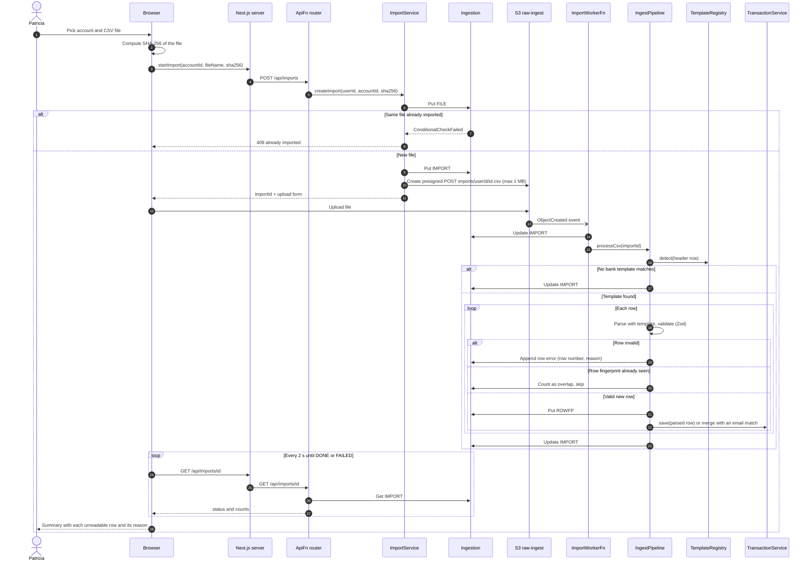
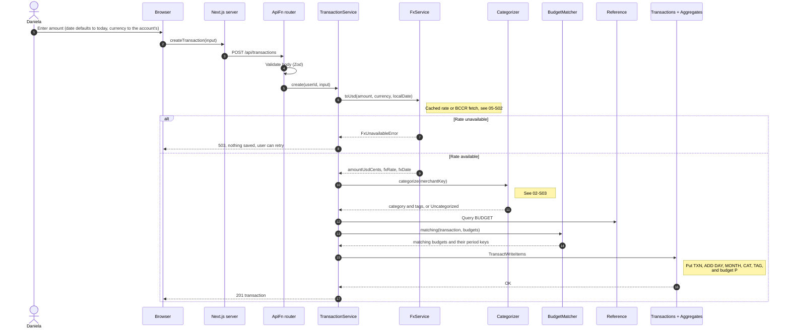
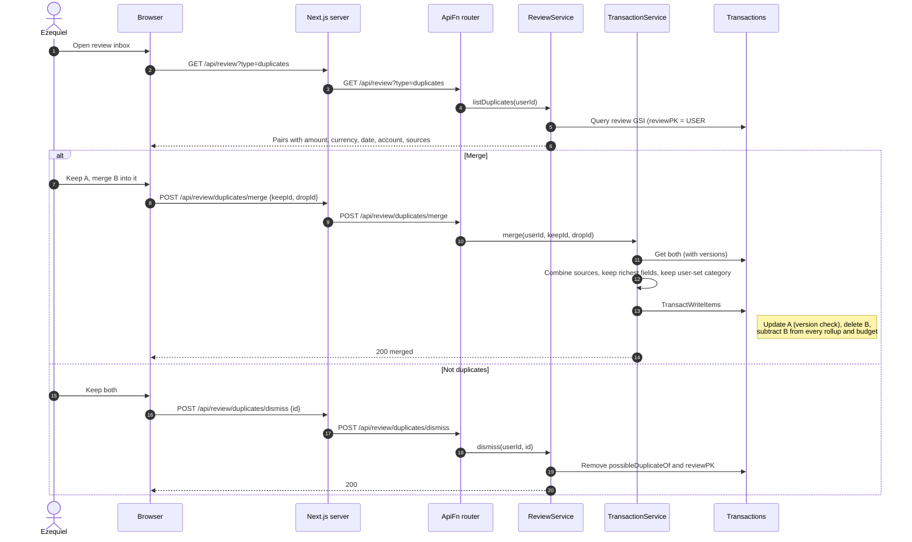
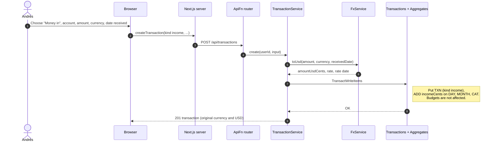
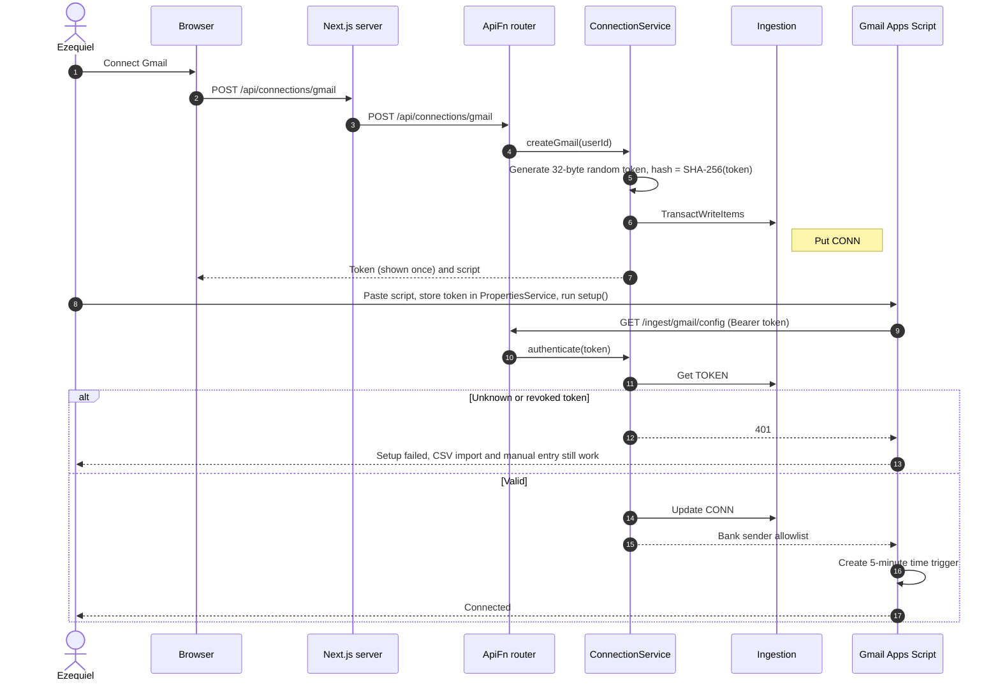
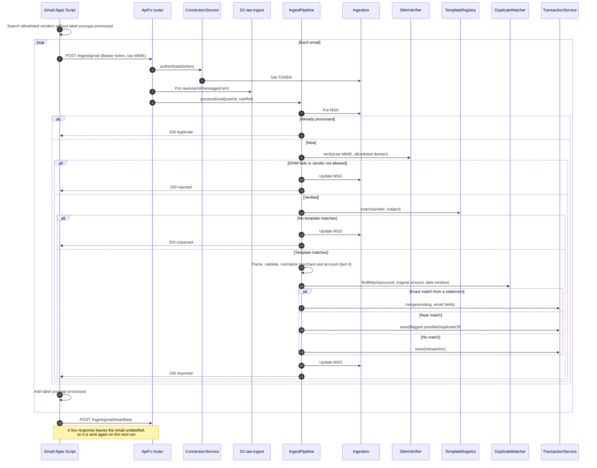
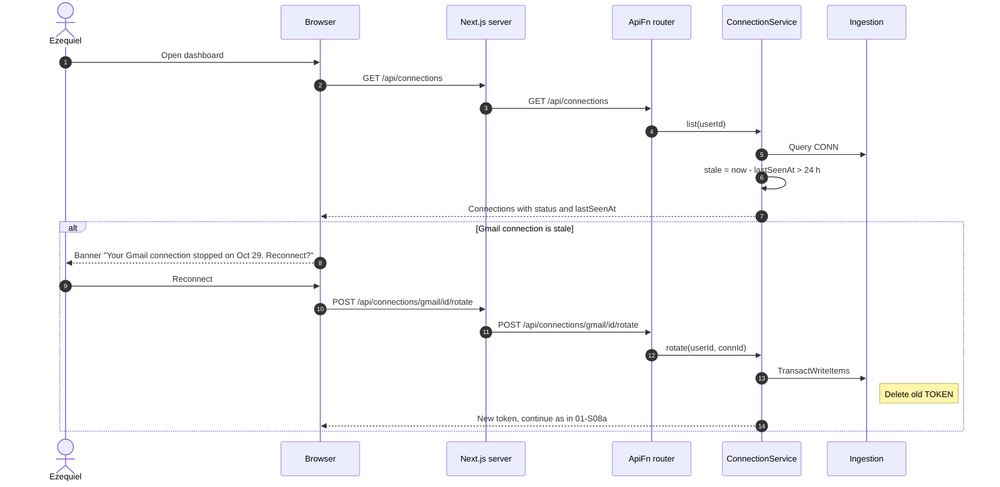

# 01 Accounts and Transaction Ingestion — Sequence Diagrams

Module 01 of the [context model](../context.md). These diagrams cover every way a
transaction enters the system: manual entry, CSV statements, and bank alert emails from
the Gmail script. All three end in the same `TransactionService.save` path (see the
[conventions](README.md#conventions)), so categorization, rollups, and budgets never need a
separate code path per source.

---

### 01-S02 — Import a CSV statement

**Story:** As Patricia, I want to import a statement file I downloaded from my bank so that
I can use the product without giving it access to my account.

The browser uploads the file straight to S3 with a presigned POST, so the file never passes
through a Lambda. The S3 event starts `ImportWorkerFn`, which runs the same `IngestPipeline`
that emails use. The file is matched to a bank template by its header row. Each row is
saved independently, and a bad row is reported with its reason while the rest import.

Re-running a failed import is safe because every row is keyed by its fingerprint, so an
interrupted import resumes rather than creating duplicates.

---

### 01-S03 — Add a transaction by hand

**Story:** As Daniela, I want to add a transaction by hand in a few seconds so that I can
record a cash payment before I forget it.

---

### 01-S04 — Review possible duplicates

**Story:** As Ezequiel, I want to be shown transactions that look like duplicates of each
other so that I can keep one record per purchase when the same charge arrives by two
routes.

Exact matches between an email and a statement row are merged by the pipeline (01-S08b).
Near matches (same account and date window, different amount) are saved with
`possibleDuplicateOf` and wait in the review inbox for Ezequiel to decide.

---

### 01-S05 — Record incoming money

**Story:** As Andrés, I want to record a payment that has arrived from a client so that I
can have money coming in counted as well as money going out.

Income uses the same save path with `kind = income`. Rollups add it to `incomeCents`
instead of `expenseCents`, so it never appears as spending.

---

### 01-S08a — Connect Gmail

**Story:** As Ezequiel, I want to authorise a connection to an institution that supports
one so that I can have its transactions arrive without my typing them.

The connection is the Gmail Apps Script. The product never sees a Gmail or bank password.
It issues a random ingest token, stores only its hash, and the token can be revoked at any
time (06-S02).

### 01-S08b — Gmail delivers a bank alert

Every 5 minutes the script sends new bank emails. An email is labelled as processed only
after a `2xx`, so a failed call is retried on the next run.

---

### 01-S09 — Detect a stale connection

**Story:** As Ezequiel, I want to be told when a connection has stopped working so that I
can notice before I rely on figures that quietly stopped updating.

Staleness is computed when the app opens, from the heartbeat the script sends on every run,
so a week without purchases does not look like a broken connection.

