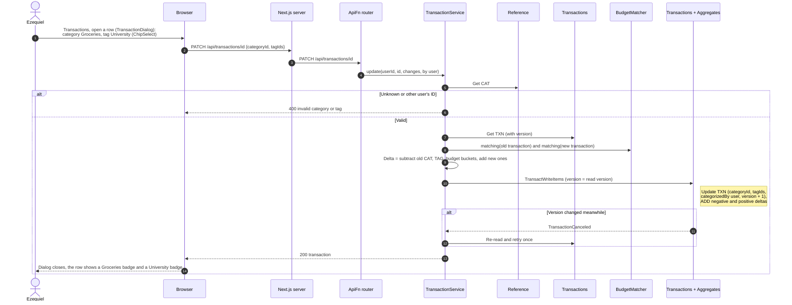
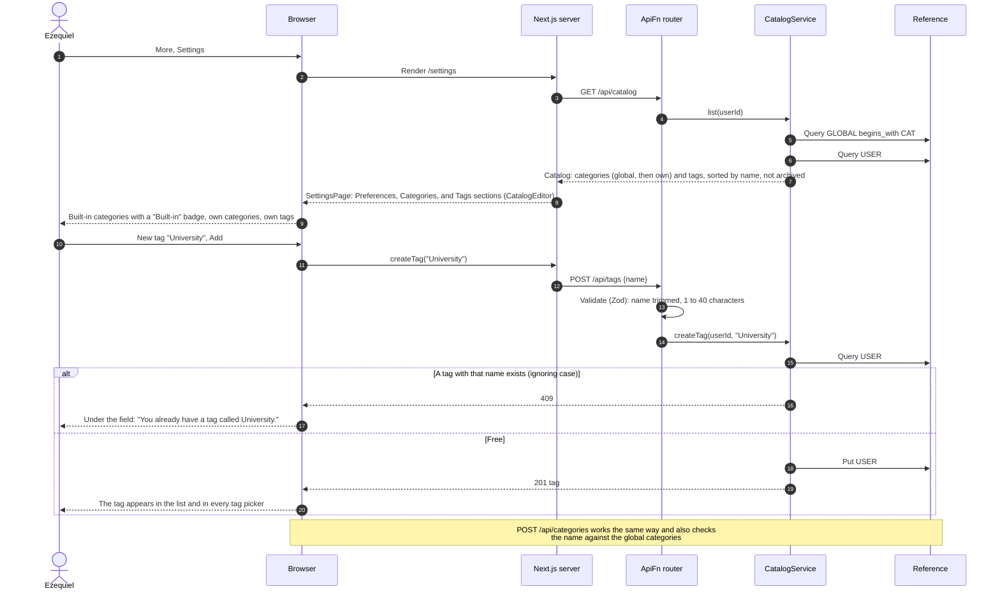
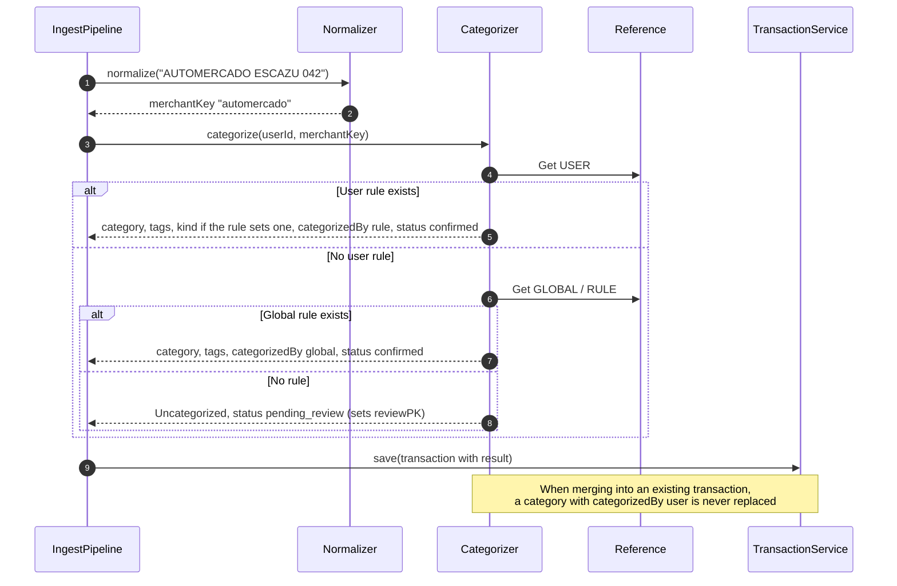
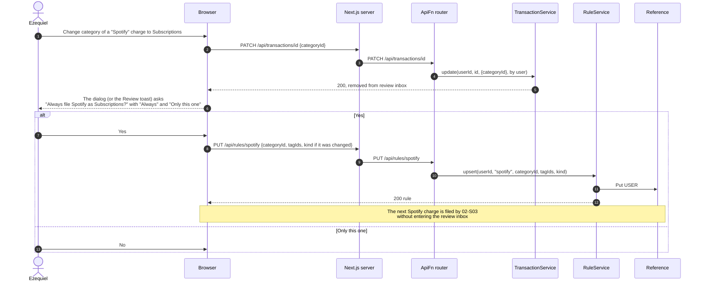
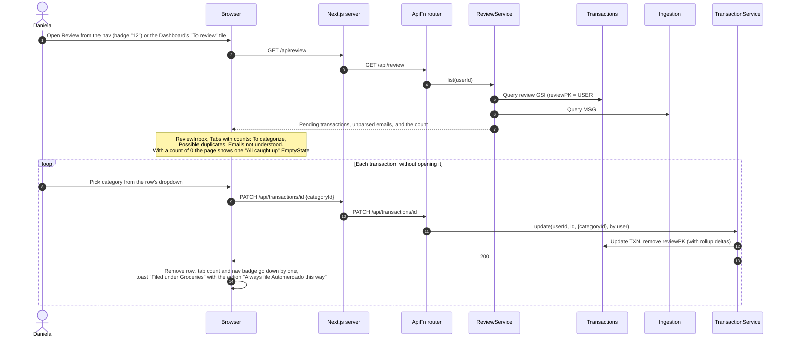

# 02 Categorization and Rules — Sequence Diagrams

Module 02 of the [context model](../context.md). A transaction has one category and any
number of tags, drawn from the same `CAT#` and `TAG#` items that budgets use (the seeded
global categories under `PK = GLOBAL`, and the user's own categories and tags under
`PK = USER#id`; see [02-S02a](#02-s02a--list-and-create-categories-and-tags)). Categorization uses rules
keyed by normalized merchant, `RULE#<merchantKey>`: the user's own rules first, then global
rules. Anything no rule settles goes to the review inbox, and correcting it can save a rule
so the same merchant files itself next time.

Every category change goes through `TransactionService.update`, which moves the amount
between the old and new category, tag, and budget rollups in one `TransactWriteItems`
(see the [conventions](README.md#conventions)).

---

### 02-S02 — Set category and tags

**Story:** As Ezequiel, I want to give a transaction both a category and tags so that I can
ask what I spent on food and what my university living cost me without the two answers
competing.

Totals by category or by tag come from the `MONTH#...#CAT#` and `MONTH#...#TAG#` rollups
(see 04-S01 and 04-S03).

---

### 02-S02a — List and create categories and tags

**Story (supporting 02-S02 and 03-S02):** As Ezequiel, I want to see the categories and
tags I can use and add my own so that I can file a purchase, or set a budget, under a name
that means something to me.

Every category select and tag picker in the product reads the same catalog: the global
categories that were seeded when the product was deployed, then the user's own categories
and tags. New ones are created on the Settings page, which is also where the week-start day
lives (see [03-S10](03-budgets-and-limits.md#03-s10--change-a-budgets-period)).

The transaction dialog, the review inbox, and the budget dialog call the same
`GET /api/catalog` for their options. "Uncategorized" is not in the catalog: it is what a
transaction without a category is called. No rule or fallback files a transaction under
"Other" by itself; only the user chooses it.

---

### 02-S03 — Categorize automatically

**Story:** As Daniela, I want to have my transactions sorted into categories without doing
it myself so that I can see where my week went without filing anything.

This is the `Categorizer` step used by the ingest pipeline and by manual entry. It is
deterministic: the same merchant and rule set always give the same result, and the rule
that decided is recorded on the transaction.

---

### 02-S05 — Correct and remember

**Story:** As Ezequiel, I want to correct a categorization and have that correction
remembered so that I can fix a mistake once rather than every month.

A correction can save a user rule for the merchant. The rule applies to transactions that
arrive from then on; past transactions keep their category. A rule can also remember the
**kind**: when the user changes a transaction's kind, for example the BAC statement row
`DTR:inversiones_hapi_VT` from `payment_sent` to `transfer` because it is money sent to their
own broker account, the same prompt offers to remember it, and later rows from that merchant
arrive as transfers that stay out of spending.

---

### 02-S06 — Clear the review inbox

**Story:** As Daniela, I want to find the transactions that have not been categorized so
that I can clear them in one sitting instead of hunting for them.

The review GSI is sparse: a transaction carries `reviewPK` only while it needs a decision,
so the list and its count are one query. Emails that matched no template (`MSG#` items
with status `unparsed`) are shown in the same inbox.

