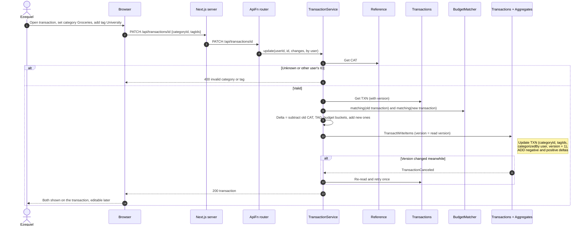
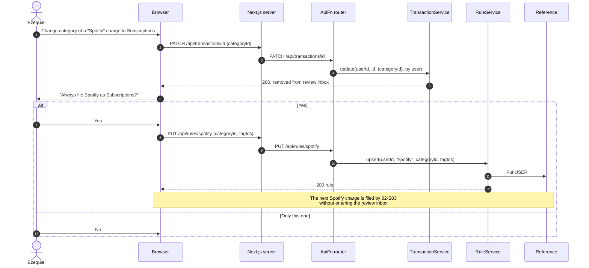
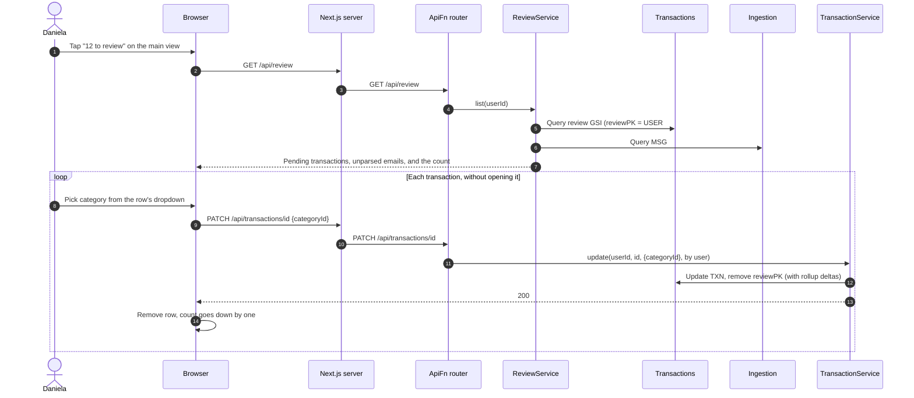

# 02 Categorization and Rules — Sequence Diagrams

Module 02 of the [context model](../context.md). A transaction has one category and any
number of tags, drawn from the same `CAT#` and `TAG#` items that budgets use (global ones
under `PK = GLOBAL` and the user's own under `PK = USER#id`). Categorization uses rules
keyed by normalized merchant, `RULE#<merchantKey>`: the user's own rules first, then global
rules. Anything no rule settles goes to the review inbox, and correcting it can save a rule
so the same merchant files itself next time.

Every category change goes through `TransactionService.update`, which moves the amount
between the old and new category, tag, and budget rollups in one `TransactWriteItems`
(see the [conventions](README.md#conventions)).

---

### 02-S02 — Set category and tags

**Story:** As Ezequiel, I want to give a transaction both a category and tags so that I can
ask what I spent on food and what my university living cost me without the two answers
competing.

Totals by category or by tag come from the `MONTH#...#CAT#` and `MONTH#...#TAG#` rollups
(see 04-S01 and 04-S03).

---

### 02-S03 — Categorize automatically

**Story:** As Daniela, I want to have my transactions sorted into categories without doing
it myself so that I can see where my week went without filing anything.

This is the `Categorizer` step used by the ingest pipeline and by manual entry. It is
deterministic: the same merchant and rule set always give the same result, and the rule
that decided is recorded on the transaction.

---

### 02-S05 — Correct and remember

**Story:** As Ezequiel, I want to correct a categorization and have that correction
remembered so that I can fix a mistake once rather than every month.

A correction can save a user rule for the merchant. The rule applies to transactions that
arrive from then on; past transactions keep their category.

---

### 02-S06 — Clear the review inbox

**Story:** As Daniela, I want to find the transactions that have not been categorized so
that I can clear them in one sitting instead of hunting for them.

The review GSI is sparse: a transaction carries `reviewPK` only while it needs a decision,
so the list and its count are one query. Emails that matched no template (`MSG#` items
with status `unparsed`) are shown in the same inbox.

