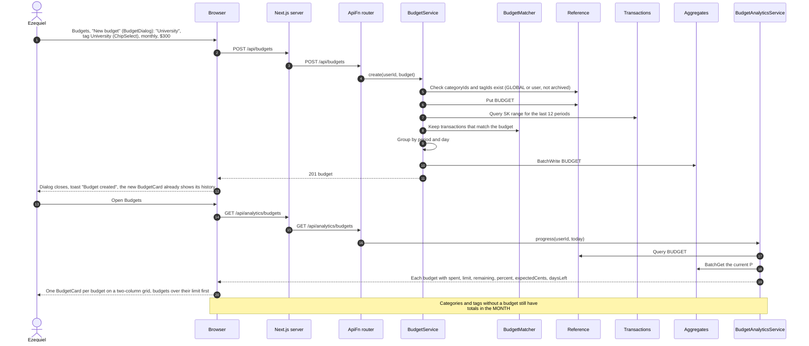
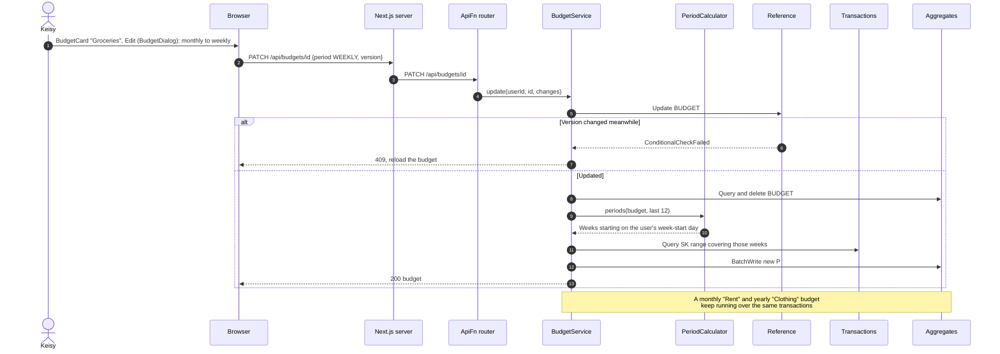
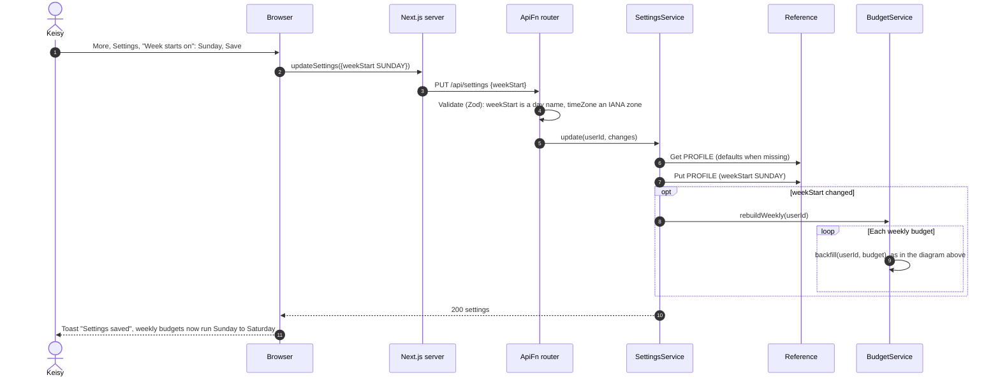
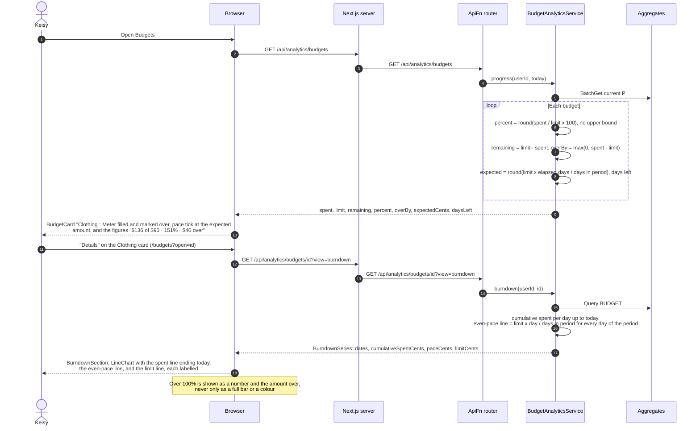

# 03 Budgets and Limits — Sequence Diagrams

Module 03 of the [context model](../context.md). A budget targets categories and/or tags,
using the same `CAT#` and `TAG#` items as transactions. A transaction matches a budget when
its category is in the budget's categories (or the budget has none) and it has any of the
budget's tags (or the budget has none). The period is weekly, monthly, quarterly, yearly,
or a custom range.

Spending is kept in budget rollup items in `Aggregates`, written in the same
`TransactWriteItems` as the transaction:

- `BUDGET#id#P#<periodStart>` holds `spentCents`, `count`, and the `limitCents` in force
  for that period.
- `BUDGET#id#D#<date>` holds daily spending, used for the burn-down chart.

Investment transactions, transfers, and card payments never count toward a budget.

---

### 03-S02 — Create a budget and see all progress

**Story:** As Ezequiel, I want to set a separate limit for each spending area so that I can
keep my university costs and my hobbies from being measured against one another.

A new budget starts with history, because `BudgetService` backfills the current period and
up to 11 earlier ones from `Transactions`.

---

### 03-S10 — Change a budget's period

**Story:** As Keisy, I want to set a budget over a week, a month, or a year so that I can
watch the things that vary weekly apart from the ones only a year makes sense of.

A weekly budget starts each week on the user's chosen week-start day. Changing the period
or the filters rebuilds the budget's rollups for the new period boundaries, using the same
backfill as 03-S02.

**The day the week starts.** It is a setting, not part of a budget, so it is changed on the
Settings page and applies to every weekly budget at once.

---

### 03-S11 — Proportion used

**Story:** As Keisy, I want to see what proportion of each budget I have used, including
when I have gone past it, so that I can tell at a glance how far over or under I am.

