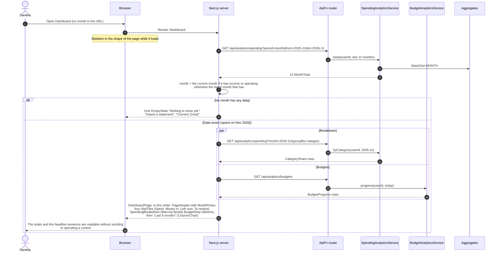
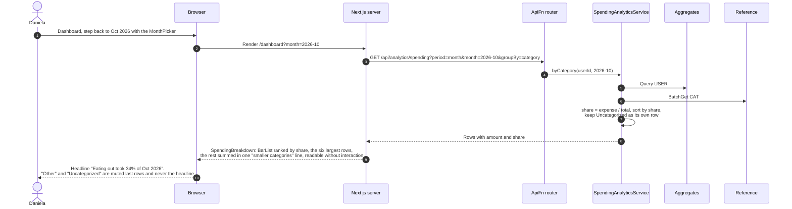
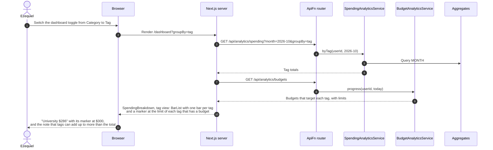
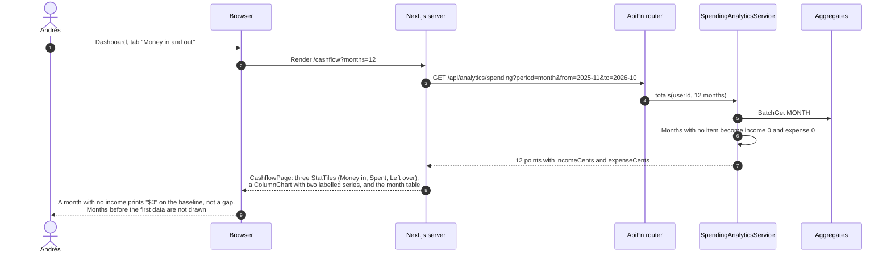

# 04 Dashboard and Insights — Sequence Diagrams

Module 04 of the [context model](../context.md). Every view here is read-only and reads
precomputed rollups from `Aggregates` instead of scanning transactions. The views are
rendered by Next.js on the server, which calls `ApiFn` for the data. All amounts are in USD
(see [05](05-multi-currency-and-roles.md)).

Each view is a chart only where a chart answers the story's question, and every chart is
server-rendered SVG with its numbers also available as a table
([class diagram section 2c](../class-diagram.md#2c-charts)). The layout and wording of the
two pages are in [section 2d](../class-diagram.md#2d-pages).

---

### 04-S01a — Open the dashboard

**Story (supporting 04-S01, 04-S03, 04-S06, and 03-S11):** As Daniela, I want to open one
page and see what I spent, where it went, and how my budgets stand so that I can come away
with the answer without operating anything.

The dashboard shows several stories on one screen. This diagram fixes how they share it:
which calls the page makes, which month it opens on, and the order of its sections.

The four tiles and the six-month chart come from the twelve `MonthTotal` rows already
loaded, and the "To review" tile from the count the app shell loaded, so the page makes
three calls. Changing the month with the `MonthPicker` renders `/dashboard?month=2026-10`
and repeats the breakdown call for that month.

---

### 04-S01 — Where last month's money went

**Story:** As Daniela, I want to see where last month's money went so that I can learn
something about my spending without having recorded any of it.

---

### 04-S03 — Breakdown by tag and category

**Story:** As Ezequiel, I want to see spending broken down by tag as well as by category so
that I can find out what my university living actually costs me.

A transaction with two tags counts in both tag totals, so the tag view is ranked bars, never
parts of one whole, and says that tag totals can overlap.

---

### 04-S06 — Income alongside spending

**Story:** As Andrés, I want to see my income alongside my spending over time so that I can
see how lumpy months actually compare against what I spent in them.

Income and expenses are kept in separate fields of each rollup, so both series come from
the same items. The page draws the months from the first one with data to the current one.
With fewer than three months of data it shows the totals and the table and says that
trends need three months, instead of drawing a chart that is mostly empty.

