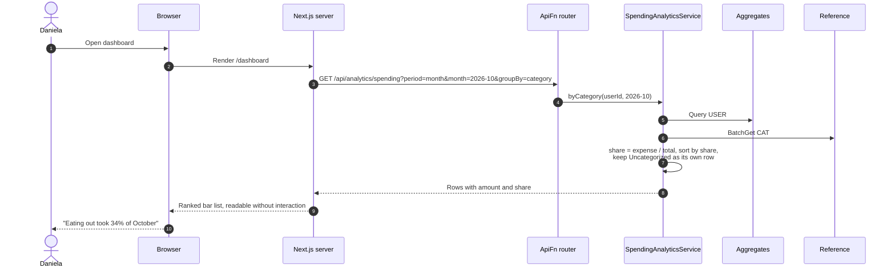
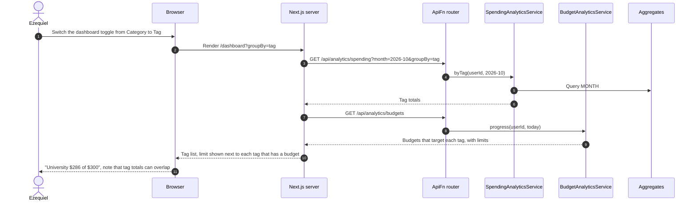
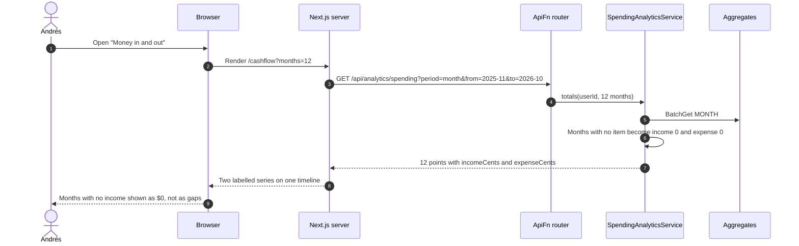

# 04 Dashboard and Insights — Sequence Diagrams

Module 04 of the [context model](../context.md). Every view here is read-only and reads
precomputed rollups from `Aggregates` instead of scanning transactions. The views are
rendered by Next.js on the server, which calls `ApiFn` for the data. All amounts are in USD
(see [05](05-multi-currency-and-roles.md)).

---

### 04-S01 — Where last month's money went

**Story:** As Daniela, I want to see where last month's money went so that I can learn
something about my spending without having recorded any of it.

---

### 04-S03 — Breakdown by tag and category

**Story:** As Ezequiel, I want to see spending broken down by tag as well as by category so
that I can find out what my university living actually costs me.

A transaction with two tags counts in both tag totals, so the tag view is a list rather than
a pie chart and says that tag totals can overlap.

---

### 04-S06 — Income alongside spending

**Story:** As Andrés, I want to see my income alongside my spending over time so that I can
see how lumpy months actually compare against what I spent in them.

Income and expenses are kept in separate fields of each rollup, so both series come from
the same items.

