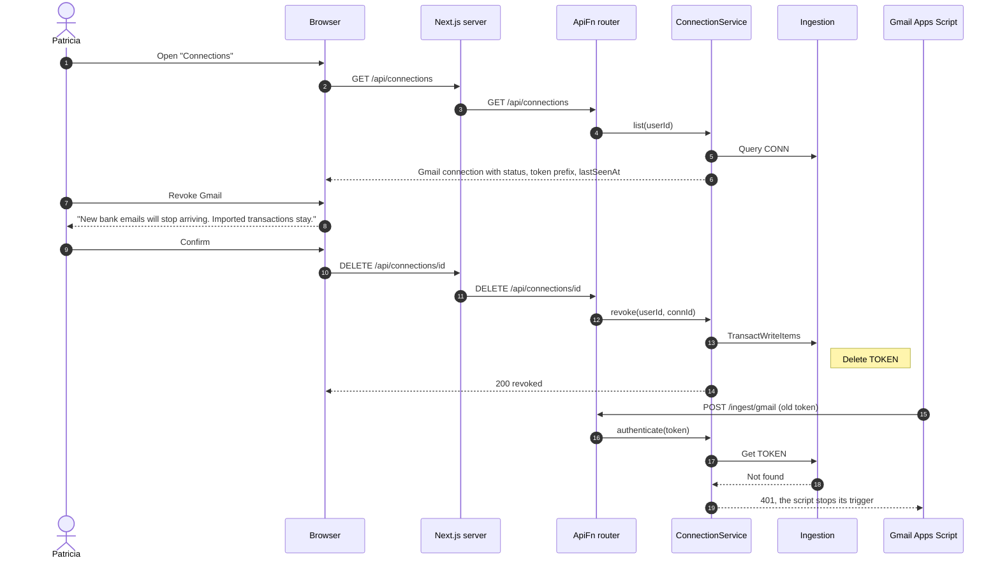

# 06 Security and Data Control — Sequence Diagrams

Module 06 of the [context model](../context.md). The product never holds a bank or Gmail
password. Its only standing access is the Gmail ingest token (01-S08a), which is stored
only as a hash and can be revoked at any time.

---

### 06-S02 — See and revoke the Gmail connection

**Story:** As Patricia, I want to see exactly what the product can currently access and
withdraw any of it immediately so that I can decide what it may see and change my mind
whenever I want.

Revoking deletes the token's hash. Every `/ingest/gmail` call looks the hash up, so the
next call from the script is rejected with no delay.

