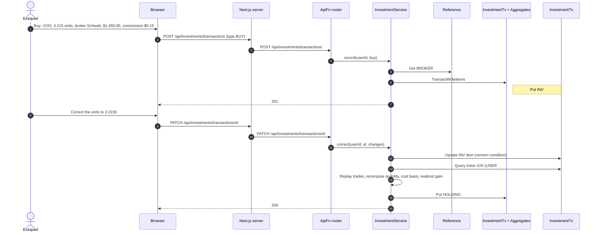
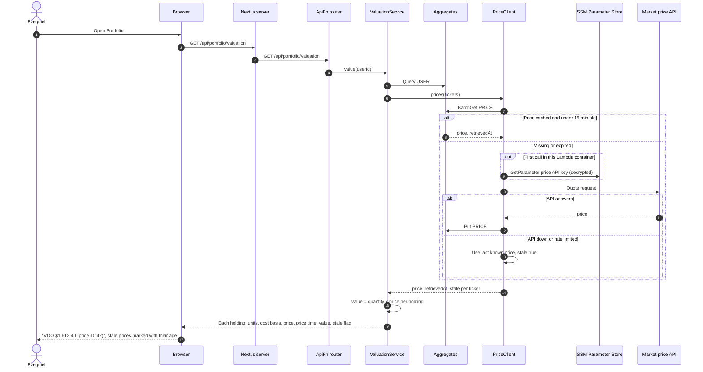
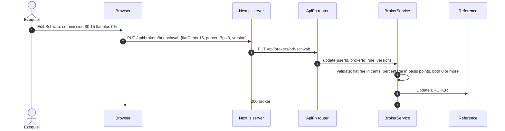
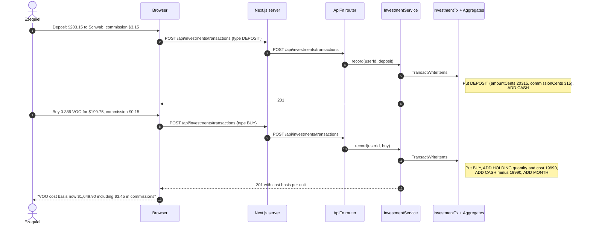
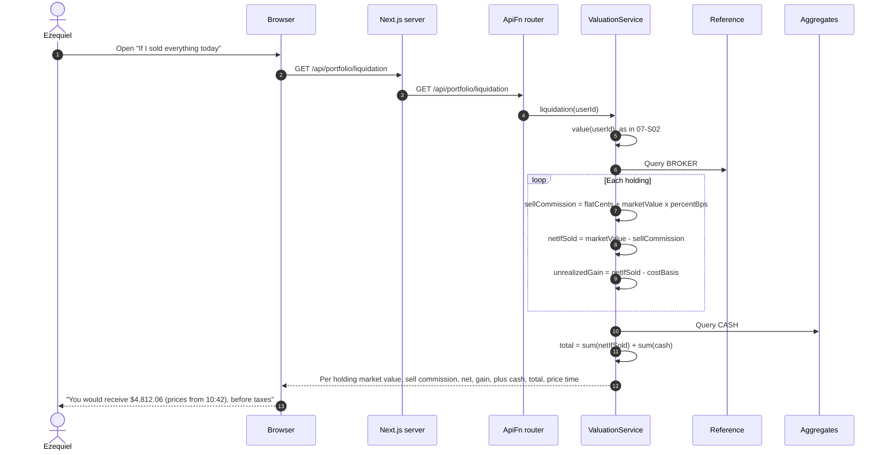

# 07 Investments — Sequence Diagrams

Module 07 of the [context model](../context.md). Investments are recorded as four kinds of
investment transaction in `InvestmentTx`: deposit, withdrawal, buy, and sell. Each carries
the broker, the amount or gross trade value, the commission actually charged, and an
optional name; buys and sells also carry the ticker and quantity. Holdings and broker cash
are rollups in `Aggregates`, written in the same `TransactWriteItems` as the investment
transaction:

- `HOLDING#<brokerId>#<ticker>` holds `quantityMicro` (6 decimals), `costBasisCents`,
  `realizedGainCents`, and `version`.
- `CASH#<brokerId>` holds uninvested cash at the broker.
- `MONTH#<yyyy-mm>#INV` holds deposits, withdrawals, buys, sells, and commissions per month.

Cost basis uses the average-cost method. Each broker has one commission rule
(`flatCents`, `percentBps`) used to estimate the cost of selling. Prices come from a market
price API and are cached as `PRICE#<ticker>` items with a 15-minute TTL, shared by all
users. Investment transactions never count toward spending or budgets.

---

### 07-S01 — Record a holding

**Story:** As Ezequiel, I want to record what I hold by entering it myself so that I can
track my positions without connecting the product to my broker.

A buy adds units and cost to the holding. Correcting an older trade changes the cost of
later sales, so the holding is rebuilt from its trades using the ticker index.

---

### 07-S02 — Value holdings at current prices

**Story:** As Ezequiel, I want to see my holdings valued at current market prices so that I
can stop looking at figures anchored to a stale quote.

---

### 07-S03 — Describe a broker's commission

**Story:** As Ezequiel, I want to describe the fees my broker charges so that I can have
every figure account for them instead of correcting each one by hand.

The commission rule is used to estimate what selling would cost (07-S05). Commissions
already stored on past transactions are not changed when the rule is edited.

---

### 07-S04 — Record a contribution with commissions

**Story:** As Ezequiel, I want to record a contribution with the fees it actually incurred so
that I can know what a position has really cost me.

A contribution is a deposit to the broker followed by a buy. Each records the commission
actually charged, and both commissions become part of the holding's cost basis.

---

### 07-S05 — Value if sold today

**Story:** As Ezequiel, I want to see what I would actually receive if I sold everything
today so that I can know what my investments are worth to me rather than on paper.

