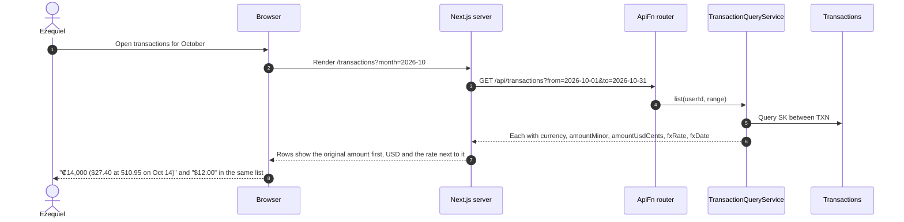
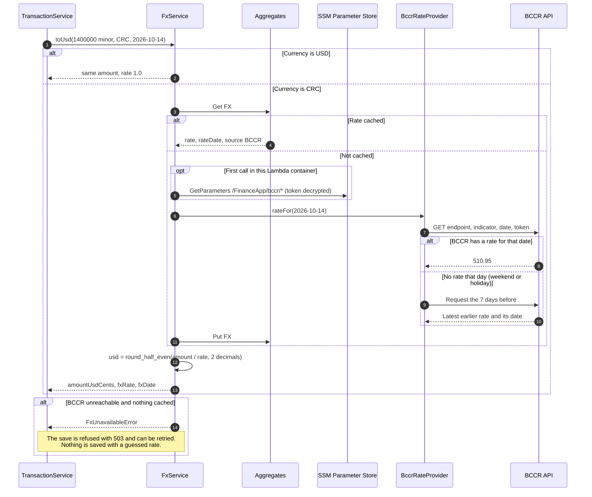
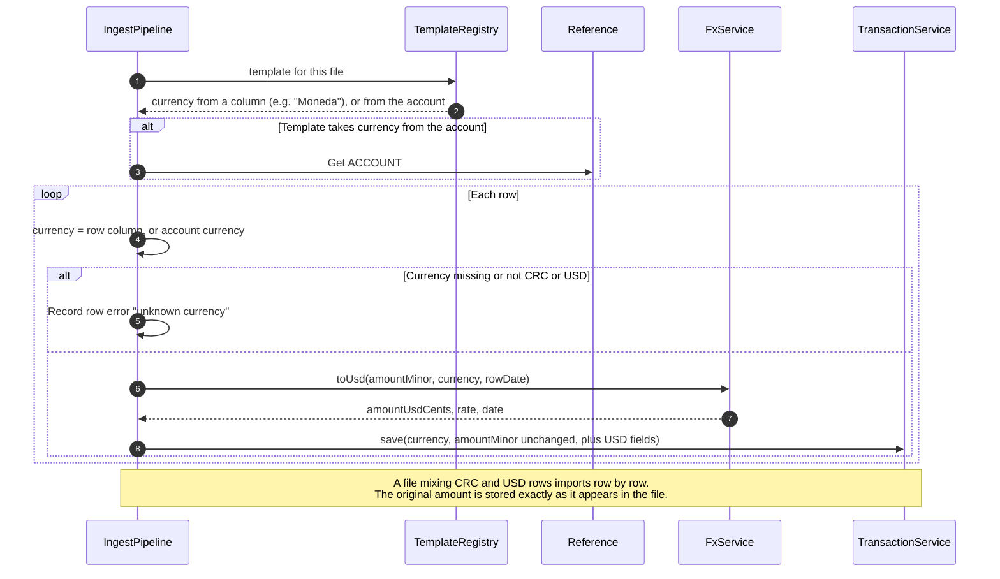

# 05 Multi-Currency — Sequence Diagrams

Module 05 of the [context model](../context.md). The base currency is USD. Every
transaction keeps its original `currency` and `amountMinor`, which are never changed, and
also stores `amountUsdCents`, `fxRate`, and `fxDate`. CRC is converted at the BCCR rate of
the transaction date. Rollups and budgets use the USD amount.

`FxService` reads the BCCR endpoint, indicator code, and token from SSM Parameter Store
(`/FinanceApp/bccr/*`) once per Lambda container, and caches each day's rate as an
`FX#USD-CRC#<date>` item in `Aggregates`, so BCCR is called at most once per date.

---

### 05-S01 — Show the original currency

**Story:** As Ezequiel, I want to see every amount in the currency it actually occurred in
so that I can check any figure against my bank statement.

---

### 05-S02 — Convert at the BCCR rate

**Story:** As Ezequiel, I want to see which rate produced my totals so that I can trust a
combined figure enough to use it.

Every converted amount is produced here, and the rate and its date are stored on the
transaction so they can be shown next to it (05-S01).

---

### 05-S06 — Import a statement in its own currency

**Story:** As Patricia, I want to import a statement in a currency and have it stay in that
currency so that I can reconcile what I imported against the document I downloaded.

This is the currency step of the CSV pipeline in 01-S02. Each row keeps its own currency.

