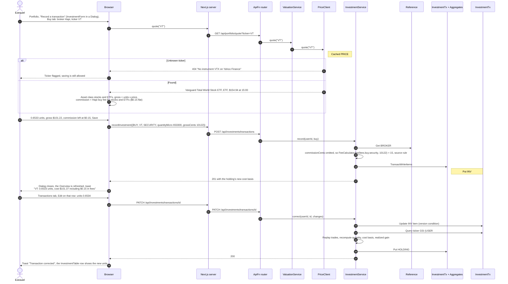
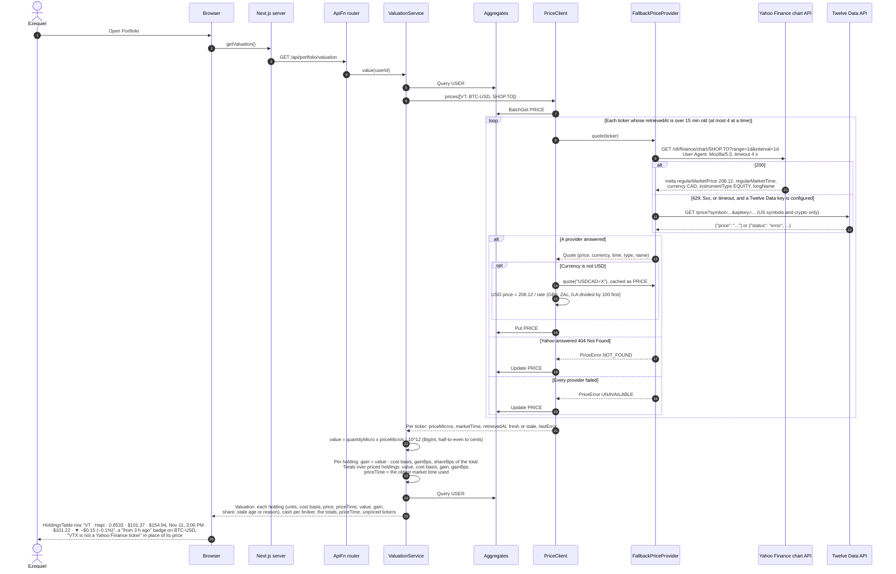
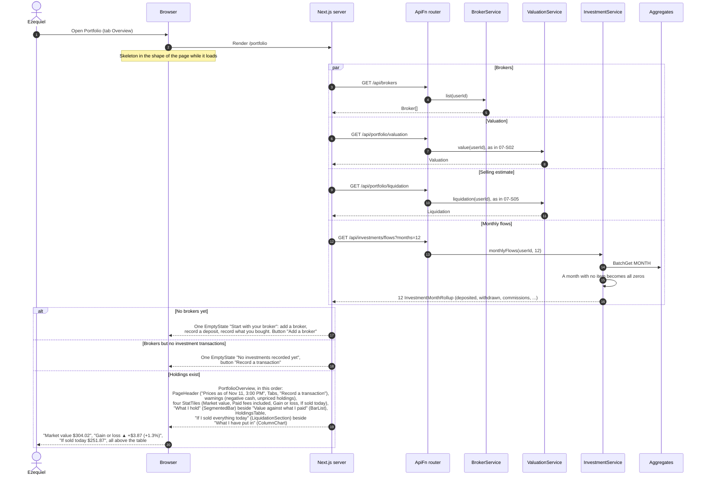
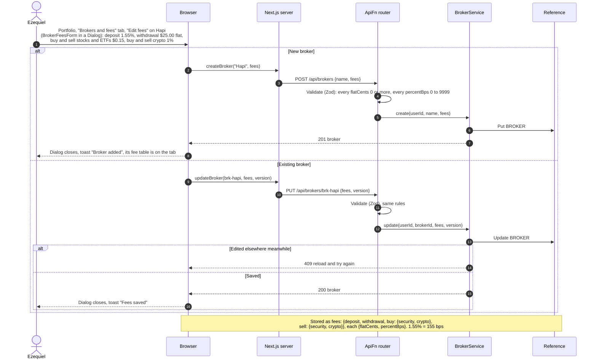
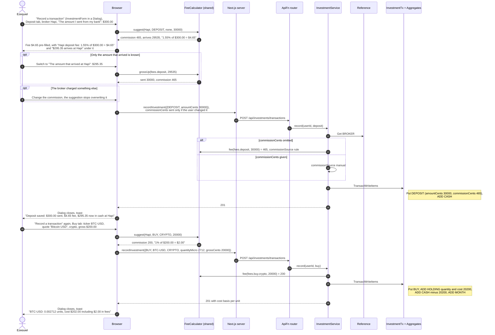
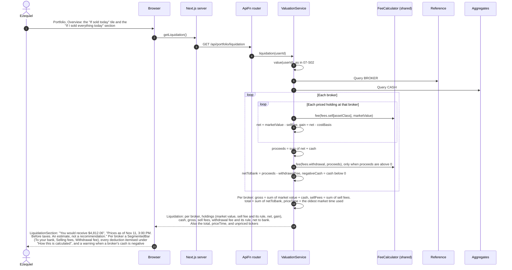

# 07 Investments — Sequence Diagrams

Module 07 of the [context model](../context.md). Investments are recorded as four kinds of
investment transaction in `InvestmentTx`: deposit, withdrawal, buy, and sell. Each carries
the broker, the amount or gross trade value, the commission charged, and an optional name;
buys and sells also carry the ticker, its asset class, and the quantity. Holdings and broker
cash are rollups in `Aggregates`, written in the same `TransactWriteItems` as the investment
transaction:

- `HOLDING#<brokerId>#<ticker>` holds `assetClass`, `name`, `quantityMicro` (6 decimals),
  `costBasisCents`, `realizedGainCents`, and `version`.
- `CASH#<brokerId>` holds uninvested cash at the broker. It may go below zero when buys are
  recorded without the deposits that paid for them; the portfolio then shows a warning.
- `MONTH#<yyyy-mm>#INV` holds deposits, withdrawals, buys, sells, and commissions per month.

Cost basis uses the average-cost method. **Each broker has a fee schedule**: one fee for
deposits, one for withdrawals, and one per asset class (stocks and ETFs, or crypto) for buys
and for sells. Each fee is a flat amount plus a percentage. The schedule pre-fills the
commission when a transaction is recorded, the user can override it, and it estimates what
selling would cost. The shared `FeeCalculator` does the arithmetic in the browser and in the
API, so both always agree (see [class diagram section 10](../class-diagram.md#10-module-07-investments)).

Prices come from the Yahoo Finance chart API, which needs no key and covers stocks, ETFs,
mutual funds, crypto, and exchanges outside the US. Twelve Data is an optional fallback when
its key is configured. Prices are shared by all users as `PRICE#<ticker>` items: fresh for
15 minutes, then refreshed, and kept for 30 days so a last known price can still be shown,
marked stale with its age. Investment transactions never count toward spending or budgets.

All five stories are shown on one page, Portfolio. [07-S02a](#07-s02a--open-the-portfolio-overview)
fixes how they share it; the layout and wording are in
[class diagram section 2d](../class-diagram.md#portfolio-portfolio). Every price time the
user sees is the market time of the price, with its date (one rule, class diagram section
10b).

---

### 07-S01 — Record a holding

**Story:** As Ezequiel, I want to record what I hold by entering it myself so that I can
track my positions without connecting the product to my broker.

The ticker is looked up first, so the form can show the instrument's name and live price,
choose its asset class, and suggest the gross value and the commission. A buy adds units and
cost to the holding. Correcting an older trade changes the cost of later sales, so the
holding is rebuilt from its trades using the ticker index.

---

### 07-S02 — Value holdings at current prices

**Story:** As Ezequiel, I want to see my holdings valued at current market prices so that I
can stop looking at figures anchored to a stale quote.

Prices older than 15 minutes are refreshed when the portfolio opens. A quote in another
currency is converted to USD with Yahoo's own exchange rate for that currency. When a price
cannot be refreshed, the last known price is shown with its age; when there has never been
one, the holding says why.

A `NOT_FOUND` ticker is asked again at most once an hour. The Twelve Data key, when it
exists, is read from SSM Parameter Store (`/FinanceApp/prices/twelvedata-api-key`) once per
Lambda container; without it only Yahoo is used.

---

### 07-S02a — Open the portfolio overview

**Story (supporting 07-S02, 07-S04, and 07-S05):** As Ezequiel, I want to open one page and
see what my investments are worth, what they cost me, and what would reach my bank so that
I can read my position without working through a form or a fee table first.

The Portfolio page shows several stories at once. This diagram fixes how they share the
screen: the four reads the server makes in parallel, the order of the sections, and what
the page shows before there is anything to value. Recording a transaction and editing
broker fees are not on this view; they open in a dialog (07-S01, 07-S04) or sit on their
own tab (07-S03).

Both price-dependent reads use the same cached `PRICE#` items, so the page refreshes each
price at most once. The header, the holdings table, and the selling estimate all show the
same `priceTime`. A chart with too little data is replaced by a sentence: "What I hold"
needs two priced holdings, and "What I have put in" needs three months with activity.

---

### 07-S03 — Describe a broker's fees

**Story:** As Ezequiel, I want to describe the fees my broker charges so that I can have
every figure account for them instead of correcting each one by hand.

Each broker has six fees, each a flat amount plus a percentage. Hapi, for example, charges
1.55% on deposits, $0.15 flat to buy or sell stocks and ETFs, 1% to buy or sell crypto, and a
flat charge to withdraw. Commissions already stored on past transactions are not changed
when the schedule is edited.

---

### 07-S04 — Record a contribution with commissions

**Story:** As Ezequiel, I want to record a contribution with the fees it actually incurred so
that I can know what a position has really cost me.

A contribution is a deposit to the broker followed by a buy. For each one the form suggests
the commission from the broker's fee schedule as the amounts are typed, explains it, and
lets the user change it. A deposit can be entered as the amount sent from the bank or as the
amount that arrived at the broker; the other is worked out by grossing up. The deposit fee
reduces the cash that reaches the broker and is not part of any holding's cost basis; the
buy fee is added to the cost basis of the holding it bought. Both fees are counted in the
month's `commissionsCents`.

Each save closes the dialog and reports what was saved in a toast for that type, so a
deposit never shows a buy's cost line. The Overview is refreshed after every save, and
both fees appear in the caption of "What I have put in".

---

### 07-S05 — Value if sold today

**Story:** As Ezequiel, I want to see what I would actually receive if I sold everything
today so that I can know what my investments are worth to me rather than on paper.

Selling costs each holding its broker's sell fee for its asset class, and bringing the money
home costs the broker's withdrawal fee, charged once on everything withdrawn from that
broker. Every deduction is listed with the rule that produced it.

