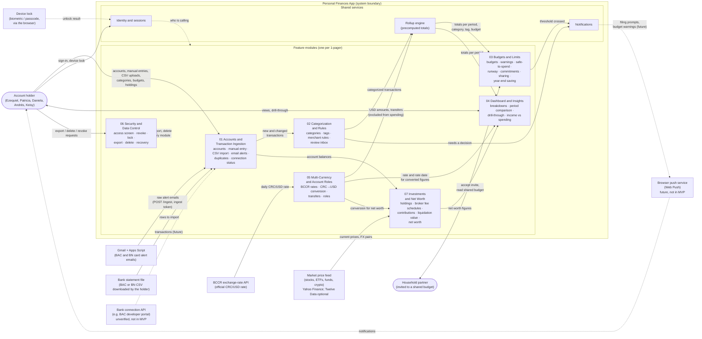
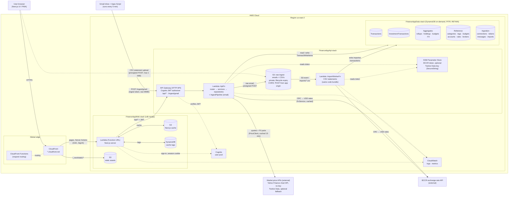

# Personal Finances App

**CS 3365 - Fall 2026 - Project 2: High-Level Design and MVP**

By Keisy Núñez Fallas and Ezequiel Buck Martínez

Repository: <https://github.com/Ezequiel294/cs3365-finance-app>

---

## 1. Cover

### Selected option

In Project 1 we produced four sets of documents: two product ideas, each written with two
different models. For this project we selected the **Personal Finance & Expense Tracker,
in the version written with Claude**. Its vision, personas, 1-pagers, and sizing are in
[`docs/`](.), and they are the requirements this design is built from.

### Summary of the problem

People who manage money across more than one bank and more than one currency often fall
back on a spreadsheet, because existing trackers get wrong the details that matter most to
them. Specifically, those trackers count a transfer between two of a person's own accounts
as spending, convert currencies without saying so (or do not handle them at all), and show
an investment's market value without the fees that stand between that number and money in
the bank. A spreadsheet avoids those mistakes, but it is only accurate for as long as
someone keeps typing into it.

The Personal Finances App is a web dashboard, usable from a phone's browser, that brings
transactions in from bank alert emails, statement files, and manual entry. It files each
transaction under a category and tags, keeps colones and dollars distinct while reporting
in USD, ignores transfers between the user's own accounts, and values investments at
market prices net of broker fees. The users we designed for are in Costa Rica, so the
design reads statements and alerts from BAC Credomatic and Banco Nacional and converts
colones at the official BCCR exchange rate.

### Comments from the 1-pagers

- The 1-pagers define **7 initiatives** (one per module in the context model) with
  **50 stories**. Since the app has to be generated in one shot, we kept **25 stories in
  scope** and moved the other 25 to the product backlog. The stories we kept are the ones
  needed for the product's main loop: get transactions in, file them, budget against them,
  see where the money went, and value investments.
- Several requirements could not be built as written, so the design departs from the
  1-pagers in recorded places ([`requirements-changes.md`](requirements-changes.md)). The
  main ones are:
  - USD is the base currency, and CRC amounts are converted at the BCCR rate of the
    transaction date, with the original amount kept on every transaction.
  - Bank connection APIs were replaced by a Gmail Apps Script that forwards bank alert
    emails, plus CSV statements, since no Costa Rican bank was confirmed to offer
    personal-account API access.
  - A purchase that arrives both from an email alert and from a statement is merged
    automatically, instead of asking the user to confirm every pair.
  - Spending groups were replaced by tags, so a transaction can belong to more than one
    budget area.
  - Prompts and warnings at the time of a charge were removed, because they need push
    notifications. Uncategorized transactions wait in an in-app review inbox instead.
- The 1-pagers left the market price provider and the bank file formats open. Both turned
  out to matter for the code generation (see [Iterations](#4-iterations)), so the design
  now names a price provider and specifies the exact bank formats.

---

## 2. Repository

All design artifacts are in the public repository
<https://github.com/Ezequiel294/cs3365-finance-app>.

| Path | Contents |
|---|---|
| [`docs/one-pagers/`](one-pagers/), [`vision.md`](vision.md), [`personas.md`](personas.md), [`sizing.md`](sizing.md) | Project 1 documents, used as context |
| [`docs/diagrams/`](diagrams/) | The design: context model, architecture, sequence diagrams, class diagram, and bank formats, all in Mermaid |
| [`docs/samples/`](samples/) | Redacted real bank files used to specify the bank formats |
| [`docs/requirements-changes.md`](requirements-changes.md) | Where the design departs from the 1-pagers |
| `one-shot/` (on the `attemptN` branches) | The prompts given to the coding agents and the instructions for running a round |
| `agent-a/`, `agent-b/` (on the `attemptN` branches) | The code each agent generated in that round |

We manage the work with branches and pull requests:

- Every change to the diagrams is made on a branch and merged into `main` through a pull
  request, so the history of the design is preserved:
  [PR #1](https://github.com/Ezequiel294/cs3365-finance-app/pull/1) (initial design) and
  [PR #2](https://github.com/Ezequiel294/cs3365-finance-app/pull/2) (changes for
  iteration 2). Iteration 3's pull request is TBD.
- After each merge, the next `attemptN` branch (`attempt1`, `attempt2`, `attempt3`) merges
  `main`, receives fresh copies of the diagrams for each agent, and then holds the code the
  agents generated. This keeps each round's input and output together, and it lets us
  compare rounds with a diff.

---

## 3. Design Artifacts

All diagrams are written in Mermaid and render directly on GitHub. The context model and
the architecture diagram are included below. The sequence and class diagrams are included
in [Appendix A](#appendix-a-sequence-and-class-diagrams).

### 3.1 Context Model

Source: [`diagrams/context.md`](diagrams/context.md)

<!-- BEGIN:context -->

<!-- END:context -->

**What it shows.** The context model draws the boundary of the system. Inside it are seven
feature modules, one per 1-pager, and three shared services that several modules depend
on: identity, notifications, and the rollup engine that keeps totals precomputed. Outside
it are the account holder, the household partner, and the external systems the product
exchanges data with (Gmail, bank statement files, the BCCR exchange-rate API, and the
market price feed). Dashed elements, such as bank connection APIs and Web Push, are
deliberately not part of the MVP.

**Why it is valuable.**

- It fixes the boundary. Since banks, BCCR, Gmail, and the price feed are outside the
  system, their failures are something the product must handle (stale rates, stale prices,
  a connection that stopped sending) rather than something it can fix.
- It gives every story one owner. The class diagram is grouped by these modules, and each
  sequence diagram starts from the module that owns its story.
- It makes cross-module dependencies explicit, for example that budgets and the dashboard
  read from the rollup engine, and that net worth depends on currency conversion. These
  are the connections a code generator is most likely to miss.

### 3.2 Architecture Diagram

Source: [`diagrams/architecture.md`](diagrams/architecture.md) (an editable draw.io
version with AWS icons is in [`architecture.drawio`](diagrams/architecture.drawio))

<!-- BEGIN:architecture -->

<!-- END:architecture -->

**What it shows.** Every runtime element of the system, deployed on AWS in `us-east-2`:

- **Front end:** a Next.js app served through CloudFront. Static assets come from S3, and
  pages and Server Actions run in a Next.js server Lambda (deployed with the `cdk-nextjs`
  construct).
- **Back end:** an API Gateway HTTP API with a Cognito JWT authorizer in front of one
  Lambda (`ApiFn`) that holds the routers, services, and repositories. A second Lambda
  (`ImportWorkerFn`, built from the same code) processes CSV statements when they are
  uploaded to S3.
- **Data:** five DynamoDB tables (transactions, investment transactions, precomputed
  aggregates, reference data, and ingestion state), a private S3 bucket for raw emails and
  CSV files, and SSM Parameter Store for the BCCR token.
- **Services:** Cognito for sign-in, CloudWatch for logs and metrics, and the external
  BCCR, Yahoo Finance, and Gmail Apps Script integrations.

**Why it is valuable.** It decides which AWS service runs each part of the system, and it
groups resources into the three stacks (data, API, web) that the agents deploy. It also
shows which paths are protected by Cognito and which use the Gmail ingest token, and it
documents the limits of the account we deploy to. Since the agents deploy to a real AWS
account with a restricted policy, choosing only services that policy allows was what made
deployment possible in one shot.

### 3.3 Sequence Diagrams

Source: [`diagrams/sequences/`](diagrams/sequences/) (one file per module, with an index
in [`README.md`](diagrams/sequences/README.md))

**What they show.** There is at least one sequence diagram per in-scope user story: 28
diagrams for 25 stories, plus one supporting story (01-S02a, registering an account).
Each diagram follows a request from the browser through the Next.js server, the API
router, and the services, down to the DynamoDB items it reads or writes. Rules that apply
to every diagram (authentication, partitioning by user, the shared save path, error
handling, and logging) are written once in the index instead of being repeated.

| Module | Stories |
|---|---|
| 01 Accounts and Ingestion | 01-S02a, 01-S02, 01-S03, 01-S04, 01-S05, 01-S08 (3 diagrams), 01-S09 |
| 02 Categorization and Rules | 02-S02, 02-S03, 02-S05, 02-S06 |
| 03 Budgets and Limits | 03-S02, 03-S10, 03-S11 |
| 04 Dashboard and Insights | 04-S01, 04-S03, 04-S06 |
| 05 Multi-Currency | 05-S01, 05-S02, 05-S06 |
| 06 Security and Data Control | 06-S02 |
| 07 Investments and Net Worth | 07-S01, 07-S02, 07-S03, 07-S04, 07-S05 |

**Why they are valuable.**

- They turn each story into concrete calls. Each diagram names the route, the service
  method, and the DynamoDB items involved, which gives a code generator an order of
  operations instead of a sentence of intent.
- They show where the hard rules live, such as idempotency checks, the version condition
  on edits, and the single DynamoDB transaction that keeps rollups and budgets consistent.
- They define the class diagram, since every participant must exist as a class and every
  message must exist as a method.
- They expose shared paths. Manual entry, Gmail alerts, and CSV statements all end in the
  same save path, and drawing them makes that reuse visible, so it is built once.

### 3.4 Class Diagram

Source: [`diagrams/class-diagram.md`](diagrams/class-diagram.md)

**What it shows.** The classes needed to implement every in-scope sequence diagram. It is
split into one diagram per layer or module, so each stays readable:

| Section | Contents |
|---|---|
| 1. Domain model | Entities, value objects, and enums stored in DynamoDB |
| 2. Next.js layer | Pages, Server Actions (UI controllers), session handling, and the typed API client |
| 3. API shell and data access | Lambda entry points, routers (API controllers), errors, configuration, factories, and repositories (database handlers) |
| 4. Transactions core | The single save path every source uses, and the rollup planner |
| 5–10. Modules 01, 02, 03, 04, 05, 07 | The services, parsers, and calculators of each module |
| 11. Gmail Apps Script | The script that runs in the user's Google account |

Module 06 has no classes of its own, since its only in-scope story (revoking the Gmail
connection) is handled by the connection service in module 01. The diagram also fixes
conventions the code must follow: money is stored as integer minor units, never floating
point, and dependencies are passed through constructors so tests can use fakes.

**Why it is valuable.** It is the build list: a code generator can create one file per
class and one function per method, and the sequence diagrams say in which order to call
them. It also fixes the boundaries between layers. Routers only validate, services hold
the business rules, and repositories are the only classes that touch DynamoDB, S3, or
SSM, so each rule has exactly one class that owns it.

### 3.5 Bank Formats

Source: [`diagrams/bank-formats.md`](diagrams/bank-formats.md)

This document was added in iteration 2. It specifies the four bank files the app reads
(a statement CSV and a card alert email from each of BAC Credomatic and Banco Nacional),
with a diagram of how a file is matched to its template, and the exact result each
redacted sample in [`samples/`](samples/) must produce. We added it because a template can
only be written against a real file, and the expected results let the agents write golden
tests that prove their parsers work.

---

## 4. Iterations

### 4.1 Process

Each iteration follows the same steps:

1. We change the diagrams on a branch and merge them into `main` with a pull request.
2. On the next `attemptN` branch, we merge `main` and copy the 1-pagers, the diagrams, and
   (from iteration 2) the bank samples into two fresh directories, `agent-a/` and
   `agent-b/`.
3. Two coding agents, each with a different model, start in a new session with no prior
   context. **Agent A uses Claude Opus 5.5** and **agent B uses GPT Terra 5.6**. Each one
   receives the prompt in [Section 5](#5-prompts), and it may only read its own directory.
4. The agents work on their own until they finish. We do not answer questions or give
   hints during the run. Each one builds the app, runs its tests, deploys to our AWS
   account under its own stack prefix (for example `FinanceAppA2`), and writes an
   `IMPLEMENTATION_NOTES.md` with what it built, what it left incomplete, and every error it
   could not resolve.
5. We review the code, the notes, and the deployment, commit each agent's directory, and
   use what we found to decide the next round of diagram changes.

The only thing we change between rounds is the diagrams. The prompt changes only to point
at new inputs (such as the bank samples) and to describe the AWS environment more
accurately. It never adds a design decision that is not already in the diagrams.

### 4.2 Iteration 1

**Diagrams** ([PR #1](https://github.com/Ezequiel294/cs3365-finance-app/pull/1)). The
first design included the context model, the architecture diagram (Mermaid and draw.io),
sequence diagrams for the 25 in-scope stories, the class diagram, the summary of changes
from the 1-pagers, and the BCCR request and response format. Two parts were left open on
purpose, because we did not have the information yet: the bank file formats (the agents
were told to add placeholder templates) and the market price provider (the agents were
told to pick one with a free tier).

**Results.**

| | Agent A (Claude Opus 5.5) | Agent B (GPT Terra 5.6) |
|---|---|---|
| Run time | 77 minutes | 22 minutes |
| Stories built | All 25, end to end | Schemas, calculators, and service outlines. Several core paths were stubs (CSV import, Gmail processing, rollup writes, analytics) |
| Unit tests | 112 passing | 7 passing |
| Deployment | All 3 stacks deployed. App at <https://d49sywx0ptz9d.cloudfront.net> | Data and API stacks deployed. The web stack failed |
| Verification against the deployment | A smoke test script passed 21 of 21 checks (manual entry with a live BCCR rate, budgets, Gmail connection, CSV import through S3) | `401` checks on the API only |
| Gaps reported | Placeholder bank templates (real files are rejected), market prices unavailable (the chosen provider needed a key that did not exist) | The stubs above, and the web stack stuck in `DELETE_FAILED` |

**What we learned.**

- The parts of the design we left open were exactly where the app did not work. Agent A
  built the whole app, but a real BAC or Banco Nacional file could not be imported, and
  no investment could be valued, since the price provider it picked needed an API key.
- Agent B pointed out that the diagrams had no flow for registering accounts. That flow
  was also needed to tell transfers between the user's own accounts apart from spending.
- The `cdk-nextjs` construct creates an SSM parameter that our CloudFormation policy does
  not allow, which made agent B's web stack fail. Agent A's web stack deployed without
  this error.
- Long deployments were cut off by the agents' tool time limits, and both agents hit
  errors with the credential setup before they could start deploying.

### 4.3 Iteration 2

**Diagram changes** ([PR #2](https://github.com/Ezequiel294/cs3365-finance-app/pull/2)):

- **Real bank formats.** We added [`bank-formats.md`](diagrams/bank-formats.md) with the
  BAC and Banco Nacional statement and alert templates, and redacted real samples with
  their expected results in [`samples/`](samples/). This replaced the placeholder
  templates.
- **Account registration (01-S02a).** A new sequence diagram for registering an account
  with its bank, currency, IBAN, and card numbers. Alerts are routed to an account by card
  number, and statement rows that send money to a registered IBAN (or come from the
  account holder's own name) are imported as transfers and kept out of spending.
- **Retrying an email that was not understood (01-S08c).** A third Gmail diagram, so an
  alert that failed to parse can be retried from the review inbox.
- **Market prices.** The Yahoo Finance chart API, which needs no key, is the primary
  source, with Twelve Data as an optional fallback. The last known price is kept for 30
  days and shown as stale.
- **Broker fee schedules.** A single commission rule per broker could not describe real
  broker fees (for example a 1.55% deposit fee, a flat fee on funds, and a percentage on
  crypto at the same broker). Each broker now has a fee schedule for deposits,
  withdrawals, and buys and sells per asset class, and a shared `FeeCalculator` suggests
  the commission on every investment transaction.
- **Architecture details.** The price APIs, the upload limits and CORS rule for statement
  uploads, and the S3 event filter that starts the import worker.
- **Fixes.** Two Mermaid syntax errors, the deposit fee wording, the Gmail label name, and
  a broken link.

**Prompt changes.** The prompt now points to the samples and asks for golden tests on
them. It also warns about the `cdk-nextjs` SSM parameter, tells the agents to run long
deployments in the background, uses absolute paths for the credential files, and tells
them not to delete stacks.

**Results.**

| | Agent A (Claude Opus 5.5) | Agent B (GPT Terra 5.6) |
|---|---|---|
| Run time | 89 minutes | 18 minutes |
| Stories built | All 25 plus 01-S02a, end to end | Schemas, parsers, calculators, and price providers. Core paths were still incomplete (rollup writes, CSV persistence, Gmail processing, analytics, investment endpoints) |
| Size | 156 source files, about 12,000 lines | 22 source files |
| Unit tests | 153 passing, including golden tests for all 4 samples | 11 passing, including golden tests for all 4 samples |
| Deployment | All 3 stacks deployed. App at <https://d3o67i9lghbxl7.cloudfront.net> | Data and API stacks deployed. The web stack ended in `ROLLBACK_FAILED` |
| Verification against the deployment | Imported the real BAC sample through S3 and the worker: 65 rows, 58 recognized as transfers, totals matched the bank's printed checksum. Also checked live BCCR conversion, Yahoo quotes, budgets, the Gmail connection, and investment valuation | `401` checks on the API only |

**What we learned.**

- Real samples with expected results worked well. Both agents parsed all four bank files
  correctly, even agent B, which left most of the rest of the app incomplete.
- Agent A found a bug in the design: the class diagram's formula for a holding's value
  (`quantityMicro × priceMicros ÷ 10¹²`) gives dollars, not cents. Cents need `÷ 10¹⁰`.
  Agent A noticed the mismatch and used the correct value, but a design that relies on the
  agent to catch its mistakes is fragile, so we fixed it for iteration 3.
- Agent B's web stack failed again on the same SSM parameter. It removed the parameter
  from its template, but only after the first failed deployment, and a stack in
  `ROLLBACK_FAILED` cannot be deployed again without manual cleanup.

### 4.4 Iteration 3

**Diagram changes:** TBD. So far this includes the fix to the holding value formula in the
class diagram and in the 07-S02 sequence diagram.

**Results:** TBD.

### 4.5 Comparison of the Two Models

Across both rounds, agent A (Claude Opus 5.5) built the complete app from the diagrams,
followed the class and method names, tested it against the live deployment, and reported
the parts it could not finish. Agent B (GPT Terra 5.6) followed the same structure and
handled the self-contained parts well, such as schemas, parsers, and calculators. However,
it left most of the paths that connect those parts as stubs, and it did not get its web
stack deployed in either round. Agent B did report every stub in its notes instead of
claiming those paths worked. Agent B also finished in about a quarter of the time (22 and
18 minutes, against 77 and 89 minutes for agent A), which matches how much less of the app
it built. Overall, the more precisely a part of the design was
specified (exact formats, expected results, named classes), the closer the two agents'
results were.

---

## 5. Prompts

Each agent received one prompt as the first message of a new session, with no follow-up.
The prompts for agent A and agent B are identical except for the working directory
(`agent-a/` or `agent-b/`) and the stack prefix (`FinanceAppA1` or `FinanceAppB1`, and so
on). The prompt tells the agent:

- to work on its own until it finishes, without asking questions, and to record every
  assumption in `IMPLEMENTATION_NOTES.md`;
- to read only its own directory, to build every story that has a sequence diagram, and
  to follow the diagrams where they disagree with the 1-pagers;
- what to build (web app, API, infrastructure, shared schemas, Gmail script, bank
  templates, price provider, tests, and a README);
- how to use the AWS account: the credentials, what its role and the CloudFormation policy
  allow, how to name its stacks, and what is already in Parameter Store;
- how to verify the deployment and what to report at the end.

The full iteration 1 prompt is in [Appendix B](#appendix-b-prompts), followed by the
changes made for iteration 2. The exact files for each round are in `one-shot/` on each
attempt branch:

| Iteration | Agent A | Agent B |
|---|---|---|
| 1 | [`prompt-agent-a.md`](https://github.com/Ezequiel294/cs3365-finance-app/blob/attempt1/one-shot/prompt-agent-a.md) | [`prompt-agent-b.md`](https://github.com/Ezequiel294/cs3365-finance-app/blob/attempt1/one-shot/prompt-agent-b.md) |
| 2 | [`prompt-agent-a.md`](https://github.com/Ezequiel294/cs3365-finance-app/blob/attempt2/one-shot/prompt-agent-a.md) | [`prompt-agent-b.md`](https://github.com/Ezequiel294/cs3365-finance-app/blob/attempt2/one-shot/prompt-agent-b.md) |
| 3 | TBD | TBD |

---

## 6. Deployment

The app is deployed on AWS instead of Vercel or Railway. The architecture is built around
AWS services: a background worker started by file uploads to S3, DynamoDB tables, Cognito
for sign-in, and Parameter Store for the BCCR token. Hosting only the front end on Vercel
would still leave the rest on AWS, so we deploy everything to one AWS account
(`us-east-2`). All infrastructure is defined with the AWS CDK, which lets each agent deploy
its own copy of the app under its own stack prefix.

| Iteration | Agent | App | Status |
|---|---|---|---|
| 1 | A | <https://d49sywx0ptz9d.cloudfront.net> | Deployed |
| 1 | B | None | Web stack failed (API only) |
| 2 | A | <https://d3o67i9lghbxl7.cloudfront.net> | Deployed |
| 2 | B | None | Web stack failed (API only) |
| 3 | A | TBD | TBD |
| 3 | B | TBD | TBD |

---

## 7. Product Backlog

TBD after iteration 3. This section will contain:

- **Backlog items** written as user stories with acceptance criteria and estimates,
  following the textbook's recommendations. They will cover the stories that were
  removed from scope (listed in [`diagrams/sequences/README.md`](diagrams/sequences/README.md#not-covered-in-this-iteration-backlog))
  and the gaps that remain after iteration 3.
- **First sprint selection:** the stories we would take into a hypothetical first sprint,
  and why.

---

## Appendix A: Sequence and Class Diagrams

TBD. The sequence and class diagrams will be copied here from
[`diagrams/sequences/`](diagrams/sequences/) and
[`diagrams/class-diagram.md`](diagrams/class-diagram.md) once the iteration 3 diagram
changes are merged, so the printed report shows the final design.

---

## Appendix B: Prompts

### Iteration 1 (agent A)

Agent B's prompt is the same, with `agent-b/` and `FinanceAppB1` in place of `agent-a/` and
`FinanceAppA1`.

<!-- BEGIN:prompt1 -->
````markdown
# One-shot build prompt: agent A, iteration 1

You are building a complete application in a single session, from design documents only.
Work autonomously from start to finish. Do not ask questions and do not wait for
confirmation. When something is unclear, make the most reasonable decision that fits the
documents, write it down in `IMPLEMENTATION_NOTES.md`, and keep going.

## Your inputs

Your working directory is `agent-a/`. Treat it as the entire project.

- `diagrams/` is the design: `architecture.md` (and `architecture.drawio`), `context.md`,
  `class-diagram.md`, and `sequences/` (a `README.md` plus one file per module).
- `one-pagers/` holds the original product requirements, for context.

Rules for the inputs:

- Read only files inside your working directory. Do not read, list, or change anything
  outside it: no parent directories, no sibling directories, no git history or other
  branches. The only exception is the AWS credential files described below, which you use
  only through environment variables and never open.
- The diagrams define the scope. Build every user story that has a sequence diagram (the
  index is in `diagrams/sequences/README.md`). Stories listed there as not covered are out
  of scope: do not build them.
- Where the diagrams and the one-pagers disagree, follow the diagrams. The differences are
  listed in `diagrams/sequences/README.md` under "Where the design differs from the
  one-pagers".
- Follow the architecture, the class diagram, the routes, the DynamoDB keys, and the
  conventions in the diagrams. Use the class and method names from the class diagram.

## What to build

Build everything inside your working directory:

1. The Next.js web app, deployed with the `cdk-nextjs` construct (`NextjsGlobalFunctions`)
   as shown in the architecture diagram.
2. The API: `ApiFn` and `ImportWorkerFn` built from one code bundle, behind an API Gateway
   HTTP API with a Cognito JWT authorizer.
3. The infrastructure as an AWS CDK app in TypeScript, split into the data, API, and web
   stacks shown in the architecture diagram.
4. The shared Zod schemas used by both the web app and the API.
5. The Gmail Apps Script (for example `gmail-script/Code.gs`) that users paste into their
   own Google account.
6. The bank template registry with the generic email and CSV parsers. Real bank samples are
   not available yet, so add one example email template and one example CSV template,
   clearly marked as placeholders, with tests that use synthetic fixtures.
7. Market prices: no provider has been chosen. Implement `MarketPriceProvider` with a
   provider of your choice that has a free tier. Read its API key from the SSM parameter
   `/FinanceApp/prices/apiKey`. That parameter does not exist yet, so when it is missing the
   app must report prices as unavailable, as the design describes for a failed price feed.
8. Unit tests for the services, calculators, parsers, and the rollup planner. Tests must run
   without AWS, with AWS clients mocked at the client boundary.
9. A `README.md` in your working directory explaining how to install, test, deploy, and use
   the app.

## Tooling

- Node.js 24 is installed. Write TypeScript.
- The machine's default npm registry is a private mirror that will not work for you. Before
  installing anything, create a `.npmrc` containing `registry=https://registry.npmjs.org/`
  at the root of every npm project or workspace you create.
- Docker is not available, and the design does not need it.
- Do not use git. Do not run `git commit`, `push`, `checkout`, `switch`, `branch`, `stash`,
  `reset`, or `clean`. The person running you will commit your work.
- Stop any server or watcher you start before you finish.

## AWS account

**Environment.** A personal AWS account on the AWS Free plan. Only the `us-east-2` Region is
allowed; `us-east-1` and every other Region are blocked by the account's guardrails.
CloudFront works because it is global. This rules out custom domains and ACM certificates,
Lambda@Edge, and WAF on CloudFront. Use the default `*.cloudfront.net` domain.

**Credentials.** Use the profile `finance-agent`, which lives in non-standard files. Every
command that talks to AWS (`aws`, `npx cdk`, or a script that uses the AWS SDK) must run
with these variables. Your shell may not keep exported variables between commands, so put
them in front of each command:

```
AWS_CONFIG_FILE=$HOME/.finance-aws/config AWS_SHARED_CREDENTIALS_FILE=$HOME/.finance-aws/credentials AWS_PROFILE=finance-agent AWS_REGION=us-east-2 <command>
```

- Start by running `aws sts get-caller-identity` with those variables. The ARN must contain
  `assumed-role/FinanceAgentDevRole`.
- If an `aws` CLI command fails with an error about `.aws/cli/cache` or "Operation not
  permitted", also add `HOME=$HOME/.finance-aws` in front of that `aws` command. Do this
  only for the `aws` CLI, never for `npm`, `npx`, `cdk`, or `node`.
- Never open, print, copy, or change the credential files. Never use any other profile or
  credentials.

**What your role (`FinanceAgentDevRole`) can do.**

- Read almost everything in the account.
- Deploy through CDK. It can assume the CDK bootstrap roles (`cdk-hnb659fds-*`). CDK is
  already bootstrapped in `us-east-2`; do not run `cdk bootstrap`.
- Test what you deployed: invoke Lambda functions whose names start with `FinanceApp`;
  `PutItem`, `UpdateItem`, `DeleteItem`, and `BatchWriteItem` on DynamoDB tables whose names
  start with `FinanceApp`; and `PutObject` and `DeleteObject` in S3 buckets whose names start
  with `financeapp`.
- Nothing else. It cannot change IAM, create Cognito users, or create resources outside
  CloudFormation. Organizations and account actions are denied.

**What your stacks may contain.** CloudFormation deploys with a restricted policy that
allows Lambda, DynamoDB, S3, CloudFront (including CloudFront Functions), API Gateway,
Cognito user pools, CloudWatch Logs and metrics, reading SSM parameters, and IAM roles
whose names start with `FinanceApp`. Anything else fails to deploy, including VPCs, EC2, NAT
gateways, SQS, SNS, EventBridge, Step Functions, SES, KMS keys, Secrets Manager, WAF,
Route 53, and ACM. Do not use them.

**Naming.** Your stack prefix is `FinanceAppA1`. Name your stacks `FinanceAppA1Data`,
`FinanceAppA1Api`, and `FinanceAppA1Web`. Do not set physical names (`tableName`,
`functionName`, `bucketName`, `roleName`, and similar) on any resource; let CDK generate
them from the stack name. The permissions above depend on resource names starting with
your stack name. Another agent deploys into the same account with a different prefix:
never read, change, or delete any stack or resource that does not start with
`FinanceAppA1`, and never touch the `CDKToolkit` stack.

**Deploying.** Deploy with `npx cdk deploy --all --require-approval never`, with the
variables above in front. If a deployment fails because a service or permission is not
allowed, do not try to work around the restrictions. Record the exact error in
`IMPLEMENTATION_NOTES.md`, change your approach if the design allows it, and otherwise
continue with the rest of the work.

**Configuration already in Parameter Store (`us-east-2`).**

| Parameter | Type | Contents |
|---|---|---|
| `/FinanceApp/bccr/endpoint` | String | BCCR base URL, up to and including `/indicadoresEconomicos` |
| `/FinanceApp/bccr/indicator` | String | The exchange-rate indicator code |
| `/FinanceApp/bccr/token` | SecureString | The BCCR bearer token |

- Give the Lambdas that need them `ssm:GetParameter` and `ssm:GetParameters` on
  `/FinanceApp/bccr/*`, and pass only parameter names to them as environment variables. The
  Lambdas read the values at runtime, with decryption for the token.
**Secrets and cost.** Never put a secret in code, in a file, in an environment variable, or
in a log. The repository is public. Never read, print, log, or store the BCCR token's value,
and test the BCCR client with a mocked HTTP response. Use on-demand and serverless options
only; do not use provisioned capacity.

## Verifying and finishing

1. Run the type checks and unit tests until they pass.
2. Deploy, then verify what you can without a user account:
   - the CloudFront URL loads the app;
   - an `/api/*` request without a token returns `401`;
   - `/ingest/gmail` with an invalid token returns `401`.
3. You cannot create Cognito users. The person running you will sign up through the app to
   test the signed-in flows, so make sure sign-up and sign-in work.
4. Finish by writing `IMPLEMENTATION_NOTES.md` with:
   - what was built for each in-scope user story, and anything left incomplete;
   - the deployed stack names and URLs;
   - which tests ran and their results;
   - every assumption and decision you made;
   - every error you could not resolve, with its exact message.

Then stop.
````
<!-- END:prompt1 -->

### Changes for iteration 2

- The iteration number and stack prefixes changed to `FinanceAppA2` and `FinanceAppB2`.
- The inputs list `diagrams/bank-formats.md` and `samples/`, and the agents are told to use
  `samples/` where the documents say `docs/samples/`.
- Item 4 adds the shared `FeeCalculator` to the shared code.
- Item 6 replaces the placeholder templates with the four templates in `bank-formats.md`,
  and asks for golden tests that run every sample through its parser.
- Item 7 replaces "a provider of your choice" with Yahoo Finance first and Twelve Data as an
  optional fallback, and says the app must work without the Twelve Data key.
- Tests must also mock HTTP calls at the client boundary.
- Long commands, such as the first web deployment, must run in the background with a log
  file, and a second deployment must never start while one is running.
- The credential file paths are absolute instead of using `$HOME`.
- The CloudFormation policy description adds that creating SSM parameters is not allowed,
  and explains how to remove the parameter that `cdk-nextjs` creates before the first
  deployment.
- The agents must not run `cdk destroy` or delete stacks. If a stack fails, they record its
  status and the failing resource's error.
- The Lambdas may also read `/FinanceApp/prices/*` from Parameter Store.
- The final notes must include each stack's final status.

### Iteration 3

TBD.
