# Personal Finances App

**CS 3365 - Fall 2026 - Project 2: High-Level Design and MVP**

By Keisy Núñez Fallas and Ezequiel Buck Martínez

Repository: <https://github.com/Ezequiel294/cs3365-finance-app>

---

## 1. Cover

### Selected option

In Project 1 we produced four sets of documents: two product ideas, each written with two
different models. For this project we selected the **Personal Finance & Expense Tracker,
in the version written with Claude**. Its vision, personas, 1-pagers, and sizing are in
[`docs/`](.), and they are the requirements this design is built from.

### Summary of the problem

People who manage money across more than one bank and more than one currency often fall
back on a spreadsheet, because existing trackers get wrong the details that matter most to
them. Specifically, those trackers count a transfer between two of a person's own accounts
as spending, convert currencies without saying so (or do not handle them at all), and show
an investment's market value without the fees that stand between that number and money in
the bank. A spreadsheet avoids those mistakes, but it is only accurate for as long as
someone keeps typing into it.

The Personal Finances App is a web dashboard, usable from a phone's browser, that brings
transactions in from bank alert emails, statement files, and manual entry. It files each
transaction under a category and tags, keeps colones and dollars distinct while reporting
in USD, ignores transfers between the user's own accounts, and values investments at
market prices net of broker fees. The users we designed for are in Costa Rica, so the
design reads statements and alerts from BAC Credomatic and Banco Nacional and converts
colones at the official BCCR exchange rate.

### Comments from the 1-pagers

- The 1-pagers define **7 initiatives** (one per module in the context model) with
  **50 stories**. Since the app has to be generated in one shot, we kept **25 stories in
  scope** and moved the other 25 to the product backlog. The stories we kept are the ones
  needed for the product's main loop: get transactions in, file them, budget against them,
  see where the money went, and value investments.
- Several requirements could not be built as written, so the design departs from the
  1-pagers in recorded places ([`requirements-changes.md`](requirements-changes.md)). The
  main ones are:
  - USD is the base currency, and CRC amounts are converted at the BCCR rate of the
    transaction date, with the original amount kept on every transaction.
  - Bank connection APIs were replaced by a Gmail Apps Script that forwards bank alert
    emails, plus CSV statements, since no Costa Rican bank was confirmed to offer
    personal-account API access.
  - A purchase that arrives both from an email alert and from a statement is merged
    automatically, instead of asking the user to confirm every pair.
  - Spending groups were replaced by tags, so a transaction can belong to more than one
    budget area.
  - Prompts and warnings at the time of a charge were removed, because they need push
    notifications. Uncategorized transactions wait in an in-app review inbox instead.
- The 1-pagers left the market price provider and the bank file formats open. Both turned
  out to matter for the code generation (see [Iterations](#4-iterations)), so the design
  now names a price provider and specifies the exact bank formats.

---

## 2. Repository

All design artifacts are in the public repository
<https://github.com/Ezequiel294/cs3365-finance-app>.

| Path | Contents |
|---|---|
| [`docs/one-pagers/`](one-pagers/), [`vision.md`](vision.md), [`personas.md`](personas.md), [`sizing.md`](sizing.md) | Project 1 documents, used as context |
| [`docs/diagrams/`](diagrams/) | The design: context model, architecture, sequence diagrams, class diagram, and bank formats, all in Mermaid |
| [`docs/samples/`](samples/) | Redacted real bank files used to specify the bank formats |
| [`docs/requirements-changes.md`](requirements-changes.md) | Where the design departs from the 1-pagers |
| `docs/backlog.md` (on the `attempt3` branch) | The product backlog for the next phase and the first sprint |
| `one-shot/` (on the `attemptN` branches) | The prompts given to the coding agents and the instructions for running a round |
| `agent-a/`, `agent-b/` (on the `attemptN` branches) | The code each agent generated in that round |

We manage the work with branches and pull requests:

- Every change to the diagrams is made on a branch and merged into `main` through a pull
  request, so the history of the design is preserved:
  [PR #1](https://github.com/Ezequiel294/cs3365-finance-app/pull/1) (initial design) and
  [PR #2](https://github.com/Ezequiel294/cs3365-finance-app/pull/2) (changes for
  iteration 2). Iteration 3's diagram changes were committed to `main` directly
  (`b4a4613` and `ed8dbe9`) instead of through a pull request.
- After each merge, the next `attemptN` branch (`attempt1`, `attempt2`, `attempt3`) merges
  `main`, receives fresh copies of the diagrams for each agent, and then holds the code the
  agents generated. This keeps each round's input and output together, and it lets us
  compare rounds with a diff.

---

## 3. Design Artifacts

All diagrams are written in Mermaid and render directly on GitHub. The context model and
the architecture diagram are included below. The sequence and class diagrams are included
in [Appendix A](#appendix-a-sequence-and-class-diagrams).

### 3.1 Context Model

Source: [`diagrams/context.md`](diagrams/context.md)

<!-- BEGIN:context -->
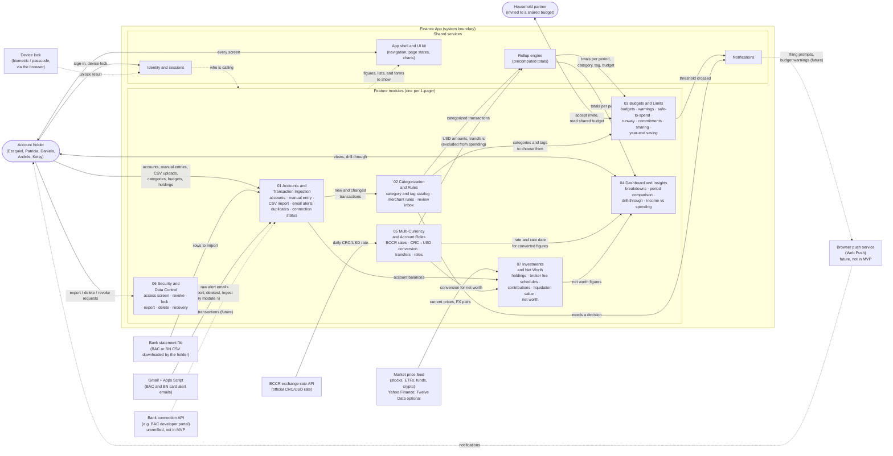
<!-- END:context -->

**What it shows.** The context model draws the boundary of the system. Inside it are seven
feature modules, one per 1-pager, and four shared services that several modules depend
on: identity, notifications, the rollup engine that keeps totals precomputed, and the app
shell and UI kit through which every module is shown. Outside
it are the account holder, the household partner, and the external systems the product
exchanges data with (Gmail, bank statement files, the BCCR exchange-rate API, and the
market price feed). Dashed elements, such as bank connection APIs and Web Push, are
deliberately not part of the MVP.

**Why it is valuable.**

- It fixes the boundary. Since banks, BCCR, Gmail, and the price feed are outside the
  system, their failures are something the product must handle (stale rates, stale prices,
  a connection that stopped sending) rather than something it can fix.
- It gives every story one owner. The class diagram is grouped by these modules, and each
  sequence diagram starts from the module that owns its story.
- It makes cross-module dependencies explicit, for example that budgets and the dashboard
  read from the rollup engine, and that net worth depends on currency conversion. These
  are the connections a code generator is most likely to miss.
- It names presentation as a shared concern. Drawing the app shell and UI kit as a service
  every module depends on makes the screens consistent by design, instead of leaving each
  page to be built on its own.

### 3.2 Architecture Diagram

Source: [`diagrams/architecture.md`](diagrams/architecture.md) (an editable draw.io
version with AWS icons is in [`architecture.drawio`](diagrams/architecture.drawio))

<!-- BEGIN:architecture -->
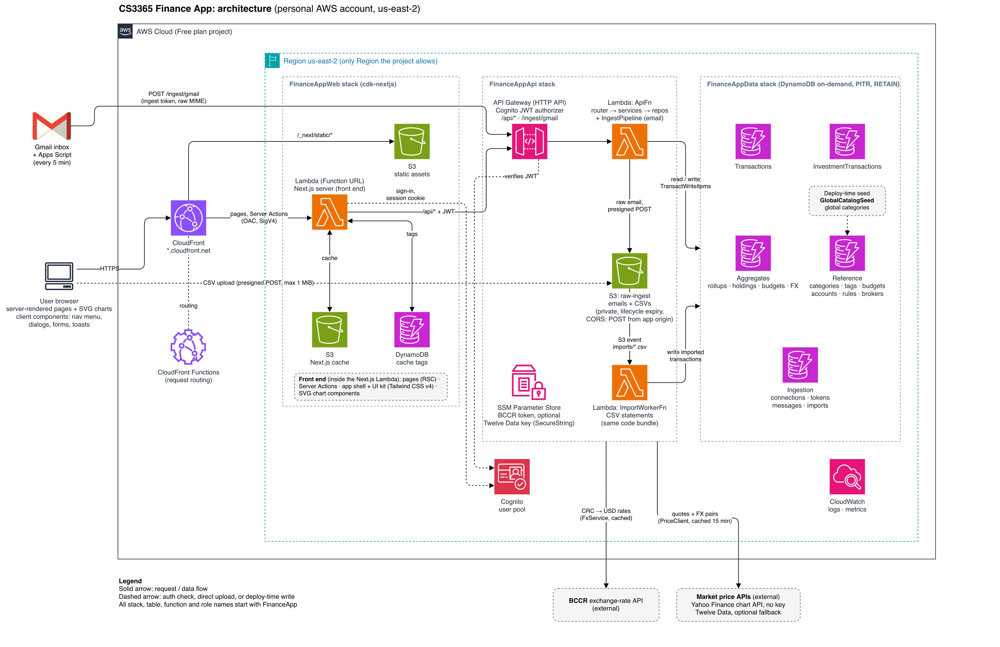
<!-- END:architecture -->

**What it shows.** Every runtime element of the system, deployed on AWS in `us-east-2`:

- **Front end:** a Next.js app served through CloudFront. Static assets come from S3, and
  pages and Server Actions run in a Next.js server Lambda (deployed with the `cdk-nextjs`
  construct). The pages and their charts are rendered on the server, using a UI kit
  styled with Tailwind CSS and hand-written SVG charts, so the browser only runs small
  client components such as the navigation menu, dialogs, and forms.
- **Back end:** an API Gateway HTTP API with a Cognito JWT authorizer in front of one
  Lambda (`ApiFn`) that holds the routers, services, and repositories. A second Lambda
  (`ImportWorkerFn`, built from the same code) processes CSV statements when they are
  uploaded to S3.
- **Data:** five DynamoDB tables (transactions, investment transactions, precomputed
  aggregates, reference data, and ingestion state), a private S3 bucket for raw emails and
  CSV files, and SSM Parameter Store for the BCCR token. On every deployment, the data
  stack also writes the sixteen built-in categories to the reference table.
- **Services:** Cognito for sign-in, CloudWatch for logs and metrics, and the external
  BCCR, Yahoo Finance, and Gmail Apps Script integrations.

**Why it is valuable.** It decides which AWS service runs each part of the system, and it
groups resources into the three stacks (data, API, web) that the agents deploy. It also
shows which paths are protected by Cognito and which use the Gmail ingest token, and it
documents the limits of the account we deploy to. Since the agents deploy to a real AWS
account with a restricted policy, choosing only services that policy allows was what made
deployment possible in one shot.

### 3.3 Sequence Diagrams

Source: [`diagrams/sequences/`](diagrams/sequences/) (one file per module, with an index
in [`README.md`](diagrams/sequences/README.md))

**What they show.** There is at least one sequence diagram per in-scope user story: 32
diagrams for 25 stories, plus four supporting stories (01-S02a registering an account,
02-S02a listing and creating categories and tags, 04-S01a opening the dashboard, and
07-S02a opening the portfolio overview). The supporting diagrams show how several stories
share one page. Each diagram follows a request from the browser through the Next.js
server, the API router, and the services, down to the DynamoDB items it reads or writes,
and it ends with the page section and component that show the result. Rules that apply
to every diagram (authentication, partitioning by user, the shared save path, error
handling, logging, and the loading, empty, and error states of every page) are written
once in the index instead of being repeated.

| Module | Stories |
|---|---|
| 01 Accounts and Ingestion | 01-S02a, 01-S02, 01-S03, 01-S04, 01-S05, 01-S08 (3 diagrams), 01-S09 |
| 02 Categorization and Rules | 02-S02, 02-S02a, 02-S03, 02-S05, 02-S06 |
| 03 Budgets and Limits | 03-S02, 03-S10 (2 diagrams), 03-S11 |
| 04 Dashboard and Insights | 04-S01a, 04-S01, 04-S03, 04-S06 |
| 05 Multi-Currency | 05-S01, 05-S02, 05-S06 |
| 06 Security and Data Control | 06-S02 |
| 07 Investments and Net Worth | 07-S01, 07-S02, 07-S02a, 07-S03, 07-S04, 07-S05 |

**Why they are valuable.**

- They turn each story into concrete calls. Each diagram names the route, the service
  method, and the DynamoDB items involved, which gives a code generator an order of
  operations instead of a sentence of intent.
- They show where the hard rules live, such as idempotency checks, the version condition
  on edits, and the single DynamoDB transaction that keeps rollups and budgets consistent.
- They define the class diagram, since every participant must exist as a class and every
  message must exist as a method.
- They expose shared paths. Manual entry, Gmail alerts, and CSV statements all end in the
  same save path, and drawing them makes that reuse visible, so it is built once.

### 3.4 Class Diagram

Source: [`diagrams/class-diagram.md`](diagrams/class-diagram.md)

**What it shows.** The classes needed to implement every in-scope sequence diagram. It is
split into 26 diagrams, one per layer or module (or part of one), so each stays readable:

| Section | Contents |
|---|---|
| 1. Domain model | Entities, value objects, and enums stored in DynamoDB |
| 2. Next.js layer | Server Actions (UI controllers) and session handling, the app shell, UI kit, and design tokens, the chart components, and every page's layout, states, and wording |
| 3. API shell and data access | Lambda entry points, routers (API controllers), errors, configuration, factories, and repositories (database handlers) |
| 4. Transactions core | The single save path every source uses, and the rollup planner |
| 5–10. Modules 01, 02, 03, 04, 05, 07 | The services, parsers, and calculators of each module, including the category and tag catalog and the user settings in module 02 |
| 11. Gmail Apps Script | The script that runs in the user's Google account |

Module 06 has no classes of its own, since its only in-scope story (revoking the Gmail
connection) is handled by the connection service in module 01. The diagram also fixes
conventions the code must follow: money is stored as integer minor units, never floating
point, and dependencies are passed through constructors so tests can use fakes.

**Why it is valuable.** It is the build list: a code generator can create one file per
class and one function per method, and the sequence diagrams say in which order to call
them. It also fixes the boundaries between layers. Routers only validate, services hold
the business rules, and repositories are the only classes that touch DynamoDB, S3, or
SSM, so each rule has exactly one class that owns it. Since iteration 3, it also specifies
the screens: section 2 gives every page its components, layout, states, charts, and
wording, so the front end is built from the design the same way the services are.

### 3.5 Bank Formats

Source: [`diagrams/bank-formats.md`](diagrams/bank-formats.md)

This document was added in iteration 2. It specifies the four bank files the app reads
(a statement CSV and a card alert email from each of BAC Credomatic and Banco Nacional),
with a diagram of how a file is matched to its template, and the exact result each
redacted sample in [`samples/`](samples/) must produce. We added it because a template can
only be written against a real file, and the expected results let the agents write golden
tests that prove their parsers work.

---

## 4. Iterations

### 4.1 Process

Each iteration follows the same steps:

1. We change the diagrams on a branch and merge them into `main` with a pull request. (In
   iteration 3, the changes were committed to `main` directly.)
2. On the next `attemptN` branch, we merge `main` and copy the 1-pagers, the diagrams, and
   (from iteration 2) the bank samples into two fresh directories, `agent-a/` and
   `agent-b/`.
3. Two coding agents, each with a different model, start in a new session with no prior
   context. **Agent A uses Claude Opus 5.5** and **agent B uses GPT Terra 5.6**. Each one
   receives the prompt in [Section 5](#5-prompts), and it may only read its own directory.
4. The agents work on their own until they finish. We do not answer questions or give
   hints during the run. Each one builds the app, runs its tests, deploys to our AWS
   account under its own stack prefix (for example `FinanceAppA2`), and writes an
   `IMPLEMENTATION_NOTES.md` with what it built, what it left incomplete, and every error it
   could not resolve.
5. We review the code, the notes, and the deployment, commit each agent's directory, and
   use what we found to decide the next round of diagram changes.

The only thing we change between rounds is the diagrams. The prompt changes only to point
at new inputs (such as the bank samples) and to describe the AWS environment more
accurately. It never adds a design decision that is not already in the diagrams.

### 4.2 Iteration 1

**Diagrams** ([PR #1](https://github.com/Ezequiel294/cs3365-finance-app/pull/1)). The
first design included the context model, the architecture diagram (Mermaid and draw.io),
sequence diagrams for the 25 in-scope stories, the class diagram, the summary of changes
from the 1-pagers, and the BCCR request and response format. Two parts were left open on
purpose, because we did not have the information yet: the bank file formats (the agents
were told to add placeholder templates) and the market price provider (the agents were
told to pick one with a free tier).

**Results.**

| | Agent A (Claude Opus 5.5) | Agent B (GPT Terra 5.6) |
|---|---|---|
| Run time | 77 minutes | 22 minutes |
| Stories built | All 25, end to end | Schemas, calculators, and service outlines. Several core paths were stubs (CSV import, Gmail processing, rollup writes, analytics) |
| Unit tests | 112 passing | 7 passing |
| Deployment | All 3 stacks deployed. App at <https://d49sywx0ptz9d.cloudfront.net> | Data and API stacks deployed. The web stack failed |
| Verification against the deployment | A smoke test script passed 21 of 21 checks (manual entry with a live BCCR rate, budgets, Gmail connection, CSV import through S3) | `401` checks on the API only |
| Gaps reported | Placeholder bank templates (real files are rejected), market prices unavailable (the chosen provider needed a key that did not exist) | The stubs above, and the web stack stuck in `DELETE_FAILED` |

**What we learned.**

- The parts of the design we left open were exactly where the app did not work. Agent A
  built the whole app, but a real BAC or Banco Nacional file could not be imported, and
  no investment could be valued, since the price provider it picked needed an API key.
- Agent B pointed out that the diagrams had no flow for registering accounts. That flow
  was also needed to tell transfers between the user's own accounts apart from spending.
- The `cdk-nextjs` construct creates an SSM parameter that our CloudFormation policy does
  not allow, which made agent B's web stack fail. Agent A's web stack deployed without
  this error.
- Long deployments were cut off by the agents' tool time limits, and both agents hit
  errors with the credential setup before they could start deploying.

### 4.3 Iteration 2

**Diagram changes** ([PR #2](https://github.com/Ezequiel294/cs3365-finance-app/pull/2)):

- **Real bank formats.** We added [`bank-formats.md`](diagrams/bank-formats.md) with the
  BAC and Banco Nacional statement and alert templates, and redacted real samples with
  their expected results in [`samples/`](samples/). This replaced the placeholder
  templates.
- **Account registration (01-S02a).** A new sequence diagram for registering an account
  with its bank, currency, IBAN, and card numbers. Alerts are routed to an account by card
  number, and statement rows that send money to a registered IBAN (or come from the
  account holder's own name) are imported as transfers and kept out of spending.
- **Retrying an email that was not understood (01-S08c).** A third Gmail diagram, so an
  alert that failed to parse can be retried from the review inbox.
- **Market prices.** The Yahoo Finance chart API, which needs no key, is the primary
  source, with Twelve Data as an optional fallback. The last known price is kept for 30
  days and shown as stale.
- **Broker fee schedules.** A single commission rule per broker could not describe real
  broker fees (for example a 1.55% deposit fee, a flat fee on funds, and a percentage on
  crypto at the same broker). Each broker now has a fee schedule for deposits,
  withdrawals, and buys and sells per asset class, and a shared `FeeCalculator` suggests
  the commission on every investment transaction.
- **Architecture details.** The price APIs, the upload limits and CORS rule for statement
  uploads, and the S3 event filter that starts the import worker.
- **Fixes.** Two Mermaid syntax errors, the deposit fee wording, the Gmail label name, and
  a broken link.

**Prompt changes.** The prompt now points to the samples and asks for golden tests on
them. It also warns about the `cdk-nextjs` SSM parameter, tells the agents to run long
deployments in the background, uses absolute paths for the credential files, and tells
them not to delete stacks.

**Results.**

| | Agent A (Claude Opus 5.5) | Agent B (GPT Terra 5.6) |
|---|---|---|
| Run time | 89 minutes | 18 minutes |
| Stories built | All 25 plus 01-S02a, end to end | Schemas, parsers, calculators, and price providers. Core paths were still incomplete (rollup writes, CSV persistence, Gmail processing, analytics, investment endpoints) |
| Size | 156 source files, about 12,000 lines | 22 source files |
| Unit tests | 153 passing, including golden tests for all 4 samples | 11 passing, including golden tests for all 4 samples |
| Deployment | All 3 stacks deployed. App at <https://d3o67i9lghbxl7.cloudfront.net> | Data and API stacks deployed. The web stack ended in `ROLLBACK_FAILED` |
| Verification against the deployment | Imported the real BAC sample through S3 and the worker: 65 rows, 58 recognized as transfers, totals matched the bank's printed checksum. Also checked live BCCR conversion, Yahoo quotes, budgets, the Gmail connection, and investment valuation | `401` checks on the API only |

**What we learned.**

- Real samples with expected results worked well. Both agents parsed all four bank files
  correctly, even agent B, which left most of the rest of the app incomplete.
- Agent A found a bug in the design: the class diagram's formula for a holding's value
  (`quantityMicro × priceMicros ÷ 10¹²`) gives dollars, not cents. Cents need `÷ 10¹⁰`.
  Agent A noticed the mismatch and used the correct value, but a design that relies on the
  agent to catch its mistakes is fragile, so we fixed it for iteration 3.
- Agent B's web stack failed again on the same SSM parameter. It removed the parameter
  from its template, but only after the first failed deployment, and a stack in
  `ROLLBACK_FAILED` cannot be deployed again without manual cleanup.

### 4.4 Iteration 3

**Diagram changes** (commits `b4a4613` and `ed8dbe9` on `main`). Both earlier builds
computed the right numbers but showed each page as a stack of tables and forms, which was
hard to read at a glance, and that is the dashboard's whole purpose. Since a code
generator improvises whatever it is not told, most of this round specifies the screens:

- **Screens are part of the design.** Section 2 of the class diagram is now four parts:
  controllers and session, the app shell and UI kit (navigation, about twenty shared
  components, and colour and type tokens), the chart components, and every page's layout
  (as a wireframe), sections in order, states, and wording. The components and charts are
  hand-written (Tailwind CSS and SVG), with no component or chart library, so both agents
  build the same components from the same specification instead of each choosing its own.
  The context model adds the app shell and UI kit as a shared service, and the
  architecture diagram lists the front-end elements.
- **Page states.** Every page shows a skeleton while it loads, one empty state when there is
  no data, and an error state with "Try again" when a call fails. Creating or editing
  anything happens in a dialog, and every action ends in a toast or in errors under the
  fields. Each sequence diagram now ends with the page section and the component that
  shows the result.
- **Categories, tags, and settings (02-S02a, and a second 03-S10 diagram).** Sixteen
  built-in categories are seeded when the app is deployed, and users add their own
  categories and tags on a Settings page, where the day the week starts is also set. The
  earlier design did not say where the list came from, so each agent invented one in a
  different place.
- **Dashboard month (04-S01a).** The dashboard and the transaction list open on the current
  month, or on the latest month with data, and last month is one step back. The two pages
  used to open on different months, and one of them opened empty.
- **Portfolio overview (07-S02a).** The portfolio also shows how the value splits across
  holdings, each holding's value against its cost, the part of the value that fees would
  take on selling, and deposits and withdrawals by month. Each view answers a question the
  1-pager already asks.
- **Price time.** Prices show the time the market last traded at that price, instead of
  the time the app retrieved it, since the page used to show two different times for the
  same price.
- **Holding value formula.** The value in cents is `quantityMicro × priceMicros ÷ 10¹⁰`,
  the fix for the bug agent A found in iteration 2.
- **Product name.** The `{{PRODUCT_NAME}}` placeholder was replaced with "Finance App"
  everywhere, so the generated app and its documents use the same name.

Overall, the design grew from 48 to 61 diagrams. All of them still parse.

**Prompt changes.** The prompt now gives agent B's repeated failure its solution. Both of
agent B's web stacks failed on the SSM parameter that `cdk-nextjs` creates. In iteration 2,
the prompt only warned about it, and agent B deployed before removing it. The iteration 3
prompt includes the lines agent A used to remove the parameter, the policy that reads it,
and the environment variable that names it, and asks for a `cdk synth` check that no
template contains an SSM parameter before the first deploy. Since this is about the AWS
account's restrictions, not the design, it is the same in both prompts. Otherwise, only
the iteration number and the stack prefixes (`FinanceAppA3`, `FinanceAppB3`) changed.

**Results.**

| | Agent A (Claude Opus 5.5) | Agent B (GPT Terra 5.6) |
|---|---|---|
| Run time | 141 minutes | 20 minutes |
| Stories built | All 25 plus the 4 supporting stories, end to end, with the specified screens: a UI kit of 24 shared components, the 5 hand-written SVG charts, one page per route, and the Settings page | API routes for most stories, but several return fixed empty results (spending analytics, the review inbox, portfolio valuation, and liquidation). Every page is the same generic page, which shows a title and an empty state with buttons that do nothing |
| Size | 220 source files, about 15,500 lines | 19 source files, 117 lines (64 KB, with most of each file on one line) |
| Unit tests | 171 passing, including golden tests for all 4 samples | 10 passing, including the parser tests |
| Deployment | All 3 stacks deployed. App at <https://d343n1cthv1u7o.cloudfront.net> | **All 3 stacks deployed, for the first time.** App at <https://d2r3kcip509cjc.cloudfront.net> |
| Verification against the deployment | The 16 categories were seeded. A ₡14,000 entry was converted at the live BCCR rate. The BAC sample imported through S3 and the worker (65 rows, 58 transfers, checksum OK), and uploading it again was refused. It also checked the Gmail connection and heartbeat, budget backfill, and Yahoo quotes, including a Canadian ticker converted with `USDCAD=X`. Every page was rendered locally against the deployed tables | None reported. Our own checks: `/api/*` without a token returns `401`, but the pages load without signing in, and `/ingest/gmail` with an invalid token returns `500` instead of `401` |

**What we learned.**

- Giving the solution to a repeated problem worked. Both web stacks deployed with no SSM
  errors, and agent B's notes describe removing the parameter, the policy, and the
  environment variable exactly as the prompt said. This is the first round where agent B
  delivered a working URL.
- Agent A built the screens from the class diagram's section 2, using the same component
  and chart names (`PageHeader`, `StatTile`, `EmptyState`, `BarList`, `SegmentedBar`, and so
  on). Specifying the screens left it less to improvise.
- Agent B's pattern did not change across the three rounds. It finished quickly, wrote its
  code with most of each file on one line, and left the core paths returning fixed data.
  This time its notes also did not list the incomplete parts, the test results, or the
  deployment results, which earlier rounds did include.
- Agent A again left test records under a synthetic user in its tables, and it could not
  test sign-up through a real browser session, since confirming a Cognito user needs a
  mailbox.

### 4.5 Comparison of the Two Models

Across the three rounds, agent A (Claude Opus 5.5) built the complete app from the
diagrams, followed the class and method names, tested it against the live deployment, and
reported the parts it could not finish. Agent B (GPT Terra 5.6) followed the same structure
and handled the self-contained parts well, such as schemas, parsers, and calculators.
However, it left most of the paths that connect those parts as stubs in every round. Its
web stack only deployed in iteration 3, once the prompt gave it the exact fix instead of a
warning, which suggests that agent B follows explicit instructions well but does not work
out open problems on its own. Agent B also finished much faster in every round (22, 18,
and 20 minutes, against 77, 89, and 141 minutes for agent A), which matches how much less
of the app it built. Overall, the more precisely a part of the design was
specified (exact formats, expected results, named classes and components), the closer the
two agents' results were.

---

## 5. Prompts

Each agent received one prompt as the first message of a new session, with no follow-up.
The prompts for agent A and agent B are identical except for the working directory
(`agent-a/` or `agent-b/`) and the stack prefix (`FinanceAppA1` or `FinanceAppB1`, and so
on). The prompt tells the agent:

- to work on its own until it finishes, without asking questions, and to record every
  assumption in `IMPLEMENTATION_NOTES.md`;
- to read only its own directory, to build every story that has a sequence diagram, and
  to follow the diagrams where they disagree with the 1-pagers;
- what to build (web app, API, infrastructure, shared schemas, Gmail script, bank
  templates, price provider, tests, and a README);
- how to use the AWS account: the credentials, what its role and the CloudFormation policy
  allow, how to name its stacks, and what is already in Parameter Store;
- how to verify the deployment and what to report at the end.

The full iteration 1 prompt is in [Appendix B](#appendix-b-prompts), followed by the
changes made for iterations 2 and 3. The exact files for each round are in `one-shot/` on each
attempt branch:

| Iteration | Agent A | Agent B |
|---|---|---|
| 1 | [`prompt-agent-a.md`](https://github.com/Ezequiel294/cs3365-finance-app/blob/attempt1/one-shot/prompt-agent-a.md) | [`prompt-agent-b.md`](https://github.com/Ezequiel294/cs3365-finance-app/blob/attempt1/one-shot/prompt-agent-b.md) |
| 2 | [`prompt-agent-a.md`](https://github.com/Ezequiel294/cs3365-finance-app/blob/attempt2/one-shot/prompt-agent-a.md) | [`prompt-agent-b.md`](https://github.com/Ezequiel294/cs3365-finance-app/blob/attempt2/one-shot/prompt-agent-b.md) |
| 3 | [`prompt-agent-a.md`](https://github.com/Ezequiel294/cs3365-finance-app/blob/attempt3/one-shot/prompt-agent-a.md) | [`prompt-agent-b.md`](https://github.com/Ezequiel294/cs3365-finance-app/blob/attempt3/one-shot/prompt-agent-b.md) |

---

## 6. Deployment

The app is deployed on AWS instead of Vercel or Railway. The architecture is built around
AWS services: a background worker started by file uploads to S3, DynamoDB tables, Cognito
for sign-in, and Parameter Store for the BCCR token. Hosting only the front end on Vercel
would still leave the rest on AWS, so we deploy everything to one AWS account
(`us-east-2`). All infrastructure is defined with the AWS CDK, which lets each agent deploy
its own copy of the app under its own stack prefix.

| Iteration | Agent | App | Status |
|---|---|---|---|
| 1 | A | <https://d49sywx0ptz9d.cloudfront.net> | Deployed |
| 1 | B | None | Web stack failed (API only) |
| 2 | A | <https://d3o67i9lghbxl7.cloudfront.net> | Deployed |
| 2 | B | None | Web stack failed (API only) |
| 3 | A | <https://d343n1cthv1u7o.cloudfront.net> | Deployed (the version to demo) |
| 3 | B | <https://d2r3kcip509cjc.cloudfront.net> | Deployed, but the pages are placeholders |

---

## 7. Product Backlog

The full backlog is in
[`docs/backlog.md`](https://github.com/Ezequiel294/cs3365-finance-app/blob/attempt3/docs/backlog.md).
This section summarizes how it is written and includes the ordered backlog, the release
plan, and the first sprint. Every item, with its story and acceptance criteria, is in
[Appendix C](#appendix-c-backlog-items).

**How it is written.** The backlog follows the recommendations of Sommerville's
*Engineering Software Products* (chapters 2 and 3) and *Software Engineering* (chapters 3
and 23):

- **Item types.** Features (user stories), feature changes (where the design does not
  meet a story's acceptance criteria), and engineering improvements (`TECH-nn`, such as
  checks on every pull request).
- **Stories.** Every story uses the format *As \<persona\>, I want to \<do something\> so
  that I can \<reason\>*, fits in one sprint, and has acceptance criteria that can each be
  tested.
- **States.** Each item is ready for consideration, ready for refinement, or ready for
  implementation, and items near the top are written in more detail.
- **Estimates.** Items are estimated in story points on the modified Fibonacci scale,
  relative to the same baseline as Project 1 (01-S03, adding a transaction by hand, is 2
  points).
- **Priority.** Items are ranked by value to the vision first, then dependencies, risk,
  and cost.
- **Ready and Done.** It defines a Definition of Ready and a Definition of Done. Since the
  app is generated from the design, "done" starts with the item being designed (sequence
  diagram, class diagram, and page specification) and merged through a pull request.

**Where the items come from.** The main stories removed from the design, the parts of
in-scope stories the design does not meet (for example, there is no way to delete a
transaction or a budget), and what the three iterations showed (a broken diagram reached
`main`, signed-in flows were only checked by hand, agent B's web stack failed on the SSM
parameter, and the Portfolio page failed to load with a React error). The backlog is
kept short: 15 items, 55 points, in two releases.

<!-- BEGIN:backlogOrdered -->
### Ordered Product Backlog

| Rank | ID | Type | Title | Persona | Points | State | Depends on |
|---|---|---|---|---|---|---|---|
| 1 | [01-S10](#01-s10--delete-a-transaction) | Feature change | Delete a transaction entered by mistake | Daniela | 2 | Implementation | — |
| 2 | [07-S07](#07-s07--remove-an-investment-transaction) | Feature change | Remove an investment transaction | Ezequiel | 2 | Implementation | — |
| 3 | [01-S06](#01-s06--every-account-and-its-balance) | Feature | See every account and its balance | Ezequiel | 5 | Implementation | — |
| 4 | [07-S06](#07-s06--accounts-and-holdings-in-one-total) | Feature | See accounts and holdings in one total | Ezequiel | 3 | Implementation | 01-S06 |
| 5 | [04-S04](#04-s04--see-the-transactions-behind-a-figure) | Feature | See the transactions behind any figure | Daniela | 5 | Implementation | — |
| 6 | [TECH-01](#tech-01--checks-on-every-pull-request) | Engineering improvement | Checks on every pull request | Team | 3 | Implementation | — |
| 7 | [TECH-08](#tech-08--the-portfolio-page-loads) | Engineering improvement | The portfolio page loads | Team | 2 | Refinement | — |
| 8 | [TECH-02](#tech-02--signed-in-checks-on-the-deployment) | Engineering improvement | Signed-in checks on the deployment | Team | 5 | Implementation | — |
| 9 | [TECH-07](#tech-07--the-web-stack-deploys-the-first-time) | Engineering improvement | The web stack deploys the first time | Team | 2 | Implementation | — |
| 10 | [03-S15](#03-s15--delete-a-budget) | Feature change | Delete a budget | Keisy | 2 | Implementation | — |
| 11 | [05-S03](#05-s03--pair-the-two-sides-of-a-transfer) | Feature | Pair the two sides of a transfer | Ezequiel | 8 | Implementation | — |
| 12 | [03-S13](#03-s13--in-app-budget-warning) | Feature | In-app budget warning | Daniela | 3 | Implementation | — |
| 13 | [02-S04](#02-s04--create-and-order-rules) | Feature | Create and order rules | Ezequiel | 5 | Implementation | — |
| 14 | [06-S04](#06-s04--export-all-data) | Feature | Export all my data | Patricia | 5 | Implementation | — |
| 15 | [01-S11](#01-s11--import-colones-statements) | Feature change | Import colones statements | Patricia | 3 | Refinement | — |

**15 items, 55 points:** 7 features, 4 feature changes, and 4 engineering improvements.
"State" is shortened to the last word. Rank and state are separate: `TECH-08` and `01-S11`
rank high while still being refined.

The backlog was cut down to the main items to keep it short; the stories left out remain in the removed-from-scope list. 01-S06 was re-estimated from 3 to 5 points: a balance includes transfers and card payments, which the spending rollups leave out, and BN statements print no balance, so a starting balance must be entered.

<!-- END:backlogOrdered -->

<!-- BEGIN:backlogRelease -->
### Release Plan

The releases are provisional: how many sprints each takes is worked out once the first
sprint has measured the team's velocity.

| Release | Theme | Ranks | Points |
|---|---|---|---|
| 1 | **Correct and traceable figures.** Mistakes can be removed, every figure opens to its transactions, balances and net worth exist, the Portfolio page works, and every pull request and deployment is checked | 1–10 | 31 |
| 2 | **Complete records and control.** Transfers are paired, budgets warn, rules can be created, data can be exported, and colones statements come in | 11–15 | 24 |

<!-- END:backlogRelease -->

<!-- BEGIN:backlogSprint -->
### First Sprint

#### Sprint goal

> **Show where my money is, and let every figure on the dashboard be checked and
> corrected.**

It is met when, on the deployed app:

1. each registered account shows a balance and where the balance came from;
2. the dashboard and the portfolio show a net worth figure, with its two parts;
3. every figure on the dashboard and the budgets page opens to a list of transactions whose
   total equals it;
4. a transaction and an investment transaction can each be removed, and every figure they
   counted in changes; and
5. a pull request that breaks a diagram or a test cannot be merged.

#### Length and capacity

- **Length:** two weeks, fixed. Anything unfinished returns to the product backlog.
- **Forecast:** about **20 points**. The team has no velocity yet, so the two smallest items
  (01-S10 and 07-S07) are done first to measure it. The points finished at the end become
  the velocity for the second sprint.
- **Mid-sprint check.** If about half the points (10) are not done halfway through, the
  lowest-ranked selected item returns to the backlog.

#### Selected items and sprint backlog

The six highest-ranked items, all serving the goal. Team members sign up for tasks (4 to 16
hours each) rather than having them assigned.

| Rank | ID | Title | Points | Tasks | Hours |
|---|---|---|---|---|---|
| 1 | 01-S10 | Delete a transaction | 2 | Class diagram and section 2d; sequence diagram; route, service method, and button; rollup and re-import tests; check on the deployment | 26 |
| 2 | 07-S07 | Remove an investment transaction | 2 | Class diagram; sequence diagram with the refused removal; route and service method; tests for an older buy and the refused case; check on the deployment | 26 |
| 3 | 01-S06 | See every account and its balance | 5 | Balance rollup design; BAC balance column in `bank-formats.md`; dialog and Accounts section design; sequence diagram; rollup and template build; dialog and section build; golden and unit tests; check on the deployment | 64 |
| 4 | 07-S06 | See accounts and holdings in one total | 3 | Net worth headline design; sequence diagram; build; stale balance and price tests; check on the deployment | 30 |
| 5 | 04-S04 | See the transactions behind any figure | 5 | Filter parameters in the class diagram; filter bar and links design; sequence diagram; query filters; filter bar and links; total-equals-figure tests; check on the deployment | 54 |
| 6 | TECH-01 | Checks on every pull request | 3 | Workflow; Mermaid render step; required check on `main`, tested with a broken diagram | 16 |
| | | **Total** | **20** | | **216** |

#### How the team runs the sprint

There is no separate Product Owner or ScrumMaster. The daily meeting is a short written
update in a shared chat (done, next, blocked), since the two members take classes at
different times. At the sprint review the team checks the five goal conditions on the
deployed app, adds the problems it found to the backlog, and reviews its way of working.

#### Considered and left out

- **05-S03, pairing transfers (8 points).** The most valuable item after the selected ones,
  but more than a third of a forecast that has never been measured. First candidate for
  the second sprint.
- **TECH-08, the portfolio page loads (2 points).** Should be reproduced early in the
  sprint, since 07-S06 adds to that page; if the cause is small it is pulled in.
- **03-S15, deleting a budget (2 points).** The first item to pull in if the team finishes
  early.

<!-- END:backlogSprint -->

---

## Appendix A: Sequence and Class Diagrams

These are the final diagrams, after iteration 3, copied from
[`diagrams/sequences/`](diagrams/sequences/) and
[`diagrams/class-diagram.md`](diagrams/class-diagram.md). Each one keeps the short
description from its source file. The full text around each diagram (the conventions,
notes, and method descriptions) is in the repository.

<!-- BEGIN:appendixA -->
### A.1 Sequence Diagrams

#### 01 Accounts and Transaction Ingestion

##### 01-S02a — Register an account

accounts with its bank, currency, number, and cards so that statements import into the right
account and card alerts find their account.

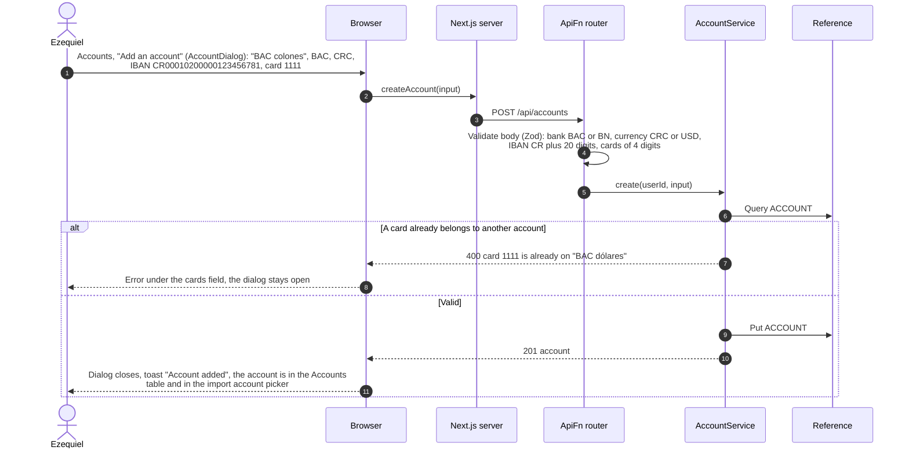

##### 01-S02 — Import a CSV statement

I can use the product without giving it access to my account.

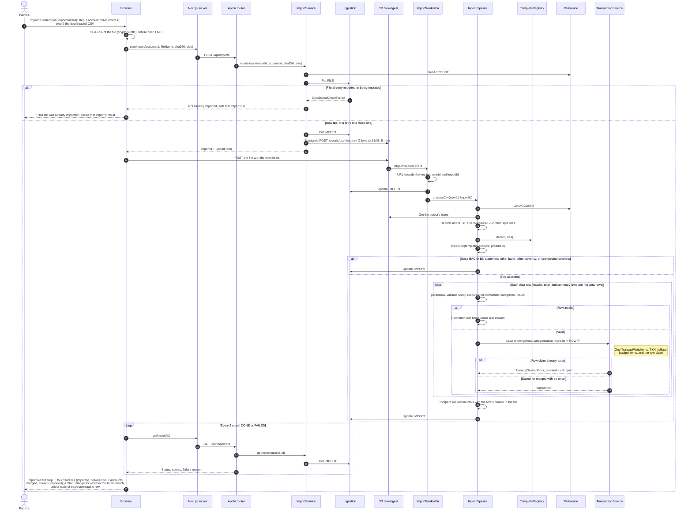

##### 01-S03 — Add a transaction by hand

record a cash payment before I forget it.

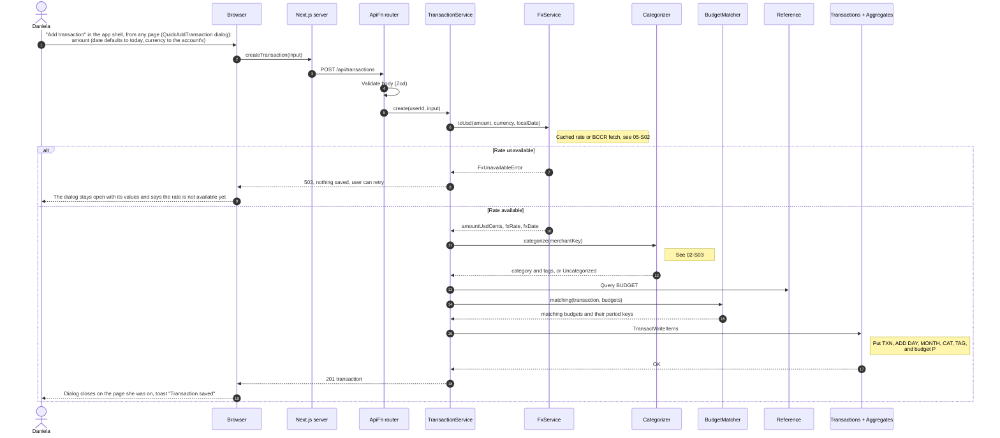

##### 01-S04 — Review possible duplicates

other so that I can keep one record per purchase when the same charge arrives by two
routes.

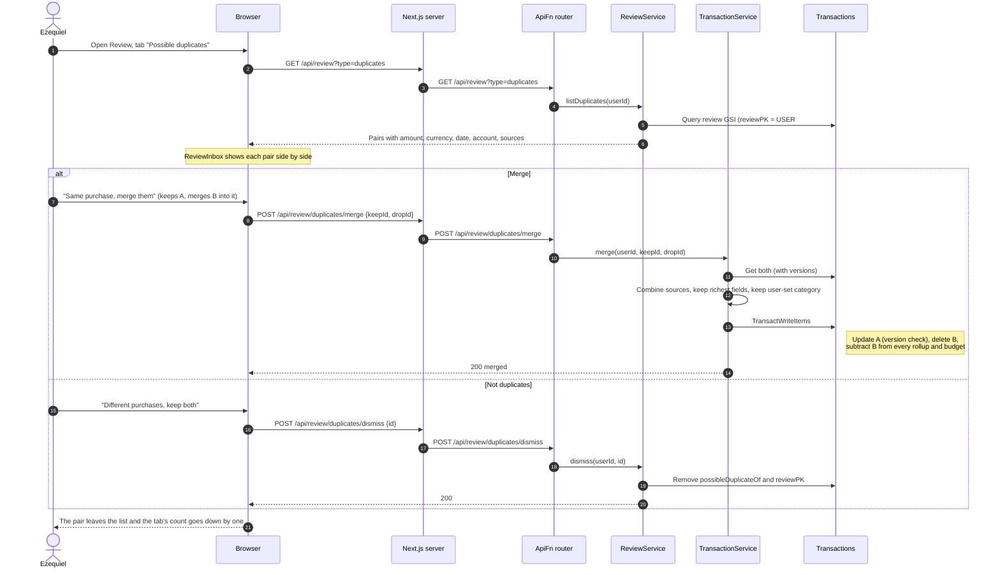

##### 01-S05 — Record incoming money

can have money coming in counted as well as money going out.

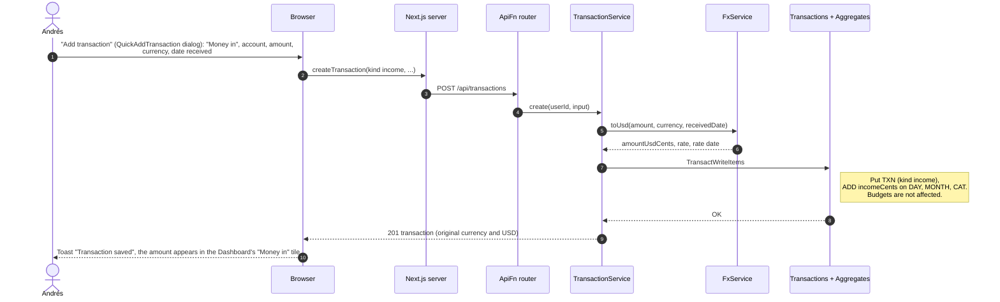

##### 01-S08a — Connect Gmail

one so that I can have its transactions arrive without my typing them.

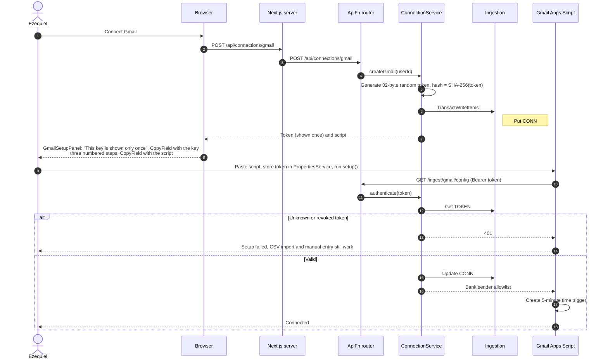

##### 01-S08b — Gmail delivers a bank alert

Every 5 minutes the script sends new BAC and BN alert emails. An email is labelled as
processed only after a `2xx`, so a failed call is retried on the next run. The template
decides which DKIM domain must have signed the email, and the card's last four digits decide
the account.

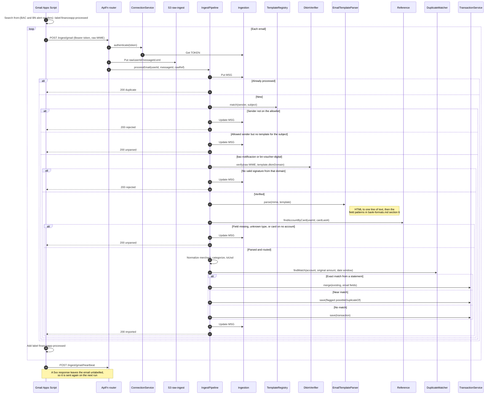

##### 01-S08c — Retry an email that was not understood

read once I have fixed the cause so that I don't have to type that purchase by hand.

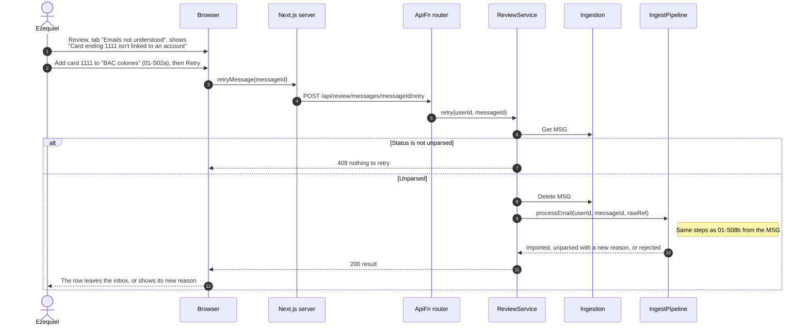

##### 01-S09 — Detect a stale connection

can notice before I rely on figures that quietly stopped updating.

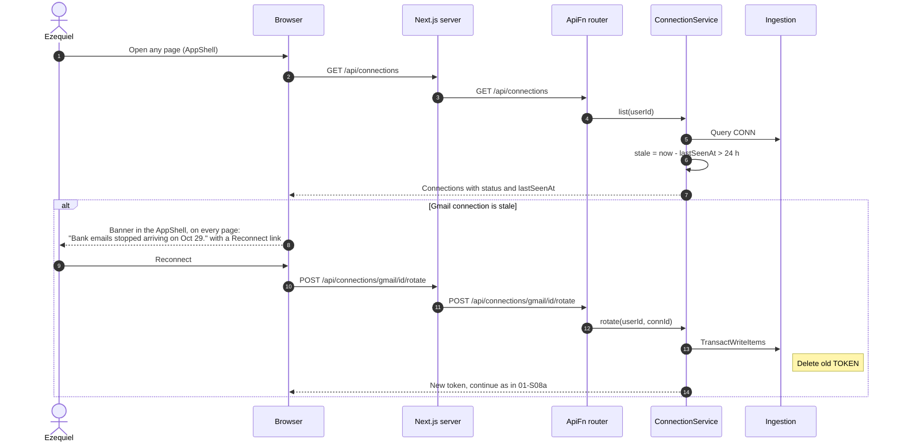

#### 02 Categorization and Rules

##### 02-S02 — Set category and tags

ask what I spent on food and what my university living cost me without the two answers
competing.

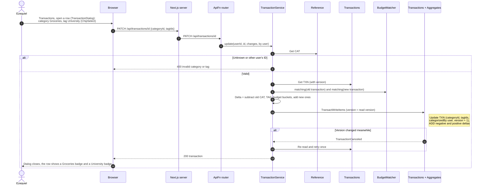

##### 02-S02a — List and create categories and tags

tags I can use and add my own so that I can file a purchase, or set a budget, under a name
that means something to me.

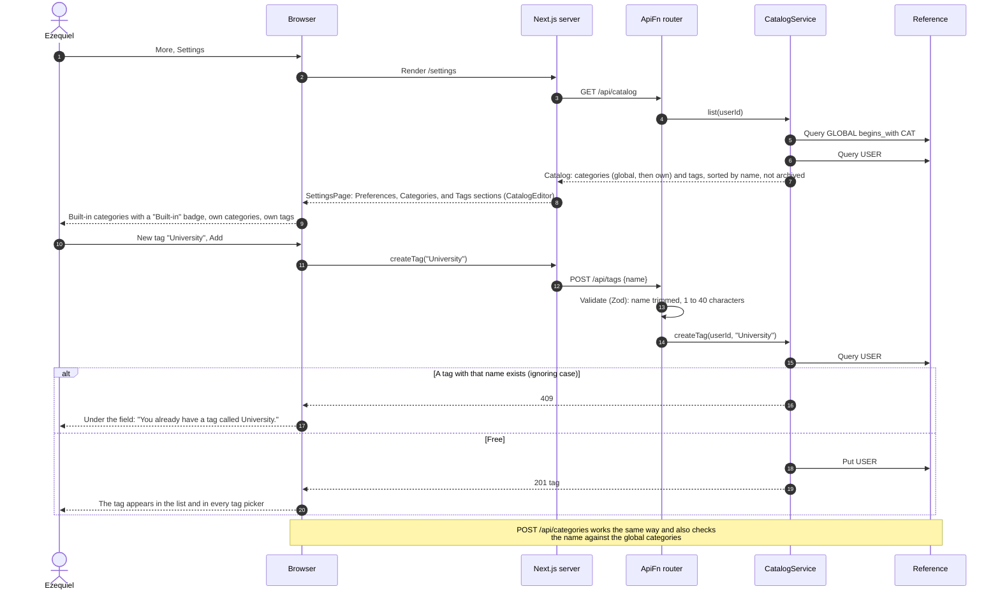

##### 02-S03 — Categorize automatically

it myself so that I can see where my week went without filing anything.

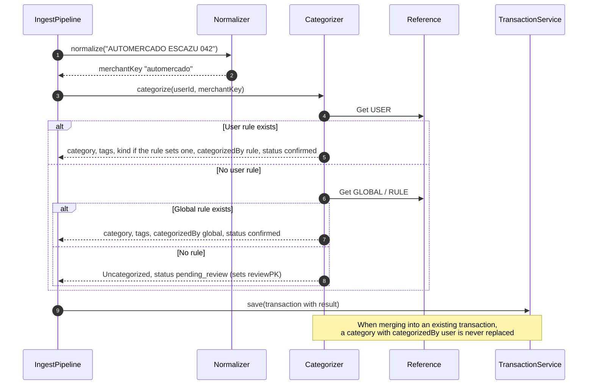

##### 02-S05 — Correct and remember

remembered so that I can fix a mistake once rather than every month.

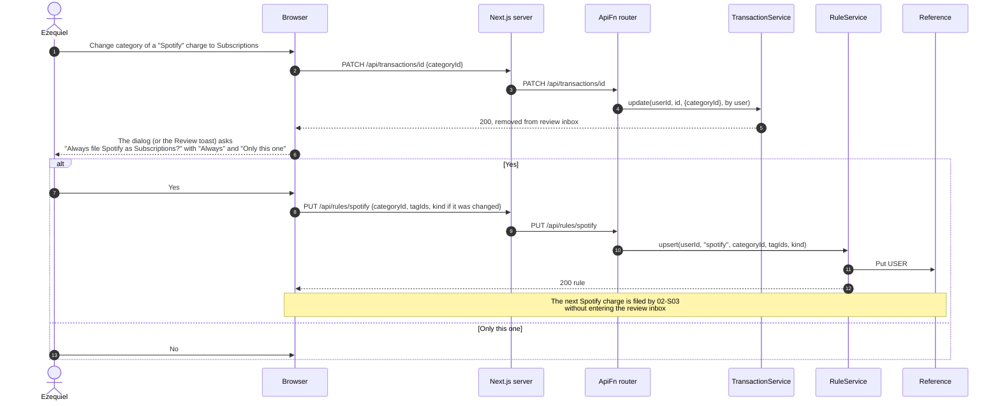

##### 02-S06 — Clear the review inbox

that I can clear them in one sitting instead of hunting for them.

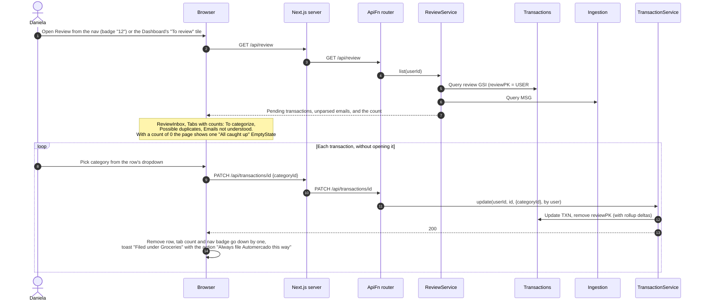

#### 03 Budgets and Limits

##### 03-S02 — Create a budget and see all progress

keep my university costs and my hobbies from being measured against one another.

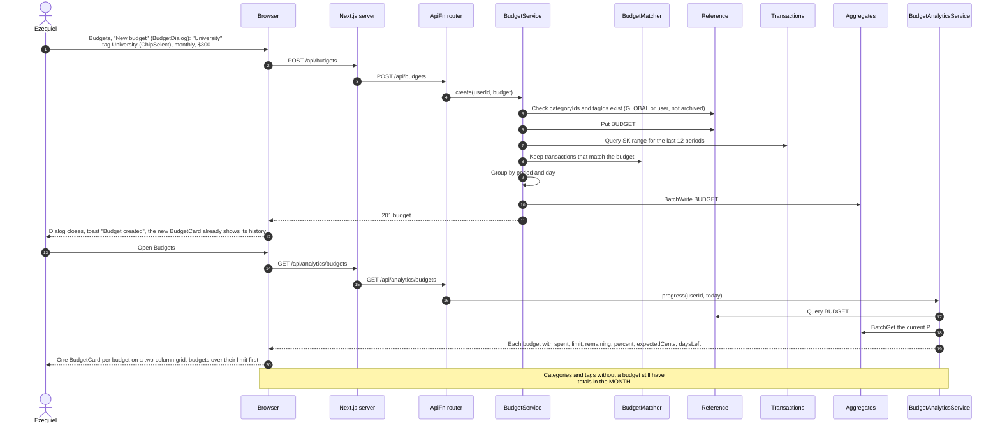

##### 03-S10 — Change a budget's period

watch the things that vary weekly apart from the ones only a year makes sense of.

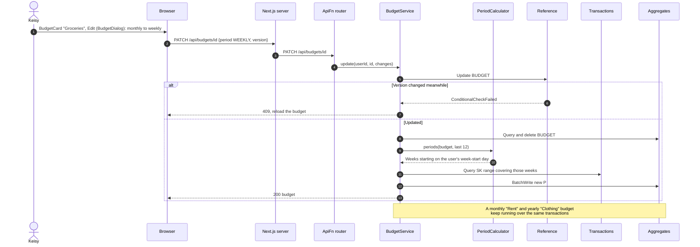

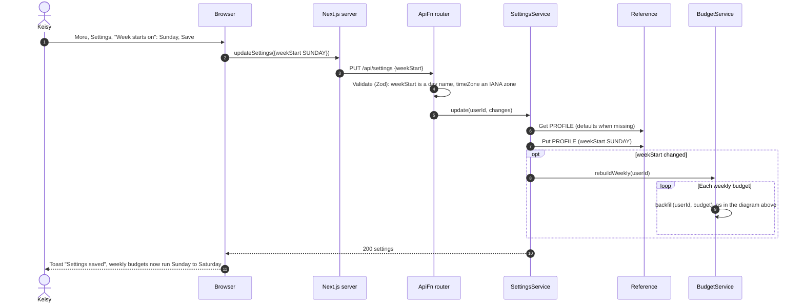

##### 03-S11 — Proportion used

when I have gone past it, so that I can tell at a glance how far over or under I am.

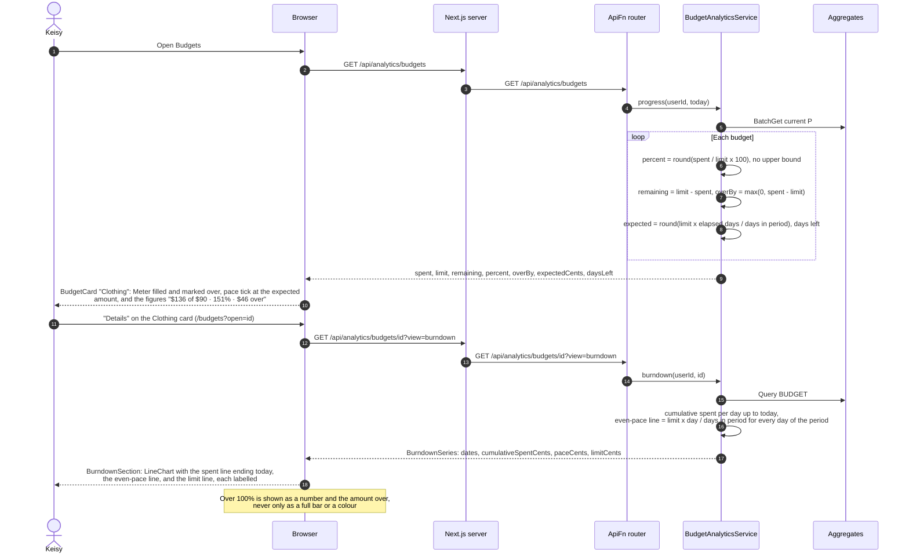

#### 04 Dashboard and Insights

##### 04-S01a — Open the dashboard

page and see what I spent, where it went, and how my budgets stand so that I can come away
with the answer without operating anything.

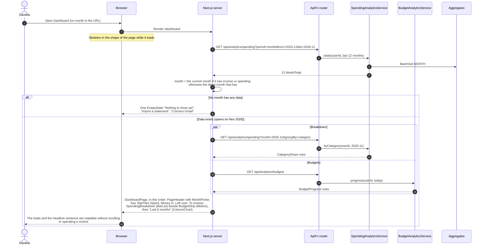

##### 04-S01 — Where last month's money went

something about my spending without having recorded any of it.

```mermaid
sequenceDiagram
    autonumber
    actor U as Daniela
    participant UI as Browser
    participant Web as Next.js server
    participant API as ApiFn router
    participant SA as SpendingAnalyticsService
    participant Agg as Aggregates
    participant Ref as Reference

    U->>UI: Dashboard, step back to Oct 2026 with the MonthPicker
    UI->>Web: Render /dashboard?month=2026-10
    Web->>API: GET /api/analytics/spending?period=month&month=2026-10&groupBy=category
    API->>SA: byCategory(userId, 2026-10)
    SA->>Agg: Query USER#id begins_with MONTH#2026-10#CAT#
    SA->>Ref: BatchGet CAT# names
    SA->>SA: share = expense / total, sort by share,<br/>keep Uncategorized as its own row
    SA-->>Web: Rows with amount and share
    Web-->>UI: SpendingBreakdown: BarList ranked by share, the six largest rows,<br/>the rest summed in one "smaller categories" line, readable without interaction
    UI-->>U: Headline "Eating out took 34% of Oct 2026".<br/>"Other" and "Uncategorized" are muted last rows and never the headline
```

##### 04-S03 — Breakdown by tag and category

that I can find out what my university living actually costs me.

```mermaid
sequenceDiagram
    autonumber
    actor U as Ezequiel
    participant UI as Browser
    participant Web as Next.js server
    participant API as ApiFn router
    participant SA as SpendingAnalyticsService
    participant BA as BudgetAnalyticsService
    participant Agg as Aggregates

    U->>UI: Switch the dashboard toggle from Category to Tag
    UI->>Web: Render /dashboard?groupBy=tag
    Web->>API: GET /api/analytics/spending?month=2026-10&groupBy=tag
    API->>SA: byTag(userId, 2026-10)
    SA->>Agg: Query MONTH#2026-10#TAG#
    SA-->>Web: Tag totals
    Web->>API: GET /api/analytics/budgets
    API->>BA: progress(userId, today)
    BA-->>Web: Budgets that target each tag, with limits
    Web-->>UI: SpendingBreakdown, tag view: BarList with one bar per tag<br/>and a marker at the limit of each tag that has a budget
    UI-->>U: "University $286" with its marker at $300,<br/>and the note that tags can add up to more than the total
```

##### 04-S06 — Income alongside spending

see how lumpy months actually compare against what I spent in them.

```mermaid
sequenceDiagram
    autonumber
    actor U as Andrés
    participant UI as Browser
    participant Web as Next.js server
    participant API as ApiFn router
    participant SA as SpendingAnalyticsService
    participant Agg as Aggregates

    U->>UI: Dashboard, tab "Money in and out"
    UI->>Web: Render /cashflow?months=12
    Web->>API: GET /api/analytics/spending?period=month&from=2025-11&to=2026-10
    API->>SA: totals(userId, 12 months)
    SA->>Agg: BatchGet MONTH#yyyy-mm#TOTAL for 12 months
    SA->>SA: Months with no item become income 0 and expense 0
    SA-->>Web: 12 points with incomeCents and expenseCents
    Web-->>UI: CashflowPage: three StatTiles (Money in, Spent, Left over),<br/>a ColumnChart with two labelled series, and the month table
    UI-->>U: A month with no income prints "$0" on the baseline, not a gap.<br/>Months before the first data are not drawn
```

#### 05 Multi-Currency

##### 05-S01 — Show the original currency

so that I can check any figure against my bank statement.

```mermaid
sequenceDiagram
    autonumber
    actor U as Ezequiel
    participant UI as Browser
    participant Web as Next.js server
    participant API as ApiFn router
    participant TQ as TransactionQueryService
    participant Tx as Transactions

    U->>UI: Open transactions for October
    UI->>Web: Render /transactions?month=2026-10
    Web->>API: GET /api/transactions?from=2026-10-01&to=2026-10-31
    API->>TQ: list(userId, range)
    TQ->>Tx: Query SK between TXN#2026-10-01 and TXN#2026-10-31~
    TQ-->>Web: Each with currency, amountMinor, amountUsdCents, fxRate, fxDate
    Web-->>UI: TransactionTable: the original amount first, USD and the rate under it
    UI-->>U: A row reads "₡14,000" with "$27.40 at 510.95" under it,<br/>next to a "$12.00" row in the same list
```

##### 05-S02 — Convert at the BCCR rate

combined figure enough to use it.

```mermaid
sequenceDiagram
    autonumber
    participant TS as TransactionService
    participant Fx as FxService
    participant Agg as Aggregates
    participant SSM as SSM Parameter Store
    participant RP as BccrRateProvider
    participant BCCR as BCCR API

    TS->>Fx: toUsd(1400000 minor, CRC, 2026-10-14)
    alt Currency is USD
        Fx-->>TS: same amount, rate 1.0
    else Currency is CRC
        Fx->>Agg: Get FX#USD-CRC#2026-10-14
        alt Rate cached
            Agg-->>Fx: rate, rateDate, source BCCR
        else Not cached
            opt First call in this Lambda container
                Fx->>SSM: GetParameters /FinanceApp/bccr/* (token decrypted)
            end
            Fx->>RP: rateFor(2026-10-14)
            RP->>BCCR: GET {endpoint}/{indicator}/series?fechaInicio&fechaFin&idioma=ES<br/>Authorization: Bearer token
            alt BCCR has a rate for that date
                BCCR-->>RP: 200 datos[0].series[] with fecha and valorDatoPorPeriodo 510.95
            else No rate that day (weekend or holiday)
                RP->>BCCR: Request the 7 days before
                BCCR-->>RP: Latest earlier rate and its date
            end
            Fx->>Agg: Put FX#USD-CRC#2026-10-14 (rate, rateDate, source)
        end
        Fx->>Fx: usd = round_half_even(amount / rate, 2 decimals)
        Fx-->>TS: amountUsdCents, fxRate, fxDate
    end
    alt BCCR unreachable and nothing cached
        Fx-->>TS: FxUnavailableError
        Note over TS,Fx: The save is refused with 503 and can be retried.<br/>Nothing is saved with a guessed rate.
    end
```

##### 05-S06 — Import a statement in its own currency

currency so that I can reconcile what I imported against the document I downloaded.

```mermaid
sequenceDiagram
    autonumber
    participant P as IngestPipeline
    participant T as TemplateRegistry
    participant Ref as Reference
    participant Fx as FxService
    participant TS as TransactionService
    participant Ing as Ingestion

    P->>Ref: Get ACCOUNT#id (bank, currency)
    P->>T: detect(lines)
    T-->>P: Template and where it takes the currency from
    alt bac-transacciones-mes: currency from the preamble
        P->>P: currency = Moneda (e.g. USD)
        alt Moneda differs from the account's currency
            P->>Ing: Update IMPORT#id (FAILED, "This statement is in USD,<br/>but the account BAC colones is in CRC")
        end
    else bn-consulta-saldos: currency from the account
        P->>P: currency = account currency
    end
    loop Each row
        alt Currency missing or not CRC or USD
            P->>P: Row error "unknown currency"
        else
            P->>Fx: toUsd(amountMinor, currency, rowDate)
            Fx-->>P: amountUsdCents, rate, date
            P->>TS: save(currency, amountMinor unchanged, plus USD fields)
        end
    end
    Note over P,TS: The original amount is stored exactly as it appears in the file.<br/>A CRC statement keeps its colones, a USD statement its dollars.
```

#### 06 Security and Data Control

##### 06-S02 — See and revoke the Gmail connection

withdraw any of it immediately so that I can decide what it may see and change my mind
whenever I want.

```mermaid
sequenceDiagram
    autonumber
    actor U as Patricia
    participant UI as Browser
    participant Web as Next.js server
    participant API as ApiFn router
    participant CS as ConnectionService
    participant Ing as Ingestion
    participant GS as Gmail Apps Script

    U->>UI: Open "Connections"
    UI->>Web: GET /api/connections
    Web->>API: GET /api/connections
    API->>CS: list(userId)
    CS->>Ing: Query CONN#
    CS-->>UI: Gmail connection with status, token prefix, lastSeenAt
    UI-->>U: ConnectionCard: StatusBadge "Working", when the last email arrived,<br/>what it can read, and the last 7 days as four StatTiles
    U->>UI: "Disconnect"
    UI-->>U: ConfirmDialog "Disconnect Gmail?":<br/>"New bank emails will stop arriving. Imported transactions stay."
    U->>UI: Confirm
    UI->>Web: DELETE /api/connections/id
    Web->>API: DELETE /api/connections/id
    API->>CS: revoke(userId, connId)
    CS->>Ing: TransactWriteItems
    Note right of Ing: Delete TOKEN#hash,<br/>Update CONN#gmail#id (REVOKED)
    CS-->>UI: 200 revoked
    UI-->>U: The connection moves under "Past connections", the page offers "Connect Gmail"
    GS->>API: POST /ingest/gmail (old token)
    API->>CS: authenticate(token)
    CS->>Ing: Get TOKEN#hash
    Ing-->>CS: Not found
    CS-->>GS: 401, the script stops its trigger
```

#### 07 Investments

##### 07-S01 — Record a holding

track my positions without connecting the product to my broker.

```mermaid
sequenceDiagram
    autonumber
    actor U as Ezequiel
    participant UI as Browser
    participant Web as Next.js server
    participant API as ApiFn router
    participant VS as ValuationService
    participant PC as PriceClient
    participant IS as InvestmentService
    participant Ref as Reference
    participant DB as InvestmentTx + Aggregates
    participant Inv as InvestmentTx

    U->>UI: Portfolio, "Record a transaction" (InvestmentForm in a Dialog),<br/>Buy tab: broker Hapi, ticker VT
    UI->>Web: quote("VT")
    Web->>API: GET /api/portfolio/quote?ticker=VT
    API->>VS: quote("VT")
    VS->>PC: quote("VT")
    Note right of PC: Cached PRICE#VT if fresh, otherwise<br/>the provider, as in 07-S02
    alt Unknown ticker
        PC-->>UI: 404 "No instrument VTX on Yahoo Finance"
        UI-->>U: Ticker flagged, saving is still allowed
    else Found
        PC-->>UI: Vanguard Total World Stock ETF, ETF, $154.94 at 15:00
        UI->>UI: Asset class stocks and ETFs, gross = units x price,<br/>commission = Hapi buy fee for stocks and ETFs ($0.15 flat)
    end
    U->>UI: 0.6533 units, gross $101.22, commission left at $0.15, Save
    UI->>Web: recordInvestment({BUY, VT, SECURITY, quantityMicro 653300, grossCents 10122})
    Web->>API: POST /api/investments/transactions
    API->>IS: record(userId, buy)
    IS->>Ref: Get BROKER#brk-hapi (exists, fee schedule)
    IS->>IS: commissionCents omitted, so FeeCalculator.fee(fees.buy.security, 10122) = 15, source rule
    IS->>DB: TransactWriteItems
    Note right of DB: Put INV#date#id (BUY, assetClass SECURITY,<br/>quantityMicro 653300, grossCents 10122, commissionCents 15),<br/>ADD HOLDING quantity and cost (gross + commission),<br/>ADD CASH minus (gross + commission),<br/>ADD MONTH#...#INV boughtCents and commissionsCents
    IS-->>UI: 201 with the holding's new cost basis
    UI-->>U: Dialog closes, the Overview is refreshed, toast<br/>"VT: 0.6533 units, cost $101.37 including $0.15 in fees"
    U->>UI: Transactions tab, Edit on that row: units 0.6534
    UI->>Web: PATCH /api/investments/transactions/id
    Web->>API: PATCH /api/investments/transactions/id
    API->>IS: correct(userId, id, changes)
    IS->>Inv: Update INV item (version condition)
    IS->>Inv: Query ticker GSI (USER#id#VT), all trades in date order
    IS->>IS: Replay trades, recompute quantity, cost basis, realized gain
    IS->>DB: Put HOLDING#brk-hapi#VT (version condition)
    IS-->>UI: 200
    UI-->>U: Toast "Transaction corrected", the InvestmentTable row shows the new units
```

##### 07-S02 — Value holdings at current prices

can stop looking at figures anchored to a stale quote.

```mermaid
sequenceDiagram
    autonumber
    actor U as Ezequiel
    participant UI as Browser
    participant Web as Next.js server
    participant API as ApiFn router
    participant VS as ValuationService
    participant Agg as Aggregates
    participant PC as PriceClient
    participant Prov as FallbackPriceProvider
    participant Y as Yahoo Finance chart API
    participant TD as Twelve Data API

    U->>UI: Open Portfolio
    UI->>Web: getValuation()
    Web->>API: GET /api/portfolio/valuation
    API->>VS: value(userId)
    VS->>Agg: Query USER#id begins_with HOLDING#
    VS->>PC: prices([VT, BTC-USD, SHOP.TO])
    PC->>Agg: BatchGet PRICE#VT, PRICE#BTC-USD, PRICE#SHOP.TO
    loop Each ticker whose retrievedAt is over 15 min old (at most 4 at a time)
        PC->>Prov: quote(ticker)
        Prov->>Y: GET /v8/finance/chart/SHOP.TO?range=1d&interval=1d<br/>User-Agent: Mozilla/5.0, timeout 4 s
        alt 200
            Y-->>Prov: meta.regularMarketPrice 208.12, regularMarketTime,<br/>currency CAD, instrumentType EQUITY, longName
        else 429, 5xx, or timeout, and a Twelve Data key is configured
            Prov->>TD: GET /price?symbol=...&apikey=... (US symbols and crypto only)
            TD-->>Prov: {"price": "..."} or {"status": "error", ...}
        end
        alt A provider answered
            Prov-->>PC: Quote (price, currency, time, type, name)
            opt Currency is not USD
                PC->>Prov: quote("USDCAD=X"), cached as PRICE#USDCAD=X
                PC->>PC: USD price = 208.12 / rate (GBp, ZAc, ILA divided by 100 first)
            end
            PC->>Agg: Put PRICE#SHOP.TO (priceMicros, native price and currency,<br/>fxRate, marketTime, retrievedAt, TTL 30 days)
        else Yahoo answered 404 Not Found
            Prov-->>PC: PriceError NOT_FOUND
            PC->>Agg: Update PRICE#ticker (lastError NOT_FOUND, lastAttemptAt)
        else Every provider failed
            Prov-->>PC: PriceError UNAVAILABLE
            PC->>Agg: Update PRICE#ticker (lastError UNAVAILABLE),<br/>the last known price stays
        end
    end
    PC-->>VS: Per ticker: priceMicros, marketTime, retrievedAt, fresh or stale, lastError
    VS->>VS: value in cents = quantityMicro x priceMicros / 10^10 (BigInt, half-to-even)
    VS->>VS: Per holding: gain = value - cost basis, gainBps, shareBps of the total.<br/>Totals over priced holdings: value, cost basis, gain, gainBps.<br/>priceTime = the oldest market time used
    VS->>Agg: Query USER#id begins_with CASH#
    VS-->>UI: Valuation: each holding (units, cost basis, price, priceTime, value, gain,<br/>share, stale age or reason), cash per broker, the totals, priceTime, unpriced tickers
    UI-->>U: HoldingsTable row "VT · Hapi · 0.6533 · $101.37 · $154.94, Nov 11, 3:00 PM ·<br/>$101.22 · ▼ −$0.15 (−0.1%)", a "from 3 h ago" badge on BTC-USD,<br/>"VTX is not a Yahoo Finance ticker" in place of its price
```

##### 07-S02a — Open the portfolio overview

see what my investments are worth, what they cost me, and what would reach my bank so that
I can read my position without working through a form or a fee table first.

```mermaid
sequenceDiagram
    autonumber
    actor U as Ezequiel
    participant UI as Browser
    participant Web as Next.js server
    participant API as ApiFn router
    participant BrS as BrokerService
    participant VS as ValuationService
    participant IS as InvestmentService
    participant Agg as Aggregates

    U->>UI: Open Portfolio (tab Overview)
    UI->>Web: Render /portfolio
    Note over UI: Skeleton in the shape of the page while it loads
    par Brokers
        Web->>API: GET /api/brokers
        API->>BrS: list(userId)
        BrS-->>Web: Broker[]
    and Valuation
        Web->>API: GET /api/portfolio/valuation
        API->>VS: value(userId), as in 07-S02
        VS-->>Web: Valuation
    and Selling estimate
        Web->>API: GET /api/portfolio/liquidation
        API->>VS: liquidation(userId), as in 07-S05
        VS-->>Web: Liquidation
    and Monthly flows
        Web->>API: GET /api/investments/flows?months=12
        API->>IS: monthlyFlows(userId, 12)
        IS->>Agg: BatchGet MONTH#yyyy-mm#INV for 12 months
        IS->>IS: A month with no item becomes all zeros
        IS-->>Web: 12 InvestmentMonthRollup (deposited, withdrawn, commissions, ...)
    end
    alt No brokers yet
        Web-->>UI: One EmptyState "Start with your broker": add a broker,<br/>record a deposit, record what you bought. Button "Add a broker"
    else Brokers but no investment transactions
        Web-->>UI: One EmptyState "No investments recorded yet",<br/>button "Record a transaction"
    else Holdings exist
        Web-->>UI: PortfolioOverview, in this order:<br/>PageHeader ("Prices as of Nov 11, 3:00 PM", Tabs, "Record a transaction"),<br/>warnings (negative cash, unpriced holdings),<br/>four StatTiles (Market value, Paid fees included, Gain or loss, If sold today),<br/>"What I hold" (SegmentedBar) beside "Value against what I paid" (BarList),<br/>HoldingsTable,<br/>"If I sold everything today" (LiquidationSection) beside<br/>"What I have put in" (ColumnChart)
        UI-->>U: "Market value $304.02", "Gain or loss ▲ +$3.87 (+1.3%)",<br/>"If sold today $251.87", all above the table
    end
```

##### 07-S03 — Describe a broker's fees

every figure account for them instead of correcting each one by hand.

```mermaid
sequenceDiagram
    autonumber
    actor U as Ezequiel
    participant UI as Browser
    participant Web as Next.js server
    participant API as ApiFn router
    participant BrS as BrokerService
    participant Ref as Reference

    U->>UI: Portfolio, "Brokers and fees" tab, "Edit fees" on Hapi<br/>(BrokerFeesForm in a Dialog): deposit 1.55%, withdrawal $25.00 flat,<br/>buy and sell stocks and ETFs $0.15, buy and sell crypto 1%
    alt New broker
        UI->>Web: createBroker("Hapi", fees)
        Web->>API: POST /api/brokers {name, fees}
        API->>API: Validate (Zod): every flatCents 0 or more, every percentBps 0 to 9999
        API->>BrS: create(userId, name, fees)
        BrS->>Ref: Put BROKER#id (version 1)
        BrS-->>UI: 201 broker
        UI-->>U: Dialog closes, toast "Broker added", its fee table is on the tab
    else Existing broker
        UI->>Web: updateBroker(brk-hapi, fees, version)
        Web->>API: PUT /api/brokers/brk-hapi {fees, version}
        API->>API: Validate (Zod), same rules
        API->>BrS: update(userId, brokerId, fees, version)
        BrS->>Ref: Update BROKER#brk-hapi (version condition)
        alt Edited elsewhere meanwhile
            BrS-->>UI: 409 reload and try again
        else Saved
            BrS-->>UI: 200 broker
            UI-->>U: Dialog closes, toast "Fees saved"
        end
    end
    Note over UI,Ref: Stored as fees: {deposit, withdrawal, buy: {security, crypto},<br/>sell: {security, crypto}}, each {flatCents, percentBps}. 1.55% = 155 bps
```

##### 07-S04 — Record a contribution with commissions

that I can know what a position has really cost me.

```mermaid
sequenceDiagram
    autonumber
    actor U as Ezequiel
    participant UI as Browser
    participant FC as FeeCalculator (shared)
    participant Web as Next.js server
    participant API as ApiFn router
    participant IS as InvestmentService
    participant Ref as Reference
    participant DB as InvestmentTx + Aggregates

    U->>UI: "Record a transaction" (InvestmentForm in a Dialog),<br/>Deposit tab, broker Hapi, "The amount I sent from my bank": $300.00
    UI->>FC: suggest(Hapi, DEPOSIT, none, 30000)
    FC-->>UI: commission 465, arrives 29535, "1.55% of $300.00 = $4.65"
    UI-->>U: Fee $4.65 pre-filled, with "Hapi deposit fee: 1.55% of $300.00 = $4.65"<br/>and "$295.35 arrives at Hapi" under it
    opt Only the amount that arrived is known
        U->>UI: Switch to "The amount that arrived at Hapi": $295.35
        UI->>FC: grossUp(fees.deposit, 29535)
        FC-->>UI: sent 30000, commission 465
    end
    opt The broker charged something else
        U->>UI: Change the commission, the suggestion stops overwriting it
    end
    UI->>Web: recordInvestment({DEPOSIT, amountCents 30000}),<br/>commissionCents sent only if the user changed it
    Web->>API: POST /api/investments/transactions
    API->>IS: record(userId, deposit)
    IS->>Ref: Get BROKER#brk-hapi (fee schedule)
    alt commissionCents omitted
        IS->>FC: fee(fees.deposit, 30000) = 465, commissionSource rule
    else commissionCents given
        IS->>IS: commissionSource manual
    end
    IS->>DB: TransactWriteItems
    Note right of DB: Put DEPOSIT (amountCents 30000, commissionCents 465),<br/>ADD CASH#brk-hapi 29535,<br/>ADD MONTH#...#INV depositedCents and commissionsCents
    IS-->>UI: 201
    UI-->>U: Dialog closes, toast<br/>"Deposit saved: $300.00 sent, $4.65 fee, $295.35 now in cash at Hapi"
    U->>UI: "Record a transaction" again, Buy tab: ticker BTC-USD,<br/>quote "Bitcoin USD", crypto, gross $200.00
    UI->>FC: suggest(Hapi, BUY, CRYPTO, 20000)
    FC-->>UI: commission 200, "1% of $200.00 = $2.00"
    UI->>Web: recordInvestment({BUY, BTC-USD, CRYPTO, quantityMicro 2712, grossCents 20000})
    Web->>API: POST /api/investments/transactions
    API->>IS: record(userId, buy)
    IS->>FC: fee(fees.buy.crypto, 20000) = 200
    IS->>DB: TransactWriteItems
    Note right of DB: Put BUY, ADD HOLDING quantity and cost 20200,<br/>ADD CASH minus 20200, ADD MONTH#...#INV
    IS-->>UI: 201 with cost basis per unit
    UI-->>U: Dialog closes, toast<br/>"BTC-USD: 0.002712 units, cost $202.00 including $2.00 in fees"
```

##### 07-S05 — Value if sold today

today so that I can know what my investments are worth to me rather than on paper.

```mermaid
sequenceDiagram
    autonumber
    actor U as Ezequiel
    participant UI as Browser
    participant Web as Next.js server
    participant API as ApiFn router
    participant VS as ValuationService
    participant FC as FeeCalculator (shared)
    participant Ref as Reference
    participant Agg as Aggregates

    U->>UI: Portfolio, Overview: the "If sold today" tile and the<br/>"If I sold everything today" section
    UI->>Web: getLiquidation()
    Web->>API: GET /api/portfolio/liquidation
    API->>VS: liquidation(userId)
    VS->>VS: value(userId), as in 07-S02
    VS->>Ref: Query BROKER# (fee schedules)
    VS->>Agg: Query CASH# per broker
    loop Each broker
        loop Each priced holding at that broker
            VS->>FC: fee(fees.sell[assetClass], marketValue)
            VS->>VS: net = marketValue - sellFee, gain = net - costBasis
        end
        VS->>VS: proceeds = sum of net + cash
        VS->>FC: fee(fees.withdrawal, proceeds), only when proceeds are above 0
        VS->>VS: netToBank = proceeds - withdrawalFee, negativeCash = cash below 0
    end
    VS->>VS: Per broker: gross = sum of market value + cash, sellFees = sum of sell fees.<br/>total = sum of netToBank, priceTime = the oldest market time used
    VS-->>UI: Liquidation: per broker, holdings (market value, sell fee and its rule, net, gain),<br/>cash, gross, sell fees, withdrawal fee and its rule, net to bank.<br/>Also the total, priceTime, and unpriced tickers
    UI-->>U: LiquidationSection: "You would receive $4,812.06", "Prices as of Nov 11, 3:00 PM.<br/>Before taxes. An estimate, not a recommendation." Per broker a SegmentedBar<br/>(To your bank, Selling fees, Withdrawal fee), every deduction itemised under<br/>"How this is calculated", and a warning when a broker's cash is negative
```

### A.2 Class Diagram

#### 1. Domain model

##### 1a. Spending, budgets, and currency

`amountMinor` is always positive. Which way the money moved, and whether it counts, follows
from the kind through `Transaction.flow()`:

```mermaid
classDiagram
    direction LR
    class Currency {
        <<enumeration>>
        USD
        CRC
    }
    class TransactionKind {
        <<enumeration>>
        purchase
        refund
        income
        sinpe_sent
        sinpe_received
        payment_sent
        transfer
        card_payment
    }
    class Flow {
        <<enumeration>>
        expense
        refund
        income
        excluded
    }
    class Bank {
        <<enumeration>>
        BAC
        BN
    }
    class TransactionStatus {
        <<enumeration>>
        confirmed
        pending_review
    }
    class TransactionSource {
        <<enumeration>>
        manual
        gmail
        csv
    }
    class BudgetPeriod {
        <<enumeration>>
        WEEKLY
        MONTHLY
        QUARTERLY
        YEARLY
        CUSTOM
    }
    class Transaction {
        +string id
        +string userId
        +string accountId
        +string localDate
        +string occurredAt
        +TransactionKind kind
        +TransactionStatus status
        +Currency currency
        +number amountMinor
        +number amountUsdCents
        +number fxRate
        +string fxDate
        +string categoryId
        +string[] tagIds
        +string categorizedBy
        +string merchantRaw
        +string merchantKey
        +TransactionSource[] sources
        +string statementRef
        +string possibleDuplicateOf
        +string reviewReason
        +number version
        +flow() Flow
        +countsAsSpending() boolean
    }
    class Account {
        +string id
        +string name
        +Bank bank
        +string type
        +Currency currency
        +string iban
        +string[] cardLast4s
        +number version
    }
    class UserSettings {
        +string userId
        +string timeZone
        +string weekStart
        +Currency baseCurrency
    }
    class Category {
        +string id
        +string name
        +string scope
        +boolean archived
    }
    class Tag {
        +string id
        +string name
        +string scope
        +boolean archived
    }
    class Rule {
        +string merchantKey
        +string categoryId
        +string[] tagIds
        +TransactionKind kind
        +string scope
    }
    class Budget {
        +string id
        +string name
        +string[] categoryIds
        +string[] tagIds
        +BudgetPeriod period
        +number limitCents
        +string startDate
        +string endDate
        +number version
    }
    class BudgetPeriodTotal {
        +string budgetId
        +string periodStart
        +number spentCents
        +number count
        +number limitCents
    }
    class BudgetDayTotal {
        +string budgetId
        +string date
        +number spentCents
    }
    class SpendingRollup {
        +string bucket
        +string dimension
        +string dimensionId
        +number expenseCents
        +number incomeCents
        +number count
    }
    class FxRate {
        +string date
        +number rate
        +string rateDate
        +string source
    }
    class UsdConversion {
        +number amountUsdCents
        +number fxRate
        +string fxDate
    }
    Transaction "*" --> "1" Account : on
    Transaction "*" --> "0..1" Category : filed as
    Transaction "*" --> "*" Tag : tagged
    Transaction ..> TransactionKind
    TransactionKind ..> Flow : decides
    Transaction ..> UsdConversion : stores
    UsdConversion ..> FxRate : from
    Account ..> Bank
    Rule "*" --> "1" Category : sets
    Rule "*" --> "*" Tag : sets
    Budget "*" --> "*" Category : targets
    Budget "*" --> "*" Tag : targets any of
    Budget "1" *-- "*" BudgetPeriodTotal : per period
    Budget "1" *-- "*" BudgetDayTotal : per day
    SpendingRollup ..> Transaction : sums
```

##### 1b. Ingestion and investments

`ParsedTransaction` is what a template produces, before currency conversion, duplicate
matching, and categorization turn it into a `Transaction`. A statement row carries the
`accountId` chosen for the import and its `line` number; a card alert carries `cardLast4`
instead, which is resolved to an account. `direction` is `out` or `in`.

```mermaid
classDiagram
    direction LR
    class InvestmentType {
        <<enumeration>>
        DEPOSIT
        WITHDRAWAL
        BUY
        SELL
    }
    class AssetClass {
        <<enumeration>>
        SECURITY
        CRYPTO
    }
    class CommissionSource {
        <<enumeration>>
        rule
        manual
    }
    class InvestmentTransaction {
        +string id
        +string userId
        +string brokerId
        +InvestmentType type
        +string localDate
        +string ticker
        +AssetClass assetClass
        +number quantityMicro
        +number grossCents
        +number amountCents
        +number commissionCents
        +CommissionSource commissionSource
        +string name
        +number version
    }
    class Broker {
        +string id
        +string name
        +FeeSchedule fees
        +number version
        +feeFor(type, assetClass) Fee
    }
    class FeeSchedule {
        +Fee deposit
        +Fee withdrawal
        +AssetFees buy
        +AssetFees sell
    }
    class AssetFees {
        +Fee security
        +Fee crypto
    }
    class Fee {
        +number flatCents
        +number percentBps
    }
    class Holding {
        +string brokerId
        +string ticker
        +AssetClass assetClass
        +string name
        +number quantityMicro
        +number costBasisCents
        +number realizedGainCents
        +number version
    }
    class BrokerCash {
        +string brokerId
        +number balanceCents
    }
    class InvestmentMonthRollup {
        +string month
        +number depositedCents
        +number withdrawnCents
        +number boughtCents
        +number soldCents
        +number commissionsCents
        +number realizedGainCents
    }
    class Price {
        +string ticker
        +number priceMicros
        +string nativePrice
        +string nativeCurrency
        +string fxRate
        +string instrumentType
        +string name
        +string provider
        +string marketTime
        +string retrievedAt
        +string lastAttemptAt
        +string lastError
        +number ttl
        +isFresh(now) boolean
    }
    class Connection {
        +string id
        +string type
        +string status
        +string tokenPrefix
        +string lastSeenAt
        +isStale(now) boolean
    }
    class IngestToken {
        +string tokenHash
        +string userId
        +string connectionId
    }
    class IngestMessage {
        +string messageId
        +string status
        +string reason
        +string templateId
        +string transactionId
        +string rawRef
        +string receivedAt
        +number ttl
    }
    class FileClaim {
        +string fileHash
        +string importId
        +string status
    }
    class ImportJob {
        +string id
        +string accountId
        +string fileHash
        +string status
        +string failureReason
        +string templateId
        +string statementIban
        +string statementDate
        +number imported
        +number merged
        +number skipped
        +number transfers
        +ChecksumResult checksum
        +RowError[] rowErrors
    }
    class ChecksumResult {
        +number expectedOutMinor
        +number expectedInMinor
        +number actualOutMinor
        +number actualInMinor
        +boolean ok
    }
    class RowError {
        +number line
        +string reason
    }
    class ParsedTransaction {
        +string accountId
        +string cardLast4
        +string localDate
        +string occurredAt
        +string direction
        +TransactionKind kind
        +Currency currency
        +number amountMinor
        +string merchantRaw
        +string statementRef
        +string bankCode
        +string authorization
        +TransactionSource source
        +string sourceRef
        +number line
    }
    InvestmentTransaction "*" --> "1" Broker : at
    InvestmentTransaction ..> AssetClass
    Broker "1" *-- "1" FeeSchedule
    FeeSchedule *-- AssetFees
    FeeSchedule *-- Fee
    AssetFees *-- Fee
    Holding "*" --> "1" Broker : held at
    BrokerCash "1" --> "1" Broker : cash at
    Holding ..> Price : valued with
    InvestmentMonthRollup ..> InvestmentTransaction : sums
    IngestToken "1" --> "1" Connection : authenticates
    IngestMessage ..> ParsedTransaction : parsed into
    FileClaim "1" --> "1" ImportJob : latest import
    ImportJob "1" *-- "*" RowError
    ImportJob "1" *-- "0..1" ChecksumResult
    ImportJob ..> ParsedTransaction : rows parsed into
```

#### 2. Next.js layer

##### 2a. Controllers and session

Pages are React Server Components. Server Actions are the UI controllers: they read the
session, call the API through `ApiClient`, and return data or errors to the page.
`ApiClient` uses the request and response types from `shared/`, so the UI and `ApiFn` agree
on the contract.

```mermaid
classDiagram
    direction LR
    class SessionService {
        +getSession(cookies) Session
        +requireIdToken(cookies) string
        +refresh(session) Session
        +signOut(cookies) void
    }
    class Session {
        +string userId
        +string idToken
        +string refreshToken
        +number expiresAt
    }
    class ApiClient {
        -string baseUrl
        +get(path, token) Response
        +post(path, body, token) Response
        +patch(path, body, token) Response
        +put(path, body, token) Response
        +delete(path, token) Response
    }
    class TransactionActions {
        <<Server Actions>>
        +createTransaction(input) Transaction
        +updateTransaction(id, changes) Transaction
        +listTransactions(from, to) Transaction[]
    }
    class AccountActions {
        <<Server Actions>>
        +listAccounts() Account[]
        +createAccount(input) Account
        +updateAccount(id, changes) Account
    }
    class ImportActions {
        <<Server Actions>>
        +startImport(accountId, fileName, sha256, size) ImportStart
        +getImport(id) ImportJob
    }
    class ReviewActions {
        <<Server Actions>>
        +listReview() ReviewList
        +mergeDuplicate(keepId, dropId) void
        +dismissDuplicate(id) void
        +retryMessage(messageId) IngestResult
        +saveRule(merchantKey, categoryId, tagIds, kind) Rule
    }
    class ConnectionActions {
        <<Server Actions>>
        +connectGmail() GmailSetup
        +listConnections() ConnectionView[]
        +rotateGmail(id) GmailSetup
        +revokeConnection(id) void
    }
    class BudgetActions {
        <<Server Actions>>
        +createBudget(input) Budget
        +updateBudget(id, changes) Budget
        +getProgress() BudgetProgress[]
        +getBurndown(id) BurndownSeries
    }
    class InvestmentActions {
        <<Server Actions>>
        +recordInvestment(input) InvestmentTransaction
        +correctInvestment(id, changes) InvestmentTransaction
        +listInvestments() InvestmentTransaction[]
        +listBrokers() Broker[]
        +createBroker(name, fees) Broker
        +updateBroker(id, fees, version) Broker
        +quote(ticker) Quote
        +getValuation() Valuation
        +getLiquidation() Liquidation
        +getFlows(months) InvestmentMonthRollup[]
    }
    class CatalogActions {
        <<Server Actions>>
        +listCatalog() Catalog
        +createCategory(name) Category
        +createTag(name) Tag
    }
    class SettingsActions {
        <<Server Actions>>
        +getSettings() UserSettings
        +updateSettings(changes) UserSettings
    }
    class AnalyticsLoader {
        <<server-side data loader>>
        +spendingByCategory(month) CategoryShare[]
        +spendingByTag(month) TagTotal[]
        +monthlyTotals(from, to) MonthTotal[]
    }
    SessionService --> Session
    TransactionActions --> SessionService
    TransactionActions --> ApiClient
    AccountActions --> ApiClient
    ImportActions --> ApiClient
    ReviewActions --> ApiClient
    ConnectionActions --> ApiClient
    BudgetActions --> ApiClient
    InvestmentActions --> ApiClient
    CatalogActions --> ApiClient
    SettingsActions --> ApiClient
    AnalyticsLoader --> SessionService
    AnalyticsLoader --> ApiClient
```

##### 2b. App shell and UI kit

Every signed-in page is rendered inside `AppShell`, and every page is built only from the
components below. They live in `app/ui/`, are styled with Tailwind CSS utilities that read
the `Theme` tokens, and use no component library.

```mermaid
classDiagram
    direction LR
    class AppShell {
        <<server component, app/(app)/layout.tsx>>
        +number reviewCount
        +ConnectionView staleConnection
        +render(children) Element
    }
    class PrimaryNav {
        <<client component>>
        +NavItem[] primary
        +NavItem[] more
        +string currentPath
    }
    class NavItem {
        +string label
        +string href
        +number badge
    }
    class QuickAddTransaction {
        <<client component>>
        +Account[] accounts
        +Catalog catalog
        +submit() void
    }
    class PageHeader {
        +string title
        +string subtitle
        +Tabs tabs
        +Element primaryAction
    }
    class Section {
        +string title
        +string description
        +Element action
    }
    class StatTile {
        +string label
        +string value
        +Delta delta
        +string caption
        +string href
    }
    class Delta {
        +number amountCents
        +number bps
        +boolean upIsGood
    }
    class Money {
        +number cents
        +string currency
        +boolean signed
    }
    class DataTable {
        +Column[] columns
        +Row[] rows
        +string caption
    }
    class Tabs {
        +TabItem[] items
        +string current
    }
    class MonthPicker {
        +string month
        +string latestMonthWithData
        +string currentMonth
    }
    class Dialog {
        <<client component>>
        +string title
        +open() void
        +close() void
    }
    class ConfirmDialog {
        <<client component>>
        +string title
        +string consequence
        +string confirmLabel
    }
    class FormField {
        +string label
        +string hint
        +string error
    }
    class Button {
        +string variant
        +boolean pending
    }
    class ChipSelect {
        <<client component>>
        +Option[] options
        +string[] selected
    }
    class CopyField {
        <<client component>>
        +string label
        +string value
        +boolean multiline
    }
    class Stepper {
        +string[] steps
        +number current
    }
    class Badge {
        +string label
        +string tone
    }
    class StatusBadge {
        +string status
        +string label
    }
    class Disclosure {
        +string summary
    }
    class EmptyState {
        +string title
        +string body
        +Element[] actions
    }
    class ErrorState {
        +string message
        +retry() void
    }
    class Skeleton {
        <<loading.tsx of each route>>
    }
    class Toast {
        <<client component>>
        +string message
        +string tone
        +Element action
    }
    class Theme {
        <<design tokens, app/globals.css>>
    }
    AppShell *-- PrimaryNav
    AppShell *-- QuickAddTransaction
    AppShell *-- Toast
    PrimaryNav *-- NavItem
    PageHeader o-- Tabs
    PageHeader o-- MonthPicker
    PageHeader o-- Button
    StatTile o-- Delta
    StatTile ..> Money
    Delta ..> Money
    DataTable ..> Money
    QuickAddTransaction *-- Dialog
    ConfirmDialog --|> Dialog
    Dialog o-- FormField
    Dialog o-- Button
    Section o-- EmptyState
    AppShell ..> Theme
```

```mermaid
block-beta
    columns 6
    brand["Finance App"] nav["Dashboard · Transactions · Review (3) · Budgets · Portfolio"]:3 more["More"] add["Add transaction"]
    banner["Banner, only while the Gmail connection is stale: 'Bank emails stopped arriving on Oct 29.' Reconnect"]:6
    page["Page content: PageHeader, then Sections on a 2-column grid, max width 1200 px, centred"]:6
```

##### 2c. Charts

Charts are hand-written SVG and HTML components in `app/ui/charts/`. There is no chart
library. They are rendered on the server from their props, so a chart is on the page as
soon as it loads and is readable without any interaction (04-S01). `scale` holds the only
arithmetic, as pure functions with unit tests.

```mermaid
classDiagram
    direction LR
    class ChartFrame {
        +string title
        +string summary
        +LegendItem[] legend
        +TableData table
        +number minPoints
        +string notEnoughData
    }
    class LegendItem {
        +string label
        +number seriesSlot
    }
    class BarList {
        +BarRow[] rows
        +number maxRows
        +string tailLabel
    }
    class BarRow {
        +string label
        +number valueCents
        +number shareBps
        +number markerCents
        +string markerLabel
        +boolean muted
    }
    class SegmentedBar {
        +Segment[] parts
        +string variant
    }
    class Segment {
        +string label
        +number valueCents
        +number seriesSlot
    }
    class ColumnChart {
        +string[] months
        +ColumnSeries[] series
    }
    class ColumnSeries {
        +string label
        +number seriesSlot
        +number[] valuesCents
    }
    class LineChart {
        +string[] dates
        +LineSeries[] series
        +ReferenceLine limit
    }
    class LineSeries {
        +string label
        +number[] valuesCents
        +boolean context
    }
    class ReferenceLine {
        +string label
        +number valueCents
    }
    class Meter {
        +number valueCents
        +number limitCents
        +number markerCents
        +string markerLabel
    }
    class scale {
        <<pure functions, scale.ts>>
        +linear(domainMax, rangePx)$ Function
        +niceTicks(max, count)$ number[]
        +bandPositions(count, widthPx)$ number[]
    }
    ChartFrame o-- BarList
    ChartFrame o-- SegmentedBar
    ChartFrame o-- ColumnChart
    ChartFrame o-- LineChart
    ChartFrame *-- LegendItem
    BarList *-- BarRow
    SegmentedBar *-- Segment
    ColumnChart *-- ColumnSeries
    LineChart *-- LineSeries
    LineChart o-- ReferenceLine
    ColumnChart ..> scale
    LineChart ..> scale
    BarList ..> scale
```

##### 2d. Pages

Each page is a class that composes its own components (in the page's folder) from the UI
kit and the charts, and reads its data through the controllers of section 2a.

```mermaid
classDiagram
    direction LR
    class DashboardPage {
        <<page /dashboard>>
        +string month
        +string groupBy
    }
    class CashflowPage {
        <<page /cashflow>>
    }
    class TransactionsPage {
        <<page /transactions>>
        +string month
    }
    class ReviewPage {
        <<page /review>>
        +string tab
    }
    class BudgetsPage {
        <<page /budgets>>
        +string open
    }
    class PortfolioPage {
        <<page /portfolio>>
        +string tab
    }
    class AccountsPage {
        <<page /accounts>>
    }
    class ImportPage {
        <<page /import>>
    }
    class ConnectionsPage {
        <<page /connections>>
    }
    class SettingsPage {
        <<page /settings>>
    }
    class SpendingBreakdown {
        +CategoryShare[] byCategory
        +TagTotal[] byTag
        +headline() string
    }
    class BudgetStrip {
        +BudgetProgress[] budgets
    }
    class TransactionTable {
        +Transaction[] transactions
    }
    class TransactionDialog {
        <<client component>>
        +Transaction transaction
        +submit() void
        +offerRule() void
    }
    class ReviewInbox {
        <<client component>>
        +ReviewList list
        +file(transactionId, categoryId) void
        +merge(keepId, dropId) void
        +keepBoth(id) void
        +retry(messageId) void
    }
    class BudgetCard {
        +BudgetProgress progress
        +paceText() string
    }
    class BudgetDialog {
        <<client component>>
        +Budget budget
        +Catalog catalog
        +submit() void
    }
    class BurndownSection {
        +BurndownSeries series
    }
    class PortfolioOverview {
        +Valuation valuation
        +Liquidation liquidation
        +InvestmentMonthRollup[] flows
    }
    class HoldingsTable {
        +HoldingValue[] holdings
        +BrokerCash[] cash
    }
    class LiquidationSection {
        +Liquidation liquidation
    }
    class InvestmentTable {
        +InvestmentTransaction[] transactions
    }
    class InvestmentForm {
        <<client component>>
        -string type
        -FeeSuggestion suggestion
        -boolean feeEdited
        +onTypeChange(type) void
        +onTickerBlur(ticker) void
        +recalculate() void
        +submit() void
    }
    class BrokerFeesForm {
        <<client component>>
        +submit(broker) void
    }
    class FeeCalculator {
        <<shared pure functions>>
    }
    class AccountDialog {
        <<client component>>
        +submit() void
    }
    class ImportWizard {
        <<client component>>
        +number step
        +hashFile() string
        +upload() void
        +poll() void
    }
    class ConnectionCard {
        +ConnectionView view
    }
    class GmailSetupPanel {
        <<client component>>
        +GmailSetup setup
    }
    class PreferencesForm {
        <<client component>>
        +UserSettings settings
        +submit() void
    }
    class CatalogEditor {
        <<client component>>
        +Catalog catalog
        +addCategory(name) void
        +addTag(name) void
    }
    DashboardPage --> AnalyticsLoader
    DashboardPage --> BudgetActions
    DashboardPage *-- SpendingBreakdown
    DashboardPage *-- BudgetStrip
    CashflowPage --> AnalyticsLoader
    TransactionsPage --> TransactionActions
    TransactionsPage --> CatalogActions
    TransactionsPage --> AnalyticsLoader : months with data
    TransactionsPage *-- TransactionTable
    TransactionsPage *-- TransactionDialog
    TransactionDialog --> ReviewActions : saveRule
    ReviewPage --> ReviewActions
    ReviewPage --> CatalogActions
    ReviewPage *-- ReviewInbox
    ReviewInbox --> TransactionActions : updateTransaction
    BudgetsPage --> BudgetActions
    BudgetsPage --> CatalogActions
    BudgetsPage *-- BudgetCard
    BudgetsPage *-- BudgetDialog
    BudgetsPage *-- BurndownSection
    PortfolioPage --> InvestmentActions
    PortfolioPage *-- PortfolioOverview
    PortfolioPage *-- InvestmentTable
    PortfolioPage *-- InvestmentForm
    PortfolioPage *-- BrokerFeesForm
    PortfolioOverview *-- HoldingsTable
    PortfolioOverview *-- LiquidationSection
    InvestmentForm --> FeeCalculator : live fee suggestion
    InvestmentForm --> InvestmentActions : quote, record
    BrokerFeesForm --> InvestmentActions : create, update broker
    AccountsPage --> AccountActions
    AccountsPage *-- AccountDialog
    ImportPage --> AccountActions
    ImportPage --> ImportActions
    ImportPage *-- ImportWizard
    ConnectionsPage --> ConnectionActions
    ConnectionsPage *-- ConnectionCard
    ConnectionsPage *-- GmailSetupPanel
    SettingsPage --> SettingsActions
    SettingsPage --> CatalogActions
    SettingsPage *-- PreferencesForm
    SettingsPage *-- CatalogEditor
```

##### Dashboard `/dashboard`

the URL, or with the current month when the URL has none; `spendingByCategory(month)` or
`spendingByTag(month)`; and `getProgress()`. When the URL has no `month`, the page opens the
current month if it has income or spending, otherwise the latest of the loaded months that
has (rule 5). The tiles and the six-month chart are read from the same twelve rows.

```mermaid
block-beta
    columns 4
    hdr["PageHeader: Dashboard · Tabs: Spending | Money in and out · MonthPicker"]:4
    t1["StatTile<br/>Spent"] t2["StatTile<br/>Money in"] t3["StatTile<br/>Left over"] t4["StatTile<br/>To review"]
    brk["Section: Where the money went<br/>headline sentence · Category | Tag<br/>BarList"]:2 bud["Section: Budgets<br/>Meter per budget<br/>link: All budgets"]:2
    six["Section: Last 6 months<br/>ColumnChart: money in and spending · link: See 12 months"]:4
```

##### Transactions `/transactions`

`monthlyTotals` for the `MonthPicker` default.

```mermaid
block-beta
    columns 4
    hdr["PageHeader: Transactions · MonthPicker · primary: Add transaction"]:4
    sum["Summary line: 42 transactions · $3,314.91 spent · $2,018.67 in"]:4
    tbl["Section: TransactionTable, grouped by day, newest first<br/>Merchant · Category and tags · Account · Amount<br/>a row opens TransactionDialog"]:4
```

##### Budgets `/budgets`

`?open=`.

```mermaid
block-beta
    columns 4
    hdr["PageHeader: Budgets · summary: 3 on track, 1 over · primary: New budget"]:4
    c1["BudgetCard<br/>name · filters · period, days left<br/>Meter with pace tick<br/>$286 of $300 · 95% · $14 left"]:2 c2["BudgetCard<br/>Clothing<br/>Meter over the limit<br/>$136 of $90 · 151% · $46 over"]:2
    burn["BurndownSection for the open budget<br/>LineChart: spent, even pace, limit"]:4
```

##### Portfolio `/portfolio`

my bank if I sold them?
**Data (Overview):** `getValuation()`, `getLiquidation()`, `getFlows(12)`, and
`listBrokers()`, requested in parallel (07-S02a).

```mermaid
block-beta
    columns 4
    hdr["PageHeader: Portfolio · subtitle: Prices as of Nov 11, 3:00 PM · Tabs: Overview | Transactions | Brokers and fees · primary: Record a transaction"]:4
    t1["StatTile<br/>Market value"] t2["StatTile<br/>Paid, fees included"] t3["StatTile<br/>Gain or loss"] t4["StatTile<br/>If sold today"]
    alloc["Section: What I hold<br/>SegmentedBar (tall) + legend"]:2 cost["Section: Value against what I paid<br/>BarList with a cost marker, Delta per row"]:2
    hold["Section: Holdings<br/>HoldingsTable: holding · broker · units · paid · price · value · gain"]:4
    liq["Section: If I sold everything today<br/>You would receive $251.87<br/>SegmentedBar (tall) per broker<br/>Disclosure: How this is calculated"]:2 flow["Section: What I have put in<br/>ColumnChart: deposited and withdrawn by month<br/>caption: fees paid"]:2
```

#### 3. API shell and data access

##### 3a. Entry points, routers, and errors

Every router uses `AuthContext` and `RequestSchemas` the way `TransactionsRouter` does; only
that pair of edges is drawn. `IngestRouter` is the exception: it has no Cognito claims and
authenticates the Gmail ingest token through `ConnectionService` instead.
`ErrorHandler` maps `ValidationError` to 400, `UnauthorizedError` to 401, `NotFoundError` to
404, `ConflictError` to 409, `FxUnavailableError` and `PriceUnavailableError` to 503, and
anything else to 500, always as `{code, message}`.

```mermaid
classDiagram
    direction LR
    class ApiHandler {
        <<Lambda entry ApiFn>>
        -Router app
        +handler(event, context) Result
        -mountRouters() void
    }
    class ImportWorkerHandler {
        <<Lambda entry ImportWorkerFn>>
        +handler(event) void
    }
    class AuthContext {
        +string userId
        +fromCognitoClaims(event)$ AuthContext
    }
    class ErrorHandler {
        +register(app) void
        +toResponse(error) Result
    }
    class AppError {
        <<abstract>>
        +string code
        +number status
        +string message
    }
    class ValidationError
    class UnauthorizedError
    class NotFoundError
    class ConflictError
    class FxUnavailableError
    class PriceUnavailableError
    class RequestSchemas {
        <<shared Zod schemas>>
        +NewTransaction
        +TransactionChanges
        +NewAccount
        +AccountChanges
        +NewImport
        +RuleInput
        +NewBudget
        +BudgetChanges
        +NewInvestmentTransaction
        +InvestmentChanges
        +NewBroker
        +BrokerFees
        +NewCatalogEntry
        +SettingsChanges
    }
    class TransactionsRouter
    class AccountsRouter
    class ImportsRouter
    class ReviewRouter
    class RulesRouter
    class ConnectionsRouter
    class IngestRouter
    class BudgetsRouter
    class AnalyticsRouter
    class InvestmentsRouter
    class BrokersRouter
    class PortfolioRouter
    class CatalogRouter
    class SettingsRouter
    AppError <|-- ValidationError
    AppError <|-- UnauthorizedError
    AppError <|-- NotFoundError
    AppError <|-- ConflictError
    AppError <|-- FxUnavailableError
    AppError <|-- PriceUnavailableError
    ApiHandler --> ErrorHandler
    ApiHandler --> TransactionsRouter
    ApiHandler --> AccountsRouter
    ApiHandler --> ImportsRouter
    ApiHandler --> ReviewRouter
    ApiHandler --> RulesRouter
    ApiHandler --> ConnectionsRouter
    ApiHandler --> IngestRouter
    ApiHandler --> BudgetsRouter
    ApiHandler --> AnalyticsRouter
    ApiHandler --> InvestmentsRouter
    ApiHandler --> BrokersRouter
    ApiHandler --> PortfolioRouter
    ApiHandler --> CatalogRouter
    ApiHandler --> SettingsRouter
    ErrorHandler ..> AppError : maps
    TransactionsRouter ..> AuthContext
    TransactionsRouter ..> RequestSchemas
```

##### 3b. Configuration and factories

`Config.getRequired` throws at start-up if an environment variable is missing, so a
misconfigured Lambda fails on its first request instead of part way through one. Environment
variables hold table names, the bucket name, and SSM parameter names, never secret values.
`twelveDataKeyParam` (`/FinanceApp/prices/twelvedata-api-key`) is read with `getOptional`:
the primary price provider needs no key, and the fallback provider is only built when that
parameter exists in SSM.

```mermaid
classDiagram
    direction LR
    class Config {
        +getRequired(name)$ string
        +getOptional(name)$ string
        +string transactionsTable
        +string investmentTxTable
        +string aggregatesTable
        +string referenceTable
        +string ingestionTable
        +string rawBucket
        +string bccrParamPrefix
        +string twelveDataKeyParam
    }
    class ServiceFactory {
        <<singletons per Lambda container>>
        +transactionService() TransactionService
        +accountService() AccountService
        +ingestPipeline() IngestPipeline
        +importService() ImportService
        +connectionService() ConnectionService
        +reviewService() ReviewService
        +budgetService() BudgetService
        +investmentService() InvestmentService
        +brokerService() BrokerService
        +valuationService() ValuationService
        +priceClient() PriceClient
        +catalogService() CatalogService
        +settingsService() SettingsService
    }
    class Clock {
        <<interface>>
        +now() Date
        +today(timeZone) string
    }
    class SystemClock
    class ApiHandler
    class ImportWorkerHandler
    Clock <|.. SystemClock
    ServiceFactory --> Config
    ServiceFactory --> Clock
    ApiHandler --> ServiceFactory
    ImportWorkerHandler --> ServiceFactory
```

##### 3c. Repositories (database handlers)

Repositories are the only classes that call DynamoDB, S3, or SSM. There is one repository per
DynamoDB table, all built on `DynamoStore`, and every key is built by `Keys`. Methods ending
in `Item` return a `TransactItem` instead of writing, so a service can combine writes to
several tables in one `DynamoStore.transactWrite`.

```mermaid
classDiagram
    direction LR
    class DynamoStore {
        -DynamoDBDocumentClient client
        +get(table, key) Item
        +query(table, keyCondition, options) Page
        +put(table, item, condition) void
        +update(table, key, expression, condition) void
        +batchGet(table, keys) Item[]
        +batchWrite(table, puts, deletes) void
        +transactWrite(items) void
    }
    class Keys {
        <<keys.ts>>
        +user(userId)$ string
        +txn(date, id)$ string
        +inv(date, id)$ string
        +day(date)$ string
        +month(month, dimension, id)$ string
        +budgetPeriod(budgetId, periodStart)$ string
        +budgetDay(budgetId, date)$ string
        +holding(brokerId, ticker)$ string
        +cash(brokerId)$ string
        +fx(date)$ string
        +price(ticker)$ string
        +token(hash)$ string
        +account(id)$ string
        +broker(id)$ string
        +category(id)$ string
        +tag(id)$ string
        +profile()$ string
        +file(sha256)$ string
        +rowFingerprint(hash)$ string
        +message(messageId)$ string
    }
    class TransactionRepository {
        +get(userId, id) Transaction
        +listByDate(userId, from, to) Transaction[]
        +findNear(userId, accountId, from, to) Transaction[]
        +listReview(userId, reason) Transaction[]
        +putItem(txn) TransactItem
        +updateItem(txn, expectedVersion) TransactItem
        +deleteItem(txn) TransactItem
    }
    class InvestmentTxRepository {
        +get(userId, id) InvestmentTransaction
        +listByTicker(userId, ticker) InvestmentTransaction[]
        +putItem(tx) TransactItem
        +update(tx, expectedVersion) void
    }
    class AggregateRepository {
        +getMonth(userId, month, dimension) SpendingRollup[]
        +getMonths(userId, months) SpendingRollup[]
        +getInvestmentMonths(userId, months) InvestmentMonthRollup[]
        +getBudgetPeriods(userId, keys) BudgetPeriodTotal[]
        +getBudgetDays(userId, budgetId, from, to) BudgetDayTotal[]
        +replaceBudgetItems(userId, budgetId, periods, days) void
        +addItems(deltas) TransactItem[]
        +getHoldings(userId) Holding[]
        +getCash(userId) BrokerCash[]
        +putHolding(userId, holding, expectedVersion) void
        +getFxRate(date) FxRate
        +putFxRate(rate) void
        +getPrices(tickers) Price[]
        +putPrice(price) void
    }
    class ReferenceRepository {
        +getSettings(userId) UserSettings
        +putSettings(userId, settings) void
        +getAccount(userId, id) Account
        +listAccounts(userId) Account[]
        +findAccountByCard(userId, last4) Account
        +putAccount(userId, account) void
        +updateAccount(userId, account, expectedVersion) void
        +getCategories(userId, ids) Category[]
        +getTags(userId, ids) Tag[]
        +listCategories(userId) Category[]
        +listTags(userId) Tag[]
        +putCategory(userId, category) void
        +putTag(userId, tag) void
        +getRule(scope, merchantKey) Rule
        +putRule(userId, rule) void
        +listBudgets(userId) Budget[]
        +putBudget(userId, budget) void
        +updateBudget(userId, budget, expectedVersion) void
        +getBroker(userId, id) Broker
        +listBrokers(userId) Broker[]
        +putBroker(userId, broker) void
        +updateBroker(userId, broker, expectedVersion) void
    }
    class IngestionRepository {
        +claimFile(userId, sha256, importId) boolean
        +setFileStatus(userId, sha256, status) void
        +claimMessage(userId, messageId) boolean
        +rowClaimItem(userId, fingerprint, importId) TransactItem
        +putImport(userId, job) void
        +updateImport(userId, job) void
        +getImport(userId, id) ImportJob
        +getMessage(userId, messageId) IngestMessage
        +updateMessage(userId, message) void
        +listUnparsed(userId) IngestMessage[]
        +messageStats(userId, since) DeliveryStats
        +getToken(hash) IngestToken
        +listConnections(userId) Connection[]
        +writeConnection(connection, putToken, deleteToken) void
        +touchConnection(userId, connectionId, at) void
    }
    class RawObjectStore {
        +putRawEmail(userId, messageId, mime) string
        +presignCsvUpload(userId, importId, maxBytes) PresignedPost
        +getObject(key) Uint8Array
    }
    class ParameterStore {
        +getParameters(prefix) Map
    }
    TransactionRepository --> DynamoStore
    InvestmentTxRepository --> DynamoStore
    AggregateRepository --> DynamoStore
    ReferenceRepository --> DynamoStore
    IngestionRepository --> DynamoStore
    TransactionRepository ..> Keys
    InvestmentTxRepository ..> Keys
    AggregateRepository ..> Keys
    ReferenceRepository ..> Keys
    IngestionRepository ..> Keys
```

#### 4. Transactions core

Manual entry, Gmail alerts, and CSV rows all end in `TransactionService`. It converts to USD,
categorizes, matches budgets, and asks `RollupPlanner` for every rollup change, then writes
the transaction and all rollups in one `TransactWriteItems`. Updates and merges subtract the
old contribution and add the new one in the same call, guarded by `version`.

```mermaid
classDiagram
    direction LR
    class TransactionService {
        +create(userId, input) Transaction
        +save(userId, parsed, categorization, extraItems) Transaction
        +update(userId, id, changes, actor) Transaction
        +merge(userId, keepId, dropId, extraItems) Transaction
        -write(oldTxn, newTxn, extraItems) void
    }
    class TransactionQueryService {
        +list(userId, from, to, filter) Transaction[]
    }
    class RollupPlanner {
        +plan(oldTxn, newTxn, oldBudgets, newBudgets) RollupDelta[]
        -spendingDeltas(txn, sign) RollupDelta[]
        -budgetDeltas(matches, txn, sign) RollupDelta[]
    }
    class RollupDelta {
        +string key
        +number expenseCents
        +number incomeCents
        +number count
        +number limitCents
    }
    class FxService
    class Categorizer
    class Normalizer
    class BudgetMatcher
    class ReferenceRepository
    class TransactionRepository
    class AggregateRepository
    class DynamoStore
    TransactionService --> FxService : toUsd
    TransactionService --> Normalizer : merchantKey
    TransactionService --> Categorizer : manual entries
    TransactionService --> BudgetMatcher : matching
    TransactionService --> RollupPlanner : plan
    TransactionService --> ReferenceRepository : budgets, categories, tags
    TransactionService --> TransactionRepository : txn items
    TransactionService --> AggregateRepository : rollup items
    TransactionService --> DynamoStore : transactWrite
    RollupPlanner ..> RollupDelta : creates
    TransactionQueryService --> TransactionRepository
```

#### 5. Module 01: Accounts and Ingestion

##### 5a. CSV import and the shared pipeline

`IngestPipeline` handles both CSV statements and Gmail emails. Each source is claimed
(`FILE#`, `ROWFP#`, `MSG#`), so a repeat delivery is skipped. Templates are declarative
config objects; the two parsers are generic and interpret them. **Every template, its sample
file, and the exact result it must produce are in Bank Formats**; the
four supported templates are `bac-transacciones-mes` and `bn-consulta-saldos` (statements)
and `bac-notificacion` and `bn-voucher-digital` (card alert emails).

```mermaid
classDiagram
    direction LR
    class ImportService {
        +createImport(userId, accountId, sha256, size) ImportStart
        +getImport(userId, importId) ImportJob
    }
    class IngestPipeline {
        +processCsv(userId, importId) ImportJob
        +processEmail(userId, messageId, rawRef) IngestResult
        -checkFile(template, account, meta) string
        -ingest(userId, parsed, extraItems) IngestResult
        -rowFingerprint(accountId, templateId, parsed) string
    }
    class CsvReader {
        +decode(bytes) string[]
        +split(line, delimiter) string[]
        +normalize(text) string
    }
    class TemplateRegistry {
        +detect(lines) CsvTemplate
        +match(sender, subject) EmailTemplate
        +senderAllowlist() string[]
    }
    class Template {
        <<interface>>
        +string id
        +Bank bank
    }
    class CsvTemplate {
        +string layout
        +string delimiter
        +string[] header
        +PreambleSpec preamble
        +string detailMarker
        +Map columns
        +string merchant
        +string currencySource
        +TotalRowSpec totalRow
        +string checksum
        +KindRule[] kindRules
    }
    class KindRule {
        +string direction
        +RegExp pattern
        +string when
        +TransactionKind kind
    }
    class EmailTemplate {
        +string[] senders
        +RegExp subject
        +string dkimDomain
        +Map fields
        +string clock
        +Map typeMap
    }
    class CsvTemplateParser {
        +extract(lines, template) StatementData
        +parseRow(row, template, meta, account) ParsedTransaction
    }
    class StatementData {
        +StatementMeta meta
        +RawRow[] rows
        +Checksum checksum
    }
    class StatementMeta {
        +string holderName
        +string iban
        +Currency currency
        +string statementDate
    }
    class KindResolver {
        +resolve(parsed, rules, ownIbans, holderName) TransactionKind
    }
    class AmountParser {
        +parse(text)$ number
    }
    class DateParser {
        +dmy(text)$ string
        +month(text)$ number
        +time(hour, minute, ampm)$ string
    }
    class HtmlText {
        +toText(html)$ string
    }
    class EmailTemplateParser {
        +parse(mime, template) ParsedTransaction
    }
    class ParsedRowSchema {
        <<Zod schema>>
        +validate(parsed) ParsedTransaction
    }
    class DuplicateMatcher {
        +findMatch(userId, parsed) DuplicateMatch
        -windowFor(source) number
    }
    class DuplicateMatch {
        +string type
        +Transaction existing
    }
    class TransactionService
    class Categorizer
    class Normalizer
    class FxService
    class IngestionRepository
    class ReferenceRepository
    class RawObjectStore
    class TransactionRepository
    Template <|.. CsvTemplate
    Template <|.. EmailTemplate
    CsvTemplate *-- KindRule
    ImportService --> IngestionRepository : claimFile, putImport
    ImportService --> ReferenceRepository : account exists
    ImportService --> RawObjectStore : presignCsvUpload
    IngestPipeline --> RawObjectStore : read CSV or email
    IngestPipeline --> CsvReader : decode
    IngestPipeline --> TemplateRegistry
    IngestPipeline --> CsvTemplateParser
    IngestPipeline --> EmailTemplateParser
    IngestPipeline --> KindResolver
    IngestPipeline --> ParsedRowSchema
    IngestPipeline --> Normalizer
    IngestPipeline --> Categorizer
    IngestPipeline --> FxService
    IngestPipeline --> DuplicateMatcher
    IngestPipeline --> TransactionService : save or merge
    IngestPipeline --> IngestionRepository : claims, import status
    IngestPipeline --> ReferenceRepository : account, accounts, account by card
    TemplateRegistry --> CsvReader : normalize
    CsvTemplateParser ..> CsvTemplate
    CsvTemplateParser --> CsvReader : split
    CsvTemplateParser --> AmountParser
    CsvTemplateParser --> DateParser
    CsvTemplateParser ..> StatementData : returns
    StatementData *-- StatementMeta
    KindResolver ..> KindRule
    EmailTemplateParser ..> EmailTemplate
    EmailTemplateParser --> HtmlText
    EmailTemplateParser --> AmountParser
    EmailTemplateParser --> DateParser
    DuplicateMatcher --> TransactionRepository : findNear
    DuplicateMatcher ..> DuplicateMatch : returns
```

##### 5b. Gmail connection and review inbox

`ConnectionService.authenticate` hashes the bearer token and looks up `TOKEN#<sha256>`. A
revoked token has no item, so the lookup fails and `IngestRouter` returns `401`. The token is
returned only once, from `createGmail` or `rotate`, and is never stored or logged.
`isStale(now)` on `Connection` compares `lastSeenAt` with a 24-hour threshold (01-S09).
`ConnectionView.lastSevenDays` counts the emails received in the last 7 days by outcome, so
the Connections page shows, for example, "12 imported, 1 not understood, 0 rejected" and a
problem with a template or with DKIM is visible instead of silent.

```mermaid
classDiagram
    direction LR
    class ConnectionService {
        +createGmail(userId) GmailSetup
        +authenticate(token) IngestToken
        +list(userId) ConnectionView[]
        +rotate(userId, connectionId) GmailSetup
        +revoke(userId, connectionId) void
        +heartbeat(token) void
        -newToken() string
        -hash(token) string
    }
    class ConnectionView {
        +Connection connection
        +boolean stale
        +DeliveryStats lastSevenDays
    }
    class DeliveryStats {
        +number imported
        +number unparsed
        +number rejected
        +number duplicate
    }
    class GmailSetup {
        +string connectionId
        +string token
        +string script
    }
    class DkimVerifier {
        +verify(mime, dkimDomain) boolean
    }
    class ReviewService {
        +list(userId) ReviewList
        +listDuplicates(userId) DuplicatePair[]
        +dismiss(userId, transactionId) void
        +retry(userId, messageId) IngestResult
    }
    class ReviewList {
        +Transaction[] uncategorized
        +DuplicatePair[] duplicates
        +IngestMessage[] unparsed
        +number count
    }
    class IngestPipeline
    class TemplateRegistry
    class IngestionRepository
    class TransactionRepository
    ConnectionService --> IngestionRepository : TOKEN#, CONN#, messageStats
    ConnectionService --> TemplateRegistry : senderAllowlist
    ConnectionService ..> GmailSetup : returns
    ConnectionService ..> ConnectionView : returns
    ConnectionView *-- DeliveryStats
    IngestPipeline --> DkimVerifier
    ReviewService --> TransactionRepository : review GSI
    ReviewService --> IngestionRepository : unparsed MSG#
    ReviewService --> IngestPipeline : retry processEmail
    ReviewService ..> ReviewList : returns
```

##### 5c. Accounts

`validateCards` rejects a card that already belongs to another of the user's accounts
(`ValidationError`), because a card must route to exactly one account. An account's bank and
currency cannot change once transactions exist on it; the rest can be edited.

```mermaid
classDiagram
    direction LR
    class AccountService {
        +list(userId) Account[]
        +create(userId, input) Account
        +update(userId, accountId, changes, version) Account
        -validateCards(userId, cardLast4s, accountId) void
    }
    class ReferenceRepository
    class Account
    AccountService --> ReferenceRepository : ACCOUNT#
    AccountService ..> Account : returns
```

#### 6. Module 02: Categorization and Rules

`Normalizer` lower-cases the merchant text, strips digits, store numbers, and padding, and
returns a stable `merchantKey` such as `automercado`. `Categorizer` returns
`categorizedBy = rule` for a user rule, `global` for a global rule, and status
`pending_review` with no category when nothing matches. It is deterministic. When the rule
that matched has a `kind`, `Categorization.kind` carries it and replaces the kind the template
derived (for example, a rule that files the BAC row `DTR:inversiones_hapi_VT` as a
`transfer`, because it is money sent to the user's own broker account). A manual entry keeps the kind the user picked. Category, tag, and kind
changes on an existing transaction go through `TransactionService.update` (section 4), and a
category set by the user (`categorizedBy = user`) is never replaced by a merge.

```mermaid
classDiagram
    direction LR
    class Normalizer {
        +normalize(merchantRaw) string
    }
    class Categorizer {
        +categorize(userId, merchantKey) Categorization
    }
    class Categorization {
        +string categoryId
        +string[] tagIds
        +TransactionKind kind
        +string categorizedBy
        +string status
    }
    class RuleService {
        +upsert(userId, merchantKey, categoryId, tagIds, kind) Rule
    }
    class ReferenceRepository
    Categorizer --> ReferenceRepository : user rule, then GLOBAL rule
    Categorizer ..> Categorization : returns
    RuleService --> ReferenceRepository : validate IDs, putRule
```

##### Catalog and settings

Categories, tags, and the user's settings are reference data that every other module reads:
the category select of a transaction, the filters of a budget, the labels of the dashboard.
These classes are how the user sees and extends them.

```mermaid
classDiagram
    direction LR
    class CatalogService {
        +list(userId) Catalog
        +createCategory(userId, name) Category
        +createTag(userId, name) Tag
        -assertNameFree(existing, name) void
    }
    class Catalog {
        +Category[] categories
        +Tag[] tags
    }
    class SettingsService {
        +get(userId) UserSettings
        +update(userId, changes) UserSettings
    }
    class GlobalCatalogSeed {
        <<deploy-time seed>>
        +Category[] categories
        +run() void
    }
    class BudgetService
    class ReferenceRepository
    class Category
    class Tag
    class UserSettings
    CatalogService --> ReferenceRepository : listCategories, listTags, putCategory, putTag
    CatalogService ..> Catalog : returns
    Catalog *-- Category
    Catalog *-- Tag
    SettingsService --> ReferenceRepository : getSettings, putSettings
    SettingsService --> BudgetService : rebuildWeekly when weekStart changes
    SettingsService ..> UserSettings : returns
    GlobalCatalogSeed --> ReferenceRepository : GLOBAL CAT# items
```

#### 7. Module 03: Budgets

`BudgetMatcher.matches` returns true when `txn.countsAsSpending()`, the transaction's
category is in `categoryIds` (or the list is empty), and it has any of `tagIds` (or the list
is empty). `BudgetProgress.percent` is `round(spent / limit × 100)` with no upper bound, so
an exceeded budget reads above 100. `BurndownSeries.paceCents` is the even-spending line,
`limit × day ÷ daysInPeriod`. The week-start day and time zone come from the user's settings.

```mermaid
classDiagram
    direction LR
    class BudgetService {
        +create(userId, input) Budget
        +update(userId, budgetId, changes) Budget
        +rebuildWeekly(userId) void
        -backfill(userId, budget) void
    }
    class BudgetMatcher {
        +matches(txn, budget) boolean
        +matching(txn, budgets) BudgetMatch[]
    }
    class BudgetMatch {
        +string budgetId
        +string periodStart
        +number limitCents
    }
    class PeriodCalculator {
        +periodStart(localDate, budget, weekStart) string
        +periods(budget, count, today) string[]
        +daysInPeriod(periodStart, budget) number
    }
    class BudgetAnalyticsService {
        +progress(userId, today) BudgetProgress[]
        +burndown(userId, budgetId, today) BurndownSeries
    }
    class BudgetProgress {
        +Budget budget
        +string periodStart
        +string periodEnd
        +number daysLeft
        +number spentCents
        +number limitCents
        +number remainingCents
        +number percent
        +number overByCents
        +number expectedCents
    }
    class BurndownSeries {
        +string[] dates
        +number[] cumulativeSpentCents
        +number[] paceCents
        +number limitCents
    }
    class ReferenceRepository
    class TransactionRepository
    class AggregateRepository
    BudgetService --> ReferenceRepository : validate IDs, BUDGET#
    BudgetService --> TransactionRepository : listByDate for backfill
    BudgetService --> AggregateRepository : replaceBudgetItems
    BudgetService --> BudgetMatcher
    BudgetService --> PeriodCalculator
    BudgetMatcher --> PeriodCalculator
    BudgetMatcher ..> BudgetMatch : returns
    BudgetAnalyticsService --> ReferenceRepository : listBudgets
    BudgetAnalyticsService --> AggregateRepository : P# and D# items
    BudgetAnalyticsService --> PeriodCalculator
    BudgetAnalyticsService ..> BudgetProgress : returns
    BudgetAnalyticsService ..> BurndownSeries : returns
```

#### 8. Module 04: Dashboard

`byCategory` keeps `Uncategorized` as its own row instead of dropping it. `totals` returns
one point per month in the range, filling months with no rollup item as zero, so a month
with no income shows as `$0` and not as a gap. Tag totals can overlap, because a transaction
with two tags counts in both.

```mermaid
classDiagram
    direction LR
    class SpendingAnalyticsService {
        +byCategory(userId, month) CategoryShare[]
        +byTag(userId, month) TagTotal[]
        +totals(userId, fromMonth, toMonth) MonthTotal[]
    }
    class CategoryShare {
        +string categoryId
        +string name
        +number expenseCents
        +number share
    }
    class TagTotal {
        +string tagId
        +string name
        +number expenseCents
        +number budgetLimitCents
    }
    class MonthTotal {
        +string month
        +number incomeCents
        +number expenseCents
    }
    class AggregateRepository
    class ReferenceRepository
    SpendingAnalyticsService --> AggregateRepository : MONTH# items
    SpendingAnalyticsService --> ReferenceRepository : category and tag names
    SpendingAnalyticsService ..> CategoryShare : returns
    SpendingAnalyticsService ..> TagTotal : returns
    SpendingAnalyticsService ..> MonthTotal : returns
```

#### 9. Module 05: Multi-Currency

```mermaid
classDiagram
    direction LR
    class FxService {
        +toUsd(amountMinor, currency, localDate) UsdConversion
        -convert(amountMinor, rate) number
    }
    class FxRateProvider {
        <<interface>>
        +rateFor(date) FxRate
    }
    class BccrRateProvider {
        -string endpoint
        -string indicator
        -string token
        +rateFor(date) FxRate
        -buildUrl(fromDate, toDate) string
        -parseSeries(json) FxRate[]
    }
    class UsdConversion
    class FxRate
    class AggregateRepository
    class ParameterStore
    class FxUnavailableError
    FxRateProvider <|.. BccrRateProvider
    FxService --> FxRateProvider
    FxService --> AggregateRepository : FX# cache
    FxService ..> UsdConversion : returns
    FxService ..> FxUnavailableError : throws
    BccrRateProvider --> ParameterStore : /FinanceApp/bccr/*
    BccrRateProvider ..> FxRate : returns
```

#### 10. Module 07: Investments

##### 10a. Recording, fees, and brokers

`HoldingCalculator.cashDelta` applies the cash column.

```mermaid
classDiagram
    direction LR
    class InvestmentService {
        +record(userId, input) InvestmentTransaction
        +correct(userId, id, changes) InvestmentTransaction
        +list(userId) InvestmentTransaction[]
        +monthlyFlows(userId, months) InvestmentMonthRollup[]
        -deriveCommission(broker, input) number
    }
    class HoldingCalculator {
        +applyBuy(holding, tx) Holding
        +applySell(holding, tx) SellResult
        +replay(trades) Holding
        +cashDelta(tx) number
    }
    class SellResult {
        +Holding holding
        +number costRemovedCents
        +number realizedGainCents
    }
    class FeeCalculator {
        <<shared/ pure functions>>
        +fee(fee, baseCents)$ number
        +grossUp(fee, netCents)$ number
        +suggest(broker, type, assetClass, baseCents)$ FeeSuggestion
        +explain(fee, baseCents)$ string
    }
    class FeeSuggestion {
        +number commissionCents
        +number netCents
        +string explanation
    }
    class BrokerService {
        +list(userId) Broker[]
        +create(userId, name, fees) Broker
        +update(userId, brokerId, fees, version) Broker
    }
    class Broker
    class InvestmentMonthRollup
    class InvestmentTxRepository
    class AggregateRepository
    class ReferenceRepository
    class DynamoStore
    InvestmentService ..> InvestmentMonthRollup : returns
    InvestmentService --> ReferenceRepository : broker and its fees
    InvestmentService --> FeeCalculator : commission when omitted
    InvestmentService --> InvestmentTxRepository : INV# items, ticker GSI
    InvestmentService --> AggregateRepository : HOLDING#, CASH#, MONTH#INV
    InvestmentService --> HoldingCalculator
    InvestmentService --> DynamoStore : transactWrite
    HoldingCalculator ..> SellResult : returns
    FeeCalculator ..> Broker : reads fees
    FeeCalculator ..> FeeSuggestion : returns
    BrokerService --> ReferenceRepository : BROKER#
```

##### 10b. Prices and valuation

`BRK-B`, `VWRA.L`, `SHOP.TO`, `7203.T`, mutual funds such as `VTSAX`, and crypto as
`BTC-USD`. The only rewrite is `/` to `-`, so `BTC/USD` is stored as `BTC-USD`. The ticker
field's hint says "as shown on Yahoo Finance, e.g. VT, BTC-USD, VWRA.L".

```mermaid
classDiagram
    direction LR
    class ValuationService {
        +value(userId) Valuation
        +liquidation(userId) Liquidation
        +quote(ticker) Quote
    }
    class Valuation {
        +HoldingValue[] holdings
        +BrokerCash[] cash
        +number totalValueCents
        +number totalCostBasisCents
        +number unrealizedGainCents
        +number gainBps
        +string priceTime
        +string[] unpriced
    }
    class HoldingValue {
        +Holding holding
        +Price price
        +number marketValueCents
        +number unrealizedGainCents
        +number gainBps
        +number shareBps
        +string priceTime
        +boolean stale
    }
    class Liquidation {
        +BrokerExit[] brokers
        +number totalCents
        +string priceTime
        +string[] unpriced
    }
    class BrokerExit {
        +string brokerId
        +HoldingExit[] holdings
        +number cashCents
        +number grossCents
        +number sellFeesCents
        +number proceedsCents
        +number withdrawalFeeCents
        +string withdrawalFeeExplained
        +number netToBankCents
        +boolean negativeCash
    }
    class HoldingExit {
        +string ticker
        +number marketValueCents
        +number sellFeeCents
        +string sellFeeExplained
        +number netCents
        +number unrealizedGainCents
    }
    class PriceClient {
        +prices(tickers) Price[]
        +quote(ticker) Quote
        -refresh(ticker) Price
        -toUsd(quote) Price
    }
    class Quote {
        +string symbol
        +string name
        +string instrumentType
        +AssetClass assetClass
        +string currency
        +string price
        +string time
    }
    class MarketPriceProvider {
        <<interface>>
        +quote(symbol) Quote
    }
    class YahooChartPriceProvider {
        -string userAgent
        +quote(symbol) Quote
    }
    class TwelveDataPriceProvider {
        -string apiKey
        +supports(symbol) boolean
        +quote(symbol) Quote
    }
    class FallbackPriceProvider {
        -MarketPriceProvider[] providers
        +quote(symbol) Quote
    }
    class PriceError {
        +string code
        +string provider
        +number httpStatus
    }
    class FeeCalculator
    class AggregateRepository
    class ReferenceRepository
    class ParameterStore
    ValuationService --> AggregateRepository : HOLDING#, CASH#
    ValuationService --> ReferenceRepository : broker fees
    ValuationService --> PriceClient
    ValuationService --> FeeCalculator : sell and withdrawal fees
    ValuationService ..> Valuation : returns
    ValuationService ..> Liquidation : returns
    Valuation *-- HoldingValue
    Liquidation *-- BrokerExit
    BrokerExit *-- HoldingExit
    PriceClient --> AggregateRepository : PRICE# cache
    PriceClient --> MarketPriceProvider
    MarketPriceProvider <|.. YahooChartPriceProvider
    MarketPriceProvider <|.. TwelveDataPriceProvider
    MarketPriceProvider <|.. FallbackPriceProvider
    FallbackPriceProvider o-- MarketPriceProvider : tries in order
    TwelveDataPriceProvider --> ParameterStore : optional API key
    MarketPriceProvider ..> PriceError : throws
```

#### 11. Gmail Apps Script

The script runs in the user's own Google account, not in AWS. It is plain Apps Script
(JavaScript) and talks to the product only through the three `/ingest/gmail` routes.

```mermaid
classDiagram
    direction LR
    class GmailIngestScript {
        <<Apps Script>>
        -string apiBase
        +setup() void
        +run() void
        -fetchConfig() IngestConfig
        -findUnprocessed(senders) GmailMessage[]
        -send(message) number
        -markProcessed(message) void
        -heartbeat() void
    }
    class IngestConfig {
        +string[] senders
        +string label
    }
    class PropertiesService {
        <<Google>>
        +getScriptProperties() Properties
    }
    class GmailApp {
        <<Google>>
        +search(query) GmailThread[]
        +getUserLabelByName(name) GmailLabel
    }
    class UrlFetchApp {
        <<Google>>
        +fetch(url, options) HTTPResponse
    }
    class IngestRouter
    GmailIngestScript --> PropertiesService : ingest token
    GmailIngestScript --> GmailApp : search, label
    GmailIngestScript --> UrlFetchApp : HTTPS calls
    GmailIngestScript ..> IngestConfig : from config route
    UrlFetchApp ..> IngestRouter : /ingest/gmail
```
<!-- END:appendixA -->

---

## Appendix B: Prompts

### Iteration 1 (agent A)

Agent B's prompt is the same, with `agent-b/` and `FinanceAppB1` in place of `agent-a/` and
`FinanceAppA1`.

<!-- BEGIN:prompt1 -->
````markdown
# One-shot build prompt: agent A, iteration 1

You are building a complete application in a single session, from design documents only.
Work autonomously from start to finish. Do not ask questions and do not wait for
confirmation. When something is unclear, make the most reasonable decision that fits the
documents, write it down in `IMPLEMENTATION_NOTES.md`, and keep going.

## Your inputs

Your working directory is `agent-a/`. Treat it as the entire project.

- `diagrams/` is the design: `architecture.md` (and `architecture.drawio`), `context.md`,
  `class-diagram.md`, and `sequences/` (a `README.md` plus one file per module).
- `one-pagers/` holds the original product requirements, for context.

Rules for the inputs:

- Read only files inside your working directory. Do not read, list, or change anything
  outside it: no parent directories, no sibling directories, no git history or other
  branches. The only exception is the AWS credential files described below, which you use
  only through environment variables and never open.
- The diagrams define the scope. Build every user story that has a sequence diagram (the
  index is in `diagrams/sequences/README.md`). Stories listed there as not covered are out
  of scope: do not build them.
- Where the diagrams and the one-pagers disagree, follow the diagrams. The differences are
  listed in `diagrams/sequences/README.md` under "Where the design differs from the
  one-pagers".
- Follow the architecture, the class diagram, the routes, the DynamoDB keys, and the
  conventions in the diagrams. Use the class and method names from the class diagram.

## What to build

Build everything inside your working directory:

1. The Next.js web app, deployed with the `cdk-nextjs` construct (`NextjsGlobalFunctions`)
   as shown in the architecture diagram.
2. The API: `ApiFn` and `ImportWorkerFn` built from one code bundle, behind an API Gateway
   HTTP API with a Cognito JWT authorizer.
3. The infrastructure as an AWS CDK app in TypeScript, split into the data, API, and web
   stacks shown in the architecture diagram.
4. The shared Zod schemas used by both the web app and the API.
5. The Gmail Apps Script (for example `gmail-script/Code.gs`) that users paste into their
   own Google account.
6. The bank template registry with the generic email and CSV parsers. Real bank samples are
   not available yet, so add one example email template and one example CSV template,
   clearly marked as placeholders, with tests that use synthetic fixtures.
7. Market prices: no provider has been chosen. Implement `MarketPriceProvider` with a
   provider of your choice that has a free tier. Read its API key from the SSM parameter
   `/FinanceApp/prices/apiKey`. That parameter does not exist yet, so when it is missing the
   app must report prices as unavailable, as the design describes for a failed price feed.
8. Unit tests for the services, calculators, parsers, and the rollup planner. Tests must run
   without AWS, with AWS clients mocked at the client boundary.
9. A `README.md` in your working directory explaining how to install, test, deploy, and use
   the app.

## Tooling

- Node.js 24 is installed. Write TypeScript.
- The machine's default npm registry is a private mirror that will not work for you. Before
  installing anything, create a `.npmrc` containing `registry=https://registry.npmjs.org/`
  at the root of every npm project or workspace you create.
- Docker is not available, and the design does not need it.
- Do not use git. Do not run `git commit`, `push`, `checkout`, `switch`, `branch`, `stash`,
  `reset`, or `clean`. The person running you will commit your work.
- Stop any server or watcher you start before you finish.

## AWS account

**Environment.** A personal AWS account on the AWS Free plan. Only the `us-east-2` Region is
allowed; `us-east-1` and every other Region are blocked by the account's guardrails.
CloudFront works because it is global. This rules out custom domains and ACM certificates,
Lambda@Edge, and WAF on CloudFront. Use the default `*.cloudfront.net` domain.

**Credentials.** Use the profile `finance-agent`, which lives in non-standard files. Every
command that talks to AWS (`aws`, `npx cdk`, or a script that uses the AWS SDK) must run
with these variables. Your shell may not keep exported variables between commands, so put
them in front of each command:

```
AWS_CONFIG_FILE=$HOME/.finance-aws/config AWS_SHARED_CREDENTIALS_FILE=$HOME/.finance-aws/credentials AWS_PROFILE=finance-agent AWS_REGION=us-east-2 <command>
```

- Start by running `aws sts get-caller-identity` with those variables. The ARN must contain
  `assumed-role/FinanceAgentDevRole`.
- If an `aws` CLI command fails with an error about `.aws/cli/cache` or "Operation not
  permitted", also add `HOME=$HOME/.finance-aws` in front of that `aws` command. Do this
  only for the `aws` CLI, never for `npm`, `npx`, `cdk`, or `node`.
- Never open, print, copy, or change the credential files. Never use any other profile or
  credentials.

**What your role (`FinanceAgentDevRole`) can do.**

- Read almost everything in the account.
- Deploy through CDK. It can assume the CDK bootstrap roles (`cdk-hnb659fds-*`). CDK is
  already bootstrapped in `us-east-2`; do not run `cdk bootstrap`.
- Test what you deployed: invoke Lambda functions whose names start with `FinanceApp`;
  `PutItem`, `UpdateItem`, `DeleteItem`, and `BatchWriteItem` on DynamoDB tables whose names
  start with `FinanceApp`; and `PutObject` and `DeleteObject` in S3 buckets whose names start
  with `financeapp`.
- Nothing else. It cannot change IAM, create Cognito users, or create resources outside
  CloudFormation. Organizations and account actions are denied.

**What your stacks may contain.** CloudFormation deploys with a restricted policy that
allows Lambda, DynamoDB, S3, CloudFront (including CloudFront Functions), API Gateway,
Cognito user pools, CloudWatch Logs and metrics, reading SSM parameters, and IAM roles
whose names start with `FinanceApp`. Anything else fails to deploy, including VPCs, EC2, NAT
gateways, SQS, SNS, EventBridge, Step Functions, SES, KMS keys, Secrets Manager, WAF,
Route 53, and ACM. Do not use them.

**Naming.** Your stack prefix is `FinanceAppA1`. Name your stacks `FinanceAppA1Data`,
`FinanceAppA1Api`, and `FinanceAppA1Web`. Do not set physical names (`tableName`,
`functionName`, `bucketName`, `roleName`, and similar) on any resource; let CDK generate
them from the stack name. The permissions above depend on resource names starting with
your stack name. Another agent deploys into the same account with a different prefix:
never read, change, or delete any stack or resource that does not start with
`FinanceAppA1`, and never touch the `CDKToolkit` stack.

**Deploying.** Deploy with `npx cdk deploy --all --require-approval never`, with the
variables above in front. If a deployment fails because a service or permission is not
allowed, do not try to work around the restrictions. Record the exact error in
`IMPLEMENTATION_NOTES.md`, change your approach if the design allows it, and otherwise
continue with the rest of the work.

**Configuration already in Parameter Store (`us-east-2`).**

| Parameter | Type | Contents |
|---|---|---|
| `/FinanceApp/bccr/endpoint` | String | BCCR base URL, up to and including `/indicadoresEconomicos` |
| `/FinanceApp/bccr/indicator` | String | The exchange-rate indicator code |
| `/FinanceApp/bccr/token` | SecureString | The BCCR bearer token |

- Give the Lambdas that need them `ssm:GetParameter` and `ssm:GetParameters` on
  `/FinanceApp/bccr/*`, and pass only parameter names to them as environment variables. The
  Lambdas read the values at runtime, with decryption for the token.
**Secrets and cost.** Never put a secret in code, in a file, in an environment variable, or
in a log. The repository is public. Never read, print, log, or store the BCCR token's value,
and test the BCCR client with a mocked HTTP response. Use on-demand and serverless options
only; do not use provisioned capacity.

## Verifying and finishing

1. Run the type checks and unit tests until they pass.
2. Deploy, then verify what you can without a user account:
   - the CloudFront URL loads the app;
   - an `/api/*` request without a token returns `401`;
   - `/ingest/gmail` with an invalid token returns `401`.
3. You cannot create Cognito users. The person running you will sign up through the app to
   test the signed-in flows, so make sure sign-up and sign-in work.
4. Finish by writing `IMPLEMENTATION_NOTES.md` with:
   - what was built for each in-scope user story, and anything left incomplete;
   - the deployed stack names and URLs;
   - which tests ran and their results;
   - every assumption and decision you made;
   - every error you could not resolve, with its exact message.

Then stop.
````
<!-- END:prompt1 -->

### Changes for iteration 2

- The iteration number and stack prefixes changed to `FinanceAppA2` and `FinanceAppB2`.
- The inputs list `diagrams/bank-formats.md` and `samples/`, and the agents are told to use
  `samples/` where the documents say `docs/samples/`.
- Item 4 adds the shared `FeeCalculator` to the shared code.
- Item 6 replaces the placeholder templates with the four templates in `bank-formats.md`,
  and asks for golden tests that run every sample through its parser.
- Item 7 replaces "a provider of your choice" with Yahoo Finance first and Twelve Data as an
  optional fallback, and says the app must work without the Twelve Data key.
- Tests must also mock HTTP calls at the client boundary.
- Long commands, such as the first web deployment, must run in the background with a log
  file, and a second deployment must never start while one is running.
- The credential file paths are absolute instead of using `$HOME`.
- The CloudFormation policy description adds that creating SSM parameters is not allowed,
  and explains how to remove the parameter that `cdk-nextjs` creates before the first
  deployment.
- The agents must not run `cdk destroy` or delete stacks. If a stack fails, they record its
  status and the failing resource's error.
- The Lambdas may also read `/FinanceApp/prices/*` from Parameter Store.
- The final notes must include each stack's final status.

### Changes for iteration 3

- The iteration number and stack prefixes changed to `FinanceAppA3` and `FinanceAppB3`.
- The `NextjsGlobalFunctions` bullet now gives the code that removes the SSM parameter, the
  policy that reads it, and the environment variable that names it, and asks for a
  `cdk synth` check before the first deploy:

````markdown
- `NextjsGlobalFunctions` creates an `AWS::SSM::Parameter` (`DistributionIdParameter`)
  that holds the CloudFront distribution ID, and this policy cannot create it. If it
  reaches CloudFormation, the web stack fails with `Access denied for operation
  'PutParameter'` and its rollback gets stuck in `ROLLBACK_FAILED`, which you cannot
  recover from. Add these lines when you first write the web stack, right after creating
  the construct (here named `nextjs`), before any deploy:

  ```ts
  // import type { CfnFunction } from 'aws-cdk-lib/aws-lambda';
  nextjs.node.tryRemoveChild('DistributionIdParameter');
  nextjs.node.tryRemoveChild('InvalidationPolicy');
  for (const group of nextjs.nextjsFunctions.functionGroups) {
    (group.function.node.defaultChild as CfnFunction).addPropertyDeletionOverride(
      'Environment.Variables.CDK_NEXTJS_DISTRIBUTION_ID_PARAM_NAME',
    );
  }
  ```

  Then run `cdk synth` and confirm that no template contains `AWS::SSM::Parameter` before
  you run `cdk deploy`.
````

---

## Appendix C: Backlog Items

Copied from
[`docs/backlog.md`](https://github.com/Ezequiel294/cs3365-finance-app/blob/attempt3/docs/backlog.md),
in order of state and then rank.

<!-- BEGIN:appendixC -->
### Ready for implementation

#### 01-S10 — Delete a transaction

**As** Daniela, **I want to** delete a transaction I entered by mistake **so that I can**
keep a typo out of my totals and budgets.

- A transaction can be deleted from its edit dialog, after a confirmation that names its
  amount, merchant, and date.
- Deleting it subtracts it from every rollup and budget it counted in, in the same
  `TransactWriteItems` as the delete and with the same `version` condition as an edit.
- A deleted transaction that came from a Gmail alert or a statement row is not created
  again when the same email or row arrives again.
- The transaction list and the dashboard no longer show it, without a page reload.

**Design to add.** `DELETE /api/transactions/{id}`, `TransactionService.delete`, and a
sequence diagram. The row fingerprint (`ROWFP#`) and message (`MSG#`) items are kept, which
is what stops the re-import. **Size.** Equal to the anchor: the save path run in reverse.

#### 07-S07 — Remove an investment transaction

**As** Ezequiel, **I want to** remove an investment transaction I recorded by mistake
**so that I can** keep it out of my holdings, cost, and broker cash.

- Removing a deposit, withdrawal, buy, or sell reverses its effect on the holding and on
  the broker's cash.
- Removing an older trade recomputes the average cost of later sales, as a correction
  does. A removal that would leave a later sale larger than the holding is refused, and
  the message names that sale.
- The portfolio's value, cost, and "if I sold today" figures change at once.

**Design to add.** `DELETE /api/investments/transactions/{id}` and
`InvestmentService.remove`, reusing the correction path of 07-S01. **Size.** Equal to the
anchor.

#### 01-S06 — Every account and its balance

**As** Ezequiel, **I want to** see every account I hold and its current balance in one
list **so that I can** know where my money is without opening three banking applications.

- Accounts from both banks appear in one list, each with its balance in its own currency,
  and a USD total that states the BCCR rate and rate date used for colones accounts.
- A balance comes from the last balance printed in an imported BAC statement, or from a
  starting balance and date the user enters (BN statements print none), plus every
  transaction after it, including transfers and card payments.
- Each balance shows when it was last updated and from what: a statement, an entered
  balance, or transactions since.
- A balance whose account has received nothing for longer than its Gmail connection's stale
  period is marked stale.

**Design to add.** An `ACCOUNT#<id>#BAL` rollup written in the save path for every kind;
`balanceCents` read from the BAC template's `Balance de Transacción` column; a starting
balance in the account dialog; an Accounts section on the dashboard.

#### 07-S06 — Accounts and holdings in one total

**As** Ezequiel, **I want to** see my accounts and my holdings in one total **so that I
can** answer what I am worth without adding two numbers from two places.

- One figure adds the account balances of 01-S06 to the "if I sold today" value of 07-S05,
  in USD.
- The figure states the BCCR rate and date for colones balances and the market time of the
  prices for holdings.
- Both parts stay visible on their own and each opens to its accounts or holdings.
- If any balance or price in it is stale, the total says so and gives the oldest age.

**Design to add.** A net worth headline on the dashboard and the portfolio, read from the
account rollups and `ValuationService.liquidation`. No projection of future value is shown.

#### 04-S04 — See the transactions behind a figure

**As** Daniela, **I want to** open a part of a chart and see the transactions behind it
**so that I can** find out what made a number look wrong.

- Every bar, segment, and row on the dashboard and the budgets page opens the transaction
  list filtered to that category, tag, budget, or month.
- The list keeps the same period and filters, and shows a total that equals the figure
  that was opened, to the cent.
- Each element is a link, so it works by tap and by keyboard, with no hover.
- The list appears within 500 ms.

**Design to add.** Filter parameters on `GET /api/transactions` (`categoryId`, `tagId`,
`budgetId`, `kind`, date range) and a filter bar on the transactions page.

#### TECH-01 — Checks on every pull request

**As** the team, **we want** every pull request checked automatically **so that** a broken
diagram or a failing test cannot reach `main`.

- A GitHub Actions workflow runs on every pull request: type checks, unit tests, the golden
  tests on the four bank samples, `cdk synth` of the three stacks, and a render of every
  Mermaid block under `docs/`.
- A failing check blocks the merge, and the workflow needs no AWS credentials.

**Why now.** Two Mermaid syntax errors reached `main` before PR #2 fixed them, and every
later item adds diagrams.

#### TECH-02 — Signed-in checks on the deployment

**As** the team, **we want** a script that runs the signed-in flows against a deployment
**so that** "deployed" means the app works, not only that the stacks exist.

- The script signs in as a test user and follows the demo path: register the BAC and BN
  accounts, import the BAC sample, add a colones expense, save a rule, create a budget,
  read the dashboard, add a broker, deposit, buy, and read the valuation.
- It checks the figures against the expected results in
  [`bank-formats.md`](diagrams/bank-formats.md), prints pass or fail for each step, and
  removes what it created.
- It opens the Portfolio page, so a failure like `TECH-08` is caught.

**Why.** In iterations 1 and 2, agent B's deployments were checked only for `401`
responses, and the signed-in flows of both agents were checked by hand.

#### TECH-07 — The web stack deploys the first time

**As** the team, **we want** the web stack to deploy without manual cleanup **so that** a
fresh build can be deployed in one attempt.

- The architecture diagram states how the web stack avoids the SSM parameter that
  `cdk-nextjs` creates, which the account's CloudFormation policy does not allow.
- A deployment of all three stacks into an empty prefix succeeds the first time.
- The architecture notes say how to recover a stack left in `ROLLBACK_FAILED` or
  `DELETE_FAILED`.

#### 03-S15 — Delete a budget

**As** Keisy, **I want to** delete a budget I no longer keep **so that I can** stop seeing
progress against something I have stopped watching.

- A budget can be deleted after a confirmation; its period and day rollups are removed.
- No transaction, category, tag, or other budget changes.

**Design to add.** `DELETE /api/budgets/{id}` and `BudgetService.delete`.

#### 05-S03 — Pair the two sides of a transfer

**As** Ezequiel, **I want to** pair the two sides of a transfer between my own accounts
**so that I can** stop my own money moving around being counted as spending, even when the
two sides are in different currencies.

- When a transfer leaves one of the user's accounts, the review inbox proposes its other
  side: the same amount, or for USD to CRC an amount within 2% of the BCCR conversion,
  within 3 days.
- Confirming a pair keeps both sides out of spending and links them so each shows the other.
- A movement the IBAN rule did not recognise can be paired by hand; nothing is kept out of
  spending on a probable match alone.
- A pair the user declines is not proposed again.

**Design to add.** A `transferPairId` on both transactions, a pairing step in the review
inbox, and a sequence diagram. The 2% and 3-day limits are a first guess to confirm.

#### 03-S13 — In-app budget warning

**As** Daniela, **I want to** be warned in the app when I am running down a budget **so
that I can** change what I do while it still makes a difference.

- Each budget has a warning threshold, 80% by default, that the user can change or switch
  off without switching off the budget.
- Once spending crosses it, the dashboard and the budgets page show a warning with the
  amount left and the days remaining in the period.
- At most one warning per budget per period; dismissing it hides it until the next period.

**Design to add.** A `warnAtBps` field on the budget and a `warnedPeriod` marker written in
the save path when a period crosses it. Warnings by push notification are left out.

#### 02-S04 — Create and order rules

**As** Ezequiel, **I want to** create a rule that files matching transactions
automatically **so that I can** stop answering the same question about the same merchant
every month.

- A rule matches on merchant (exact or containing a text), amount range, account, or a
  combination, and sets a category, tags, a kind, or several.
- A Rules page lists rules in the order they apply; they can be reordered, edited, switched
  off, and deleted.
- The same transaction and the same rules always give the same result, and the transaction
  shows which rule filed it.
- No rule changes a category the user set by hand.

**Design to add.** Today a rule is one `RULE#<merchantKey>` item per merchant. Ordered
rules with conditions need a new item shape and a new matcher in `CategorizationService`.

#### 06-S04 — Export all data

**As** Patricia, **I want to** take all my data out in a format I can open elsewhere **so
that I can** leave whenever I choose without losing what I have recorded.

- One action on the Settings page downloads a ZIP with one CSV per type: transactions,
  accounts, categories, tags, budgets, rules, brokers, and investment transactions.
- Each CSV opens in a spreadsheet application without conversion (UTF-8 with a byte order
  mark, ISO dates, decimal amounts).
- Transactions include the original amount and currency, the USD amount, and the rate and
  rate date.
- The download link expires.

### Ready for refinement

#### TECH-08 — The portfolio page loads

**As** the team, **we want** the Portfolio page, where brokers and holdings are listed, to
load **so that** the portfolio views, and the net worth figure that 07-S06 adds to them,
can be used at all.

- Opening the Portfolio page with at least one broker, and with none, shows the page and
  not the error screen "This page could not load".
- The cause is found in a non-minified (development) build, where React gives the full
  message instead of "Minified React error #441", and is written in the notes of this item.
- A test, or a step of `TECH-02`'s signed-in checks, opens the Portfolio page and fails if
  the error screen appears.
- A failure inside the page shows the page's own error state rather than replacing the
  whole screen.

**Found.** In the review of iteration 3's generated application, the Portfolio page showed
the error screen with "Minified React error #441; visit https://react.dev/errors/441 for
the full message". The cause is not yet known. **Missing:** the full message from a
development build, and whether the failure depends on the data (no brokers, or a holding
with a missing price) or happens always.

#### 01-S11 — Import colones statements

**As** Patricia, **I want to** import the colones statements of my BAC and BN accounts
**so that I can** bring in my colones spending the same way as my dollar spending.

- The colones exports of both banks are imported, kept in CRC, and converted at the BCCR
  rate of each row's date.
- Golden tests run each new sample through its template.

*Missing:* redacted real samples of both exports, with their expected results.

<!-- END:appendixC -->
